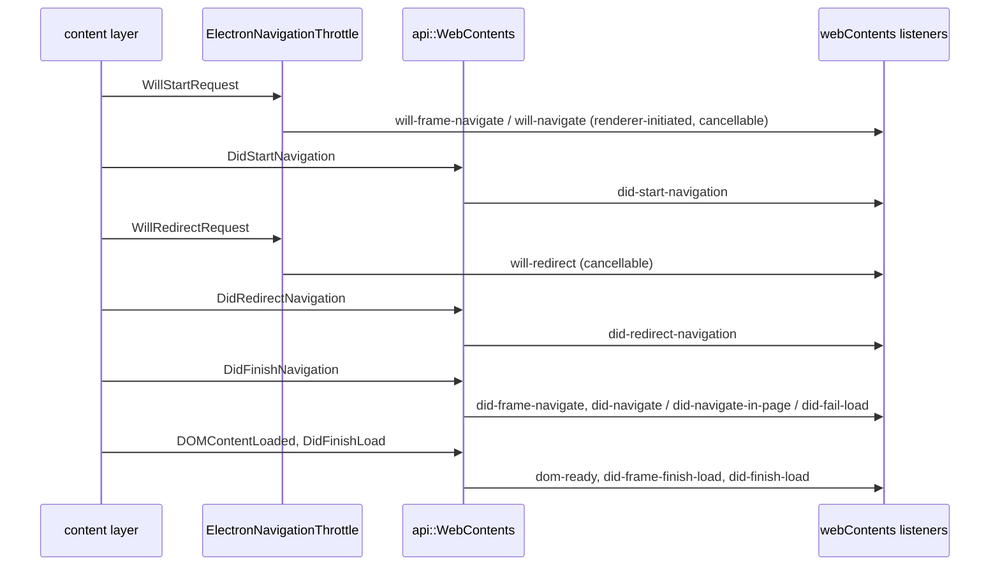

## Overview

`webContents` is Electron's handle on a page: one `api::WebContents` wraps one Chromium `content::WebContents`, observes it, acts as its delegate, and turns what Chromium reports into JS events. Every page, whether shown in a `BrowserWindow`, a `WebContentsView`, a `<webview>` or offscreen, or a DevTools front end, has one. Frames inside the page are exposed separately as `WebFrameMain`. This page covers creation, loading and navigation, frames and DevTools; the window around the page is on [[Windows, Views and WebContentsView]], and pages opened by `window.open` or `<webview>` on [[Child Windows and webview Guests]].

Sources: [shell/browser/api/electron_api_web_contents.cc:735-764](repo://shell/browser/api/electron_api_web_contents.cc#L735-L764), [shell/browser/api/electron_api_web_contents.cc:1013-1033](repo://shell/browser/api/electron_api_web_contents.cc#L1013-L1033)

## Types of WebContents

| `Type` | `getType()` | Created by |
| --- | --- | --- |
| `kBrowserWindow` | `window` | `BrowserWindow` / `WebContentsView` |
| `kBrowserView` | `browserView` | The JS `BrowserView` compatibility layer; otherwise identical to `window` |
| `kWebView` | `webview` | A `<webview>` guest |
| `kOffScreen` | `offscreen` | `webPreferences.offscreen` |
| `kBackgroundPage` | `backgroundPage` | An extension background page |
| `kRemote` | `remote` | A thin wrapper around a `content::WebContents` Electron did not create, such as the DevTools front end |

Sources: [shell/browser/api/electron_api_web_contents.h:128-137](repo://shell/browser/api/electron_api_web_contents.h#L128-L137), [shell/browser/api/electron_api_web_contents.cc:302-325](repo://shell/browser/api/electron_api_web_contents.cc#L302-L325)

Each instance gets an integer `id` from a global `IDMap` (`webContents.fromId`, `getAllWebContents`), and a `UserDataLink` attached to the `content::WebContents` lets C++ code find the API object with `WebContents::From`. `FromOrCreate` wraps any unknown contents as `kRemote`.

Sources: [shell/browser/api/electron_api_web_contents.cc:735-764](repo://shell/browser/api/electron_api_web_contents.cc#L735-L764), [shell/browser/api/electron_api_web_contents.cc:4588-4611](repo://shell/browser/api/electron_api_web_contents.cc#L4588-L4611), [shell/browser/api/electron_api_web_contents.cc:4641-4644](repo://shell/browser/api/electron_api_web_contents.cc#L4641-L4644)

## Creating a WebContents

### From options

`WebContentsView` and `BrowserWindow` call `CreateFromWebPreferences`. If the preferences carry a hidden existing `webContents`, its `WebContentsPreferences` are updated in place and it is reused; otherwise `WebContents::New` constructs one and immediately calls its JS `_init`, reporting a throwing `_init` as an uncaught exception.

Sources: [shell/browser/api/electron_api_web_contents.cc:4560-4571](repo://shell/browser/api/electron_api_web_contents.cc#L4560-L4571), [shell/browser/api/electron_api_web_contents.cc:4613-4639](repo://shell/browser/api/electron_api_web_contents.cc#L4613-L4639)

The options constructor reads `backgroundThrottling`, `type`, `offscreen` (a boolean or an object with `useSharedTexture`), `embedder`, `devTools` and `show`, and picks the session: an explicit `session`, else `partition`, else the default session ([[Sessions, Protocols and Networking]]). It then creates the `content::WebContents` one of three ways. A guest gets a fake `chrome-guest://fake-host` site instance and a `WebViewGuestDelegate`. An offscreen page gets an `OffScreenWebContentsView` that paints through `OnPaint`, transparent when the hidden background colour is transparent. A normal page gets plain create params with `initially_hidden` set from `show`.

Sources: [shell/browser/api/electron_api_web_contents.cc:785-889](repo://shell/browser/api/electron_api_web_contents.cc#L785-L889)

### Shared initialisation

`InitWithWebContents` makes the API object the contents' delegate, sets up printing, and wraps the contents in an `InspectableWebContents`, which owns the page and its DevTools. `InitWithSessionAndOptions` then fills renderer preferences: `accept_languages` from the application locale plus the OS's preferred languages, font rendering parameters on Linux and Windows, and the system caret blink rate. It creates the `WebContentsPreferences` (unless `setWindowOpenHandler` already did), the permission helper, zoom controller and autofill driver, applies the session's user agent, and for guests inherits the embedder's owner window.

Sources: [shell/browser/api/electron_api_web_contents.cc:906-988](repo://shell/browser/api/electron_api_web_contents.cc#L906-L988), [shell/browser/api/electron_api_web_contents.cc:1013-1033](repo://shell/browser/api/electron_api_web_contents.cc#L1013-L1033)

`WebContentsPreferences` is the C++ store of `webPreferences`. It is what decides sandboxing, context isolation and node integration for every renderer this page starts, as described in [[Sandboxed Renderers and Preload Realm]].

Sources: [shell/browser/web_contents_preferences.cc:114-127](repo://shell/browser/web_contents_preferences.cc#L114-L127), [shell/browser/web_contents_preferences.cc:280-286](repo://shell/browser/web_contents_preferences.cc#L280-L286)

### The JS _init

`web-contents.ts` extends the native prototype. `_init` freezes `id`, creates the per-contents `ipc` emitter used by [[IPC Between Main and Renderer]], and builds `navigationHistory` from private native methods (`restore` waits for the restored entry to load). It re-emits `render-process-gone` on `app` with a debugging hint, lets interactive types (`window`, `offscreen`, `browserView`) cancel unload when `beforeunload` did not proceed, reloads on `devtools-reload-page`, and for non-remote contents wires the `-new-window` and `-will-add-new-contents` events into the window-open handler.

Sources: [lib/browser/api/web-contents.ts:542-622](repo://lib/browser/api/web-contents.ts#L542-L622), [lib/browser/api/web-contents.ts:624-663](repo://lib/browser/api/web-contents.ts#L624-L663)

## Loading a URL

### loadURL in JS

`loadURL` installs listeners with `_awaitNextLoad` *before* calling the native `_loadURL`, so it returns a promise for the next load. `loadFile` resolves the path against `app.getAppPath()` and loads it as a `file:` URL.

Sources: [lib/browser/api/web-contents.ts:324-338](repo://lib/browser/api/web-contents.ts#L324-L338), [lib/browser/api/web-contents.ts:427-433](repo://lib/browser/api/web-contents.ts#L427-L433)

| Event seen | Effect on the promise |
| --- | --- |
| `did-start-navigation` in the main frame, after another non-same-document one started | Reject with `ERR_ABORTED` (-3): a new navigation replaced this one |
| `did-fail-load` in the main frame | Remember the first error; reject at once if no navigation started |
| `did-finish-load` | Resolve, or reject with the remembered error |
| `did-navigate-in-page` | Resolve, unless it was the page's own same-document routing |
| `did-stop-loading` or `destroyed` without finish or fail | Reject with `ERR_FAILED` (-2) |

Sources: [lib/browser/api/web-contents.ts:342-425](repo://lib/browser/api/web-contents.ts#L342-L425)

The rejection is an `Error` whose message is `<description> (<code>) loading '<url>'` with `errno`, `code` and `url` set. A no-op `catch` is attached so an ignored promise does not raise an unhandled rejection.

Sources: [lib/browser/api/web-contents.ts:349-354](repo://lib/browser/api/web-contents.ts#L349-L354), [lib/browser/api/web-contents.ts:427-433](repo://lib/browser/api/web-contents.ts#L427-L433)

### LoadURL in C++

`WebContents::LoadURL` emits `did-fail-load` with `ERR_INVALID_URL` for an invalid or over-long URL. It builds `LoadURLParams` from the options: `httpReferrer` (a string or a referrer object), `userAgent`, `extraHeaders`, `postData` (making it a POST), `baseURLForDataURL` (making it a data load) and `reloadIgnoringCache`. The transition is "typed from the address bar". It refuses to start a navigation while another navigation call is still on the stack, emitting `did-fail-load` with `ERR_FAILED`, a guard taken from Chromium (crbug 347742). It then discards uncommitted entries, calls `LoadURLWithParams`, and, if `this` survived the JS events that triggers, notifies user activation so `beforeunload` works.

Sources: [shell/browser/api/electron_api_web_contents.cc:2331-2405](repo://shell/browser/api/electron_api_web_contents.cc#L2331-L2405)

## Navigation events

### Order of events

Sources: [shell/browser/electron_navigation_throttle.cc:26-86](repo://shell/browser/electron_navigation_throttle.cc#L26-L86), [shell/browser/api/electron_api_web_contents.cc:2027-2128](repo://shell/browser/api/electron_api_web_contents.cc#L2027-L2128), [shell/browser/api/electron_api_web_contents.cc:1891-1916](repo://shell/browser/api/electron_api_web_contents.cc#L1891-L1916)

### Cancellable events

`ElectronNavigationThrottle` is where navigations can be stopped. For renderer-initiated navigations it emits `will-frame-navigate` for any frame and `will-navigate` for the main frame, and cancels the navigation if a listener prevented the event; WebUI pages count as renderer-initiated even though Chromium marks them browser-initiated. Every redirect emits `will-redirect`, also cancellable. `loadURL` itself is browser-initiated, so it never triggers `will-navigate`.

Sources: [shell/browser/electron_navigation_throttle.cc:26-86](repo://shell/browser/electron_navigation_throttle.cc#L26-L86)

`EmitNavigationEvent` builds the event for all of these: an `Event` object carrying `url`, `isSameDocument`, `isMainFrame`, `processId`, `routingId`, and lazy `frame` and `initiator` getters, followed by the same values as positional arguments. It returns whether the event was prevented. While `DidStartNavigation`, `DidRedirectNavigation` and `ReadyToCommitNavigation` run, `is_safe_to_delete_` is false, which is what makes a nested `loadURL` fail.

Sources: [shell/browser/api/electron_api_web_contents.cc:1951-1991](repo://shell/browser/api/electron_api_web_contents.cc#L1951-L1991), [shell/browser/api/electron_api_web_contents.cc:2027-2042](repo://shell/browser/api/electron_api_web_contents.cc#L2027-L2042)

### Results

`DidFinishNavigation` ignores navigations that did not commit. A same-document commit emits `did-navigate-in-page`. A cross-document commit emits `did-frame-navigate` with the HTTP status and, for the main frame, `did-navigate`, and refreshes the title after back or forward navigation. Guests also emit `load-commit`. An error page emits `did-fail-provisional-load` and, except for `ERR_ABORTED`, logs a warning and emits `did-fail-load`. `ReadyToCommitNavigation` gives initial focus to the page of an active top-level window.

Sources: [shell/browser/api/electron_api_web_contents.cc:2039-2128](repo://shell/browser/api/electron_api_web_contents.cc#L2039-L2128)

Load events come from separate observers: `dom-ready` for the top frame, `did-frame-finish-load` for every frame and `did-finish-load` for the main frame, `did-fail-load` (skipped for media documents' aborted first request), `did-start-loading` and `did-stop-loading`. `ready-to-show` fires on the main frame's first non-empty layout, reported by the renderer. A crashed renderer produces `render-process-gone` with `reason` and `exitCode`.

Sources: [shell/browser/api/electron_api_web_contents.cc:1891-1949](repo://shell/browser/api/electron_api_web_contents.cc#L1891-L1949), [shell/browser/api/electron_api_web_contents.cc:1993-1998](repo://shell/browser/api/electron_api_web_contents.cc#L1993-L1998), [shell/browser/api/electron_api_web_contents.cc:1846-1854](repo://shell/browser/api/electron_api_web_contents.cc#L1846-L1854)

## Frames: WebFrameMain

### Identity across navigations

A `WebFrameMain` represents one frame in the main process. Two maps index instances: by frame tree node id, which stays the same across navigations "most similar to how `<iframe>` works", and by the exact `RenderFrameHost` token. A host already running unload handlers is treated as detached and is not entered in the node-id map.

Sources: [shell/browser/api/electron_api_web_frame_main.cc:56-70](repo://shell/browser/api/electron_api_web_frame_main.cc#L56-L70), [shell/browser/api/electron_api_web_frame_main.cc:98-165](repo://shell/browser/api/electron_api_web_frame_main.cc#L98-L165)

When a cross-origin navigation swaps a frame's host, `RenderFrameHostChanged` finds the instance by node id and `UpdateRenderFrameHost` re-keys it to the new token and rebuilds its mojo connection, so the same JS object follows the frame. `FrameDeleted` and `RenderFrameDeleted` mark it disposed; afterwards its methods throw `Render frame was disposed before WebFrameMain could be accessed`.

Sources: [shell/browser/api/electron_api_web_contents.cc:1779-1828](repo://shell/browser/api/electron_api_web_contents.cc#L1779-L1828), [shell/browser/api/electron_api_web_frame_main.cc:167-214](repo://shell/browser/api/electron_api_web_frame_main.cc#L167-L214)

### Running code in a frame

`WebFrameMain.executeJavaScript(code, userGesture)` runs the code in the frame's main world directly through the frame host and resolves or rejects with the result. `webContents.executeJavaScript` instead waits until the main frame has stopped loading and asks the renderer over the internal `RENDERER_WEB_FRAME_METHOD` channel; `insertCSS`, `insertText` and `setVisualZoomLevelLimits` use the same channel.

Sources: [shell/browser/api/electron_api_web_frame_main.cc:216-261](repo://shell/browser/api/electron_api_web_frame_main.cc#L216-L261), [lib/browser/api/web-contents.ts:150-183](repo://lib/browser/api/web-contents.ts#L150-L183)

`webContents.send` and `sendToFrame` go through `WebFrameMain.send`; that path is on [[IPC Between Main and Renderer]].

Sources: [lib/browser/api/web-contents.ts:121-148](repo://lib/browser/api/web-contents.ts#L121-L148)

## DevTools

`openDevTools` does nothing for remote contents or when `devTools: false`. Webview guests, background pages and contents without an owner window always open detached; otherwise the `mode`, `activate` and `title` options apply. `InspectableWebContents::ShowDevTools` creates a managed DevTools `content::WebContents` in the same browser context (wrapped as a remote `webContents`, unless the app supplied its own with `setDevToolsWebContents`), attaches it to the page's DevTools agent host, and loads the bundled front end from `devtools://devtools/bundled/devtools_app.html`. The view is shown only after the front end finishes loading, so the dock state is set first. Bounds, zoom and front-end preferences persist in the browser context's prefs under `electron.devtools.*`.

Sources: [shell/browser/api/electron_api_web_contents.cc:2753-2799](repo://shell/browser/api/electron_api_web_contents.cc#L2753-L2799), [shell/browser/ui/inspectable_web_contents.cc:74-88](repo://shell/browser/ui/inspectable_web_contents.cc#L74-L88), [shell/browser/ui/inspectable_web_contents.cc:405-435](repo://shell/browser/ui/inspectable_web_contents.cc#L405-L435)

## Destruction

The destructor emits the internal `will-destroy` event and, unless the contents belong to someone else (an attached OOPIF guest or an extension background page), destroys the page. `WebContentsDestroyed` then emits `destroyed`, which is what `BrowserWindow` listens for to close its window.

Sources: [shell/browser/api/electron_api_web_contents.cc:1035-1060](repo://shell/browser/api/electron_api_web_contents.cc#L1035-L1060), [shell/browser/api/electron_api_web_contents.cc:2265](repo://shell/browser/api/electron_api_web_contents.cc#L2265), [shell/browser/api/electron_api_browser_window.cc:114-117](repo://shell/browser/api/electron_api_browser_window.cc#L114-L117)
