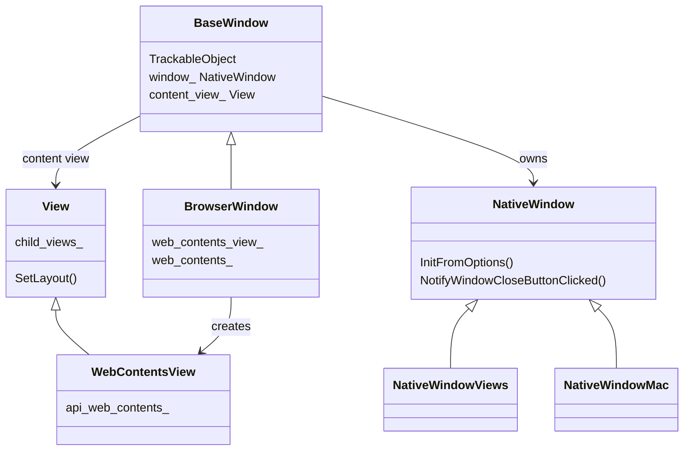
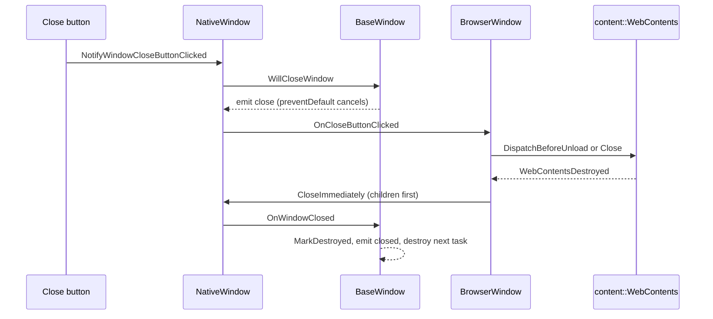

## Overview

An Electron window is three objects stacked on each other. The JS class (`BaseWindow` or `BrowserWindow`) is a thin wrapper around a C++ API object of the same name in `shell/browser/api`. That object owns a `NativeWindow`, the platform window, implemented with Chromium's `views` toolkit on Windows and Linux (`NativeWindowViews`) and with Cocoa on macOS (`NativeWindowMac`). Inside the window sits a tree of `View` objects, and a `WebContentsView` is the view that shows a web page. `BrowserWindow` is a `BaseWindow` that creates one `WebContentsView` for you. What happens inside that page is on [[WebContents and Navigation]].

Sources: [shell/browser/api/electron_api_base_window.h:37-40](repo://shell/browser/api/electron_api_base_window.h#L37-L40), [shell/browser/api/electron_api_browser_window.h:21-25](repo://shell/browser/api/electron_api_browser_window.h#L21-L25), [shell/browser/native_window_views.cc:1950-1954](repo://shell/browser/native_window_views.cc#L1950-L1954), [shell/browser/native_window_mac.mm:1879](repo://shell/browser/native_window_mac.mm#L1879)

Sources: [shell/browser/api/electron_api_base_window.cc:96-124](repo://shell/browser/api/electron_api_base_window.cc#L96-L124), [shell/browser/api/electron_api_browser_window.cc:28-99](repo://shell/browser/api/electron_api_browser_window.cc#L28-L99), [shell/browser/api/electron_api_view.h:24-28](repo://shell/browser/api/electron_api_view.h#L24-L28), [shell/browser/api/electron_api_web_contents_view.h:23-27](repo://shell/browser/api/electron_api_web_contents_view.h#L23-L27)

## The JS classes

`base-window.ts` makes the native `BaseWindow` an `EventEmitter`, adds property accessors (`autoHideMenuBar`, `fullScreen`, `visibleOnAllWorkspaces` and others), and in `_init` applies the application menu to the window on platforms other than macOS, where menus are per window.

Sources: [lib/browser/api/base-window.ts:1-40](repo://lib/browser/api/base-window.ts#L1-L40)

`browser-window.ts` chains `BrowserWindow.prototype` to `BaseWindow.prototype` and extends `_init`. It freezes `id` so it stays readable after the native window is gone, makes `setBounds` merge partial bounds with the current ones, and re-emits `focus` and `blur` on `app` as `browser-window-focus` and `browser-window-blur`. It debounces the page's `unresponsive` event by 50 ms (and arms a 5 s timer after a `close` that was not prevented), forwards visibility changes to the page as `-window-visibility-change`, closes attached `BrowserView`s when the window closes, and emits `browser-window-created` on `app`. `fromId`, `getAllWindows` and `getFocusedWindow` filter the `BaseWindow` registry for `BrowserWindow` instances.

Sources: [lib/browser/api/browser-window.ts:1-120](repo://lib/browser/api/browser-window.ts#L1-L120)

## Creating a window

### BaseWindow

`BaseWindow`'s constructor remembers the `parent` option, forces `frame: false` for offscreen windows, creates the platform window with `NativeWindow::Create(options, parent)`, observes it, and sets an empty `View` as the content view. The `Arguments` overload then runs the JS `_init` (`InitWithArgs`) and finally `window()->InitFromOptions(options)`, so platform setup that reads options happens after the JS side is ready.

Sources: [shell/browser/api/electron_api_base_window.cc:96-132](repo://shell/browser/api/electron_api_base_window.cc#L96-L132)

`InitWith` attaches the API object to the `NativeWindow` as user data (so `BrowserWindow::From(native_window)` can find it), registers it in the `TrackableObject` weak map that backs `fromId` and `getAllWindows`, adds it to its parent's `child_windows_`, and holds a strong `self_ref_` so the window is not garbage-collected while open even if the app drops its reference. The [[Native Bindings and the gin_helper Layer]] page explains the weak map.

Sources: [shell/browser/api/electron_api_base_window.cc:146-161](repo://shell/browser/api/electron_api_base_window.cc#L146-L161), [shell/browser/api/electron_api_base_window.cc:1337-1347](repo://shell/browser/api/electron_api_base_window.cc#L1337-L1347), [shell/browser/api/electron_api_browser_window.cc:324-330](repo://shell/browser/api/electron_api_browser_window.cc#L324-L330)

### BrowserWindow

`BrowserWindow::New` throws `Cannot create BrowserWindow before app is ready` and accepts at most one options object. The constructor runs `BaseWindow`'s and then prepares the `webPreferences` for its page: it copies `backgroundColor` (or transparent, for translucent windows) as a hidden value, copies `show` when `paintWhenInitiallyHidden` is false, passes an existing `webContents` option through, and defaults `show` to true.

Sources: [shell/browser/api/electron_api_browser_window.cc:28-65](repo://shell/browser/api/electron_api_browser_window.cc#L28-L65), [shell/browser/api/electron_api_browser_window.cc:292-311](repo://shell/browser/api/electron_api_browser_window.cc#L292-L311)

It then creates a `WebContentsView` from those preferences, registers it as a draggable-region provider, keeps references to the view and its `WebContents`, observes the `WebContents`, and sets the window as the contents' owner. After `InitWithArgs` it inserts the web view at index 0 of the window's internal contents view, so views the app adds to `contentView` paint on top of the page, and finally calls `InitFromOptions`.

Sources: [shell/browser/api/electron_api_browser_window.cc:67-99](repo://shell/browser/api/electron_api_browser_window.cc#L67-L99)

### NativeWindow and InitFromOptions

The `NativeWindow` base constructor reads options every platform needs (`titleBarStyle`, `transparent`, `enableLargerThanScreen`, `modal` with a parent, `frame`, `titleBarOverlay`) and adds the window to the global `WindowList`. A window has a frame only when `frame` is true *and* the title bar style is normal.

Sources: [shell/browser/native_window.cc:100-126](repo://shell/browser/native_window.cc#L100-L126)

`InitFromOptions` then applies the rest: position or `center`, minimum and maximum size (for the content area when `useContentSize`), `closable`, `movable`, `hasShadow`, `opacity`, `alwaysOnTop`, fullscreen and `fullscreenable`, `resizable`, `skipTaskbar`, `kiosk`, vibrancy or background material, the background colour (white unless set or translucent), the title (defaulting to the app name), and last of all `Show()` unless `show` is false.

Sources: [shell/browser/native_window.cc:137-249](repo://shell/browser/native_window.cc#L137-L249)

### NativeWindowViews

On Windows and Linux, `NativeWindowViews` builds a `views::Widget` sized from `width` and `height` (default 800 by 600). It removes the standard frame for frameless or client-frame windows, makes translucent windows' widgets translucent without a shadow, honours `focusable: false`, and uses Electron's own native widget and window tree host classes per platform. On Linux it sets the window role, `WM_CLASS` and Wayland app id from the app name and, under X11, the `_NET_WM_STATE` and window type hints (child windows become dialogs, modal ones get `_NET_WM_STATE_MODAL`). On Windows it reads `resizable`, `minimizable`, `maximizable`, `thickFrame` and `accentColor`, and sets window styles so frameless windows still animate.

Sources: [shell/browser/native_window_views.cc:198-260](repo://shell/browser/native_window_views.cc#L198-L260), [shell/browser/native_window_views.cc:261-380](repo://shell/browser/native_window_views.cc#L261-L380)

## Window events

`BaseWindow` is a `NativeWindowObserver`; each `OnWindow*` notification becomes a JS event via `Emit` (`show`, `hide`, `maximize`, `minimize`, `restore`, `resize`, `resized`, `move`, `moved`, fullscreen transitions, `swipe`, `always-on-top-changed` and more). `will-resize` and `will-move` are cancellable: a listener calling `preventDefault()` stops the change. `focus` and `blur` are posted to the next UI task (`EmitEventSoon`) rather than emitted synchronously. `query-session-end` passes the `reasons` on the event and can be prevented.

Sources: [shell/browser/api/electron_api_base_window.cc:191-232](repo://shell/browser/api/electron_api_base_window.cc#L191-L232), [shell/browser/api/electron_api_base_window.cc:258-328](repo://shell/browser/api/electron_api_base_window.cc#L258-L328), [shell/browser/api/electron_api_base_window.h:275-280](repo://shell/browser/api/electron_api_base_window.h#L275-L280)

`BrowserWindow` overrides some of these to keep the page in step: on blur and focus it stores and restores the focused element (and focuses the page outside macOS unless DevTools is open), on show and hide it calls `WasShown` and `WasOccluded`, and a `page-title-updated` event that is not prevented sets the window title.

Sources: [shell/browser/api/electron_api_browser_window.cc:133-142](repo://shell/browser/api/electron_api_browser_window.cc#L133-L142), [shell/browser/api/electron_api_browser_window.cc:168-186](repo://shell/browser/api/electron_api_browser_window.cc#L168-L186), [shell/browser/api/electron_api_browser_window.cc:282-290](repo://shell/browser/api/electron_api_browser_window.cc#L282-L290)

## Closing a window

Sources: [shell/browser/native_window.cc:486-512](repo://shell/browser/native_window.cc#L486-L512), [shell/browser/api/electron_api_browser_window.cc:110-117](repo://shell/browser/api/electron_api_browser_window.cc#L110-L117), [shell/browser/api/electron_api_browser_window.cc:148-166](repo://shell/browser/api/electron_api_browser_window.cc#L148-L166), [shell/browser/api/electron_api_browser_window.cc:210-220](repo://shell/browser/api/electron_api_browser_window.cc#L210-L220), [shell/browser/api/electron_api_base_window.cc:163-189](repo://shell/browser/api/electron_api_base_window.cc#L163-L189)

`NativeWindow::NotifyWindowCloseButtonClicked` first asks observers whether to close at all. A prevented `close` event calls `WindowList::WindowCloseCancelled`, which also cancels an `app.quit()` in progress ([[Main Process Startup and App Lifecycle]]). It then asks how to close. A `BrowserWindow` always takes over here: it closes the *page* first, dispatching `beforeunload` if the page has handlers or closing the contents directly. A `beforeunload` that cancels is reported as a cancelled close. When the contents are destroyed, the window closes all its child windows and then itself with `CloseImmediately`.

Sources: [shell/browser/native_window.cc:486-502](repo://shell/browser/native_window.cc#L486-L502), [shell/browser/api/electron_api_browser_window.cc:110-117](repo://shell/browser/api/electron_api_browser_window.cc#L110-L117), [shell/browser/api/electron_api_browser_window.cc:148-166](repo://shell/browser/api/electron_api_browser_window.cc#L148-L166), [shell/browser/api/electron_api_browser_window.cc:210-220](repo://shell/browser/api/electron_api_browser_window.cc#L210-L220)

When the native window reports it closed, `BaseWindow::OnWindowClosed` invalidates weak pointers so delayed events cannot fire, removes itself from the weak map, marks the JS wrapper destroyed (so later method calls fail), emits `closed`, detaches from its parent and posts its own destruction. The `NativeWindow` is removed from `WindowList`; when that list becomes empty, observers are told all windows closed, which drives `window-all-closed` and the quit sequence. `WindowList::CloseAllWindows` (used by `app.quit()`) closes each window, in reverse order on macOS; `DestroyAllWindows` (used by `app.exit()`) skips the close events.

Sources: [shell/browser/api/electron_api_base_window.cc:169-189](repo://shell/browser/api/electron_api_base_window.cc#L169-L189), [shell/browser/native_window.cc:504-512](repo://shell/browser/native_window.cc#L504-L512), [shell/browser/window_list.cc:46-99](repo://shell/browser/window_list.cc#L46-L99)

## Views

### View

`View` wraps a `views::View` and is an `EventEmitter`. `addChildView(child, index)` refuses destroyed children and adding a view to itself, reorders a view that is already a child instead of adding it twice, keeps a strong reference to each child's wrapper in `child_views_`, and on macOS disables implicit Core Animation layer animations while the tree changes. `setBounds` sets the view's rectangle within its parent.

Sources: [shell/browser/api/electron_api_view.cc:210-293](repo://shell/browser/api/electron_api_view.cc#L210-L293), [lib/browser/api/view.ts:1-7](repo://lib/browser/api/view.ts#L1-L7)

`setLayout` installs a layout manager: a `JSLayoutManager` when the object has a `calculateProposedLayout` callback, otherwise a `views::FlexLayout` configured from `orientation`, `mainAxisAlignment`, `crossAxisAlignment`, `interiorMargin` and the other flex options.

Sources: [shell/browser/api/electron_api_view.cc:295-338](repo://shell/browser/api/electron_api_view.cc#L295-L338)

### WebContentsView

`WebContentsView` is a `View` whose `views::View` is the `InspectableWebContents` view of its `WebContents` (the page plus an optional docked DevTools). Its constructor accepts `webPreferences` and an existing `webContents`, which must not already be attached to a window, and defaults `show` to false. The page itself is created by `WebContents::CreateFromWebPreferences`.

Sources: [shell/browser/api/electron_api_web_contents_view.cc:32-43](repo://shell/browser/api/electron_api_web_contents_view.cc#L32-L43), [shell/browser/api/electron_api_web_contents_view.cc:156-209](repo://shell/browser/api/electron_api_web_contents_view.cc#L156-L209)

When the view is added to a window's widget it sets that `NativeWindow` as the contents' owner window and registers itself as a draggable-region provider; its `NonClientHitTest` reports `HTCAPTION` for points inside the page's `-webkit-app-region: drag` areas, which is how frameless windows can be dragged by page content. `setBackgroundColor` also updates the page's web preferences so the colour survives the next navigation, and `setBorderRadius` rounds the page's corners.

Sources: [shell/browser/api/electron_api_web_contents_view.cc:58-123](repo://shell/browser/api/electron_api_web_contents_view.cc#L58-L123)

Destroying a `WebContentsView` without closing its contents destroys the `WebContents`; when the contents are destroyed first, the view drops its references. In JS, `WebContentsView.prototype` chains to `View.prototype`, and `lib/browser/init.ts` loads it before app code because `new BrowserWindow` creates one.

Sources: [shell/browser/api/electron_api_web_contents_view.cc:45-48](repo://shell/browser/api/electron_api_web_contents_view.cc#L45-L48), [shell/browser/api/electron_api_web_contents_view.cc:96-99](repo://shell/browser/api/electron_api_web_contents_view.cc#L96-L99), [lib/browser/api/web-contents-view.ts:1-7](repo://lib/browser/api/web-contents-view.ts#L1-L7), [lib/browser/init.ts:158-160](repo://lib/browser/init.ts#L158-L160)
