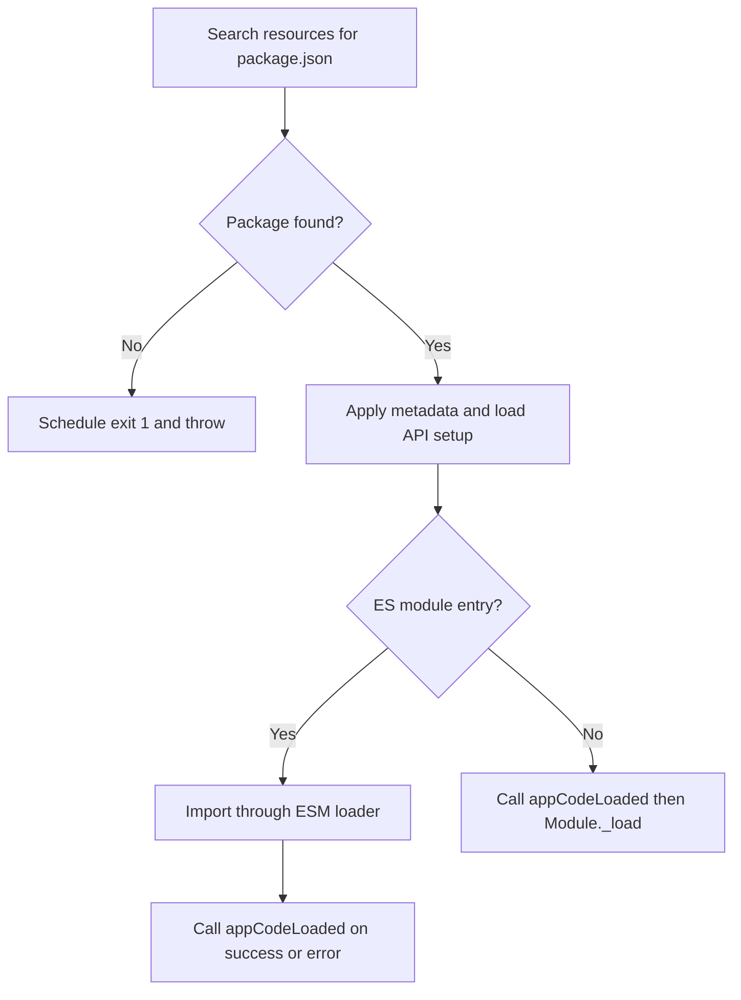

## Overview

Browser startup prepares the Node environment, locates a valid application package, applies its metadata, and executes its main script. The application window in [[Quickstart]] is created only after this bootstrap has selected and loaded the entry point. The central JavaScript sequence lives in `lib/browser/init.ts`; the separate default application handles command-line requests to launch an external package, script, document, or URL.

Sources: [lib/browser/init.ts:12-19](repo://lib/browser/init.ts#L12-L19), [lib/browser/init.ts:82-163](repo://lib/browser/init.ts#L82-L163), [lib/browser/init.ts:204-222](repo://lib/browser/init.ts#L204-L222), [default_app/main.ts:253-265](repo://default_app/main.ts#L253-L265), [docs/fiddles/quick-start/main.js:16-24](repo://docs/fiddles/quick-start/main.js#L16-L24)

## Prepare the browser environment

The bootstrap first removes the argument inserted to load Electron's initialization script, imports common initialization, and gives the native browser event-emitter binding Node's `EventEmitter.prototype`. Common initialization adapts scheduling as described in [[Electron Overview]] and inserts Electron module aliases into Node's cache. Its filename-resolution hook maps `electron`, `electron/main`, `electron/renderer`, `electron/common`, and `electron/utility` to the same Electron module identity.

Sources: [lib/browser/init.ts:12-19](repo://lib/browser/init.ts#L12-L19), [lib/common/init.ts:78-119](repo://lib/common/init.ts#L78-L119)

The aliases serve TypeScript-facing process descriptions rather than selecting a different runtime implementation by spelling alone. The comment on the resolver explicitly allows those names to be required across main and renderer contexts. To understand the actual available exports, follow the process module lists described in [[Electron Overview]], rather than assuming an alias grants another process's capabilities.

Sources: [lib/common/init.ts:92-118](repo://lib/common/init.ts#L92-L118), [lib/browser/api/module-list.ts:4-43](repo://lib/browser/api/module-list.ts#L4-L43), [lib/renderer/api/module-list.ts:1-9](repo://lib/renderer/api/module-list.ts#L1-L9)

Browser initialization installs an `uncaughtException` listener. If another listener exists, this default handler returns; otherwise it lazily imports Electron and shows the exception stack in an error dialog. It also converts application `quit` into the process `exit` event and replaces `process.exit` with `app.exit`. These behaviors are installed before the application's entry script runs.

Sources: [lib/browser/init.ts:21-45](repo://lib/browser/init.ts#L21-L45), [lib/browser/init.ts:73-77](repo://lib/browser/init.ts#L73-L77)

## Locate an application package

The package search reads hidden `appSearchPaths` and `appSearchPathsOnlyLoadASAR` values from the global object. For each search candidate, it joins the candidate to `process.resourcesPath`. When archive-only loading is enabled, the candidate must open through the ASAR archive helper before its `package.json` is loaded. The first successful package load ends the search; an exception for one candidate causes the loop to continue.

Sources: [lib/browser/init.ts:82-107](repo://lib/browser/init.ts#L82-L107)

The archive helper is temporarily obtained through `process._getOrCreateArchive`, then removed from `process`. Its archive cache and path handling are explained in [[ASAR File Access]]. Here the helper is used as a package-selection gate: a candidate that does not produce an archive is skipped when the archive-only flag is set, before Node attempts its package metadata.

Sources: [lib/browser/init.ts:88-101](repo://lib/browser/init.ts#L88-L101), [lib/node/asar-fs-wrapper.ts:29-47](repo://lib/node/asar-fs-wrapper.ts#L29-L47)

If no package was found, startup schedules exit code 1 on the next tick and throws `Unable to find a valid app`. A failed candidate therefore does not immediately stop the search, while failure of the entire search prevents normal application loading. This distinction matters when diagnosing a broken resources directory: inspect the candidates and archive requirement before investigating the application's own code.

Sources: [lib/browser/init.ts:92-114](repo://lib/browser/init.ts#L92-L114)

## Apply metadata and prepare API initialization

The selected package can set the application version, product name or name, desktop name, and V8 flags. `productName` takes precedence over `name`; both are converted to strings and trimmed. An omitted desktop name becomes the application name plus `.desktop`. The V8 module is loaded only if flags were supplied, with a comment explaining that applications not using the feature should avoid its cost. Startup then records the selected package directory with `app.setAppPath`.

Sources: [lib/browser/init.ts:116-141](repo://lib/browser/init.ts#L116-L141)

Next, startup loads developer-tools support and eagerly requires protocol, service-worker, WebContents, and main-frame modules so their readiness setup occurs. It also requires WebContentsView before a BrowserWindow can invoke its functionality, because the inheritance must already be established. [[Windows and Navigation]] begins at the later construction step, after this ordering constraint has been satisfied.

Sources: [lib/browser/init.ts:143-160](repo://lib/browser/init.ts#L143-L160)

## Execute CommonJS or ES modules

The main script is `packageJson.main`, falling back to `index.js`. The ESM path is selected for `.mjs`, or for a package with `type` equal to `module` unless the script ends in `.cjs`. ESM startup turns the script path into a file URL and runs the import through Node's entry-point ESM loader. Successful import calls `appCodeLoaded`; rejected import also calls it before emitting `uncaughtException`.

Sources: [lib/browser/init.ts:162-163](repo://lib/browser/init.ts#L162-L163), [lib/browser/init.ts:201-217](repo://lib/browser/init.ts#L201-L217)

The CommonJS branch calls `appCodeLoaded` before `Module._load`. Its comment explains that this is safe because loading is synchronous. The callback is captured from `process` and deleted before either branch runs. Both branches therefore notify native startup, but their placement differs to account for synchronous loading versus an awaited module import.

Sources: [lib/browser/init.ts:201-222](repo://lib/browser/init.ts#L201-L222)

Sources: [lib/browser/init.ts:92-163](repo://lib/browser/init.ts#L92-L163), [lib/browser/init.ts:201-222](repo://lib/browser/init.ts#L201-L222)

## Default application and shutdown policy

The default application accepts the first non-option argument as its file. It dispatches recognized URL protocols to URL loading, `.html` and `.htm` paths to document loading, and other arguments to package loading. Package loading resolves the path, reads package metadata if present, asks Node to resolve the entry, sets the application path, and imports the resolved file. Resolution errors show an “Error launching app” dialog and exit with code 1.

Sources: [default_app/main.ts:35-64](repo://default_app/main.ts#L35-L64), [default_app/main.ts:77-148](repo://default_app/main.ts#L77-L148), [default_app/main.ts:253-265](repo://default_app/main.ts#L253-L265)

The browser bootstrap registers a default menu at `will-finish-launching`, which its comment places before `ready` and user window creation. Its `window-all-closed` listener calls `app.quit` only when no application listener accompanies it. The example in [[Quickstart]] overrides that default by adding its own platform-sensitive listener, so shutdown behavior is a collaboration between bootstrap defaults and application event handlers.

Sources: [lib/browser/init.ts:186-199](repo://lib/browser/init.ts#L186-L199), [docs/fiddles/quick-start/main.js:26-30](repo://docs/fiddles/quick-start/main.js#L26-L30)
