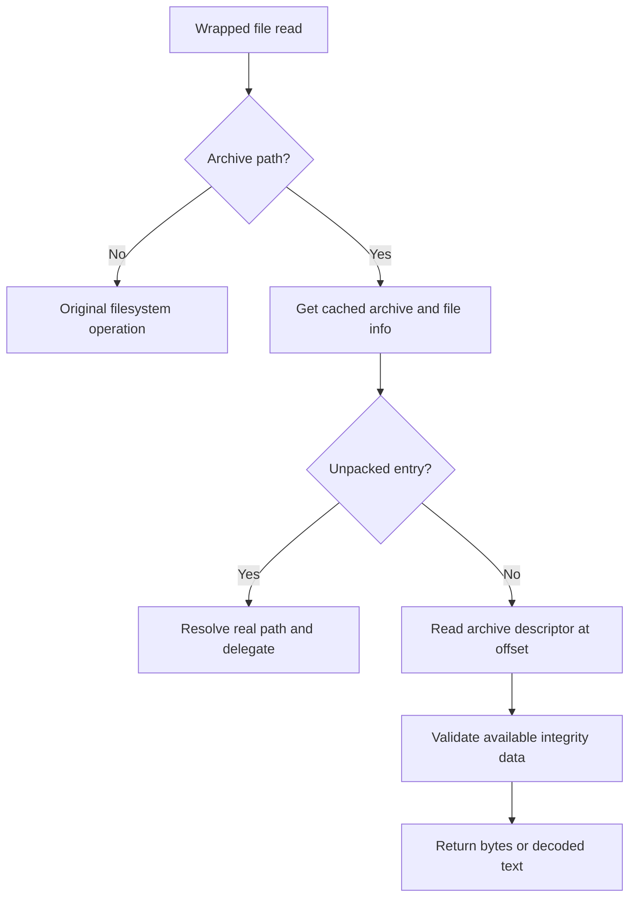

## Overview

Electron wraps Node's filesystem implementation so paths inside an ASAR archive can participate in ordinary file access. Node initialization calls `wrapFsWithAsar(require('fs'))`; the wrapper splits archive paths, obtains a native archive object, and either reads packed bytes or maps the operation to a real file. [[Application Startup]] uses the same archive helper while selecting an application package, but package discovery and file access have separate responsibilities.

Sources: [lib/node/init.ts:1-5](repo://lib/node/init.ts#L1-L5), [lib/node/asar-fs-wrapper.ts:29-87](repo://lib/node/asar-fs-wrapper.ts#L29-L87), [lib/node/asar-fs-wrapper.ts:623-651](repo://lib/node/asar-fs-wrapper.ts#L623-L651), [lib/browser/init.ts:88-101](repo://lib/browser/init.ts#L88-L101)

## Detect archive paths and bypass handling

`splitPath` first checks whether ASAR handling is disabled. `process.noAsar` disables it directly; `ELECTRON_NO_ASAR` contributes only outside browser and renderer process types. For candidate paths, Buffers become strings, Node URL objects pass through validated-path conversion, and non-string values fall back to ordinary handling. A case-insensitive `.asar` check avoids invoking the native splitter for paths that cannot refer to an archive.

Sources: [lib/node/asar-fs-wrapper.ts:15-18](repo://lib/node/asar-fs-wrapper.ts#L15-L18), [lib/node/asar-fs-wrapper.ts:49-87](repo://lib/node/asar-fs-wrapper.ts#L49-L87)

Paths that pass the preliminary check are normalized and sent to `asar.splitPath`, which determines the archive and internal path. Wrapped methods call their original implementation when the result is not an archive path. This fallback is visible in both callback and promise-based `readFile`, and prevents ordinary filesystem paths from entering the archive-specific read algorithm.

Sources: [lib/node/asar-fs-wrapper.ts:83-87](repo://lib/node/asar-fs-wrapper.ts#L83-L87), [lib/node/asar-fs-wrapper.ts:656-675](repo://lib/node/asar-fs-wrapper.ts#L656-L675)

## Cache and inspect an archive

`getOrCreateArchive` stores native Archive wrappers in a Map keyed by archive path. A cached path returns its existing object. A new native constructor is cached only after successful creation; constructor failure becomes null. The native constructor obtains an archive through `GetOrCreateAsarArchive` and throws if initialization fails, which the JavaScript helper converts into that null result.

Sources: [lib/node/asar-fs-wrapper.ts:29-45](repo://lib/node/asar-fs-wrapper.ts#L29-L45), [shell/common/api/electron_api_asar.cc:43-63](repo://shell/common/api/electron_api_asar.cc#L43-L63)

The binding's `getFileInfo` returns size, unpacked status, offset, and available integrity information. Its `stat` returns archive metadata that JavaScript converts into Node-style Stats. These stats are synthesized: the wrapper supplies inode values, current user and group IDs where available, and a shared generated time. They represent the archive entry through Node's interface rather than recording a separate physical file's metadata for every packed entry.

Sources: [shell/common/api/electron_api_asar.cc:65-123](repo://shell/common/api/electron_api_asar.cc#L65-L123), [lib/node/asar-fs-wrapper.ts:89-147](repo://lib/node/asar-fs-wrapper.ts#L89-L147)

## Read packed and unpacked files

Callback `readFile` normalizes encoding options, opens the archive, and retrieves the entry's file information. Missing archives and entries return errors asynchronously through `nextTick`. Empty files also return on the next tick. An unpacked entry resolves through `copyFileOut` and delegates to the ordinary `fs.readFile` implementation using its real path.

Sources: [lib/node/asar-fs-wrapper.ts:599-638](repo://lib/node/asar-fs-wrapper.ts#L599-L638)

A packed entry allocates a buffer of the recorded size, obtains the archive descriptor, and reads at the entry's recorded offset. It then checks buffer integrity and returns either bytes or a decoded string. Promise-based `fs.promises.readFile` uses a promisified version of that archive callback helper; non-archive paths still call the original promise implementation.

Sources: [lib/node/asar-fs-wrapper.ts:640-675](repo://lib/node/asar-fs-wrapper.ts#L640-L675)

The synchronous read follows the same archive lookup and unpacked-file branch, then calls `fs.readSync` at the recorded offset for packed content. It checks integrity before returning the buffer or encoded string. Its errors are thrown directly. This distinction preserves the synchronous call's control flow while the callback version schedules its own archive-lookup failures.

Sources: [lib/node/asar-fs-wrapper.ts:677-722](repo://lib/node/asar-fs-wrapper.ts#L677-L722), [lib/node/asar-fs-wrapper.ts:615-627](repo://lib/node/asar-fs-wrapper.ts#L615-L627)

Sources: [lib/node/asar-fs-wrapper.ts:615-675](repo://lib/node/asar-fs-wrapper.ts#L615-L675)

## Operations requiring a physical path

The generic override helpers replace a path argument with `archive.copyFileOut(filePath)` before calling the original operation. The synchronous helper throws for an invalid archive or missing file; the asynchronous helper schedules an error callback when one exists. The wrapper also adapts custom promisified implementations and methods on the module's promises object.

Sources: [lib/node/asar-fs-wrapper.ts:185-250](repo://lib/node/asar-fs-wrapper.ts#L185-L250)

Native `Archive::CopyFileOut` first reuses a previously extracted file. An unpacked entry returns the corresponding path under the archive's `.unpacked` sibling. A packed entry is copied into a ScopedTemporaryFile, validated through the copy operation's integrity payload, and retained in the archive's extracted-file map. Subsequent requests for that internal path can reuse the same extraction.

Sources: [shell/common/asar/archive.cc:356-393](repo://shell/common/asar/archive.cc#L356-L393)

These overrides are installed for copying and opening files, loading native modules through `process.dlopen` and the `.node` extension handler, and executing files through child-process `execFile` methods. That explains why some archive-backed operations require extraction even though ordinary packed `readFile` uses offsets directly.

Sources: [lib/node/asar-fs-wrapper.ts:1233-1253](repo://lib/node/asar-fs-wrapper.ts#L1233-L1253), [lib/node/asar-fs-wrapper.ts:640-651](repo://lib/node/asar-fs-wrapper.ts#L640-L651)

## Errors, write access, and integrity

The wrapper constructs familiar errors for missing entries, non-directories, and access denial, including their `code` and numeric `errno`. Invalid archives receive an `Invalid package` error. Access checks delegate unpacked entries to their physical files; packed entries reject checks that include write access with `EACCES`. This is an explicit permission behavior of the archive wrapper.

Sources: [lib/node/asar-fs-wrapper.ts:149-183](repo://lib/node/asar-fs-wrapper.ts#L149-L183), [lib/node/asar-fs-wrapper.ts:574-596](repo://lib/node/asar-fs-wrapper.ts#L574-L596)

Buffer integrity validation is skipped when no payload exists. Otherwise it lazily loads crypto, hashes the read buffer using the recorded algorithm, and compares the result with the expected hash. A mismatch logs an ASAR integrity violation and exits with code 1. The lazy load has a stated startup-performance reason: applications without integrity protection should not pay the crypto loading cost.

Sources: [lib/node/asar-fs-wrapper.ts:253-265](repo://lib/node/asar-fs-wrapper.ts#L253-L265)
