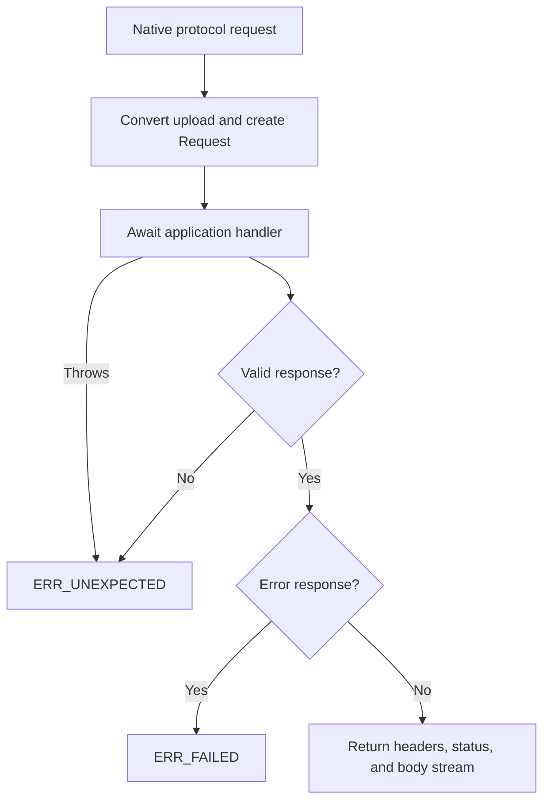

## Overview

Protocol handlers let an application answer scheme requests through a web Request/Response interface. `Protocol.prototype.handle` adapts the browser's protocol request, awaits the application's handler, and converts its response back to the native callback format. The handler belongs to a session's protocol object; the module-level `protocol.handle` delegates to the default session. [[Sessions and Network Requests]] explains how requests acquire that session context.

Sources: [lib/browser/api/protocol.ts:111-147](repo://lib/browser/api/protocol.ts#L111-L147), [lib/browser/api/protocol.ts:159-183](repo://lib/browser/api/protocol.ts#L159-L183)

## Scheme privileges and registration timing

The module exposes two native global operations, `registerSchemesAsPrivileged` and `getStandardSchemes`, separately from session forwarding. Privilege registration must happen before application readiness; calling it after readiness throws. This is the opposite side of the readiness boundary from session lookup, which is available after readiness. Keep global scheme setup in the early application entry flow described in [[Application Startup]], and attach session handlers when the relevant session can be obtained.

Sources: [lib/browser/api/protocol.ts:7-8](repo://lib/browser/api/protocol.ts#L7-L8), [lib/browser/api/protocol.ts:159-162](repo://lib/browser/api/protocol.ts#L159-L162), [shell/browser/api/electron_api_protocol.cc:348-357](repo://shell/browser/api/electron_api_protocol.cc#L348-L357), [shell/browser/api/electron_api_session.cc:1874-1883](repo://shell/browser/api/electron_api_session.cc#L1874-L1883)

Privilege registration accepts an array of custom scheme records. Supported options include standard URL treatment, secure treatment, CSP bypass, CORS, fetch support, service workers, streaming, and code cache. Code cache requires the scheme to be standard; the function validates that condition before applying registrations. Several scheme lists are also appended to command-line switches so child processes can register them consistently.

Sources: [shell/browser/api/electron_api_protocol.cc:110-188](repo://shell/browser/api/electron_api_protocol.cc#L110-L188)

## Register or intercept a handler

The JavaScript wrapper classifies `http`, `https`, and `file` as built-in schemes. For these, `handle` uses `interceptProtocol`; for other names it uses `registerProtocol`. Native registration stores the handler through ProtocolRegistry and reports whether it was added. A failed registration causes `handle` to throw `Failed to register protocol` with the scheme name, rather than leaving the application to infer the failure from a later request.

Sources: [lib/browser/api/protocol.ts:13-13](repo://lib/browser/api/protocol.ts#L13-L13), [lib/browser/api/protocol.ts:111-146](repo://lib/browser/api/protocol.ts#L111-L146), [shell/browser/api/electron_api_protocol.cc:219-241](repo://shell/browser/api/electron_api_protocol.cc#L219-L241)

The module also forwards the string, buffer, stream, file, HTTP, and generic callback-style protocol APIs to `session.defaultSession.protocol`. Those variants share the native Protocol class's registration methods; `handle` is the wrapper that constructs a web Request and accepts an awaited Response. Choosing the session object's method directly is how a handler is attached outside the default session.

Sources: [lib/browser/api/protocol.ts:159-180](repo://lib/browser/api/protocol.ts#L159-L180), [shell/browser/api/electron_api_protocol.cc:307-336](repo://shell/browser/api/electron_api_protocol.cc#L307-L336)

## Convert incoming upload data

Without upload data, the adapter uses a null body. A single raw-data chunk takes a fast path that returns its bytes directly. Other uploads become a ReadableStream that processes a copied chunk list in order, retaining a reader while a file or pipe chunk is being consumed. It moves to the next chunk only after that reader reports completion, and closes after the list is exhausted.

Sources: [lib/browser/api/protocol.ts:48-89](repo://lib/browser/api/protocol.ts#L48-L89)

| Upload kind | Conversion |
| --- | --- |
| Raw data | Enqueue the supplied bytes |
| File | Open a Node read stream using the supplied offset and length, then convert it to a web stream |
| Stream | Pull data from the pipe into a reusable one-megabyte buffer and enqueue a sliced chunk |
| Blob | Resolve bytes with `session.defaultSession.getBlobData` |
| Unknown kind | Throw an error naming the chunk type |

Sources: [lib/browser/api/protocol.ts:15-45](repo://lib/browser/api/protocol.ts#L15-L45), [lib/browser/api/protocol.ts:67-85](repo://lib/browser/api/protocol.ts#L67-L85)

Using the default session for blob lookup is deliberate: the comment states that the blob implementation relies on global variables rather than the Session context. It therefore avoids needing the session associated with the individual request for this particular conversion. This exception is local to blob retrieval and does not change which session owns the protocol registration.

Sources: [lib/browser/api/protocol.ts:77-83](repo://lib/browser/api/protocol.ts#L77-L83), [lib/browser/api/protocol.ts:159-180](repo://lib/browser/api/protocol.ts#L159-L180)

## Call the application and convert its response

The registered callback copies request headers, removes an origin header whose value is the literal string `null`, and constructs a Request from URL, method, referrer, and converted body. Stream bodies receive `duplex: 'half'`. It then awaits the application's handler, allowing either a direct result or a promise. Errors in conversion or in the awaited handler enter the wrapper's catch block.

Sources: [lib/browser/api/protocol.ts:113-143](repo://lib/browser/api/protocol.ts#L113-L143)

Response validation first requires a non-null object. An error-type response is accepted for special handling. Other values are checked for the types of their own `status`, `statusText`, `headers`, and `body` properties; an own non-null body must be a ReadableStream. The validator is a set of explicit property checks, so it should not be described as a strict `instanceof Response` requirement.

Sources: [lib/browser/api/protocol.ts:92-109](repo://lib/browser/api/protocol.ts#L92-L109)

A valid response becomes callback data with a Node stream converted from the web body, a plain header object, status code, and status text. A response originating from Electron fetch can additionally supply its original MIME type through the retained IncomingMessage. This links the response adapter to [[Sessions and Network Requests]], where that original response is saved.

Sources: [lib/browser/api/protocol.ts:133-139](repo://lib/browser/api/protocol.ts#L133-L139), [lib/browser/api/net-fetch.ts:101-115](repo://lib/browser/api/net-fetch.ts#L101-L115)

Sources: [lib/browser/api/protocol.ts:92-147](repo://lib/browser/api/protocol.ts#L92-L147)

## Failure and removal

The adapter maps an invalid response or caught exception to `ERR_UNEXPECTED` (-9), while a response with type `error` becomes `ERR_FAILED` (-2). Caught exceptions are logged before returning the native error. These are network-level failures rather than ordinary successful responses carrying an HTTP error status.

Sources: [lib/browser/api/protocol.ts:10-11](repo://lib/browser/api/protocol.ts#L10-L11), [lib/browser/api/protocol.ts:127-143](repo://lib/browser/api/protocol.ts#L127-L143)

`unhandle` mirrors registration: built-in schemes are unintercepted and other schemes are unregistered, with a thrown error when removal fails. `isProtocolHandled` mirrors the same distinction by checking interception for built-ins and registration otherwise. The module-level versions forward to the default session, so removal and inspection must use the same session context as the original registration.

Sources: [lib/browser/api/protocol.ts:149-180](repo://lib/browser/api/protocol.ts#L149-L180)
