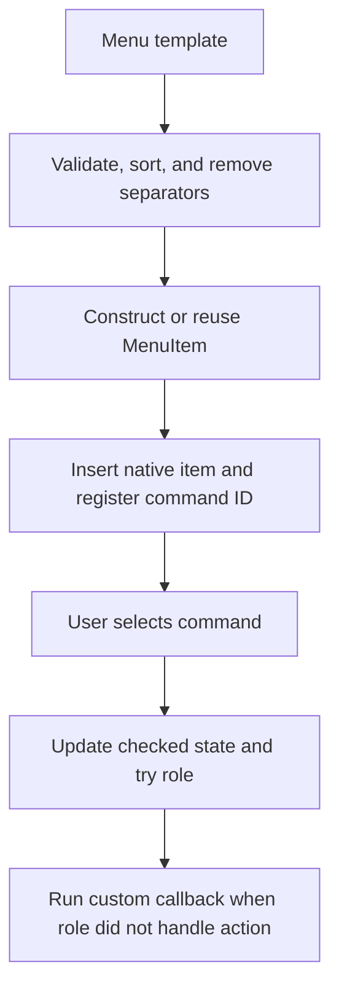

## Overview

Electron's main-process UI APIs translate application descriptions and user actions into native menus, dialogs, and tray operations. Menus share a command map and MenuItem model; dialogs normalize options before invoking their native binding; tray icons retain native menu objects and forward operating-system events. Window lookup and lifecycle are described in [[Windows and Navigation]], including the owner objects used when placing a popup or parenting a dialog.

Sources: [lib/browser/api/menu.ts:15-58](repo://lib/browser/api/menu.ts#L15-L58), [lib/browser/api/dialog.ts:115-153](repo://lib/browser/api/dialog.ts#L115-L153), [lib/browser/api/dialog.ts:241-255](repo://lib/browser/api/dialog.ts#L241-L255), [shell/browser/api/electron_api_tray.cc:373-386](repo://shell/browser/api/electron_api_tray.cc#L373-L386)

## Choose a desktop interface

| Interface | Application description | Native interaction |
| --- | --- | --- |
| Application menu | Menu built from MenuItems or a template | Set on the application on macOS, on existing windows elsewhere |
| Popup menu | Menu plus window, position, and optional frame | Calls `popupAt` after choosing a BaseWindow |
| File dialog | Open or save options and optional parent window | Calls synchronous or asynchronous native dialog methods |
| Message box | Message, type, buttons, cancellation and presentation options | Normalizes settings and invokes the native message box |
| Tray context menu | Menu object retained by a Tray | Installs its native menu model on the tray icon |

Sources: [lib/browser/api/menu.ts:69-98](repo://lib/browser/api/menu.ts#L69-L98), [lib/browser/api/menu.ts:172-187](repo://lib/browser/api/menu.ts#L172-L187), [lib/browser/api/dialog.ts:76-153](repo://lib/browser/api/dialog.ts#L76-L153), [lib/browser/api/dialog.ts:156-239](repo://lib/browser/api/dialog.ts#L156-L239), [shell/browser/api/electron_api_tray.cc:373-386](repo://shell/browser/api/electron_api_tray.cc#L373-L386)

## Build a menu and route commands

`Menu.buildFromTemplate` requires an array, validates every entry, sorts the template, removes extra separators, and appends items to a new Menu. Existing MenuItem instances are reused; plain option objects become new MenuItems. Validation requires a non-null object with an own label or role property, or a separator type. Array submenus are sorted recursively before construction.

Sources: [lib/browser/api/menu.ts:190-232](repo://lib/browser/api/menu.ts#L190-L232)

MenuItem preserves extra application fields, normalizes a string role to lowercase, obtains role defaults, and builds a submenu when its value is not already a Menu. A submenu determines the default item type; a submenu-type item without a valid Menu throws. Properties such as enabled, visible, and checked receive defaults, and each item receives a non-writable command ID. Supported types include normal, separator, submenu, checkbox, radio, header, and palette.

Sources: [lib/browser/api/menu-item.ts:7-45](repo://lib/browser/api/menu-item.ts#L7-L45), [lib/browser/api/menu-item.ts:74-97](repo://lib/browser/api/menu-item.ts#L74-L97)

Inserting an item validates the MenuItem and position, selects native insertion based on item type, and updates the JavaScript item list and command map. When native UI reports a command ID, `_executeCommand` looks up the item, gets the focused BaseWindow and WebContents, and calls the item's click wrapper. That wrapper first updates checkbox or radio state when the role does not own it, then attempts the role action, then an application click callback or macOS selector.

Sources: [lib/browser/api/menu.ts:127-155](repo://lib/browser/api/menu.ts#L127-L155), [lib/browser/api/menu.ts:267-300](repo://lib/browser/api/menu.ts#L267-L300), [lib/browser/api/menu.ts:54-58](repo://lib/browser/api/menu.ts#L54-L58), [lib/browser/api/menu-item.ts:56-71](repo://lib/browser/api/menu-item.ts#L56-L71)

Sources: [lib/browser/api/menu.ts:190-211](repo://lib/browser/api/menu.ts#L190-L211), [lib/browser/api/menu.ts:127-155](repo://lib/browser/api/menu.ts#L127-L155), [lib/browser/api/menu.ts:54-58](repo://lib/browser/api/menu.ts#L54-L58), [lib/browser/api/menu-item.ts:56-71](repo://lib/browser/api/menu-item.ts#L56-L71)

## Install application menus and show popups

`Menu.setApplicationMenu` records the menu and marks that application code has set it. On macOS it prepares submenu delegates and calls the native application-menu binding when a menu exists. Elsewhere it iterates existing BaseWindows and sets their menu. New BaseWindows also obtain `app.applicationMenu` during their initialization. This complements the default menu installed before readiness in [[Application Startup]].

Sources: [lib/browser/api/menu.ts:172-187](repo://lib/browser/api/menu.ts#L172-L187), [lib/browser/api/base-window.ts:10-19](repo://lib/browser/api/base-window.ts#L10-L19), [lib/browser/init.ts:193-199](repo://lib/browser/init.ts#L193-L199)

`Menu.popup` validates its options object, supplies defaults for coordinates, positioning item, source type, and callback, then chooses a window. An unavailable supplied window falls back to the focused BaseWindow or the first known window. With no window it throws. `closePopup` targets a supplied BaseWindow's ID or passes -1 to close all popup runners belonging to the Menu.

Sources: [lib/browser/api/menu.ts:69-108](repo://lib/browser/api/menu.ts#L69-L108)

## Normalize dialog requests

Open, save, and message dialog helpers require `app.isReady()`. Their exported overloads distinguish a BaseWindow argument from an options object and pass a null parent when no window was supplied. File-dialog property names become bit flags; the recognized options include open-file, open-directory, multiple selection, hidden files, and platform-specific choices. Unrecognized property names do not contribute to the bit mask.

Sources: [lib/browser/api/dialog.ts:6-24](repo://lib/browser/api/dialog.ts#L6-L24), [lib/browser/api/dialog.ts:54-74](repo://lib/browser/api/dialog.ts#L54-L74), [lib/browser/api/dialog.ts:241-287](repo://lib/browser/api/dialog.ts#L241-L287)

The open-dialog helper validates fields including title, button label, default path, message, and properties, then constructs native settings with the parent window and converted property flags. Its `sync` argument selects `showOpenDialogSync` or `showOpenDialog`; the save helper follows the same dispatch pattern. Invalid input therefore fails in JavaScript before a native dialog is requested.

Sources: [lib/browser/api/dialog.ts:76-153](repo://lib/browser/api/dialog.ts#L76-L153)

Message-box normalization validates the requested type and button data, chooses default and cancel IDs, and optionally normalizes platform access keys. Its AbortSignal handling can return a cancellation response when already aborted or close an asynchronous message box after abort. Synchronous and asynchronous dispatch remain separate branches, so cancellation behavior should be read together with the selected interface.

Sources: [lib/browser/api/dialog.ts:156-239](repo://lib/browser/api/dialog.ts#L156-L239)

## Tray menus and object lifetime

`Tray.setContextMenu` accepts a Menu or null. A Menu is retained in a V8 handle while its native model is installed on the tray icon; null clears both. `popUpContextMenu` optionally accepts a Menu and position and passes the menu model's weak pointer to the native tray implementation. Invalid argument conversion throws before the native popup call.

Sources: [shell/browser/api/electron_api_tray.cc:342-386](repo://shell/browser/api/electron_api_tray.cc#L342-L386)

`Tray.destroy` unpins the wrapper, resets the menu handle, and destroys the native icon. `isDestroyed` reports whether that native icon is absent. Methods such as image changes and context-menu operations call `CheckAlive` before using the icon, so the native-resource lifecycle governs whether operations can continue after destruction.

Sources: [shell/browser/api/electron_api_tray.cc:188-210](repo://shell/browser/api/electron_api_tray.cc#L188-L210), [shell/browser/api/electron_api_tray.cc:342-376](repo://shell/browser/api/electron_api_tray.cc#L342-L376)
