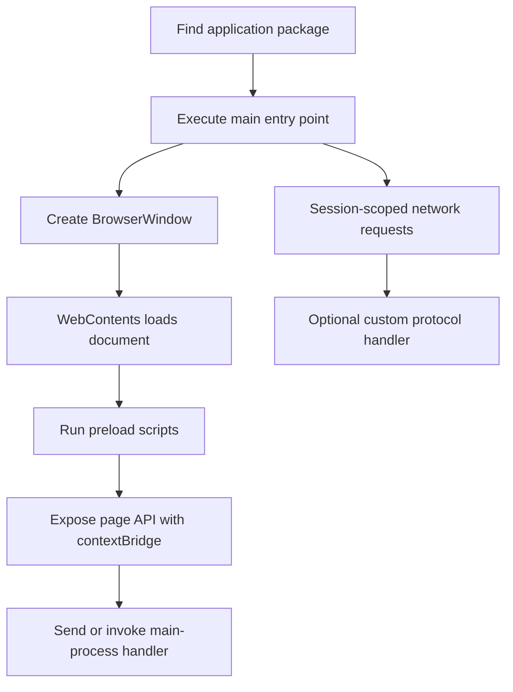

## Overview

Electron implements a desktop application runtime built on Chromium and Node.js, with application code written in JavaScript, HTML, and CSS. This repository contains the runtime itself, its JavaScript API implementations, native bindings, examples, and contributor tooling. The minimal application in [[Quickstart]] shows the visible result: a native window loads an HTML document, and a preload script fills in the running component versions.

Sources: [README.md:9-12](repo://README.md#L9-L12), [package.json:61-94](repo://package.json#L61-L94), [docs/fiddles/quick-start/main.js:1-30](repo://docs/fiddles/quick-start/main.js#L1-L30), [docs/fiddles/quick-start/preload.js:1-10](repo://docs/fiddles/quick-start/preload.js#L1-L10)

The main process exposes application and desktop objects such as `app`, `BrowserWindow`, `Menu`, `session`, and `utilityProcess`. Renderer exports include `contextBridge`, `ipcRenderer`, and `webFrame`. These separate module lists are the first useful boundary when following an API call: identify the process that owns the operation, then follow its JavaScript wrapper into the linked native binding.

Sources: [lib/browser/api/module-list.ts:4-43](repo://lib/browser/api/module-list.ts#L4-L43), [lib/renderer/api/module-list.ts:1-9](repo://lib/renderer/api/module-list.ts#L1-L9), [lib/browser/api/browser-window.ts:1-10](repo://lib/browser/api/browser-window.ts#L1-L10), [lib/renderer/api/context-bridge.ts:1-19](repo://lib/renderer/api/context-bridge.ts#L1-L19)

## Documentation map

| Area | What it does | Page |
| --- | --- | --- |
| First application | Connects a window, preload, and document | [[Quickstart]] |
| Bootstrap | Finds the application package and runs its entry point | [[Application Startup]] |
| Windows | Owns the desktop window and delegates page loads to WebContents | [[Windows and Navigation]] |
| Renderer boundary | Executes preloads and exposes APIs between JavaScript worlds | [[Renderer Isolation and Preloads]] |
| Process communication | Routes messages and request/reply calls to main-process handlers | [[Interprocess Communication]] |
| Network context | Creates session-scoped requests and streamed responses | [[Sessions and Network Requests]] |
| URL routing | Converts custom scheme requests into handler calls | [[Custom Protocols]] |
| Packaged files | Adapts filesystem access to archive paths | [[ASAR File Access]] |
| Desktop UI | Exposes menus, dialogs, and tray icons | [[Desktop Integration]] |
| Node services | Starts a utility process with messages and managed stdio | [[Utility Processes]] |
| Contributor workflow | Builds the native runtime and launches its specs | [[Building and Testing Electron]] |
| Distribution | Prepares releases and verifies assets before publication | [[Release Pipeline]] |

Sources: [docs/fiddles/quick-start/main.js:1-30](repo://docs/fiddles/quick-start/main.js#L1-L30), [lib/browser/init.ts:82-114](repo://lib/browser/init.ts#L82-L114), [lib/browser/api/browser-window.ts:131-143](repo://lib/browser/api/browser-window.ts#L131-L143), [lib/sandboxed_renderer/init.ts:16-71](repo://lib/sandboxed_renderer/init.ts#L16-L71), [lib/browser/ipc-dispatch.ts:58-108](repo://lib/browser/ipc-dispatch.ts#L58-L108), [lib/browser/api/net-fetch.ts:18-27](repo://lib/browser/api/net-fetch.ts#L18-L27), [lib/browser/api/protocol.ts:111-147](repo://lib/browser/api/protocol.ts#L111-L147), [lib/node/asar-fs-wrapper.ts:29-87](repo://lib/node/asar-fs-wrapper.ts#L29-L87), [lib/browser/api/module-list.ts:14-38](repo://lib/browser/api/module-list.ts#L14-L38), [lib/browser/api/utility-process.ts:55-119](repo://lib/browser/api/utility-process.ts#L55-L119), [script/spec-runner.js:194-221](repo://script/spec-runner.js#L194-L221), [script/release/release.ts:414-432](repo://script/release/release.ts#L414-L432)

## Main application flow

Sources: [lib/browser/init.ts:82-114](repo://lib/browser/init.ts#L82-L114), [lib/browser/init.ts:204-222](repo://lib/browser/init.ts#L204-L222), [docs/fiddles/quick-start/main.js:4-17](repo://docs/fiddles/quick-start/main.js#L4-L17), [lib/browser/api/browser-window.ts:131-143](repo://lib/browser/api/browser-window.ts#L131-L143), [lib/sandboxed_renderer/init.ts:58-71](repo://lib/sandboxed_renderer/init.ts#L58-L71), [lib/renderer/api/context-bridge.ts:7-19](repo://lib/renderer/api/context-bridge.ts#L7-L19), [lib/renderer/api/ipc-renderer.ts:8-27](repo://lib/renderer/api/ipc-renderer.ts#L8-L27), [lib/browser/api/session.ts:44-46](repo://lib/browser/api/session.ts#L44-L46), [lib/browser/api/protocol.ts:111-147](repo://lib/browser/api/protocol.ts#L111-L147)

1. [[Application Startup]] follows package search and entry execution, including the point where control passes back to native startup.
2. [[Windows and Navigation]] follows `BrowserWindow.loadFile` into the WebContents load operation and its event-driven promise.
3. [[Renderer Isolation and Preloads]] follows the sandbox bootstrap that obtains preload source and executes it with a selected module set.
4. [[Interprocess Communication]] follows the page-facing API's eventual renderer message through browser dispatch and handler replies.
5. [[Sessions and Network Requests]] follows requests made through a selected session; [[Custom Protocols]] follows the optional scheme handler that returns a response.

Sources: [lib/browser/init.ts:201-222](repo://lib/browser/init.ts#L201-L222), [lib/browser/api/browser-window.ts:131-143](repo://lib/browser/api/browser-window.ts#L131-L143), [lib/browser/api/web-contents.ts:427-432](repo://lib/browser/api/web-contents.ts#L427-L432), [lib/sandboxed_renderer/init.ts:16-39](repo://lib/sandboxed_renderer/init.ts#L16-L39), [lib/sandboxed_renderer/init.ts:58-71](repo://lib/sandboxed_renderer/init.ts#L58-L71), [lib/browser/ipc-dispatch.ts:76-108](repo://lib/browser/ipc-dispatch.ts#L76-L108), [lib/browser/api/session.ts:44-46](repo://lib/browser/api/session.ts#L44-L46), [lib/browser/api/protocol.ts:111-147](repo://lib/browser/api/protocol.ts#L111-L147)

## Shared implementation decisions

Electron adapts Node scheduling to Chromium's event loop. Common initialization wraps `process.nextTick`, immediate callbacks, and timers with `process.activateUvLoop()`. The comments explain the reason: without activation, callbacks could wait until some unrelated work wakes the Node loop, and timers scheduled under Chromium might not update the polling timeout. This adaptation is part of runtime bootstrap, before an application's own scheduling logic.

Sources: [lib/common/init.ts:8-20](repo://lib/common/init.ts#L8-L20), [lib/common/init.ts:37-62](repo://lib/common/init.ts#L37-L62)

The API surface is assembled through property getters. `defineProperties` installs enumerable getters whose loaders are supplied by the process-specific module lists, and unwraps a default export when appropriate. Startup also deliberately loads some modules early: the browser bootstrap loads protocol and WebContents modules for readiness setup and loads WebContentsView before BrowserWindow needs its inheritance. These two mechanisms explain why finding an exported name and finding its initialization point can lead to different files.

Sources: [lib/common/define-properties.ts:1-17](repo://lib/common/define-properties.ts#L1-L17), [lib/browser/api/module-list.ts:4-43](repo://lib/browser/api/module-list.ts#L4-L43), [lib/browser/init.ts:143-160](repo://lib/browser/init.ts#L143-L160)

Asynchronous wrappers establish their observation machinery before starting native work. WebContents creates the load promise before calling `_loadURL`; native IPC serializes arguments and resolves a promise through a callback; fetch attaches response and error listeners before ending the request. When tracing a failure, follow both the initiating call and the event or callback that settles it.

Sources: [lib/browser/api/web-contents.ts:427-432](repo://lib/browser/api/web-contents.ts#L427-L432), [shell/renderer/api/electron_api_ipc_renderer.cc:82-105](repo://shell/renderer/api/electron_api_ipc_renderer.cc#L82-L105), [lib/browser/api/net-fetch.ts:101-124](repo://lib/browser/api/net-fetch.ts#L101-L124)

Object lifetime can change during a native operation. The navigation implementation explicitly warns that `LoadURLWithParams` can trigger JavaScript that destroys the current WebContents wrapper, so it takes a weak pointer before navigating and checks it afterward. At the JavaScript level, a destroyed WebContents also participates in load-promise cleanup. These are concrete lifecycle constraints to preserve when changing the window flow.

Sources: [shell/browser/api/electron_api_web_contents.cc:2374-2404](repo://shell/browser/api/electron_api_web_contents.cc#L2374-L2404), [lib/browser/api/web-contents.ts:410-423](repo://lib/browser/api/web-contents.ts#L410-L423)

## Working on the runtime

The package is marked private and its `start` script launches a locally built executable selected from the surrounding source tree. [[Building and Testing Electron]] explains that source-build layout and the spec runner; [[Release Pipeline]] explains the separate sequence that assembles checksums, validates a refreshed draft, updates the distribution index, and publishes a release. The release code places the index upload late to reduce the chance that it advertises a release that fails to publish, while still ensuring the index exists before final publication.

Sources: [package.json:60-94](repo://package.json#L60-L94), [script/start.js:1-8](repo://script/start.js#L1-L8), [script/lib/utils.js:8-61](repo://script/lib/utils.js#L8-L61), [script/release/release.ts:414-432](repo://script/release/release.ts#L414-L432)
