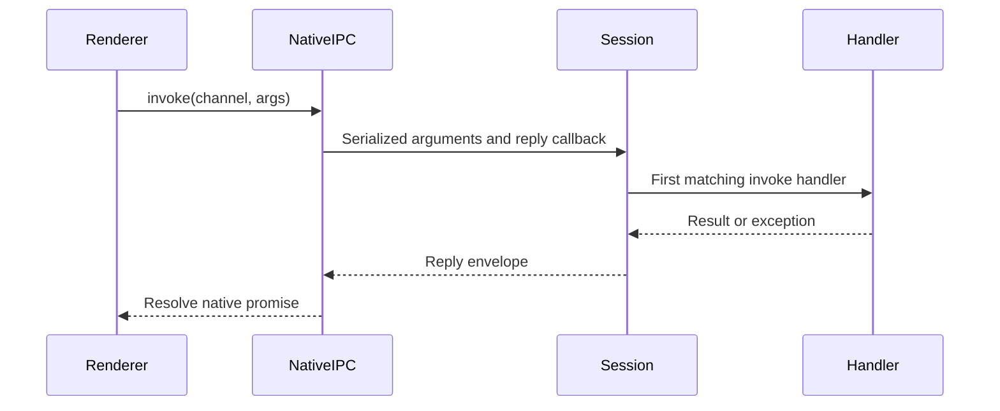

## Overview

Renderer IPC turns JavaScript calls into serialized messages, dispatches them to browser-side objects, and optionally returns a result. `ipcRenderer` exposes event-style sending, synchronous sending, promise-based invocation, host messages, and transferred-port messages. A preload can expose selected operations to document code through the bridge described in [[Renderer Isolation and Preloads]]; this page follows the subsequent process boundary.

Sources: [lib/renderer/api/ipc-renderer.ts:1-34](repo://lib/renderer/api/ipc-renderer.ts#L1-L34), [lib/renderer/api/context-bridge.ts:7-19](repo://lib/renderer/api/context-bridge.ts#L7-L19)

## Renderer transport and serialization

`getIPCRenderer` caches one native implementation. It creates a render-frame implementation for a renderer process, a service-worker implementation for a service worker, and throws for other process types. Public `ipcRenderer` calls use `internal = false`, separating them from Electron's internal channels. The JavaScript methods forward channel names and an argument array to that binding.

Sources: [lib/renderer/ipc-renderer-bindings.ts:1-17](repo://lib/renderer/ipc-renderer-bindings.ts#L1-L17), [lib/renderer/api/ipc-renderer.ts:5-30](repo://lib/renderer/api/ipc-renderer.ts#L5-L30)

Native sending first checks that the IPC remote still exists. A released context produces an error before serialization. `send` serializes the arguments into a `CloneableMessage` and calls the remote `Message`; `invoke` creates a native promise, sends the serialized arguments with a callback, and resolves that promise when the reply arrives. A serialization failure returns before dispatching the remote call.

Sources: [shell/renderer/api/electron_api_ipc_renderer.cc:66-105](repo://shell/renderer/api/electron_api_ipc_renderer.cc#L66-L105)

The browser handler obtains the session, creates an event object associated with the call, and forwards the message or invocation into that session. An invocation event additionally carries the reply callback. Session JavaScript initialization installs the dispatch listeners, so browser routing is attached at the session rather than relying on every WebContents to install an independent transport listener.

Sources: [shell/browser/electron_api_ipc_handler_impl.cc:44-70](repo://shell/browser/electron_api_ipc_handler_impl.cc#L44-L70), [lib/browser/api/session.ts:25-26](repo://lib/browser/api/session.ts#L25-L26), [lib/browser/ipc-dispatch.ts:58-108](repo://lib/browser/ipc-dispatch.ts#L58-L108)

Sources: [lib/renderer/api/ipc-renderer.ts:21-26](repo://lib/renderer/api/ipc-renderer.ts#L21-L26), [shell/renderer/api/electron_api_ipc_renderer.cc:82-105](repo://shell/renderer/api/electron_api_ipc_renderer.cc#L82-L105), [shell/browser/electron_api_ipc_handler_impl.cc:57-70](repo://shell/browser/electron_api_ipc_handler_impl.cc#L57-L70), [lib/browser/ipc-dispatch.ts:76-108](repo://lib/browser/ipc-dispatch.ts#L76-L108)

## Dispatch priority and event messages

For frame messages, the dispatcher considers emitters in this order: the frame's `ipc`, the sender WebContents' `ipc`, and global `ipcMain`. It reuses an array to avoid repeated allocation. Frame lookup uses the frame-tree-node ID so messages emitted during a frame swap can still find the appropriate main-frame object even while a render frame is pending deletion.

Sources: [lib/browser/ipc-dispatch.ts:33-53](repo://lib/browser/ipc-dispatch.ts#L33-L53)

An ordinary frame `send` attaches `event.reply`, emits `ipc-message` on the sender WebContents, then emits the named channel on every available emitter in priority order. `event.reply` targets the original process and frame IDs through `sendToFrame`. An internal message goes only to the internal emitter. A service-worker message instead goes to that worker's `ipc`, and its event gains a lazy `serviceWorker` property.

Sources: [lib/browser/ipc-dispatch.ts:10-15](repo://lib/browser/ipc-dispatch.ts#L10-L15), [lib/browser/ipc-dispatch.ts:24-30](repo://lib/browser/ipc-dispatch.ts#L24-L30), [lib/browser/ipc-dispatch.ts:58-74](repo://lib/browser/ipc-dispatch.ts#L58-L74)

## Register and invoke handlers

`IpcMainImpl.handle` stores one function per channel. Registering a second handler for the same channel throws, and a non-function handler produces a TypeError. `handleOnce` registers a wrapper that removes itself before calling the supplied function, preventing a later invocation from using it again even if the first call is still awaiting a result. `removeHandler` deletes the channel from the handler map.

Sources: [lib/browser/ipc-main-impl.ts:5-35](repo://lib/browser/ipc-main-impl.ts#L5-L35)

Invocation routing differs from event emission: it selects only the first target whose handler map contains the channel. For a frame that means a frame handler takes precedence over a WebContents handler, which takes precedence over global `ipcMain`. The selected function receives the event and arguments; its return value is normalized through `Promise.resolve` and awaited. Service-worker invocations look only at that worker's IPC target.

Sources: [lib/browser/ipc-dispatch.ts:76-104](repo://lib/browser/ipc-dispatch.ts#L76-L104)

Successful invocation sends a reply object containing `result`. A thrown or rejected handler is logged and returned through an `error` string; an absent handler produces `No handler registered` through the same path. Renderer JavaScript inspects that envelope and throws a new Error containing the channel and returned error text. This transport does not return the browser handler's original Error object or stack to the caller.

Sources: [lib/browser/ipc-dispatch.ts:79-107](repo://lib/browser/ipc-dispatch.ts#L79-L107), [lib/renderer/api/ipc-renderer.ts:21-26](repo://lib/renderer/api/ipc-renderer.ts#L21-L26)

## Synchronous replies and host messages

`sendSync` enters a native synchronous transport call and deserializes the returned message. Browser dispatch defines an `event.returnValue` setter that sends the value through the reply channel. Frame dispatch warns when neither the WebContents-level synchronous event nor any channel emitter has listeners, then delivers the message to the WebContents and available emitters. The warning identifies a call with no listeners; it does not install a fallback result.

Sources: [shell/renderer/api/electron_api_ipc_renderer.cc:164-181](repo://shell/renderer/api/electron_api_ipc_renderer.cc#L164-L181), [lib/browser/ipc-dispatch.ts:17-22](repo://lib/browser/ipc-dispatch.ts#L17-L22), [lib/browser/ipc-dispatch.ts:110-133](repo://lib/browser/ipc-dispatch.ts#L110-L133)

Host messages have a separate dispatch event. The browser forwards `-ipc-message-host` to the sender WebContents with the channel and argument array, rather than running it through the normal frame channel emitter loop. This corresponds to the distinct `sendToHost` method in the renderer wrapper.

Sources: [lib/renderer/api/ipc-renderer.ts:17-19](repo://lib/renderer/api/ipc-renderer.ts#L17-L19), [lib/browser/ipc-dispatch.ts:135-137](repo://lib/browser/ipc-dispatch.ts#L135-L137)

## Transfer message ports

`postMessage` serializes the message separately from transferred ports. Native code validates and disentangles the supplied ports before calling `ReceivePostMessage`. Browser dispatch wraps received ports as `MessagePortMain` objects and attaches them to `event.ports`, then emits the channel on frame targets or the service worker's IPC object. The ports are an explicit transfer list rather than additional ordinary invocation arguments.

Sources: [shell/renderer/api/electron_api_ipc_renderer.cc:108-146](repo://shell/renderer/api/electron_api_ipc_renderer.cc#L108-L146), [lib/browser/ipc-dispatch.ts:139-150](repo://lib/browser/ipc-dispatch.ts#L139-L150)
