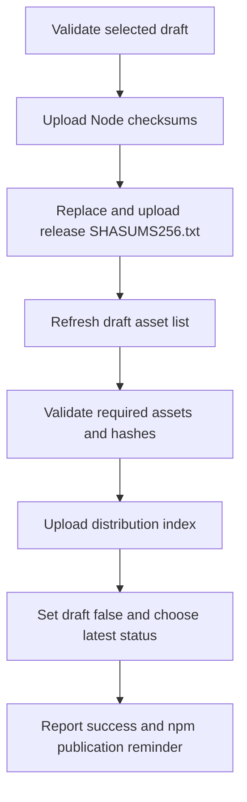

## Overview

The release tooling has two main phases. `prepareRelease` determines the next version, creates a draft release, pushes the branch and tags, and starts release builds. `makeRelease` assembles checksums, verifies uploaded assets, updates the distribution index, and publishes the draft. [[Building and Testing Electron]] explains the compilation and local verification that precede distribution; this page describes the scripts' release ordering and failure gates.

Sources: [script/release/prepare-release.ts:213-222](repo://script/release/prepare-release.ts#L213-L222), [script/release/release.ts:414-432](repo://script/release/release.ts#L414-L432)

## Determine the version and target

Preparation accepts a target repository, optional target branch, bump type, and prerelease flag. Without an explicit branch it asks the repository utility for the current branch. `getNewVersion` executes the version bumper with the requested bump; dry-run mode adds `--dryRun`, while real mode performs the change. The returned version receives a leading `v`. `printNextVersion` uses the dry-run path without creating a release.

Sources: [script/release/prepare-release.ts:22-55](repo://script/release/prepare-release.ts#L22-L55), [script/release/prepare-release.ts:208-221](repo://script/release/prepare-release.ts#L208-L221)

Publication derives its version from `getElectronVersion`. A version containing `nightly` selects the nightly repository; other versions select the regular Electron repository. Both preparation and publication construct Octokit with the repository-specific GitHub token strategy. This makes repository selection part of authentication and asset lookup, rather than merely a label in release notes.

Sources: [script/release/release.ts:25-36](repo://script/release/release.ts#L25-L36), [script/release/prepare-release.ts:88-100](repo://script/release/prepare-release.ts#L88-L100)

## Generate notes and create the draft

Nightly preparation returns a fixed note directing readers to compare tags. Other bump types invoke the notes generator for the branch and version and log any warning it returns. The generator accepts an explicit range or finds the previous release point: it first tries an earlier supported tag on the same branch, filtering to stable tags for a stable release, then walks preceding stabilization branches if needed.

Sources: [script/release/prepare-release.ts:58-73](repo://script/release/prepare-release.ts#L58-L73), [script/release/notes/index.ts:30-33](repo://script/release/notes/index.ts#L30-L33), [script/release/notes/index.ts:118-160](repo://script/release/notes/index.ts#L118-L160)

The rendered notes include a warning when unknown notes remain. Preparation logs that warning rather than treating it as an automatic abort. `createRelease` performs the real bump, generates notes, and creates an annotated tag before checking for an existing draft of that version. A duplicate draft exits with code 1. The ordering means draft duplication is detected after earlier local version and tag work, not as a transaction that rolls those steps back.

Sources: [script/release/notes/index.ts:160-169](repo://script/release/notes/index.ts#L160-L169), [script/release/prepare-release.ts:68-109](repo://script/release/prepare-release.ts#L68-L109), [script/release/prepare-release.ts:192-205](repo://script/release/prepare-release.ts#L192-L205)

The created GitHub release is explicitly a draft and receives prerelease-specific text when requested. Preparation then pushes `HEAD` to the target branch with `--follow-tags` and starts release CI jobs with `ghRelease: true` and the new version. A failed push exits before CI startup. The push success message tells the operator to wait for release builds before final publication.

Sources: [script/release/prepare-release.ts:113-165](repo://script/release/prepare-release.ts#L113-L165), [script/release/prepare-release.ts:168-190](repo://script/release/prepare-release.ts#L168-L190), [script/release/prepare-release.ts:219-221](repo://script/release/prepare-release.ts#L219-L221)

## Validate the draft and required assets

`getDraftRelease` filters releases by exact version tag and draft status. Normal validation requires exactly one draft, a prerelease flag for beta versions, and a release body longer than 50 characters without `(placeholder)`. Its check helper counts failures and can exit immediately when a gating check fails. These checks apply before checksum assembly in the ordinary `makeRelease` entry point.

Sources: [script/release/release.ts:38-67](repo://script/release/release.ts#L38-L67), [script/release/release.ts:118-126](repo://script/release/release.ts#L118-L126), [script/release/release.ts:414-417](repo://script/release/release.ts#L414-L417)

Asset validation computes required filenames from the release version and checks every required name against uploaded assets. The catalogue includes platform and architecture distributions, symbols, debug-related archives, and ChromeDriver packages. The existence gate must pass before checksum verification. A filename check establishes presence; the following hash checks establish whether the bytes match the published checksum mapping.

Sources: [script/release/release.ts:82-115](repo://script/release/release.ts#L82-L115), [script/release/release.ts:128-169](repo://script/release/release.ts#L128-L169)

## Assemble and verify checksums

`createReleaseShasums` replaces an existing `SHASUMS256.txt` asset before uploading a fresh one. It merges individual `.sha256sum` records from the `checksums-scratchpad` Azure container under the version prefix. That merge requires `ELECTRON_ARTIFACTS_BLOB_STORAGE`; its absence throws an explicit configuration error. The combined content is saved and uploaded as a release asset.

Sources: [script/release/release.ts:278-337](repo://script/release/release.ts#L278-L337)

Draft assets use authenticated GitHub asset endpoints to obtain download URLs. The verifier sends HEAD requests without following redirects, requires a 301 or 302 response, and hashes the returned locations. Failure while obtaining those URLs logs the download error and exits. It then fetches checksum mappings, requiring status 200, and compares each calculated hash with the mapping entry for that filename.

Sources: [script/release/release.ts:438-506](repo://script/release/release.ts#L438-L506), [script/release/release.ts:518-530](repo://script/release/release.ts#L518-L530)

Remote hashing calls the configured Azure hashing endpoint with the asset URL, algorithm, and `ELECTRON_HASHER_FUNCTION_KEY`. It expects a nonempty successful JSON response containing the hash and retries failures up to the configured attempt count, which defaults to three. Electron assets are checked with SHA-256; Node artifact verification additionally computes SHA-1 hashes against its separate mapping.

Sources: [script/release/get-url-hash.ts:5-49](repo://script/release/get-url-hash.ts#L5-L49), [script/release/release.ts:533-578](repo://script/release/release.ts#L533-L578)

## Publish in the required order

Sources: [script/release/release.ts:382-405](repo://script/release/release.ts#L382-L405), [script/release/release.ts:414-432](repo://script/release/release.ts#L414-L432)

`makeRelease` refreshes the draft after uploading checksums so asset validation sees the updated release. It uploads `index.json` only after validation, but before making the draft public. The comment explains both sides of this ordering: a premature index could advertise a release that fails publication, while publishing before the index could leave a release missing from the index used downstream.

Sources: [script/release/release.ts:414-428](repo://script/release/release.ts#L414-L428)

`publishRelease` keeps prereleases from becoming latest. For a stable release, it compares the candidate tag with the current latest release and sets `make_latest` accordingly when changing `draft` to false. Publication errors exit with code 1. The success message then asks for a separate npm publication step; this function's completion is the GitHub release publication boundary.

Sources: [script/release/release.ts:382-405](repo://script/release/release.ts#L382-L405), [script/release/release.ts:428-432](repo://script/release/release.ts#L428-L432)

The exported `validateRelease` uses the same draft checks but passes `validatingRelease: true` into asset validation. In that mode a draft skips the remote checksum-verification branch. It therefore provides a draft-and-asset readiness check, while `makeRelease` performs the later full verification sequence after assembling the checksum asset.

Sources: [script/release/release.ts:82-115](repo://script/release/release.ts#L82-L115), [script/release/release.ts:408-421](repo://script/release/release.ts#L408-L421)
