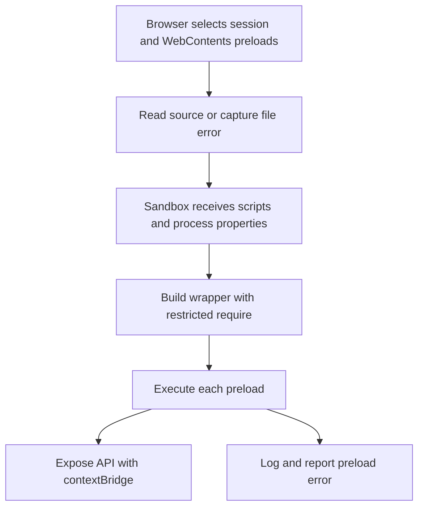

## Overview

Preloads connect application-owned code to a renderer before the document uses its exposed APIs. The quick-start preload in [[Quickstart]] waits for `DOMContentLoaded` and writes component versions into the document. Electron implements distinct bootstrap paths for renderers with a Node environment and sandboxed renderers, while `contextBridge` transfers APIs between JavaScript worlds. Cross-process calls made by those APIs continue through [[Interprocess Communication]].

Sources: [docs/fiddles/quick-start/preload.js:1-10](repo://docs/fiddles/quick-start/preload.js#L1-L10), [lib/renderer/init.ts:133-168](repo://lib/renderer/init.ts#L133-L168), [lib/sandboxed_renderer/init.ts:16-71](repo://lib/sandboxed_renderer/init.ts#L16-L71), [lib/renderer/api/context-bridge.ts:1-19](repo://lib/renderer/api/context-bridge.ts#L1-L19)

## Select scripts in the browser process

The browser's preload lookup starts with the event's session. Frame events select session scripts of type `frame` and append the WebContents preload, if present. Service-worker events select scripts of type `service-worker`. An invalid event type throws. The final filter retains only absolute file paths, with a comment tying that compatibility filter to the deprecated session preload setter.

Sources: [lib/browser/rpc-server.ts:52-70](repo://lib/browser/rpc-server.ts#L52-L70)

Sandbox startup requests source text through `BROWSER_SANDBOX_LOAD`. The browser reads each selected file as UTF-8, preserving a read error in the script record, and returns the records together with selected process metadata. Non-sandbox startup instead receives the selected file paths through `BROWSER_NONSANDBOX_LOAD`. This division places filesystem reading in the browser for sandboxed preloads and leaves module loading to the renderer's Node environment in the other path.

Sources: [lib/browser/rpc-server.ts:72-107](repo://lib/browser/rpc-server.ts#L72-L107), [lib/renderer/init.ts:136-148](repo://lib/renderer/init.ts#L136-L148), [lib/sandboxed_renderer/init.ts:16-22](repo://lib/sandboxed_renderer/init.ts#L16-L22)

## Execute sandboxed preloads

The sandbox bootstrap creates a map of already loaded modules for Electron aliases and `events`, plus lazy loaders for `timers` and `url`, including their `node:` aliases. The preload's `require` consults those maps, caches lazily loaded modules, and throws `module not found` for any other name. It does not fall through to Node's ordinary filesystem module resolution.

Sources: [lib/sandboxed_renderer/init.ts:24-39](repo://lib/sandboxed_renderer/init.ts#L24-L39), [lib/sandboxed_renderer/preload.ts:46-57](repo://lib/sandboxed_renderer/preload.ts#L46-L57)

The preload process object is an EventEmitter with a memory-information method and a forwarding `noDeprecation` property. The bootstrap adds properties from the native binding and browser response, then arranges for native process events to reach both the bootstrap process and the preload process object. Its exposed globals include `Buffer`, `global`, `setImmediate`, and `clearImmediate`.

Sources: [lib/sandboxed_renderer/preload.ts:19-43](repo://lib/sandboxed_renderer/preload.ts#L19-L43), [lib/sandboxed_renderer/init.ts:41-71](repo://lib/sandboxed_renderer/init.ts#L41-L71)

`runPreloadScript` wraps source in a function receiving the selected `require`, process object, `exports`, `module`, and explicit globals. A native-provided compiler creates that function in the window scope; the wrapper's comment explains that the source should not access the bootstrap's local scope. Scripts execute in the order returned. Each script has its own error boundary, which logs the failure and reports `BROWSER_PRELOAD_ERROR` before the loop proceeds.

Sources: [lib/sandboxed_renderer/preload.ts:59-101](repo://lib/sandboxed_renderer/preload.ts#L59-L101)

Sources: [lib/browser/rpc-server.ts:52-100](repo://lib/browser/rpc-server.ts#L52-L100), [lib/sandboxed_renderer/init.ts:16-71](repo://lib/sandboxed_renderer/init.ts#L16-L71), [lib/sandboxed_renderer/preload.ts:46-101](repo://lib/sandboxed_renderer/preload.ts#L46-L101), [lib/renderer/api/context-bridge.ts:7-19](repo://lib/renderer/api/context-bridge.ts#L7-L19)

## Execute preloads with a Node environment

The non-sandbox renderer modifies Node's module wrapper so preload closures retain `process`, `global`, and `Buffer` even if globals are later deleted. It reads the `nodeIntegration` preference: enabled integration installs a renderer `module` and `require`, derives module paths from a file document or application path, and forwards window errors to registered `uncaughtException` listeners. With integration disabled and no context isolation, it deletes Node globals on the process `loaded` event.

Sources: [lib/renderer/init.ts:20-40](repo://lib/renderer/init.ts#L20-L40), [lib/renderer/init.ts:56-130](repo://lib/renderer/init.ts#L56-L130)

Preload paths are split by extension. Non-`.mjs` scripts use `Module._load` first; `.mjs` scripts are imported sequentially through the ESM loader afterward. Both paths log and report individual preload failures. When ESM preloads exist, `appCodeLoaded` runs in the loader promise's `finally`; otherwise it runs after the synchronous preload loop. This is a renderer-specific readiness gate, separate from the main entry execution described in [[Application Startup]].

Sources: [lib/renderer/init.ts:133-168](repo://lib/renderer/init.ts#L133-L168)

## Expose an API across worlds

The public context bridge checks `process.contextIsolated` before every operation. `exposeInMainWorld` targets world 0, `exposeInIsolatedWorld` targets the supplied world ID, and `executeInMainWorld` forwards a script to world 0. If isolation is disabled, the JavaScript wrapper throws before calling the native binding. The bridge therefore has an explicit configuration precondition rather than silently changing its behavior.

Sources: [lib/renderer/api/context-bridge.ts:1-20](repo://lib/renderer/api/context-bridge.ts#L1-L20)

Native exposure refuses a key that already exists on the destination global. It converts the supplied value into the target context, then either installs a mutable property when `kContextBridgeMutability` is enabled or deep-freezes supported object values and installs a read-only, non-configurable property. The typed-array exception is explicit in that freezing branch, so a claim that every exposed value is always recursively frozen would overstate the implementation.

Sources: [shell/renderer/api/electron_api_context_bridge.cc:733-768](repo://shell/renderer/api/electron_api_context_bridge.cc#L733-L768)

Value transfer handles primitives directly, consults an object cache, and proxies functions with tracked lifetime. It rejects nesting at the recursion limit with an error identifying objects deeper than 1000 levels. The function-return path also catches conversion exceptions and rethrows an error in the caller's context, including a fallback message when no usable exception message exists. These failures can arise after a function call succeeds in its original world, while its result is being returned across the bridge.

Sources: [shell/renderer/api/electron_api_context_bridge.cc:153-238](repo://shell/renderer/api/electron_api_context_bridge.cc#L153-L238), [shell/renderer/api/electron_api_context_bridge.cc:581-627](repo://shell/renderer/api/electron_api_context_bridge.cc#L581-L627)
