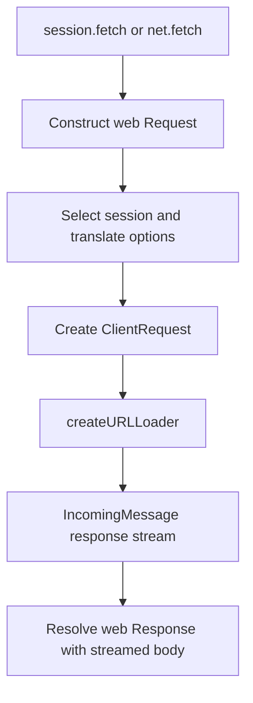

## Overview

A Session connects browser-context identity with network-facing facilities such as cookies, protocol handlers, web requests, and service workers. `session.fetch` adapts a web Request into Electron's ClientRequest using that session; `net.fetch` delegates to the default session. Session initialization also installs the message routing described in [[Interprocess Communication]], making the session a shared boundary for renderer events and browser network context.

Sources: [shell/browser/api/electron_api_session.cc:1831-1837](repo://shell/browser/api/electron_api_session.cc#L1831-L1837), [lib/browser/api/session.ts:25-26](repo://lib/browser/api/session.ts#L25-L26), [lib/browser/api/session.ts:44-46](repo://lib/browser/api/session.ts#L44-L46), [lib/browser/api/net.ts:15-17](repo://lib/browser/api/net.ts#L15-L17)

## Select a session

`session.defaultSession` calls `fromPartition('')`. Native partition lookup treats the empty string as the default persistent context; a `persist:` prefix selects a persistent named context after removing that prefix, and other names select in-memory contexts. `FromBrowserContext` and `CreateFrom` reuse an existing Session wrapper for a browser context rather than creating a new identity for every lookup.

Sources: [lib/browser/api/session.ts:114-120](repo://lib/browser/api/session.ts#L114-L120), [shell/browser/api/electron_api_session.cc:1673-1730](repo://shell/browser/api/electron_api_session.cc#L1673-L1730)

The public `fromPartition` and `fromPath` bindings require the application to be ready. `fromPath` additionally rejects an empty path or a path that is not absolute. Both entry points accept options and return the selected Session wrapper when available. For code following [[Application Startup]], perform these lookups after the readiness gate rather than while package metadata is still being applied.

Sources: [shell/browser/api/electron_api_session.cc:1732-1753](repo://shell/browser/api/electron_api_session.cc#L1732-L1753), [shell/browser/api/electron_api_session.cc:1874-1916](repo://shell/browser/api/electron_api_session.cc#L1874-L1916), [docs/fiddles/quick-start/main.js:16-24](repo://docs/fiddles/quick-start/main.js#L16-L24)

## Request entry points

| Interface | Routing | Result |
| --- | --- | --- |
| `net.request` | Checks readiness and creates ClientRequest | Writable request with response events |
| `session.fetch` | Calls `fetchWithSession` with the receiving session | Promise of a web Response |
| `net.fetch` | Calls `session.defaultSession.fetch` | Promise using the default session |
| `net.resolveHost` | Delegates to the default session | Session resolver result |

Sources: [lib/browser/api/net.ts:8-21](repo://lib/browser/api/net.ts#L8-L21), [lib/browser/api/session.ts:44-46](repo://lib/browser/api/session.ts#L44-L46), [lib/browser/api/net-fetch.ts:18-27](repo://lib/browser/api/net-fetch.ts#L18-L27), [lib/common/api/net-client-request.ts:402-458](repo://lib/common/api/net-client-request.ts#L402-L458)

ClientRequest option parsing accepts an explicit Session only when it is an instance of the native Session class. Otherwise a supplied partition must be a string and is forwarded as partition selection. Its protocol validation normally limits requests to HTTP and HTTPS; fetch deliberately calls `allowAnyProtocol` to opt into non-HTTP schemes. Those requests can enter the scheme handling described in [[Custom Protocols]].

Sources: [lib/common/api/net-client-request.ts:200-205](repo://lib/common/api/net-client-request.ts#L200-L205), [lib/common/api/net-client-request.ts:303-315](repo://lib/common/api/net-client-request.ts#L303-L315), [lib/common/api/net-client-request.ts:339-344](repo://lib/common/api/net-client-request.ts#L339-L344), [lib/browser/api/net-fetch.ts:79-90](repo://lib/browser/api/net-fetch.ts#L79-L90)

## Adapt a web Request

`fetchWithSession` creates a deferred promise and constructs `new Request(input, init)`. Construction errors reject that promise immediately. It then extracts origin and credentials, converting `same-origin` credentials to `include` when no origin header exists because the implementation cannot apply same-origin behavior without an origin. Method, URL, cache, referrer policy, redirect policy, and session are forwarded into ClientRequest creation.

Sources: [lib/browser/api/net-fetch.ts:18-27](repo://lib/browser/api/net-fetch.ts#L18-L27), [lib/browser/api/net-fetch.ts:75-88](repo://lib/browser/api/net-fetch.ts#L75-L88)

The adapter propagates `bypassCustomProtocolHandlers` into loader options. It sets `Sec-Fetch-Mode` when the requested mode can be represented with the available origin, then copies the Request headers. Body data is piped into the ClientRequest through `Writable.toWeb`; completion ends the request, while an absent body ends it directly. This is the handoff from web-stream input to Electron's writable request implementation.

Sources: [lib/browser/api/net-fetch.ts:90-99](repo://lib/browser/api/net-fetch.ts#L90-L99), [lib/browser/api/net-fetch.ts:118-124](repo://lib/browser/api/net-fetch.ts#L118-L124)

Sources: [lib/browser/api/session.ts:44-46](repo://lib/browser/api/session.ts#L44-L46), [lib/browser/api/net.ts:15-17](repo://lib/browser/api/net.ts#L15-L17), [lib/browser/api/net-fetch.ts:18-27](repo://lib/browser/api/net-fetch.ts#L18-L27), [lib/browser/api/net-fetch.ts:75-124](repo://lib/browser/api/net-fetch.ts#L75-L124), [lib/common/api/net-client-request.ts:424-458](repo://lib/common/api/net-client-request.ts#L424-L458)

## Stream the response

On a response event, the adapter creates web Headers from IncomingMessage headers, joining array values with commas. It uses no response body for HEAD requests and statuses 101, 204, 205, and 304; other responses wrap the Node readable stream with `Readable.toWeb`. The resulting Response contains status, status text, and headers, and retains the original IncomingMessage in an internal property used by protocol response adaptation.

Sources: [lib/browser/api/net-fetch.ts:101-116](repo://lib/browser/api/net-fetch.ts#L101-L116), [lib/browser/api/protocol.ts:133-139](repo://lib/browser/api/protocol.ts#L133-L139)

IncomingMessage preserves network data in a queue until `_read` permits pushing. When the stream can accept more data, it consumes queued chunks and invokes the saved resume callback. The callback is cleared before invocation to avoid a race with a new batch. This backpressure mechanism connects the consumer's readable-stream demand to continued network delivery, rather than requiring all response data to arrive before reading starts.

Sources: [lib/common/api/net-client-request.ts:101-127](repo://lib/common/api/net-client-request.ts#L101-L127)

## Cancellation, redirects, and errors

A signal already aborted at fetch entry rejects using its reason, falling back to an AbortError, and returns before creating the network request. A later abort marks the operation locally aborted, rejects the promise, attempts cancellation of a recognized readable request body, and aborts the ClientRequest. The response listener checks the local flag so an arriving response does not become a successful fetch after cancellation.

Sources: [lib/browser/api/net-fetch.ts:29-73](repo://lib/browser/api/net-fetch.ts#L29-L73), [lib/browser/api/net-fetch.ts:101-102](repo://lib/browser/api/net-fetch.ts#L101-L102)

ClientRequest validates redirect mode as `follow`, `error`, or `manual`. The redirect listener fails requests in error mode, requires an explicit follow decision during manual handling, and emits redirect information while allowing normal following in follow mode. Transport errors reject the fetch promise through its request error listener. Distinguish those errors from Request-construction failures and from custom-handler errors, whose response conversion is documented in [[Custom Protocols]].

Sources: [lib/common/api/net-client-request.ts:271-273](repo://lib/common/api/net-client-request.ts#L271-L273), [lib/common/api/net-client-request.ts:467-495](repo://lib/common/api/net-client-request.ts#L467-L495), [lib/browser/api/net-fetch.ts:22-26](repo://lib/browser/api/net-fetch.ts#L22-L26), [lib/browser/api/net-fetch.ts:118-120](repo://lib/browser/api/net-fetch.ts#L118-L120)
