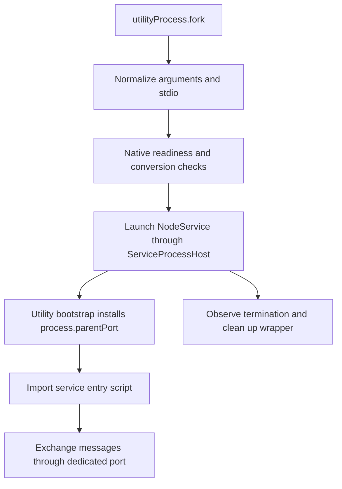

## Overview

`utilityProcess.fork` starts a Node service through Chromium's ServiceProcessHost and returns an EventEmitter wrapper for its lifecycle, messages, and output. The child receives `process.parentPort` for communication with its parent. This flow uses its own message pipe; renderer channel registration and dispatch belong to [[Interprocess Communication]]. Both rely on native serialization and transferred ports, but their public routing interfaces differ.

Sources: [lib/browser/api/utility-process.ts:9-14](repo://lib/browser/api/utility-process.ts#L9-L14), [lib/browser/api/utility-process.ts:134-152](repo://lib/browser/api/utility-process.ts#L134-L152), [shell/browser/api/electron_api_utility_process.cc:158-210](repo://shell/browser/api/electron_api_utility_process.cc#L158-L210), [lib/utility/init.ts:18-23](repo://lib/utility/init.ts#L18-L23)

## Validate fork arguments

The JavaScript constructor requires a truthy module path. Omitted arguments become an empty list; an object supplied in the arguments position becomes the options object. Options are copied before normalization. `execArgv` must be an array when present, while `serviceName` and `cwd` must be strings. The native creation binding additionally converts the script arguments, environment map, and execution arguments, returning TypeErrors when those conversions fail.

Sources: [lib/browser/api/utility-process.ts:13-53](repo://lib/browser/api/utility-process.ts#L13-L53), [shell/browser/api/electron_api_utility_process.cc:447-476](repo://shell/browser/api/electron_api_utility_process.cc#L447-L476)

Native creation also requires application readiness. Forking before that gate throws `utilityProcess cannot be created before app is ready`. The entry script is part of NodeServiceParams, along with the supplied argument list and execution arguments. Use the readiness point introduced in [[Quickstart]] before starting a utility service as part of application setup.

Sources: [shell/browser/api/electron_api_utility_process.cc:438-476](repo://shell/browser/api/electron_api_utility_process.cc#L438-L476), [docs/fiddles/quick-start/main.js:16-24](repo://docs/fiddles/quick-start/main.js#L16-L24)

## Configure standard output and environment

The wrapper supports `inherit`, `ignore`, and `pipe` as string stdio modes, expanding them into a three-element configuration whose stdin is always ignored. In pipe mode it creates PassThrough streams for stdout and stderr. Array configuration requires at least three entries and rejects stdin values other than `ignore`; stdout and stderr independently accept those same three modes.

Sources: [lib/browser/api/utility-process.ts:55-91](repo://lib/browser/api/utility-process.ts#L55-L91)

| Configuration | Parent-side behavior |
| --- | --- |
| Omitted stdio | Native defaults ignore stdin and inherit stdout and stderr |
| `inherit` | Output uses inherited handles rather than wrapper streams |
| `ignore` | Native output is directed to null handles or `/dev/null` |
| `pipe` | Native descriptors are connected to the wrapper's PassThrough streams |

Sources: [shell/browser/api/electron_api_utility_process.cc:81-155](repo://shell/browser/api/electron_api_utility_process.cc#L81-L155), [shell/browser/api/electron_api_utility_process.cc:483-494](repo://shell/browser/api/electron_api_utility_process.cc#L483-L494), [lib/browser/api/utility-process.ts:55-91](repo://lib/browser/api/utility-process.ts#L55-L91), [lib/browser/api/utility-process.ts:110-115](repo://lib/browser/api/utility-process.ts#L110-L115)

The service launch applies the display name, execution switches, and working directory. An empty environment map preserves the parent environment; a nonempty map requests environment clearing before applying supplied values. That exact empty-map branch matters when preparing a restricted environment: passing an empty object follows the inheritance path in this implementation. On macOS an option can select the plugin helper variant used for loading unsigned libraries.

Sources: [shell/browser/api/electron_api_utility_process.cc:164-191](repo://shell/browser/api/electron_api_utility_process.cc#L164-L191), [shell/browser/api/electron_api_utility_process.cc:497-499](repo://shell/browser/api/electron_api_utility_process.cc#L497-L499)

## Launch the service and load its entry

Native construction registers a service-process observer, binds a NodeService receiver, and launches through ServiceProcessHost with a launch callback. It installs a disconnect handler and creates a separate MessagePortDescriptorPair for `postMessage`. The comment gives the reason for the separate pipe: messages can queue without blocking other interfaces on the service receiver.

Sources: [shell/browser/api/electron_api_utility_process.cc:158-210](repo://shell/browser/api/electron_api_utility_process.cc#L158-L210)

Inside the child, utility initialization reads the hidden startup script, replaces the bootstrap argument in `process.argv`, and imports common runtime setup. It installs a non-writable, enumerable `process.parentPort`, then loads the entry through Node's ESM entry-point loader using a file URL. A rejected import is sent to Node's internal uncaught-exception mechanism.

Sources: [lib/utility/init.ts:6-23](repo://lib/utility/init.ts#L6-L23), [lib/utility/init.ts:38-50](repo://lib/utility/init.ts#L38-L50)

Sources: [lib/browser/api/utility-process.ts:13-119](repo://lib/browser/api/utility-process.ts#L13-L119), [shell/browser/api/electron_api_utility_process.cc:438-476](repo://shell/browser/api/electron_api_utility_process.cc#L438-L476), [shell/browser/api/electron_api_utility_process.cc:158-210](repo://shell/browser/api/electron_api_utility_process.cc#L158-L210), [lib/utility/init.ts:18-50](repo://lib/utility/init.ts#L18-L50)

## Exchange messages and transfer ports

The parent wrapper's `postMessage` unwraps any MessagePortMain values in the transfer array before calling the native handle. Native sending requires the NodeService connection to remain connected, serializes the message using structured clone, validates transferred ports, and sends through the connector. Failed serialization or an invalid transfer produces an error before the message is accepted by the connector.

Sources: [lib/browser/api/utility-process.ts:134-140](repo://lib/browser/api/utility-process.ts#L134-L140), [shell/browser/api/electron_api_utility_process.cc:332-385](repo://shell/browser/api/electron_api_utility_process.cc#L332-L385)

The child ParentPort is an EventEmitter wrapper around the `electron_utility_parent_port` binding. Its `postMessage`, `start`, and `pause` methods delegate to that binding. Utility initialization starts delivery when the first `message` listener is added and pauses delivery after the last is removed. Listener presence therefore controls incoming delivery rather than requiring the entry script to manage the port's start and pause transitions manually.

Sources: [lib/utility/parent-port.ts:1-32](repo://lib/utility/parent-port.ts#L1-L32), [lib/utility/init.ts:25-36](repo://lib/utility/init.ts#L25-L36)

## Termination and wrapper cleanup

The native layer watches normal termination, crashes, and a designated process-exit disconnect reason. Its termination handler removes process bookkeeping, closes the connector, emits `exit`, and unpins the wrapper. On POSIX, a process killed through this wrapper can have SIGTERM or SIGKILL normalized to exit code 0; the comment explains that this represents the expected result of its termination path rather than an arbitrary service failure.

Sources: [shell/browser/api/electron_api_utility_process.cc:244-315](repo://shell/browser/api/electron_api_utility_process.cc#L244-L315)

When JavaScript receives `exit`, it emits the application event inside a `try` and clears the handle and output references in `finally`. Output listeners are removed before the streams are released. The `pid` getter reads through the optional native handle, and `kill` returns false once that handle is null. This cleanup still runs if an application's exit listener throws.

Sources: [lib/browser/api/utility-process.ts:93-131](repo://lib/browser/api/utility-process.ts#L93-L131), [lib/browser/api/utility-process.ts:142-147](repo://lib/browser/api/utility-process.ts#L142-L147)
