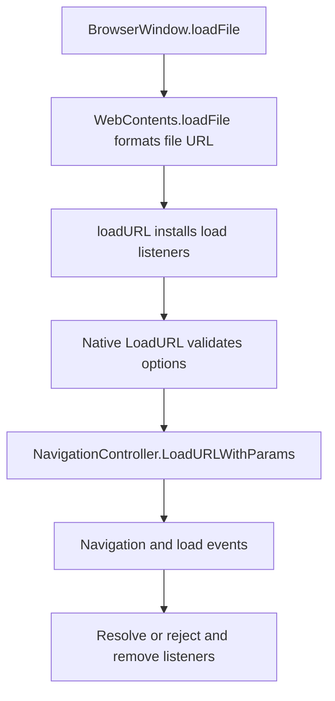

## Overview

A BrowserWindow combines a native desktop window with a WebContentsView and its WebContents. The native constructor prepares web preferences, creates the view, saves and observes the WebContents, associates it with the owner window, and installs the view into the native content hierarchy. [[Application Startup]] explains the prerequisite module initialization; this page follows construction through document loading and window lifecycle events.

Sources: [shell/browser/api/electron_api_browser_window.cc:30-98](repo://shell/browser/api/electron_api_browser_window.cc#L30-L98), [lib/browser/init.ts:158-160](repo://lib/browser/init.ts#L158-L160)

## Window initialization and identity

The JavaScript BrowserWindow prototype inherits from BaseWindow and invokes its `_init`. BrowserWindow captures its ID as a non-writable property at construction, so it remains accessible after the native window is destroyed. Its `setBounds` wrapper merges incoming fields with current bounds before calling the native method. Focus and blur events are also forwarded to `app`, carrying the originating window.

Sources: [lib/browser/api/browser-window.ts:1-38](repo://lib/browser/api/browser-window.ts#L1-L38)

Window lookup methods reuse BaseWindow's registry. `fromId` returns only objects whose constructor identifies them as BrowserWindow, while `getAllWindows` filters the registry with the same check. `getFocusedWindow` excludes destroyed windows and WebContents, then accepts focus on either the window or its developer tools. `fromWebContents` follows the WebContents' owner-window association.

Sources: [lib/browser/api/browser-window.ts:101-129](repo://lib/browser/api/browser-window.ts#L101-L129)

## From file path to native navigation

`BrowserWindow.loadURL` and `loadFile` forward directly to WebContents. `WebContents.loadFile` requires a string, resolves it against `app.getAppPath()`, and formats a file URL with optional query, search, and hash fields. The example in [[Quickstart]] therefore loads its document using the application path established during entry resolution, rather than the shell's working directory.

Sources: [lib/browser/api/browser-window.ts:131-143](repo://lib/browser/api/browser-window.ts#L131-L143), [lib/browser/api/web-contents.ts:324-337](repo://lib/browser/api/web-contents.ts#L324-L337), [default_app/main.ts:126-137](repo://default_app/main.ts#L126-L137)

`WebContents.loadURL` creates an event-backed promise before calling native `_loadURL`. Native `WebContents::LoadURL` rejects an invalid or oversized URL by emitting `did-fail-load`. For valid input it builds Chromium `LoadURLParams`, applying referrer, user agent, headers, POST data, data-URL base, and cache-bypass options when supplied. The final navigation call goes to Chromium's navigation controller.

Sources: [lib/browser/api/web-contents.ts:427-432](repo://lib/browser/api/web-contents.ts#L427-L432), [shell/browser/api/electron_api_web_contents.cc:2331-2395](repo://shell/browser/api/electron_api_web_contents.cc#L2331-L2395)

Sources: [lib/browser/api/browser-window.ts:141-143](repo://lib/browser/api/browser-window.ts#L141-L143), [lib/browser/api/web-contents.ts:324-359](repo://lib/browser/api/web-contents.ts#L324-L359), [lib/browser/api/web-contents.ts:410-432](repo://lib/browser/api/web-contents.ts#L410-L432), [shell/browser/api/electron_api_web_contents.cc:2331-2404](repo://shell/browser/api/electron_api_web_contents.cc#L2331-L2404)

The native layer checks whether starting a navigation is safe while another navigation call remains on the stack. It emits `ERR_FAILED` if that check fails. Before starting accepted navigation it discards uncommitted entries; afterward it checks a weak pointer because emitted JavaScript events can destroy the wrapper. Only a surviving WebContents receives the user-activation notification needed for `beforeunload` handling.

Sources: [shell/browser/api/electron_api_web_contents.cc:2374-2404](repo://shell/browser/api/electron_api_web_contents.cc#L2374-L2404)

## Load completion and failure

The promise stores the first main-frame load error and resolves on successful completion when no error was stored. A rejection includes `errno`, `code`, and `url` properties as well as a descriptive message. Each terminal path removes the listeners installed for finish, failure, in-page navigation, navigation start, loading stop, and destruction, preventing one completed operation from continuing to observe later loads.

Sources: [lib/browser/api/web-contents.ts:342-361](repo://lib/browser/api/web-contents.ts#L342-L361), [lib/browser/api/web-contents.ts:383-423](repo://lib/browser/api/web-contents.ts#L383-L423)

A second unrelated main-frame navigation rejects the earlier operation with `ERR_ABORTED`. Same-document transitions are treated separately so virtual routing through URL state changes can occur without aborting a page load. A load that stops without a finish or failure event receives a generic `ERR_FAILED`; destruction uses the same stop listener. The implementation also attaches a no-op catch to the returned promise to suppress unhandled rejection reporting, while still returning the original promise for callers to observe.

Sources: [lib/browser/api/web-contents.ts:363-432](repo://lib/browser/api/web-contents.ts#L363-L432)

## Responsiveness and visibility

BrowserWindow delays a WebContents `unresponsive` event by 50 milliseconds and emits only if the window still exists and is enabled. A responsive event clears the pending timer and forwards `responsive`. Closing schedules a five-second check in a microtask when closure was not prevented; WebContents destruction clears outstanding responsiveness work.

Sources: [lib/browser/api/browser-window.ts:40-65](repo://lib/browser/api/browser-window.ts#L40-L65)

Visibility is computed as visible and not minimized. On show, hide, minimize, maximize, and restore, a change in that computed state emits the internal `-window-visibility-change` event on WebContents. This is separate from navigation completion: a document can finish loading without changing whether its owning window is visible. Renderer bootstrap and preload execution are covered in [[Renderer Isolation and Preloads]].

Sources: [lib/browser/api/browser-window.ts:67-81](repo://lib/browser/api/browser-window.ts#L67-L81), [lib/sandboxed_renderer/init.ts:55-71](repo://lib/sandboxed_renderer/init.ts#L55-L71)

## Child window policy and ownership

`setWindowOpenHandler` stores the application's handler. Its response must be a non-null object with `action` equal to `allow` or `deny`; malformed responses and explicit denial prevent the event. An allow response can supply constructor overrides, `outlivesOpener`, and a custom creation function. With no registered handler, the wrapper returns its default response without preventing the event.

Sources: [lib/browser/api/web-contents.ts:435-477](repo://lib/browser/api/web-contents.ts#L435-L477)

The guest-window manager merges parsed features and main-process overrides into window options. It reuses a living window with the same registered frame name, otherwise creates a BrowserWindow or uses the custom creation function. A custom function receiving an existing guest must return that same WebContents. Newly constructed windows are navigated by the browser only when no guest WebContents was supplied, then the embedder receives `did-create-window`.

Sources: [lib/browser/guest-window-manager.ts:29-102](repo://lib/browser/guest-window-manager.ts#L29-L102)

By default, deleting the opener's current render view destroys the guest; `outlivesOpener` disables that subscription. Frame names are unregistered when guests are destroyed. Preference construction also has a deliberate precedence: parsed renderer preferences, inherited restrictive settings, then trusted main-process overrides. The code explains this ordering as preventing renderer changes to protected options while allowing the main process to change them.

Sources: [lib/browser/guest-window-manager.ts:104-174](repo://lib/browser/guest-window-manager.ts#L104-L174)
