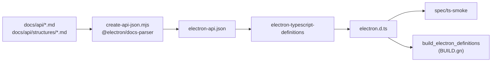

## Overview

In Electron the Markdown files in `docs/api/` are not only documentation: they are the source of the TypeScript definitions (`electron.d.ts`) that users and Electron's own code are type-checked against. A parser reads the structured Markdown into `electron-api.json`, a generator turns that JSON into `electron.d.ts`, and the same files are listed as inputs to the build so changing a doc changes the build. This page follows `dialog.showSaveDialog` from its Markdown to its type and its implementation, and covers the conventions the parser relies on and the linters that enforce them.

Sources: [docs/development/creating-api.md:37-39](repo://docs/development/creating-api.md#L37-L39), [script/create-api-json.mjs:1-18](repo://script/create-api-json.mjs#L1-L18)

Sources: [script/create-api-json.mjs:8-14](repo://script/create-api-json.mjs#L8-L14), [package.json:79-81](repo://package.json#L79-L81), [BUILD.gn:157-163](repo://BUILD.gn#L157-L163)

## From Markdown to electron.d.ts

`script/create-api-json.mjs` calls `parseDocs` from `@electron/docs-parser` with the repository root as base directory, single-package mode, no README, and the current Electron version, and writes the result to `electron-api.json` in the repository root.

Sources: [script/create-api-json.mjs:1-18](repo://script/create-api-json.mjs#L1-L18)

The npm scripts chain the steps. `create-typescript-definitions` runs `create-api-json`, then `electron-typescript-definitions --api=electron-api.json` (from `@electron/typescript-definitions`), then the type-check smoke test in `spec/ts-smoke`. `gn-typescript-definitions` runs that and copies `electron.d.ts` to a destination, which is how GN drives it. `pretest` runs it so the test suite always has fresh types (see [[Testing]]).

Sources: [package.json:79-81](repo://package.json#L79-L81), [package.json:87](repo://package.json#L87-L87), [spec/ts-smoke/runner.js:1-18](repo://spec/ts-smoke/runner.js#L1-L18)

In the build, `build_electron_definitions` is an `npm_action` whose output is `tsc/typings/electron.d.ts` under the generated directory and whose inputs are `auto_filenames.api_docs` plus `yarn.lock`. The comment above it says the generated copy is used by the build and a second one in the repository root by IDEs. Every JavaScript bundle target depends on it, so a changed doc rebuilds the TypeScript bundles; `filenames.auto.gni` records every `docs/api` file for that purpose, generated by `gen-filenames.ts` (see [[Build System]]).

Sources: [BUILD.gn:155-172](repo://BUILD.gn#L155-L172), [script/gen-filenames.ts:9-14](repo://script/gen-filenames.ts#L9-L14), [script/gen-filenames.ts:100-112](repo://script/gen-filenames.ts#L100-L112)

`typings/` contains hand-written declarations for what the docs do not describe. `internal-electron.d.ts` references the generated `electron.d.ts` and, as its header says, augments the `Electron` namespace with undocumented internal APIs, for example `app.setVersion`, `app.setAppPath` and the `ProcessType` enum. `internal-ambient.d.ts` declares the build-time constant `BUILDFLAG`, internal Node module members such as `_load` and `wrapper`, and the typed overloads for each `process._linkedBinding` name (see [[Module Loading and Linked Bindings]]).

Sources: [typings/internal-electron.d.ts:1-20](repo://typings/internal-electron.d.ts#L1-L20), [typings/internal-ambient.d.ts:1-20](repo://typings/internal-ambient.d.ts#L1-L20), [typings/internal-ambient.d.ts:219-222](repo://typings/internal-ambient.d.ts#L219-L222)

## The doc conventions the parser reads

Because the Markdown is parsed, its structure is a contract, and `docs/development/style-guide.md` spells it out. A module page starts with the module's real exported name as its title and a one-line `>` description. Modules list `## Methods` and `## Events`. Classes get a `## Class: Name` chapter, with `### Static Methods`, `### Instance Methods`, `### Instance Events` and `### Instance Properties` below it, and constructors under `###`.

Sources: [docs/development/style-guide.md:66-122](repo://docs/development/style-guide.md#L66-L122)

A method heading is the signature, ``### `objectName.methodName(required[, optional])` ``, where a class's methods use an instance variable name that differs from the module's (the style guide's example is `ses` for `Session`). Parameters follow as a bulleted list with the form `name type (optional) - description`: types are JavaScript primitives, Electron structures such as `Cookie` (linked to `structures/*.md`), `any`, `Type[]` for arrays, `Promise<T>` for promises, with `|` for unions. A return value is described by a sentence starting "Returns `[TYPE]` - ...". Platform-specific members carry italic tags (`_macOS_`, `_Windows_`, `_Linux_`) after the type.

Sources: [docs/development/style-guide.md:158-219](repo://docs/development/style-guide.md#L158-L219)

Events use `### Event: 'name'` with a `Returns:` list, properties use the property's dotted name as the heading, and every class or method can carry an API History block: YAML in an HTML comment directly under the heading that records `added`, `changes` and `deprecated` entries with PR URLs, validated against `docs/api-history.schema.json`. The `api-history-migration-guide.md` shows how to find the right PRs for older APIs: the breaking-changes document, `git blame` and release notes.

Sources: [docs/development/style-guide.md:221-300](repo://docs/development/style-guide.md#L221-L300), [docs/development/api-history-migration-guide.md:5-45](repo://docs/development/api-history-migration-guide.md#L5-L45)

## One method end to end: dialog.showSaveDialog

The documentation entry in `docs/api/dialog.md` is a heading ``### `dialog.showSaveDialog([window, ]options)` `` followed by the `window` and `options` bullets (with `_macOS_`, `_Windows_` and `_Linux_` tags on `message`, `nameFieldLabel`, `dontAddToRecent`, `showOverwriteConfirmation`...) and a line "Returns `Promise<Object>` - Resolve with an object containing the following:" listing `canceled`, `filePath` and an optional `bookmark`. The parser turns the optional first argument, the nested options and the object return into the TypeScript signature that `electron.d.ts` carries for `Dialog.showSaveDialog`.

Sources: [docs/api/dialog.md:203-232](repo://docs/api/dialog.md#L203-L232)

The implementation in `lib/browser/api/dialog.ts` imports its types from `electron/main`, so the doc-derived definitions constrain it. It declares overloads, `showSaveDialog(window, options)` and `showSaveDialog(options)`, and one implementation that decides which argument is the window with `instanceof BaseWindow` before calling the shared `saveDialog(false, window, options)`. The `Sync` variant passes `true`.

Sources: [lib/browser/api/dialog.ts:1-4](repo://lib/browser/api/dialog.ts#L1-L4), [lib/browser/api/dialog.ts:257-271](repo://lib/browser/api/dialog.ts#L257-L271)

`saveDialog` validates option types, builds a `settings` object and calls the native binding, which returns a promise for the asynchronous form (see [[Module Loading and Linked Bindings]] and [[Gin Helpers, Converters and Wrappables]]). The Markdown's description of the returned `filePath` and `canceled` is what the native `Promise<gin_helper::Dictionary>` ultimately has to produce.

Sources: [lib/browser/api/dialog.ts:76-112](repo://lib/browser/api/dialog.ts#L76-L112), [shell/browser/api/electron_api_dialog.cc:79-87](repo://shell/browser/api/electron_api_dialog.cc#L79-L87)

## Adding an API

The contributor guide in `docs/development/creating-api.md` lists the steps for a new browser module: add the C++ files, alphabetically, to the right list in `filenames.gni` (with optional per-platform lists), write the API documentation (without a `.md` file the type will not appear in `electron.d.ts`), and implement the object template and `Wrappable`, as in the examples under `shell/browser/api`. The binding registration and `lib/` wrapper steps are in [[Module Loading and Linked Bindings]], and the per-platform file lists in [[Build System]].

Sources: [docs/development/creating-api.md:7-47](repo://docs/development/creating-api.md#L7-L47)

## Linting

`npm run lint` runs `script/lint.js` and then `lint:docs`. `lint.js` has a linter definition per language: `cpp` (clang-format and cpplint over `shell/`), `objc`, `python`, `javascript` (ESLint), `gn`, `patches` and `md`; with no mode flag it runs every one, and each finds its own files with a root and a test function. A short ignore list covers vendored or generated files such as `node_includes.h`.

Sources: [package.json:64-72](repo://package.json#L64-L72), [script/lint.js:23-27](repo://script/lint.js#L23-L27), [script/lint.js:116-135](repo://script/lint.js#L116-L135), [script/lint.js:486-504](repo://script/lint.js#L486-L504)

`lint:docs` is the doc-specific chain: `remark` with the markdown style guide preset, linting of the JavaScript in Markdown code blocks, `create-typescript-definitions` (so a doc the parser cannot read fails here), a TypeScript check of the code blocks, the fiddles under `docs/fiddles` with `standard`, relative-link checks, Markdown lint and finally `lint:api-history`, which validates every API History block against the schema and checks the placement of the history blocks.

Sources: [package.json:72-78](repo://package.json#L72-L78)
