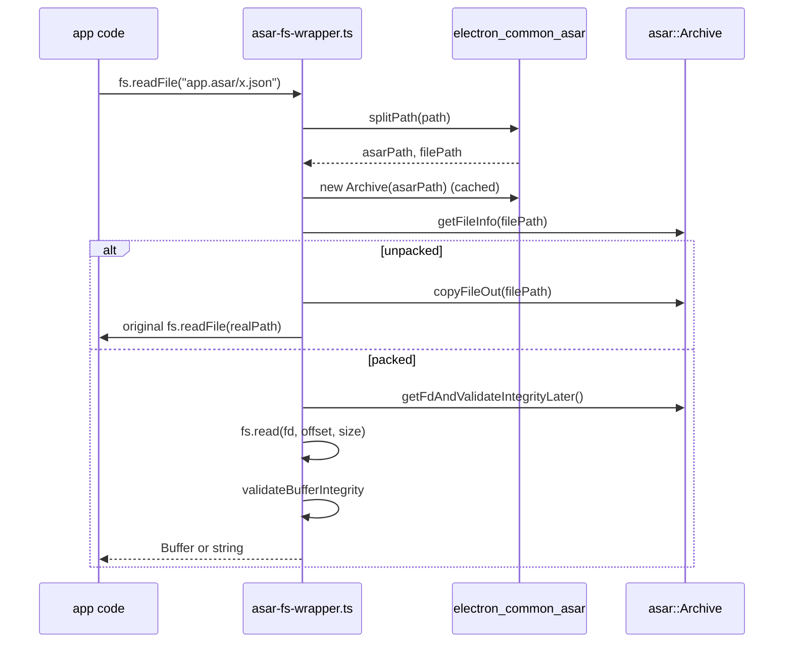

## Overview

An ASAR archive is a single file that holds a directory tree: an 8-byte size prefix, a JSON header describing every file (size, offset, unpacked flag, optional integrity data), then the concatenated file contents. Electron lets code treat `app.asar` as a directory. Three layers cooperate: the C++ `asar::Archive` that parses the header and locates files, a Node `fs` wrapper in `lib/node/asar-fs-wrapper.ts` that makes JavaScript `fs` calls on paths inside an archive work, and a URL loader that serves `file://` requests into an archive to the renderer. Two fuses decide how strictly the app is checked. This page follows one `fs.readFile` call into an archive, then the URL path.

Sources: [shell/common/asar/archive.cc:189-266](repo://shell/common/asar/archive.cc#L189-L266), [lib/node/asar-fs-wrapper.ts:9-50](repo://lib/node/asar-fs-wrapper.ts#L9-L50)

## The archive format and parser

`Archive::Init` opens the file, reads the first 8 bytes as a Pickle holding the header size, reads that many bytes, and parses a Pickle string as the JSON header into a dictionary. The body of every file starts at `header_size_ = 8 + size` plus its own `offset`. Any step that fails logs and returns false, so `GetOrCreateAsarArchive` returns null for a missing or corrupt archive.

Sources: [shell/common/asar/archive.cc:189-266](repo://shell/common/asar/archive.cc#L189-L266)

Header nodes are looked up by walking path components through each directory's `files` dictionary. A node with a `link` is resolved by following the link, and a directory can itself be a link. `FillFileInfoWithNode` reads `size`, `unpacked`, the string `offset` (parsed as uint64 and shifted by the header size) and `executable`. A node marked `unpacked` returns early: its bytes are not in the archive but in a sibling `<name>.asar.unpacked` directory.

Sources: [shell/common/asar/archive.cc:40-89](repo://shell/common/asar/archive.cc#L40-L89), [shell/common/asar/archive.cc:91-118](repo://shell/common/asar/archive.cc#L91-L118), [shell/common/asar/archive.cc:372-375](repo://shell/common/asar/archive.cc#L372-L375)

The public operations are small: `GetFileInfo` (follows links), `Stat` (reports link, directory or file), `Readdir` (the names under a directory's `files`), `Realpath` (resolves a link inside the archive) and `CopyFileOut`. `CopyFileOut` serves callers that need a real file, for example to `dlopen` a native module or to `exec` a binary: for an unpacked file it returns the path in the `.unpacked` directory; otherwise it extracts the bytes into a `ScopedTemporaryFile` (keeping the original extension and marking it `0755` if `executable`), and remembers the temp file per path under a lock so repeated calls reuse it.

Sources: [shell/common/asar/archive.cc:279-354](repo://shell/common/asar/archive.cc#L279-L354), [shell/common/asar/archive.cc:356-393](repo://shell/common/asar/archive.cc#L356-L393)

`asar_util.cc` provides the helpers used everywhere. `GetAsarArchivePath` splits a full path into the archive path and the relative path inside it by walking upward until a component with an `.asar` extension that is not a directory on disk (the directory check is cached) is found. `GetOrCreateAsarArchive` keeps a process-wide, lock-protected cache of `Archive` objects keyed by path. `ReadFileToString` reads from the archive at the computed offset, or from the unpacked copy, and validates integrity if the file has it.

Sources: [shell/common/asar/asar_util.cc:25-101](repo://shell/common/asar/asar_util.cc#L25-L101), [shell/common/asar/asar_util.cc:103-135](repo://shell/common/asar/asar_util.cc#L103-L135)

## Following fs.readFile into an archive

Sources: [lib/node/asar-fs-wrapper.ts:599-664](repo://lib/node/asar-fs-wrapper.ts#L599-L664), [lib/node/asar-fs-wrapper.ts:71-87](repo://lib/node/asar-fs-wrapper.ts#L71-L87)

`lib/node/init.ts` calls `wrapFsWithAsar(require('fs'))` at start-up in every process that has Node (see [[Node.js Integration and the Event Loop]]). The wrapper keeps the original function and replaces it with one that first calls `splitPath`. For a path that is not in an archive, `fs.readFile` calls the original unchanged; only archive paths take the new route.

Sources: [lib/node/init.ts:3-5](repo://lib/node/init.ts#L3-L5), [lib/node/asar-fs-wrapper.ts:656-664](repo://lib/node/asar-fs-wrapper.ts#L656-L664)

`splitPath` is the fast check. It returns "not asar" when ASAR is disabled (`process.noAsar`, or `ELECTRON_NO_ASAR` outside browser and renderer processes), when the argument is not a string, `Buffer` or `URL`, or when the string does not match `/\.asar/i`; otherwise it asks the native `splitPath`, which uses `GetAsarArchivePath`.

Sources: [lib/node/asar-fs-wrapper.ts:15-18](repo://lib/node/asar-fs-wrapper.ts#L15-L18), [lib/node/asar-fs-wrapper.ts:71-87](repo://lib/node/asar-fs-wrapper.ts#L71-L87), [shell/common/api/electron_api_asar.cc:191-210](repo://shell/common/api/electron_api_asar.cc#L191-L210)

`getOrCreateArchive` caches `asar.Archive` objects in a `Map` and returns null on failure; the native class is a Node `ObjectWrap` over `asar::GetOrCreateAsarArchive` with `getFileInfo`, `stat`, `readdir`, `realpath`, `copyFileOut` and `getFdAndValidateIntegrityLater`. The last one returns the archive's file descriptor, as the name implies, and integrity is checked afterwards in JavaScript.

Sources: [lib/node/asar-fs-wrapper.ts:29-47](repo://lib/node/asar-fs-wrapper.ts#L29-L47), [shell/common/api/electron_api_asar.cc:16-64](repo://shell/common/api/electron_api_asar.cc#L16-L64), [shell/common/api/electron_api_asar.cc:179-189](repo://shell/common/api/electron_api_asar.cc#L179-L189)

`fsReadFileAsar` handles the archive case. It normalizes `options`, reports `INVALID_ARCHIVE` or `NOT_FOUND` through `nextTick(callback, [error])`, short-circuits an empty file, and for an unpacked file copies it out and calls the real `fs.readFile` on the real path. For a packed file it allocates a buffer of `info.size`, takes the descriptor, reads at `info.offset` with `fs.read`, runs `validateBufferIntegrity` and calls back with a buffer or an encoded string. `readFileSync` has the same structure with `readSync`, and `fs.promises.readFile` promisifies the callback version.

Sources: [lib/node/asar-fs-wrapper.ts:599-675](repo://lib/node/asar-fs-wrapper.ts#L599-L675), [lib/node/asar-fs-wrapper.ts:677-722](repo://lib/node/asar-fs-wrapper.ts#L677-L722)

Functions that cannot read from the middle of a file go through generic helpers instead. `overrideAPISync` and `overrideAPI` take a module, a function name and the index of its path argument; for an archive path they call `archive.copyFileOut(filePath)` and run the original function on the extracted file, with the same error mapping. `fs.openSync`, the `.node` extension of `Module._extensions` and `child_process.execFile` use this route, while `exec` and `execSync` are wrapped to run with ASAR disabled. Metadata calls (`stat`, `lstat`, `realpath`, `exists`, `access`, `readdir`) are answered from the header with `archive.stat`, `archive.realpath` and `archive.readdir`, and `asarStatsToFsStats` fabricates `fs.Stats` with fixed owner and time values.

Sources: [lib/node/asar-fs-wrapper.ts:185-252](repo://lib/node/asar-fs-wrapper.ts#L185-L252), [lib/node/asar-fs-wrapper.ts:1238-1260](repo://lib/node/asar-fs-wrapper.ts#L1238-L1260), [lib/node/asar-fs-wrapper.ts:89-147](repo://lib/node/asar-fs-wrapper.ts#L89-L147)

Node's module loader needs the same view. The wrapper replaces the internal `internalModuleStat` binding so `require('app.asar/main.js')` can stat inside an archive. The wrapper also deletes `process.internalBinding` after capturing it, and exposes `process._getOrCreateArchive`, which `lib/browser/init.ts` borrows to test that `app.asar` is a valid archive before loading `package.json`; see [[Main Process Startup]].

Sources: [lib/node/asar-fs-wrapper.ts:20-47](repo://lib/node/asar-fs-wrapper.ts#L20-L47), [lib/node/asar-fs-wrapper.ts:1012-1020](repo://lib/node/asar-fs-wrapper.ts#L1012-L1020), [lib/browser/init.ts:85-100](repo://lib/browser/init.ts#L85-L100)

## Serving archive files to pages

Renderer requests do not go through `fs`. When the `GrantFileProtocolExtraPrivileges` fuse is on, `ProtocolRegistry` replaces (or adds) the `file:` URL loader factory with `AsarURLLoaderFactory`, which forwards every request to `asar::CreateAsarURLLoader` with empty response headers. The registry code comments that Chromium may add its own file factory later without overriding Electron's, and that asar support should be rechecked if that changes. See [[Sessions, Protocols and Networking]].

Sources: [shell/browser/protocol_registry.cc:23-41](repo://shell/browser/protocol_registry.cc#L23-L41), [shell/browser/net/asar/asar_url_loader_factory.cc:14-39](repo://shell/browser/net/asar/asar_url_loader_factory.cc#L14-L39)

`AsarURLLoader` checks whether the path is inside an archive. If it is not, it hands the request to Chromium's normal file loader (bypassing its security checks). Otherwise it fetches the archive and `FileInfo`, failing with `ERR_FILE_NOT_FOUND` if either is missing; for an unpacked file it copies out and reads the real file at offset 0. It opens a fresh `base::File` (the comment says the archive's own handle could be used by several requests at once), sets up a mojo data pipe and, when the file has integrity data, wraps the data source in a `FilteredDataSource` with an `AsarFileValidator` so every block is verified as it streams. Mime type comes from the file extension, with sniffing as a fallback.

Sources: [shell/browser/net/asar/asar_url_loader.cc:105-175](repo://shell/browser/net/asar/asar_url_loader.cc#L105-L175), [shell/browser/net/asar/asar_url_loader.cc:255-268](repo://shell/browser/net/asar/asar_url_loader.cc#L255-L268)

## Integrity and the fuses

Integrity validation is controlled by the `embedded_asar_integrity_validation` fuse and is compiled only for macOS and Windows. When it is on, `Archive::Init` requires the archive to have a relative path and a header integrity record, and calls `ValidateIntegrityOrDie` on the header; failing to find a record, or a hash that is not SHA256, ends in `LOG(FATAL)`. After that every file's node must carry `integrity` (algorithm, hash, block size and block hashes), or reading its info is fatal. `ValidateIntegrityOrDie` hex-encodes a SHA-256 of the data and compares it with the record, aborting on mismatch. In JavaScript, `validateBufferIntegrity` does the same for buffers read through `fs` and calls `process.exit(1)` after logging "ASAR Integrity Violation". On other platforms `HeaderIntegrity` and `RelativePath` just return nothing.

Sources: [shell/common/asar/archive.cc:116-156](repo://shell/common/asar/archive.cc#L116-L156), [shell/common/asar/archive.cc:234-277](repo://shell/common/asar/archive.cc#L234-L277), [shell/common/asar/asar_util.cc:137-149](repo://shell/common/asar/asar_util.cc#L137-L149), [lib/node/asar-fs-wrapper.ts:254-265](repo://lib/node/asar-fs-wrapper.ts#L254-L265)

The related `only_load_app_from_asar` fuse narrows where Electron looks for the app to `app.asar` alone, so that together with integrity validation unvalidated code cannot be loaded. The fuse defaults are declared in `build/fuses/fuses.json5` (integrity validation and only-load-from-asar both `0`, `grant_file_protocol_extra_privileges` `1`), which the schema comment says must never remove or change the meaning of a fuse. How the build consumes the file is covered in [[Build System]].

Sources: [build/fuses/fuses.json5:1-13](repo://build/fuses/fuses.json5#L1-L13), [docs/tutorial/fuses.md:55-61](repo://docs/tutorial/fuses.md#L55-L61), [shell/common/node_bindings.cc:680-700](repo://shell/common/node_bindings.cc#L680-L700)
