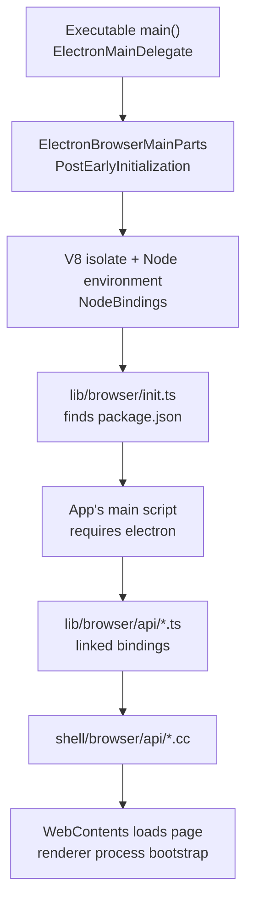

## Overview

Electron lets developers write cross-platform desktop applications with JavaScript, HTML and CSS. It is built on Node.js and Chromium, and this repository holds the glue that joins them: the C++ "shell" that embeds Node inside Chromium's content layer, the TypeScript that implements the `electron` module, and the patches, build files and scripts that produce a release.

Sources: [README.md:9-12](repo://README.md#L9-L12)

The source tree follows Chromium's conventions: `shell/` is the C++ for each process type, `lib/` is the JavaScript that runs inside them, and `patches/` holds the changes Electron applies to its upstream dependencies.

Sources: [docs/development/source-code-directory-structure.md:3-8](repo://docs/development/source-code-directory-structure.md#L3-L8), [docs/development/source-code-directory-structure.md:25-55](repo://docs/development/source-code-directory-structure.md#L25-L55)

## Parts of the repository

| Area | What it does | Read |
| --- | --- | --- |
| `shell/app`, `shell/browser` | Process entry, browser main parts, windows, sessions, native UI | [[Main Process Startup]], [[Windows, Views and Native Window Backends]] |
| `shell/common` | Code shared by all processes: Node bindings, gin helpers, ASAR | [[Node.js Integration and the Event Loop]], [[Gin Helpers, Converters and Wrappables]], [[ASAR Archives]] |
| `shell/renderer`, `lib/renderer`, `lib/sandboxed_renderer` | Renderer clients, preload scripts, context bridge | [[Renderer, Preload Scripts and Context Isolation]] |
| `lib/browser`, `lib/common` | The JavaScript half of every API module in the main process | [[Module Loading and Linked Bindings]], [[Process Types and JavaScript Bootstraps]] |
| `shell/browser/api` | C++ classes behind `WebContents`, `Session`, `Menu`, `Tray` and others | [[WebContents and Navigation]], [[Sessions, Protocols and Networking]], [[Native UI and OS Integration Modules]] |
| IPC (`lib/browser`, `lib/renderer`) | `ipcMain` / `ipcRenderer` and message ports | [[IPC Messaging]] |
| `lib/utility`, `shell/services/node`, `lib/worker` | Utility processes and Node in workers | [[Utility Processes and Workers]] |
| `BUILD.gn`, `build/`, `filenames.gni` | GN build, webpack bundles, fuses | [[Build System]] |
| `patches/` | Modifications to Chromium, Node, V8 and other dependencies | [[Patch System]] |
| `spec/` | The test suite | [[Testing]] |
| `script/release` | Release notes, version bump, upload and publish | [[Release Process]] |
| `docs/`, `typings/` | Markdown API docs that generate `electron.d.ts` | [[API Documentation Pipeline]] |

Sources: [docs/development/source-code-directory-structure.md:12-70](repo://docs/development/source-code-directory-structure.md#L12-L70)

To build and run the project see [[Quickstart: Building and Running Electron]].

Sources: [package.json:61-95](repo://package.json#L61-L95)

## Main flow

The flow below follows a launch from the executable to the user's `main` script. After that, everything the app does goes through the `electron` module, whose methods call into C++ bindings.

Sources: [shell/browser/electron_browser_main_parts.cc:225-262](repo://shell/browser/electron_browser_main_parts.cc#L225-L262), [lib/browser/init.ts:82-102](repo://lib/browser/init.ts#L82-L102), [lib/browser/init.ts:201-227](repo://lib/browser/init.ts#L201-L227)

1. The platform `main` and `ElectronMainDelegate` hand control to Chromium's content layer, which calls `ElectronBrowserMainParts`: see [[Main Process Startup]].
2. `PostEarlyInitialization` creates a `JavascriptEnvironment`, a Node environment and loads the JavaScript bootstrap: see [[Node.js Integration and the Event Loop]].
3. `lib/browser/init.ts` locates the app's `package.json`, sets the app name and version, and runs the main script: see [[Process Types and JavaScript Bootstraps]].
4. Every API module is a thin TypeScript file over a native binding registered by name: see [[Module Loading and Linked Bindings]] and [[Gin Helpers, Converters and Wrappables]].
5. Creating a window and loading a URL spawns renderer processes with their own bootstraps: see [[WebContents and Navigation]] and [[Renderer, Preload Scripts and Context Isolation]].

Sources: [shell/browser/electron_browser_main_parts.cc:225-262](repo://shell/browser/electron_browser_main_parts.cc#L225-L262), [lib/browser/init.ts:82-102](repo://lib/browser/init.ts#L82-L102), [lib/browser/init.ts:201-227](repo://lib/browser/init.ts#L201-L227)

## Design decisions

**Node runs in the same V8 isolate as the browser process code.** `PostEarlyInitialization` builds the `JavascriptEnvironment`, then asks `NodeBindings` to initialize it and create the Node environment on that isolate's current context. It also sets `unhandled_rejections` to `"warn-with-error-code"`, with the comment that the main process must not crash on unhandled rejections.

Sources: [shell/browser/electron_browser_main_parts.cc:232-258](repo://shell/browser/electron_browser_main_parts.cc#L232-L258)

**Each process type has its own JavaScript entry.** The main process starts from `lib/browser/init.ts`, which restores `process.argv`, loads the shared `common/init`, and then installs main-process-only pieces (the RPC server and the guest view manager). Renderers, sandboxed renderers, workers and utility processes have sibling `init.ts` files in `lib/`.

Sources: [lib/browser/init.ts:11-17](repo://lib/browser/init.ts#L11-L17), [lib/browser/init.ts:76-80](repo://lib/browser/init.ts#L76-L80)

**JavaScript APIs call native code through named linked bindings.** `init.ts` itself reaches C++ with `process._linkedBinding('electron_browser_event_emitter')` and `electron_common_v8_util`; the full list of browser bindings is declared as a macro in `node_bindings.cc`.

Sources: [lib/browser/init.ts:19](repo://lib/browser/init.ts#L19), [lib/browser/init.ts:83-87](repo://lib/browser/init.ts#L83-L87), [shell/common/node_bindings.cc:53-72](repo://shell/common/node_bindings.cc#L53-L72)

**Upstream projects are patched, not forked in tree.** All changes live as patch files under `patches/`, mapped to the repository each applies to by `patches/config.json`; every patch must justify its existence as temporary, a compile fix, or an incompatible functional change, so the patch count stays minimal.

Sources: [patches/config.json:1-16](repo://patches/config.json#L1-L16), [docs/development/patches.md:5-13](repo://docs/development/patches.md#L5-L13)

**The app is found through a search-path list, so an app without a valid `package.json` aborts.** `init.ts` walks the hidden `appSearchPaths` value under `process.resourcesPath` (optionally only accepting ASAR archives) and exits with "Unable to find a valid app" if none loads. See [[ASAR Archives]].

Sources: [lib/browser/init.ts:82-123](repo://lib/browser/init.ts#L82-L123)

## Next steps

Read [[Quickstart: Building and Running Electron]] to get a working build, then [[Main Process Startup]] to follow the launch in detail. The development commands (`start`, `test`, `lint`, `create-typescript-definitions`) are declared in `package.json`.

Sources: [package.json:61-95](repo://package.json#L61-L95)
