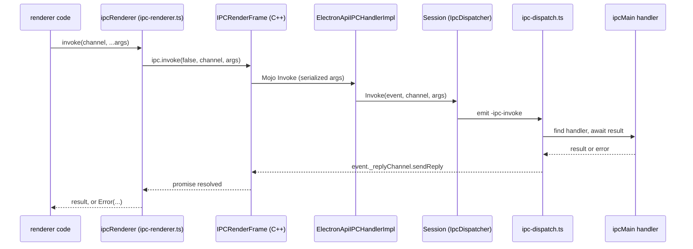

## Overview

Electron's inter-process communication has no custom transport. A renderer talks to the main process through a Mojo associated interface, `ElectronApiIPC`, defined in `shell/common/api/api.mojom`, and the main process talks back through a second interface, `ElectronRenderer`. Both sides translate between Mojo messages and JavaScript `EventEmitter` events, so `ipcRenderer.send` ends in an `ipcMain.on` listener. This page follows `invoke` across the boundary and then covers the other message kinds, internal channels and message ports. The objects that surface these events are `WebContents` and its frames, described in [[WebContents and Navigation]].

Sources: [shell/common/api/api.mojom:8-56](repo://shell/common/api/api.mojom#L8-L56)

## The Mojo interfaces

`ElectronApiIPC` is what a renderer calls. Each method carries an `internal` flag (used for Electron's own channels), a channel name and a `CloneableMessage`: `Message` is fire-and-forget, `Invoke` returns a message, `MessageSync` is marked `[Sync]` and blocks the renderer until answered, `ReceivePostMessage` carries transferable ports, and `MessageHost` is for `sendToHost`. `ElectronRenderer` is the reverse direction: `Message` and `ReceivePostMessage`, plus `TakeHeapSnapshot`.

Sources: [shell/common/api/api.mojom:8-17](repo://shell/common/api/api.mojom#L8-L17), [shell/common/api/api.mojom:28-56](repo://shell/common/api/api.mojom#L28-L56)

## Following invoke: renderer to main

Sources: [lib/renderer/api/ipc-renderer.ts:8-27](repo://lib/renderer/api/ipc-renderer.ts#L8-L27), [shell/renderer/api/electron_api_ipc_renderer.cc:82-106](repo://shell/renderer/api/electron_api_ipc_renderer.cc#L82-L106), [shell/browser/electron_api_ipc_handler_impl.cc:57-71](repo://shell/browser/electron_api_ipc_handler_impl.cc#L57-L71), [shell/browser/api/ipc_dispatcher.h:39-45](repo://shell/browser/api/ipc_dispatcher.h#L39-L45), [lib/browser/ipc-dispatch.ts:76-108](repo://lib/browser/ipc-dispatch.ts#L76-L108)

**1. The renderer API.** `IpcRenderer` is an `EventEmitter` whose methods all forward to a native object with `internal = false`. `invoke` awaits `{ error, result }` and throws `Error("Error invoking remote method '<channel>': <error>")` when the main side reports an error. `getIPCRenderer` creates the native object once per process through the `electron_renderer_ipc` binding, using `createForRenderFrame` in a `renderer` process and `createForServiceWorker` in a `service-worker` one, and throws in anything else. How a preload script exposes this object to a page is covered in [[Renderer, Preload Scripts and Context Isolation]].

Sources: [lib/renderer/api/ipc-renderer.ts:5-34](repo://lib/renderer/api/ipc-renderer.ts#L5-L34), [lib/renderer/ipc-renderer-bindings.ts:1-17](repo://lib/renderer/ipc-renderer-bindings.ts#L1-L17)

**2. The native renderer object.** `IPCBase<T>` in `electron_api_ipc_renderer.cc` implements `send`, `sendSync`, `sendToHost`, `invoke` and `postMessage` as gin methods. Each serializes the arguments with `SerializeV8Value` into a `CloneableMessage` and calls the Mojo remote. `Invoke` creates a `gin_helper::Promise`, returns its handle and resolves it from the Mojo reply callback. If the remote is gone it throws "IPC method called after context was released". `IPCRenderFrame` obtains the remote from the render frame's associated interfaces and drops it on `OnDestruct` or when its script context is released; `IPCServiceWorker` binds through the service worker's proxy instead.

Sources: [shell/renderer/api/electron_api_ipc_renderer.cc:57-106](repo://shell/renderer/api/electron_api_ipc_renderer.cc#L57-L106), [shell/renderer/api/electron_api_ipc_renderer.cc:164-193](repo://shell/renderer/api/electron_api_ipc_renderer.cc#L164-L193), [shell/renderer/api/electron_api_ipc_renderer.cc:199-264](repo://shell/renderer/api/electron_api_ipc_renderer.cc#L199-L264)

**3. The browser-side receiver.** `ElectronBrowserClient` registers `ElectronApiIPCHandlerImpl` for each render frame host, but only for a page's main frame, or for subframes when `nodeIntegrationInSubFrames` is allowed; service workers get `ElectronApiSWIPCHandlerImpl`. The handler resolves the `Session` from the frame's browser context, builds an event object with `MakeIPCEvent` and calls the matching `Session` method. If the session, `WebContents` or wrapper no longer exists, `MakeIPCEvent` still answers a pending callback with an error ("Session does not exist", "WebContents does not exist", "WebContents was destroyed") because, as its comments note, the callback must always be invoked.

Sources: [shell/browser/electron_browser_client.cc:1425-1468](repo://shell/browser/electron_browser_client.cc#L1425-L1468), [shell/browser/electron_api_ipc_handler_impl.cc:20-71](repo://shell/browser/electron_api_ipc_handler_impl.cc#L20-L71), [shell/browser/electron_api_ipc_handler_impl.cc:127-175](repo://shell/browser/electron_api_ipc_handler_impl.cc#L127-L175)

The event it builds has `type: "frame"`, `sender` (the `WebContents`), a hidden `internal` flag when set, `_replyChannel` when the call expects an answer, and a `senderFrame` getter that resolves to the originating frame.

Sources: [shell/browser/electron_api_ipc_handler_impl.cc:161-176](repo://shell/browser/electron_api_ipc_handler_impl.cc#L161-L176)

**4. Dispatch to JavaScript.** `Session` inherits `IpcDispatcher<Session>`, whose methods emit the internal events `-ipc-message`, `-ipc-invoke`, `-ipc-message-sync`, `-ipc-message-host` and `-ipc-ports` on the session. `Session.prototype._init` calls `addIpcDispatchListeners(this)` to subscribe to them.

Sources: [shell/browser/api/ipc_dispatcher.h:25-83](repo://shell/browser/api/ipc_dispatcher.h#L25-L83), [shell/browser/api/electron_api_session.h:67](repo://shell/browser/api/electron_api_session.h#L67-L67), [lib/browser/api/session.ts:25-26](repo://lib/browser/api/session.ts#L25-L26)

**5. Finding the handler.** For `-ipc-invoke`, `ipc-dispatch.ts` picks target emitters: `ipcMainInternal` for internal calls, otherwise, for a frame, the list returned by `getIpcEmittersForFrameEvent`, in priority order: the sending frame's `ipc`, the `WebContents.ipc`, then global `ipcMain`. The first target whose `_invokeHandlers` map has the channel wins; its handler runs and the result is sent with `event._replyChannel.sendReply({ result })`, or `{ error }` with a console message when it throws. With no handler, the error is `No handler registered for '<channel>'`.

Sources: [lib/browser/ipc-dispatch.ts:33-53](repo://lib/browser/ipc-dispatch.ts#L33-L53), [lib/browser/ipc-dispatch.ts:76-108](repo://lib/browser/ipc-dispatch.ts#L76-L108)

The sending frame is looked up by its frame tree node id rather than by render frame host, so a message sent by a frame that is unloading during a cross-origin swap still arrives. The `ipc-dispatch.ts` comment names exactly that case.

Sources: [lib/browser/ipc-dispatch.ts:43-53](repo://lib/browser/ipc-dispatch.ts#L43-L53)

## Handler registries

`ipcMain`, each `webContents.ipc` and each `webFrameMain.ipc` are the same class, `IpcMainImpl`: an `EventEmitter` plus a `_invokeHandlers` map. `handle` throws if a channel already has a handler or the handler is not a function, `handleOnce` removes itself on first use, and the `error` channel gets a no-op listener so an event named "error" does not throw. This is why a more specific registry can answer a channel before the global one.

Sources: [lib/browser/ipc-main-impl.ts:5-35](repo://lib/browser/ipc-main-impl.ts#L5-L35), [lib/browser/api/ipc-main.ts:1-5](repo://lib/browser/api/ipc-main.ts#L1-L5), [lib/browser/api/web-contents.ts:552-556](repo://lib/browser/api/web-contents.ts#L552-L556), [lib/browser/api/web-frame-main.ts:6-12](repo://lib/browser/api/web-frame-main.ts#L6-L12)

## Send, sendSync and sendToHost

For `send` (`-ipc-message`), the main side emits `ipc-message` on the `WebContents`, then the channel on each emitter from `getIpcEmittersForFrameEvent`, after adding `event.reply`, which sends back to the same frame by `[processId, frameId]`. For `sendSync` (`-ipc-message-sync`), `returnValue` is defined as a setter that calls `_replyChannel.sendReply`, and a warning is printed when nobody listens on that channel: otherwise the renderer would be blocked on a reply that never comes. Service worker messages go to `serviceWorker.ipc` instead. `sendToHost` re-emits `-ipc-message-host` on the `WebContents`; that is the path used by `<webview>` embedders.

Sources: [lib/browser/ipc-dispatch.ts:10-22](repo://lib/browser/ipc-dispatch.ts#L10-L22), [lib/browser/ipc-dispatch.ts:58-74](repo://lib/browser/ipc-dispatch.ts#L58-L74), [lib/browser/ipc-dispatch.ts:110-137](repo://lib/browser/ipc-dispatch.ts#L110-L137)

## Main to renderer

`webContents.send` and `postMessage` are implemented on the main frame, and `sendToFrame` accepts a frame id or `[processId, frameId]` and returns false if the frame does not exist. `WebFrameMain.send` and `_sendInternal` check that the channel is a string and call `_send(internal, channel, args)`, logging rather than throwing on failure. On the renderer, `ElectronApiServiceImpl::Message` gets the frame's context, converts the arguments, and calls `ipc_native::EmitIPCEvent`, which calls the `onMessage` function stored in the global private `ipcNative` object. `ipc-native-setup.ts` defines `onMessage` to emit the channel on `ipcRenderer` (or `ipcRendererInternal` when `internal`) with `{ sender, ports }` as the event.

Sources: [lib/browser/api/web-contents.ts:121-148](repo://lib/browser/api/web-contents.ts#L121-L148), [lib/browser/api/web-frame-main.ts:14-43](repo://lib/browser/api/web-frame-main.ts#L14-L43), [shell/renderer/electron_api_service_impl.cc:86-102](repo://shell/renderer/electron_api_service_impl.cc#L86-L102), [shell/renderer/electron_ipc_native.cc:19-81](repo://shell/renderer/electron_ipc_native.cc#L19-L81), [lib/renderer/ipc-native-setup.ts:1-14](repo://lib/renderer/ipc-native-setup.ts#L1-L14)

## Internal channels

The `internal` flag keeps Electron's own traffic apart from application channels. `ipcRendererInternal` is a copy of the renderer API with `internal = true`; on the main side `ipcMainInternal` is another `IpcMainImpl`, and `-ipc-message` and friends route to it when the event's hidden `internal` value is set, so an app's `ipcMain.handle('same-name')` can never intercept them.

Sources: [lib/renderer/ipc-renderer-internal.ts:1-26](repo://lib/renderer/ipc-renderer-internal.ts#L1-L26), [lib/browser/ipc-main-internal.ts:1-3](repo://lib/browser/ipc-main-internal.ts#L1-L3), [lib/browser/ipc-dispatch.ts:59-63](repo://lib/browser/ipc-dispatch.ts#L59-L63)

Two helper pairs build request/response patterns on top. `handleSync` on the main side (used by `rpc-server.ts`) sets `event.returnValue` to `[null, result]` or `[error]`, and `invokeSync` on the renderer unwraps that. For main-initiated calls, `invokeInWebContents` sends a command with a request id and waits on a `<command>_RESPONSE_<id>` channel; it ignores a reply whose `event.sender` is not the contents it asked, logging "Reply to ... sent by unexpected WebContents". On the renderer, `handle` answers on that channel, as the `webContents.insertCSS` family does.

Sources: [lib/browser/ipc-main-internal-utils.ts:5-38](repo://lib/browser/ipc-main-internal-utils.ts#L5-L38), [lib/renderer/ipc-renderer-internal-utils.ts:1-24](repo://lib/renderer/ipc-renderer-internal-utils.ts#L1-L24), [lib/browser/api/web-contents.ts:150-162](repo://lib/browser/api/web-contents.ts#L150-L162), [lib/browser/rpc-server.ts:11-50](repo://lib/browser/rpc-server.ts#L11-L50)

Handlers in `rpc-server.ts` guard on `event.type !== 'frame'` where they are only meaningful for a page, and restrict clipboard proxying to an allow-list per platform (`readFindText` and `writeFindText` on macOS, all clipboard methods on Linux, none elsewhere), throwing `Invalid method` for the rest.

Sources: [lib/browser/rpc-server.ts:11-50](repo://lib/browser/rpc-server.ts#L11-L50)

## Message ports

`ipcRenderer.postMessage(channel, message, transferables)` sends a `TransferableMessage` through `ReceivePostMessage`. The renderer disentangles each transferred `MessagePort` into a channel and rejects invalid transferables with `TypeError`. In the main process, `IpcDispatcher::ReceivePostMessage` entangles the ports into `MessagePort` objects, deserializes the message and emits `-ipc-ports`. `ipc-dispatch.ts` wraps each port in a `MessagePortMain` and emits the channel with `event.ports` set.

Sources: [shell/renderer/api/electron_api_ipc_renderer.cc:108-147](repo://shell/renderer/api/electron_api_ipc_renderer.cc#L108-L147), [shell/browser/api/ipc_dispatcher.h:47-60](repo://shell/browser/api/ipc_dispatcher.h#L47-L60), [lib/browser/ipc-dispatch.ts:139-150](repo://lib/browser/ipc-dispatch.ts#L139-L150)

`MessageChannelMain` creates a connected pair with the native `createPair` and wraps each end in `MessagePortMain`, an `EventEmitter` that forwards `start`, `close` and `postMessage` to the native port and re-wraps ports received in `message` events. When posting, wrapped ports are unwrapped to their `_internalPort` before crossing into C++.

Sources: [lib/browser/api/message-channel.ts:1-16](repo://lib/browser/api/message-channel.ts#L1-L16), [lib/browser/message-port-main.ts:1-28](repo://lib/browser/message-port-main.ts#L1-L28)
