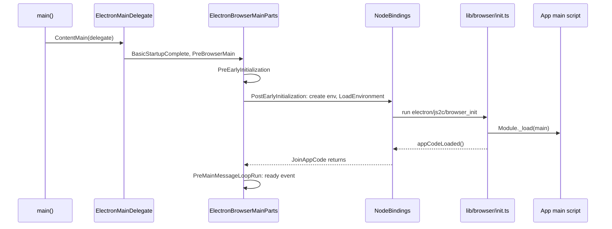

## Overview

An Electron executable is a Chromium `content` embedder. Its `main` does as little as possible and hands control to `content::ContentMain` with an `ElectronMainDelegate`; Chromium then creates `ElectronBrowserMainParts` for the browser process, and that class builds the V8 isolate and Node environment, which runs `lib/browser/init.ts`, which in turn loads the app's own main script. This page follows that chain until the app is ready. How Node's event loop is pumped afterwards is in [[Node.js Integration and the Event Loop]]; what `init.ts` shares with the other process types is in [[Process Types and JavaScript Bootstraps]].

Sources: [shell/app/electron_main_linux.cc:29-44](repo://shell/app/electron_main_linux.cc#L29-L44), [shell/browser/electron_browser_main_parts.cc:225-262](repo://shell/browser/electron_browser_main_parts.cc#L225-L262)

Sources: [shell/app/electron_main_linux.cc:42-43](repo://shell/app/electron_main_linux.cc#L42-L43), [shell/browser/electron_browser_main_parts.cc:207-262](repo://shell/browser/electron_browser_main_parts.cc#L207-L262), [shell/browser/electron_browser_main_parts.cc:425-486](repo://shell/browser/electron_browser_main_parts.cc#L425-L486), [lib/browser/init.ts:201-227](repo://lib/browser/init.ts#L201-L227)

## The executable and its delegate

On Linux, `main` fixes the stdio streams, initializes `base::CommandLine` and `ElectronCommandLine`, and then makes one decision: when the `RunAsNode` fuse is enabled and the run-as-node environment variable is set, it skips Chromium entirely and returns `electron::NodeMain()`, so the binary behaves as plain Node. Otherwise it builds an `ElectronMainDelegate` and calls `content::ContentMain`. There are separate `electron_main_mac.cc` and `electron_main_win.cc` files for the other platforms.

Sources: [shell/app/electron_main_linux.cc:29-44](repo://shell/app/electron_main_linux.cc#L29-L44)

`ElectronMainDelegate` is where Chromium asks Electron for each client object. `CreateContentBrowserClient` makes an `ElectronBrowserClient`, `CreateContentGpuClient` an `ElectronGpuClient`, `CreateContentUtilityClient` an `ElectronContentUtilityClient`, and `CreateContentRendererClient` picks the sandboxed or non-sandboxed renderer client depending on `IsSandboxEnabled`. The same delegate runs in every process type, so the renderer choice is made per child process from its command line; see [[Renderer, Preload Scripts and Context Isolation]].

Sources: [shell/app/electron_main_delegate.cc:446-479](repo://shell/app/electron_main_delegate.cc#L446-L479)

Early delegate hooks prepare the process before any thread exists. `BasicStartupComplete` honours the stack-dumping and disable-sandbox environment variables, registers the Chrome and Electron path providers, and on Linux refuses to run as root unless `--no-sandbox` was given. `PreBrowserMain` initializes the feature list and Mojo as soon as possible, because services read feature flags. `RunProcess` diverts the relauncher process type to `relauncher::RelauncherMain` and passes every other process type back to Chromium.

Sources: [shell/app/electron_main_delegate.cc:264-332](repo://shell/app/electron_main_delegate.cc#L264-L332), [shell/app/electron_main_delegate.cc:418-434](repo://shell/app/electron_main_delegate.cc#L418-L434), [shell/app/electron_main_delegate.cc:481-488](repo://shell/app/electron_main_delegate.cc#L481-L488)

`GetBrowserV8SnapshotFilename` returns `browser_v8_context_snapshot.bin` for the browser process when the matching fuse is on, otherwise Chromium's default.

Sources: [shell/app/electron_main_delegate.cc:436-444](repo://shell/app/electron_main_delegate.cc#L436-L444)

## Browser main parts

The constructor of `ElectronBrowserMainParts` creates the objects that live for the whole browser process: a `BrowserProcessImpl`, a `NodeBindings` in `kBrowser` mode, an `ElectronBindings` sharing the node bindings' libuv loop, and the `Browser` object. It asserts there is only one instance.

Sources: [shell/browser/electron_browser_main_parts.cc:175-184](repo://shell/browser/electron_browser_main_parts.cc#L175-L184)

`PostEarlyInitialization` is where JavaScript starts. In order, it:

1. creates the `JavascriptEnvironment` on the libuv loop (after the proxy resolver's V8 setup, to avoid conflicts);
2. initializes `NodeBindings` and creates the Node environment on the isolate's context;
3. configures unhandled rejections as warnings so they do not crash the main process;
4. binds Electron's extra `process` APIs through `ElectronBindings`;
5. creates the explicit microtasks runner and attaches the Node environment to the uv loop;
6. calls `LoadEnvironment`, which runs the bootstrap script, and then `JoinAppCode`.

Sources: [shell/browser/electron_browser_main_parts.cc:225-261](repo://shell/browser/electron_browser_main_parts.cc#L225-L261)

After the user's script has run, `PostEarlyInitialization` re-creates the feature list, so that switches the app added to the command line (for example with `app.commandLine.appendSwitch`) take effect. It then initializes field trials and reinitializes logging, since the app may have changed its name or user data directory.

Sources: [shell/browser/electron_browser_main_parts.cc:262-279](repo://shell/browser/electron_browser_main_parts.cc#L262-L279)

## Finding and running the app

`NodeBindings::CreateEnvironment` stores two hidden values on the global object before Node runs: `appSearchPaths` (`app.asar`, `app`, `default_app.asar`) and `appSearchPathsOnlyLoadASAR`. When the `OnlyLoadAppFromAsar` fuse is enabled, the search list shrinks to `app.asar` alone. It also inserts the init script `electron/js2c/browser_init` as Node's entry.

Sources: [shell/common/node_bindings.cc:662-704](repo://shell/common/node_bindings.cc#L662-L704)

`lib/browser/init.ts` reads those hidden values and tries each path under `process.resourcesPath` in order. In ASAR-only mode it first checks the archive exists. The first `package.json` that loads wins; if none does, it schedules `process.exit(1)` and throws "Unable to find a valid app". Because `default_app.asar` is last in the list, running a bare Electron binary lands in the default app described in [[Quickstart: Building and Running Electron]].

Sources: [lib/browser/init.ts:83-123](repo://lib/browser/init.ts#L83-L123)

With a package found, `init.ts` applies `version`, `productName` or `name`, `desktopName` (defaulting to the app name plus `.desktop`) and `v8Flags`, then calls `app.setAppPath`. It also preloads the modules that must exist on app ready (`devtools`, `protocol`, `service-worker-main`, `web-contents`, `web-frame-main`, `web-contents-view`).

Sources: [lib/browser/init.ts:125-167](repo://lib/browser/init.ts#L125-L167)

Two lifecycle defaults are installed before the app runs: the app quits on `window-all-closed` unless another listener is registered, and the default application menu is set on `will-finish-launching`, which fires before `ready`.

Sources: [lib/browser/init.ts:188-199](repo://lib/browser/init.ts#L188-L199)

Finally `init.ts` runs the main script, `main` from `package.json` or `index.js`. ESM entries (`"type": "module"` or an `.mjs` file) go through `runEntryPointWithESMLoader`, and `appCodeLoaded()` is called once the import settles, or right away for CommonJS before `Module._load`. That call is what ends the `JoinAppCode` wait: the browser process pumps libuv with `uv_run(UV_RUN_ONCE)` until `app_code_loaded_` is set.

Sources: [lib/browser/init.ts:170-227](repo://lib/browser/init.ts#L170-L227), [shell/common/node_bindings.cc:895-924](repo://shell/common/node_bindings.cc#L895-L924)

## Ready

`PreMainMessageLoopRun` starts the embed thread and polling for libuv, locks the URL scheme registries (the code comments that `url::Add*Scheme` is not thread-safe), registers the WebUI factory and starts the remote debugging pipe or port if requested. On Linux and Windows it then calls `Browser::WillFinishLaunching` and `DidFinishLaunching`; on macOS those calls come from the application delegate instead.

Sources: [shell/browser/electron_browser_main_parts.cc:425-473](repo://shell/browser/electron_browser_main_parts.cc#L425-L473)

`DidFinishLaunching` creates the user data directory, sets `is_ready_`, resolves the `whenReady` promise and notifies observers, which is what the JavaScript `ready` event hangs on.

Sources: [shell/browser/browser.cc:183-200](repo://shell/browser/browser.cc#L183-L200)

## Shutdown

`PostMainMessageLoopRun` unwinds in a fixed order. Download managers are shut down first; then utility processes started via the Electron API are shut down explicitly, before Node stops, so that their exit events can still be emitted (see [[Utility Processes and Workers]]). Only then does it stop the microtasks runner, call `node::Stop`, release the Node environment and destroy the browser contexts.

Sources: [shell/browser/electron_browser_main_parts.cc:549-601](repo://shell/browser/electron_browser_main_parts.cc#L549-L601)

On the JavaScript side, `process.exit` is replaced by `app.exit`, so exiting goes through this graceful path, and an `uncaughtException` with no custom handler shows an error box instead of quitting.

Sources: [lib/browser/init.ts:19-39](repo://lib/browser/init.ts#L19-L39), [lib/browser/init.ts:72-73](repo://lib/browser/init.ts#L72-L73)
