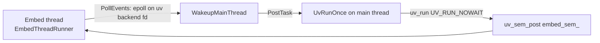

## Overview

Electron runs Node.js inside Chromium's processes instead of next to them. Chromium owns the main thread's message loop, so Node's libuv loop cannot simply block it. `NodeBindings` solves this: it creates the Node environment for a process type, runs libuv in small slices from Chromium's task runner, and uses a helper thread to learn when libuv has work. This page covers that machinery; the order in which it is invoked at launch is in [[Main Process Startup]], and the JavaScript each environment executes is in [[Process Types and JavaScript Bootstraps]].

Sources: [shell/common/node_bindings.cc:476-478](repo://shell/common/node_bindings.cc#L476-L478), [shell/common/node_bindings.cc:860-893](repo://shell/common/node_bindings.cc#L860-L893)

## One class, four environments

`NodeBindings::Create` is implemented per platform (for Linux it returns `NodeBindingsLinux`) and takes a `BrowserEnvironment`: `kBrowser`, `kRenderer`, `kWorker` or `kUtility`. The environment decides almost everything else:

| Aspect | Rule | Where |
| --- | --- | --- |
| Event loop | A worker gets its own `uv_loop_init` loop; every other type shares `uv_default_loop()` | `InitEventLoop` |
| Entry script | `electron/js2c/<type>_init`, inserted as Node's first argument | `CreateEnvironment` |
| `process.type` | `browser`, `renderer`, `worker` or `utility`, read-only | `CreateEnvironment` |
| Native bindings | Browser, common, renderer and utility sets, registered per type | `RegisterBuiltinBindings` |
| Microtask policy | `kExplicit` in browser and utility; in renderers the existing (Blink) policy is kept | `CreateEnvironment` |
| Fetch | `--no-experimental-fetch` in renderers and workers, so Node does not clash with Blink's | `ParseNodeCliFlags` |

Sources: [shell/common/node_bindings.cc:514-529](repo://shell/common/node_bindings.cc#L514-L529), [shell/common/node_bindings.cc:531-547](repo://shell/common/node_bindings.cc#L531-L547), [shell/common/node_bindings.cc:577-582](repo://shell/common/node_bindings.cc#L577-L582), [shell/common/node_bindings.cc:662-676](repo://shell/common/node_bindings.cc#L662-L676), [shell/common/node_bindings.cc:768-779](repo://shell/common/node_bindings.cc#L768-L779), [shell/common/node_bindings_linux.cc:36-38](repo://shell/common/node_bindings_linux.cc#L36-L38)

The named bindings are declared as X-macro lists. `ELECTRON_BROWSER_BINDINGS` is only registered in the browser process, `ELECTRON_COMMON_BINDINGS` everywhere (`asar`, `clipboard`, `command_line`, `native_image`, `shell`, `v8_util` and others), `ELECTRON_RENDERER_BINDINGS` in renderers (`context_bridge`, `ipc`, `web_frame`, ...) and `ELECTRON_UTILITY_BINDINGS` in utility processes. Test-only bindings are added when `DCHECK_IS_ON()`. How JavaScript looks these up is in [[Module Loading and Linked Bindings]].

Sources: [shell/common/node_bindings.cc:53-72](repo://shell/common/node_bindings.cc#L53-L72), [shell/common/node_bindings.cc:89-128](repo://shell/common/node_bindings.cc#L89-L128), [shell/common/node_bindings.cc:531-547](repo://shell/common/node_bindings.cc#L531-L547)

## Initializing Node in a Chromium process

`NodeBindings::Initialize` runs once per process. It registers the built-in bindings, applies `NODE_OPTIONS`, and keeps only a small allow-list of Node command-line options (`IsAllowedOption`) from the real command line. Then it calls `node::InitializeOncePerProcess` with flags that stop Node from initializing V8, cppgc and its own V8 platform, because Chromium has already done so. Node's stdio inheritance is turned off for utility processes, default signal handling is turned off for renderers, and the `NodeOptions` fuse removes `NODE_OPTIONS` handling when disabled.

Sources: [shell/common/node_bindings.cc:555-585](repo://shell/common/node_bindings.cc#L555-L585), [shell/common/node_bindings.cc:587-637](repo://shell/common/node_bindings.cc#L587-L637)

`CreateEnvironment` then creates the Node `IsolateData`, stores it in the context's embedder data, and builds the environment with flags such as `kNoGlobalSearchPaths` and `kNoRegisterESMLoader`. Renderers and workers also get `kNoBrowserGlobals` and `kNoCreateInspector`: the source comments explain that only one ESM loader may be registered per isolate (Blink's) and that globals such as `setImmediate` and `queueMicrotask` are already defined by the DOM. If the `NodeCliInspect` fuse is off, the SIGUSR1 debug handler is not installed either.

Sources: [shell/common/node_bindings.cc:706-740](repo://shell/common/node_bindings.cc#L706-L740)

It also customises the isolate for Node's needs. Fatal and OOM callbacks feed crash reports, uncaught exceptions never abort the browser or renderer (they abort a utility process like standard Node), and WebAssembly and `eval` policy callbacks defer to Chromium. In renderers and workers it avoids Node's own message listener and promise-rejection callback, so Blink's keep working.

Sources: [shell/common/node_bindings.cc:742-810](repo://shell/common/node_bindings.cc#L742-L810)

Last, `OnNodePreload` adds `process.resourcesPath`, `process.helperExecPath`, and the `electron` and `chrome` entries of `process.versions`.

Sources: [shell/common/node_bindings.cc:995-1012](repo://shell/common/node_bindings.cc#L995-L1012)

## Pumping libuv from the Chromium loop

Node never owns the thread in the browser or renderer process. Instead three pieces cooperate:

Sources: [shell/common/node_bindings.cc:926-993](repo://shell/common/node_bindings.cc#L926-L993)

`PrepareEmbedThread` adds a dummy async handle (so libuv does not exit when idle) and starts the embed thread. `StartPolling` records the main thread's task runner and runs the loop once so `uv__io_poll` can register its events.

Sources: [shell/common/node_bindings.cc:860-893](repo://shell/common/node_bindings.cc#L860-L893)

The embed thread waits on a semaphore, then calls the platform's `PollEvents`, which on Linux does `epoll_wait` on the libuv backend fd with `uv_backend_timeout` as the timeout. When something is ready it posts `UvRunOnce` to the main thread. `UvRunOnce` enters the Node context with an explicit microtasks scope, runs `uv_run(UV_RUN_NOWAIT)` once, and posts the semaphore so the embed thread resumes polling. If libuv has nothing left (`r == 0`), it asks the message loop to quit. `UV_LOOP_INTERRUPT_ON_IO_CHANGE` is set so that starting a new handle interrupts a poll that is already waiting.

Sources: [shell/common/node_bindings.cc:926-993](repo://shell/common/node_bindings.cc#L926-L993), [shell/common/node_bindings_linux.cc:11-33](repo://shell/common/node_bindings_linux.cc#L11-L33), [shell/common/node_bindings.cc:525-526](repo://shell/common/node_bindings.cc#L525-L526)

Because the loop runs only on demand, some Node timers would not fire. `lib/common/init.ts` wraps `process.nextTick`, `setImmediate`, `setTimeout` and `setInterval` so each call first runs `process.activateUvLoop()`, which makes the loop re-evaluate its timeout. The wrapped globals replace the real ones only in the `browser` and `utility` processes, since renderers with Node integration delete the Node globals.

Sources: [lib/common/init.ts:8-62](repo://lib/common/init.ts#L8-L62), [shell/common/api/electron_bindings.cc:81-82](repo://shell/common/api/electron_bindings.cc#L81-L82)

## Microtasks

In the browser process V8 uses the `kExplicit` policy. `MicrotasksRunner` is a Chromium task observer whose `DidProcessTask` opens a `node::CallbackScope`, so Node performs the microtask checkpoint. The comment in the file records why: after electron/electron#20013 Node does its own checkpoint, and letting Chromium run it too made the two contend and delayed Node callbacks.

Sources: [shell/browser/microtasks_runner.cc:14-34](repo://shell/browser/microtasks_runner.cc#L14-L34)

In renderers the policy must stay what Blink expects (`kScoped`), and it is toggled to `kExplicit` only while `UvRunOnce` enters Node, using `ExplicitMicrotasksScope`.

Sources: [shell/common/node_bindings.cc:768-780](repo://shell/common/node_bindings.cc#L768-L780), [shell/common/node_bindings.cc:940-955](repo://shell/common/node_bindings.cc#L940-L955)

## Node patches to the runtime

Two files in `lib/node` adapt Node's own modules in every environment that loads them. `lib/node/init.ts` wraps `fs` for ASAR support (see [[ASAR Archives]]), restores Blink's `fetch` family from the `blink*` globals when set, and hooks `child_process.fork` so a forked script runs the Electron binary with `ELECTRON_RUN_AS_NODE=1` (using the helper executable on macOS). It also filters `Module._nodeModulePaths` so modules inside `resourcesPath` cannot resolve packages from outside the app.

Sources: [lib/node/init.ts:1-59](repo://lib/node/init.ts#L1-L59)

## Running as plain Node

When the `RunAsNode` fuse and `ELECTRON_RUN_AS_NODE` allow it, `main` calls `NodeMain`, which is the `cp.fork` target above. It clears `NODE_OPTIONS` if that fuse is off, installs a `UvTaskRunner` as the thread's task runner, registers the builtin bindings, rejects disallowed flags, initializes Crashpad, creates a `JavascriptEnvironment` and Node environment, and then simply calls `node::SpinEventLoop`. Here libuv owns the thread, so none of the embed machinery is needed.

Sources: [shell/app/node_main.cc:123-131](repo://shell/app/node_main.cc#L123-L131), [shell/app/node_main.cc:180-199](repo://shell/app/node_main.cc#L180-L199), [shell/app/node_main.cc:238-299](repo://shell/app/node_main.cc#L238-L299)
