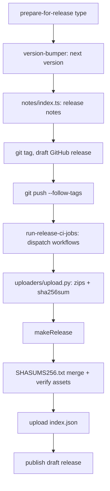

## Overview

A release is produced by scripts in `script/release/`, in two human-driven steps with automation in between. First `prepare-for-release` chooses the next version, creates and pushes a tag, drafts a GitHub release with generated notes, and triggers the platform build workflows. Those builds upload their artifacts to storage. Then `publish-to-github` (the `makeRelease` function) merges the checksums, verifies that every expected asset exists and hashes correctly, uploads the version index and flips the draft to published. This page follows that sequence; what the build produces is described in [[Build System]].

Sources: [script/release/prepare-release.ts:213-222](repo://script/release/prepare-release.ts#L213-L222), [script/release/release.ts:414-433](repo://script/release/release.ts#L414-L433)

Sources: [script/release/prepare-release.ts:76-86](repo://script/release/prepare-release.ts#L76-L86), [script/release/prepare-release.ts:213-222](repo://script/release/prepare-release.ts#L213-L222), [script/release/release.ts:414-433](repo://script/release/release.ts#L414-L433)

## Choosing the version

The command line is `prepare-for-release [stable | minor | beta | alpha | nightly] (--branch=...)`. A bump type is valid if `isVersionBumpType` accepts it, anything except `stable` and `minor` is a pre-release, and `nightly` targets the `nightlies` repository instead of `electron`.

Sources: [script/release/bin/prepare-for-release.ts:1-32](repo://script/release/bin/prepare-for-release.ts#L1-L32), [script/release/types.ts:1-11](repo://script/release/types.ts#L1-L11)

`prepareRelease` first runs `version-bumper.ts` in dry-run mode to print the intended version, then calls `createRelease`, `pushRelease` and `runReleaseBuilds`.

Sources: [script/release/prepare-release.ts:213-222](repo://script/release/prepare-release.ts#L213-L222)

`nextVersion` encodes the allowed transitions, which depend on the current version's kind:

Sources: [script/release/version-bumper.ts:59-100](repo://script/release/version-bumper.ts#L59-L100)

| Current version | Allowed bump | Result |
| --- | --- | --- |
| nightly, alpha or beta | `nightly`, `alpha`, `beta` | next nightly, alpha or beta number |
| nightly, alpha or beta | `stable` | the coerced base version (`X.Y.Z`) |
| stable | `nightly` | next nightly |
| stable | `minor` | minor increment |
| stable | `stable` | patch increment |
| stable | `alpha`, `beta` | error: cannot bump to it from stable |

Sources: [script/release/prepare-release.ts:29-56](repo://script/release/prepare-release.ts#L29-L56), [script/release/version-bumper.ts:59-100](repo://script/release/version-bumper.ts#L59-L100)

`nextAlpha` and `nextBeta` list existing tags matching `v<base>-alpha.*` (or `beta`), sort by the numeric suffix, and increment the last, starting at `.1` for a new line. `nextNightly` builds `nightly.<yyyymmdd>`; on `main` the base version is the next major after the newest `N-x-y` remote branch, and on a stable branch it is a patch bump.

Sources: [script/release/version-utils.ts:20-85](repo://script/release/version-utils.ts#L20-L85)

## Release notes

Unless the bump type is `nightly` (whose text is "Nightlies do not get release notes, please compare tags for info."), `getReleaseNotes` calls the notes generator in `script/release/notes`. Given a range such as `from..to`, or just the branch, it works out the comparison point itself: `getPreviousPoint` looks for the newest earlier supported tag on the same branch (restricted to stable tags if the current tag is stable); if there is none, it walks previous `N-x-y` stabilization branches until one has a stable tag. A tag is "supported" when it contains neither `nightly` nor `unsupported`.

Sources: [script/release/prepare-release.ts:58-74](repo://script/release/prepare-release.ts#L58-L74), [script/release/notes/index.ts:30-33](repo://script/release/notes/index.ts#L30-L33), [script/release/notes/index.ts:118-170](repo://script/release/notes/index.ts#L118-L170)

`getNotes` in `notes.ts` collects the commits between the two refs into a `Pool`, drops commits already processed and commit/revert pairs (both get `NO_NOTES`), and filters out ones without a user-facing note or that are version bumps. Each commit message is parsed: a trailing `(#1234)` or a "Merge pull request" subject yields the PR, a `type:` prefix yields a semantic type from known sets, and backport phrases yield the original PR. Commits are then bucketed into `breaking`, `docs`, `feat`, `fix`, `other` and `unknown`. The generator returns the rendered text plus a warning when there are unknown notes ("Please fix them before releasing"). GitHub responses are cached under `NOTES_CACHE_PATH` or a `.cache` folder next to the script.

Sources: [script/release/notes/notes.ts:46-47](repo://script/release/notes/notes.ts#L46-L47), [script/release/notes/notes.ts:175-215](repo://script/release/notes/notes.ts#L175-L215), [script/release/notes/notes.ts:510-603](repo://script/release/notes/notes.ts#L510-L603), [script/release/notes/index.ts:151-170](repo://script/release/notes/index.ts#L151-L170)

## Tag, draft and CI

`createRelease` bumps the version, gets the notes and tags the commit with `git tag -a`. It then lists releases through Octokit and aborts if a draft for the tag already exists. The body of a pre-release begins with a note that it is a nightly, alpha or beta, which npm tag it will be published under (`electron-nightly`, `alpha`, `beta`) and how to install it, followed by the notes; a stable release body is only the notes. It creates a draft release (`draft: true`), with `prerelease` set for pre-releases and `target_commitish` of `main` for nightlies.

Sources: [script/release/prepare-release.ts:76-166](repo://script/release/prepare-release.ts#L76-L166), [script/release/prepare-release.ts:192-206](repo://script/release/prepare-release.ts#L192-L206)

`pushRelease` runs `git push origin HEAD:<branch> --follow-tags` and tells the user to wait for the builds before running the publish step. `runReleaseBuilds` calls `runReleaseCIJobs`, which dispatches the `linux-publish`, `macos-publish` and `windows-publish` GitHub Actions workflows against `refs/tags/<version>` with the input `upload-to-storage` set to `'0'` when `ghRelease` is true (the release flow) and `'1'` otherwise, and polls until each run is found, logging an error for any failed status.

Sources: [script/release/prepare-release.ts:168-190](repo://script/release/prepare-release.ts#L168-L190), [script/release/run-release-ci-jobs.ts:15-81](repo://script/release/run-release-ci-jobs.ts#L15-L81), [script/release/run-release-ci-jobs.ts:142-179](repo://script/release/run-release-ci-jobs.ts#L142-L179)

## What the builds upload

Each platform build runs `uploaders/upload.py`. It first requires that the tag matches the build version and finds the release through `find-github-release.ts`; when uploading to GitHub the release must exist, and replacing an already published release needs `--overwrite`. It copies each artifact from the output directory to its versioned name and calls `upload_electron`:

Sources: [script/release/uploaders/upload.py:47-76](repo://script/release/uploaders/upload.py#L47-L76)

| Artifact | Platforms |
| --- | --- |
| `electron-<v>-<platform>-<arch>.zip` (dist) and `-symbols.zip` | all |
| `electron-api.json`, `electron.d.ts` | one build only (macOS x64) |
| `-dsym.zip`, `-dsym-snapshot.zip` | macOS |
| `-pdb.zip` | Windows |
| `-debug.zip`, `libcxx-objects` | Linux |
| libc++ and libc++abi headers | Linux x64 |
| `ffmpeg`, `chromedriver`, `mksnapshot` zips | all |
| hunspell dictionaries and toolchain profile | where applicable |

Sources: [script/release/uploaders/upload.py:30-76](repo://script/release/uploaders/upload.py#L30-L76), [script/release/uploaders/upload.py:78-147](repo://script/release/uploaders/upload.py#L78-L147)

`upload_electron` zeroes the zip timestamps and extra fields in place with `zero_zip_date_time` so the archives are deterministic. When `--upload-to-storage` is set it stores the file and its checksum under `release-builds/<version>_<timestamp>` in artifact storage and stops; otherwise it uploads the file to the draft release with `upload-to-github.ts` and writes a `.sha256sum` file (`<hash> *<name>`) to the `checksums-scratchpad/<version>` prefix. Storage uploads go through `store_artifact` and `azput.js` (Azure blob storage).

Sources: [script/release/uploaders/upload.py:205-217](repo://script/release/uploaders/upload.py#L205-L217), [script/release/uploaders/upload.py:334-383](repo://script/release/uploaders/upload.py#L334-L383), [script/lib/util.py:143-155](repo://script/lib/util.py#L143-L155)

Other uploaders handle non-Electron artifacts: `upload-symbols.py` for crash symbols (lower-casing the paths for the symbol server and uploading under a `symbols` prefix), `upload-node-headers.py` for the `node-*` and `iojs-*` header tarballs, and `upload-node-checksums.py` and `upload-index-json.py`, which `release.ts` calls itself.

Sources: [script/release/release.ts:250-276](repo://script/release/release.ts#L250-L276), [script/release/uploaders/upload-symbols.py:55-98](repo://script/release/uploaders/upload-symbols.py#L55-L98), [script/release/uploaders/upload-node-headers.py:20-27](repo://script/release/uploaders/upload-node-headers.py#L20-L27)

## Verifying and publishing

`makeRelease` runs, in order: find the draft for the current version and check it (exactly one draft, marked prerelease for betas, notes of more than 50 characters and no `(placeholder)`); upload the Node SHASUMS; build `SHASUMS256.txt`; re-read the draft; validate its assets; upload `index.json`; publish.

Sources: [script/release/release.ts:38-68](repo://script/release/release.ts#L38-L68), [script/release/release.ts:414-433](repo://script/release/release.ts#L414-L433)

`createReleaseShasums` deletes an existing `SHASUMS256.txt` asset and uploads a new one assembled by `mergeShasums`: it reads every `.sha256sum` blob under `<version>/` in the `checksums-scratchpad` container of the storage account named by `ELECTRON_ARTIFACTS_BLOB_STORAGE` and joins the contents with newlines.

Sources: [script/release/release.ts:278-338](repo://script/release/release.ts#L278-L338)

`validateReleaseAssets` compares the release's asset names with the list from `assetsForVersion`: chromedriver, electron, mksnapshot and ffmpeg zips for each supported platform and architecture (darwin, linux, mas, win32), symbols, dSYM and PDB archives, toolchain profiles, and `SHASUMS256.txt` unless only validating a draft. A missing asset fails the check and the final `check(..., true)` exits. For a draft, `verifyDraftGitHubReleaseAssets` fetches authenticated asset URLs and verifies their SHA-256 against the checksum file; for a published release the public URLs are used. It also checks the Node headers and `.lib` files on `artifacts.electronjs.org` for the version against `SHASUMS.txt` and `SHASUMS256.txt` (both SHA-1 and SHA-256).

Sources: [script/release/release.ts:82-126](repo://script/release/release.ts#L82-L126), [script/release/release.ts:128-234](repo://script/release/release.ts#L128-L234), [script/release/release.ts:533-588](repo://script/release/release.ts#L533-L588)

File hashing is delegated to a remote function: `getUrlHash` calls the function with the target URL and algorithm and an access key from `ELECTRON_HASHER_FUNCTION_KEY`, expects a `{ hash }` response, and retries up to three times, logging the status and body on failure.

Sources: [script/release/get-url-hash.ts:1-49](repo://script/release/get-url-hash.ts#L1-L49)

`index.json` is uploaded late on purpose. The code comment explains that it goes live as soon as it is uploaded, so doing it just before publishing keeps it from listing a release that then fails to publish, and keeps published releases from being missing from it. `publishRelease` finally calls `updateRelease` with `draft: false`, and `make_latest` true only for a non-prerelease whose tag is at least the current latest release's tag. Publishing to npm is a separate command (`publish-to-npm`), as the final message says.

Sources: [script/release/release.ts:382-406](repo://script/release/release.ts#L382-L406), [script/release/release.ts:419-433](repo://script/release/release.ts#L419-L433)
