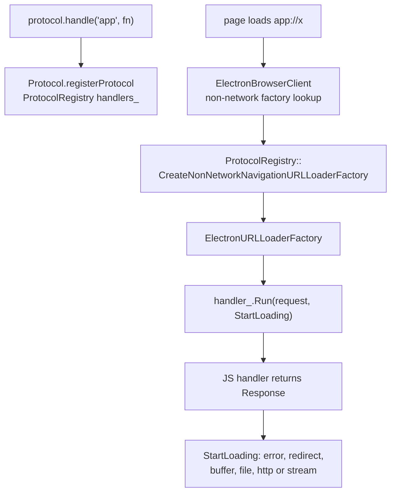

## Overview

A `Session` is the JavaScript face of an `ElectronBrowserContext`: one cookie jar, cache, storage area, permission policy, protocol table and `webRequest` hook set. Everything that touches the network goes through objects hanging off the session, so one page, one partition and one custom protocol meet in the same place. This page covers how sessions are created and found, how a custom protocol request is served, how `webRequest` and permissions hook in, and how the `net` module relates. The page that owns a session is a `WebContents`, see [[WebContents and Navigation]].

Sources: [shell/browser/api/electron_api_session.cc:1673-1710](repo://shell/browser/api/electron_api_session.cc#L1673-L1710), [shell/browser/electron_browser_context.cc:357-365](repo://shell/browser/electron_browser_context.cc#L357-L365)

## Sessions and partitions

`session.fromPartition(name)`, `session.fromPath(path)` and `session.defaultSession` all end in `Session::CreateFrom`, which returns the existing `Session` for a `BrowserContext` when there is one, and otherwise allocates a new garbage-collected `Session`, calls its JavaScript `_init`, and emits `session-created` on `app`. `Session::New` always throws, so sessions cannot be constructed with `new`.

Sources: [lib/browser/api/session.ts:114-120](repo://lib/browser/api/session.ts#L114-L120), [shell/browser/api/electron_api_session.cc:1683-1710](repo://shell/browser/api/electron_api_session.cc#L1683-L1710), [shell/browser/api/electron_api_session.cc:1752-1756](repo://shell/browser/api/electron_api_session.cc#L1752-L1756)

The partition string decides which `ElectronBrowserContext` backs the session: an empty string is the default on-disk context; a name starting with the persist prefix is an on-disk partition named by the rest; any other name is an in-memory partition; `fromPath` requires a non-empty absolute path.

Sources: [shell/browser/api/electron_api_session.cc:1713-1750](repo://shell/browser/api/electron_api_session.cc#L1713-L1750)

Contexts are cached in a static map keyed by `PartitionKey` (a partition name plus an in-memory flag, or a file path). `ElectronBrowserContext::From` creates a context on first use and returns the same one afterwards, and `DestroyAllContexts` removes them with the default context last, to avoid a use-after-free noted in the code. A context's data path is the session data directory, plus `Partitions/<name>` for named on-disk partitions; the HTTP cache is on unless `--disable-http-cache` or `cache: false` is given.

Sources: [shell/browser/electron_browser_context.cc:308-355](repo://shell/browser/electron_browser_context.cc#L308-L355), [shell/browser/electron_browser_context.cc:366-390](repo://shell/browser/electron_browser_context.cc#L366-L390), [shell/browser/electron_browser_context.cc:870-897](repo://shell/browser/electron_browser_context.cc#L870-L897)

The context also owns the protocol registry (created in its constructor) and lazily creates the `ElectronPermissionManager` that Chromium asks for permission decisions.

Sources: [shell/browser/electron_browser_context.cc:357-365](repo://shell/browser/electron_browser_context.cc#L357-L365), [shell/browser/electron_browser_context.cc:545-550](repo://shell/browser/electron_browser_context.cc#L545-L550)

`WebContents` picks its session from the `session` option, else `partition`, else the default (see [[WebContents and Navigation]]). A session's IPC role, receiving every `ipcRenderer` message from its pages, is in [[IPC Messaging]].

Sources: [shell/browser/api/electron_api_web_contents.cc:828-838](repo://shell/browser/api/electron_api_web_contents.cc#L828-L838), [shell/browser/api/ipc_dispatcher.h:25-45](repo://shell/browser/api/ipc_dispatcher.h#L25-L45)

## Following a custom protocol request

Sources: [lib/browser/api/protocol.ts:111-147](repo://lib/browser/api/protocol.ts#L111-L147), [shell/browser/protocol_registry.cc:49-64](repo://shell/browser/protocol_registry.cc#L49-L64), [shell/browser/net/electron_url_loader_factory.cc:411-431](repo://shell/browser/net/electron_url_loader_factory.cc#L411-L431)

**1. Registration.** `protocol.handle(scheme, handler)` is implemented in TypeScript on `Protocol.prototype`. It chooses `interceptProtocol` for the built-in schemes `http`, `https` and `file` and `registerProtocol` for everything else, and registers a low-level handler that wraps `handler`. Registration fails with `Failed to register protocol: <scheme>` if the scheme is already taken. The module-level `protocol.*` functions all forward to `session.defaultSession.protocol`.

Sources: [lib/browser/api/protocol.ts:13](repo://lib/browser/api/protocol.ts#L13-L13), [lib/browser/api/protocol.ts:111-147](repo://lib/browser/api/protocol.ts#L111-L147), [lib/browser/api/protocol.ts:159-181](repo://lib/browser/api/protocol.ts#L159-L181)

The native `Protocol` object keeps two tables in the context's `ProtocolRegistry`: `handlers_` for registered schemes and `intercept_handlers_` for intercepted ones; `try_emplace` makes a second registration of the same scheme fail, which the API reports with messages such as "The scheme has been registered". Many typed variants (`registerStringProtocol`, `registerFileProtocol`, `registerStreamProtocol`, ...) share one template that records a `ProtocolType`.

Sources: [shell/browser/protocol_registry.cc:66-98](repo://shell/browser/protocol_registry.cc#L66-L98), [shell/browser/api/electron_api_protocol.cc:199-253](repo://shell/browser/api/electron_api_protocol.cc#L199-L253), [shell/browser/api/electron_api_protocol.cc:304-336](repo://shell/browser/api/electron_api_protocol.cc#L304-L336)

**2. Scheme privileges.** A custom scheme must also be declared with `protocol.registerSchemesAsPrivileged` before app ready, which turns options such as `secure`, `standard` and `supportFetchAPI` into command-line switches (`kSecureSchemes`, `kStandardSchemes`, ...) so the child processes learn them.

Sources: [shell/browser/api/electron_api_protocol.cc:40-80](repo://shell/browser/api/electron_api_protocol.cc#L40-L80), [shell/browser/api/electron_api_protocol.cc:110-185](repo://shell/browser/api/electron_api_protocol.cc#L110-L185)

**3. Factory lookup.** When Chromium needs a loader for a scheme with no network handling, `ElectronBrowserClient` asks the context's `ProtocolRegistry`. `CreateNonNetworkNavigationURLLoaderFactory` returns the asar-aware file factory for `file:` (when the `GrantFileProtocolExtraPrivileges` fuse is on), and for other schemes an `ElectronURLLoaderFactory` made from the registered handler. For subresources and workers `RegisterURLLoaderFactories` adds one factory per registered scheme, and workers are explicitly not allowed `file://` access. The asar side is in [[ASAR Archives]].

Sources: [shell/browser/electron_browser_client.cc:1052-1071](repo://shell/browser/electron_browser_client.cc#L1052-L1071), [shell/browser/protocol_registry.cc:23-64](repo://shell/browser/protocol_registry.cc#L23-L64)

**4. Calling the handler.** `ElectronURLLoaderFactory::CreateLoaderAndStart` runs on the UI thread, clones itself as the target factory for redirects, and calls the stored `handler_` with the request and a callback bound to `StartLoading`. In TypeScript the low-level handler converts the request into a Fetch `Request` (turning `uploadData` into a stream or a single buffer, and dropping an `origin` of `null`), awaits the user's `handler(req)`, validates that the result looks like a `Response`, and answers with `{ data, headers, statusCode, statusText, mimeType }`. A thrown error or an invalid `Response` answers `ERR_UNEXPECTED` and an error-type `Response` answers `ERR_FAILED`.

Sources: [shell/browser/net/electron_url_loader_factory.cc:411-431](repo://shell/browser/net/electron_url_loader_factory.cc#L411-L431), [lib/browser/api/protocol.ts:48-147](repo://lib/browser/api/protocol.ts#L48-L147)

**5. Turning the answer into a load.** `StartLoading` takes the first argument. With no argument it completes with `ERR_NOT_IMPLEMENTED`; an object with `error` completes with that code. Otherwise it builds the response head and, if the headers describe a redirect, computes `RedirectInfo`, reports it to the client and parks a `RedirectedRequest` that issues a fresh loader on `FollowRedirect`, since, as the code comments, a `Location` header does not redirect by itself with the network service. Without a redirect it dispatches on the protocol type: buffer contents are written directly (`StartLoadingBuffer`), a file path goes to the asar URL loader with `Access-Control-Allow-Origin: *`, `url` forwards to an HTTP request (`StartLoadingHttp`), a stream is piped, and an unrecognised response fails with `ERR_FAILED`.

Sources: [shell/browser/net/electron_url_loader_factory.cc:446-520](repo://shell/browser/net/electron_url_loader_factory.cc#L446-L520), [shell/browser/net/electron_url_loader_factory.cc:596-650](repo://shell/browser/net/electron_url_loader_factory.cc#L596-L650)

## Intercepted schemes and webRequest

`WillCreateURLLoaderFactory` is Chromium's hook for wrapping the network factory of every request source. Electron's implementation gets or creates the context's `WebRequest`, and if no `webRequest` listener is set lets the extensions `WebRequestAPI` proxy the factory instead. Otherwise it appends a `ProxyingURLLoaderFactory` that receives the `WebRequest` object and the registry's `intercept_handlers`. This is why interception of `http`, `https` and `file` composes with `session.webRequest`: both live in the same proxy.

Sources: [shell/browser/electron_browser_client.cc:1309-1376](repo://shell/browser/electron_browser_client.cc#L1309-L1376)

`WebRequest` stores two kinds of listeners (`simple_listeners_` for observational events and `response_listeners_` for events whose result can alter the request) and `HasListener` is true when either map is non-empty. For `onBeforeRequest`, if the listener's filter matches, the request is parked in `blocked_requests_`, the listener is called with a details object and a response callback, and the network call returns `ERR_IO_PENDING`. When the callback runs, `{ cancel: true }` produces `ERR_BLOCKED_BY_CLIENT`, a `redirectURL` rewrites the target, and anything else lets the request continue. `onBeforeSendHeaders` and `onHeadersReceived` follow the same park-and-resume pattern.

Sources: [shell/browser/api/electron_api_web_request.cc:355-422](repo://shell/browser/api/electron_api_web_request.cc#L355-L422), [shell/browser/api/electron_api_web_request.cc:424-470](repo://shell/browser/api/electron_api_web_request.cc#L424-L470), [shell/browser/api/electron_api_web_request.cc:511-560](repo://shell/browser/api/electron_api_web_request.cc#L511-L560)

## Permissions

`ElectronPermissionManager` implements Chromium's permission controller delegate, and its behaviour depends on whether the app installed handlers. Without a request handler every requested permission is granted (with side effects for MIDI sysex and geolocation); with one, each request is routed to it. Requests from fenced frames are denied outright. For checks, `CheckPermissionWithDetails` returns true for everything except synchronous clipboard read when no check handler is set, and with a handler it passes details such as `requestingUrl` and `isMainFrame`. `GetPermissionStatus` maps that boolean to granted or denied. The handlers are set through `session.setPermissionRequestHandler`, `setPermissionCheckHandler` and `setDevicePermissionHandler`.

Sources: [shell/browser/electron_permission_manager.cc:111-143](repo://shell/browser/electron_permission_manager.cc#L111-L143), [shell/browser/electron_permission_manager.cc:145-215](repo://shell/browser/electron_permission_manager.cc#L145-L215), [shell/browser/electron_permission_manager.cc:271-283](repo://shell/browser/electron_permission_manager.cc#L271-L283), [shell/browser/electron_permission_manager.cc:308-330](repo://shell/browser/electron_permission_manager.cc#L308-L330)

> [!WARNING]
> With no permission handlers installed, every permission request is granted: the default of `ElectronPermissionManager` is permissive, not prompting.

Sources: [shell/browser/electron_permission_manager.cc:196-214](repo://shell/browser/electron_permission_manager.cc#L196-L214)

## The net module

The `net` module is a thin layer over the same session machinery. `net.request` throws unless the app is ready and creates a `ClientRequest`, whose implementation obtains a native loader with `createURLLoader` from the `electron_common_net` binding (`SimpleURLLoaderWrapper` in C++). `net.fetch` and `net.resolveHost` delegate to `session.defaultSession`, and `Session.prototype.fetch` calls `fetchWithSession`, which builds the Fetch `Request`, handles abort signals and body streaming, and uses `net.request` for the transport. In a utility process the `net` module is also available, via `electron_common_net`.

Sources: [lib/browser/api/net.ts:6-27](repo://lib/browser/api/net.ts#L6-L27), [lib/common/api/net-client-request.ts:9-13](repo://lib/common/api/net-client-request.ts#L9-L13), [lib/browser/api/session.ts:44-46](repo://lib/browser/api/session.ts#L44-L46), [lib/browser/api/net-fetch.ts:18-60](repo://lib/browser/api/net-fetch.ts#L18-L60), [shell/common/api/electron_api_url_loader.cc:325-381](repo://shell/common/api/electron_api_url_loader.cc#L325-L381)
