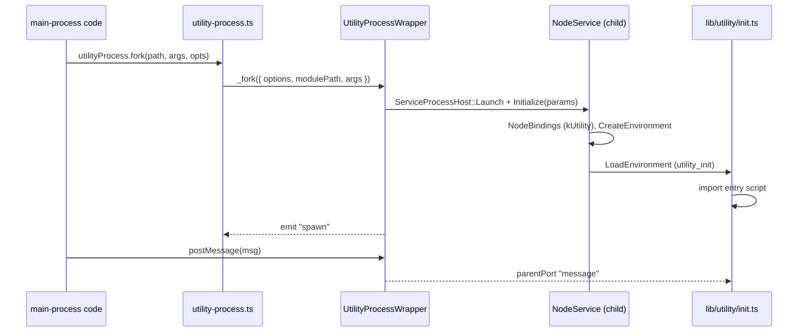

## Overview

Two features run Node.js away from the main process's event loop. `utilityProcess.fork` starts a separate, unsandboxed child process that runs an entry script in a Node environment and talks to its parent by message port. Web workers, optionally, get a Node environment inside the renderer when `nodeIntegrationInWorker` is on. They use the same `NodeBindings` class in two of its four modes (`kUtility` and `kWorker`, see [[Node.js Integration and the Event Loop]]) but are otherwise separate mechanisms: the first is a process managed from the main process, the second a per-thread environment inside a renderer.

Sources: [lib/browser/api/utility-process.ts:7-9](repo://lib/browser/api/utility-process.ts#L7-L9), [shell/services/node/node_service.cc:88-93](repo://shell/services/node/node_service.cc#L88-L93), [shell/renderer/web_worker_observer.cc:41-45](repo://shell/renderer/web_worker_observer.cc#L41-L45)

Sources: [lib/browser/api/utility-process.ts:93-119](repo://lib/browser/api/utility-process.ts#L93-L119), [shell/browser/api/electron_api_utility_process.cc:158-191](repo://shell/browser/api/electron_api_utility_process.cc#L158-L191), [shell/services/node/node_service.cc:108-194](repo://shell/services/node/node_service.cc#L108-L194), [lib/utility/init.ts:1-50](repo://lib/utility/init.ts#L1-L50)

## Forking from the main process

`utilityProcess.fork(modulePath, args, options)` constructs a `ForkUtilityProcess`, an `EventEmitter`. The constructor rejects a missing entry script, accepts `args` or `options` in the second position, type-checks `execArgv`, `serviceName` and `cwd`, and normalizes `stdio`. Only `ignore`, `inherit` and `pipe` are valid, stdin must be `ignore`, and each `pipe` creates a `PassThrough` stream on the JavaScript side. It then calls the native `_fork` and takes over the returned handle's `emit` so that `exit` clears the handle and streams, and `stdout`/`stderr` events, which carry a file descriptor, are turned into `Socket`s piped into the streams.

Sources: [lib/browser/api/utility-process.ts:13-119](repo://lib/browser/api/utility-process.ts#L13-L119)

The public surface is `pid`, `stdout`, `stderr`, `postMessage(message, transfer)` (unwrapping `MessagePortMain` to internal ports) and `kill()`, which returns false once the handle is gone.

Sources: [lib/browser/api/utility-process.ts:122-152](repo://lib/browser/api/utility-process.ts#L122-L152)

## Launching the process

`UtilityProcessWrapper::Create` refuses to run before app ready ("utilityProcess cannot be created before app is ready."), reads `modulePath`, `args`, `env`, `execArgv`, `serviceName`, `cwd`, the three stdio modes, `respondToAuthRequestsFromMainProcess` and, on macOS, `allowLoadingUnsignedLibraries`, builds a `NodeServiceParams` struct and creates the wrapper, which `Pin`s itself so that garbage collection cannot kill a running process object.

Sources: [shell/browser/api/electron_api_utility_process.cc:438-508](repo://shell/browser/api/electron_api_utility_process.cc#L438-L508)

The constructor then launches the child as a Chromium service: `ServiceProcessHost::Launch` with the `NodeService` receiver, a display name (default "Node Utility Process"), extra switches taken from `execArgv`, the working directory and environment (a custom environment replaces the parent's; otherwise it is inherited), and platform stdio plumbing: handles on Windows, extra file descriptors on POSIX, and the plugin helper on macOS when unsigned libraries are allowed. The `NodeService` mojom interface is marked `kNoSandbox`, so the child is unsandboxed.

Sources: [shell/browser/api/electron_api_utility_process.cc:158-191](repo://shell/browser/api/electron_api_utility_process.cc#L158-L191), [shell/services/node/public/mojom/node_service.mojom:13-31](repo://shell/services/node/public/mojom/node_service.mojom#L13-L31)

Messages travel on a separate message pipe rather than on the service interface: the wrapper creates a `MessagePortDescriptorPair`, keeps one end behind a `mojo::Connector`, and ships the other in `params->port`; the code comments that a dedicated pipe lets messages queue without blocking other interfaces. It also sends a `URLLoaderFactory` and `HostResolver` so `net` works in the child.

Sources: [shell/browser/api/electron_api_utility_process.cc:197-215](repo://shell/browser/api/electron_api_utility_process.cc#L197-L215)

`ElectronContentUtilityClient` registers `RunNodeService` among its main-thread services, so when the process starts Chromium instantiates a `NodeService` for the receiver.

Sources: [shell/utility/electron_content_utility_client.cc:102-104](repo://shell/utility/electron_content_utility_client.cc#L102-L104), [shell/utility/electron_content_utility_client.cc:134-156](repo://shell/utility/electron_content_utility_client.cc#L134-L156)

## Inside the child

`NodeService::Initialize` is the child-side counterpart of the browser's startup. It does nothing if `NodeBindings` is already initialized; otherwise it binds the client remote, initializes the `ParentPort` with the transferred port, stores the URL loader factory and resolver in a `URLLoaderBundle`, creates the `JavascriptEnvironment` and Node environment with the args and exec args (inserting the program path first, so `process.argv0` is right), and overrides V8's fatal-error handler so the parent is told through `OnV8FatalError` with a Node report and crash keys are set. It installs a process-exit handler that closes the parent port, stops the microtask runner and resets the receiver with the exit code and the reason `process_exit_termination`; sets unhandled rejections to warn; binds Electron's `process` extensions; stores the entry script as the hidden `_serviceStartupScript`; and calls `LoadEnvironment`, then starts the embed thread and polling.

Sources: [shell/services/node/node_service.cc:35-51](repo://shell/services/node/node_service.cc#L35-L51), [shell/services/node/node_service.cc:108-194](repo://shell/services/node/node_service.cc#L108-L194)

`lib/utility/init.ts` then runs. It reads `_serviceStartupScript`, restores `process.argv` with the entry script in place, runs the shared `common/init`, installs the event emitter prototype, and defines `process.parentPort`. The port starts paused: `ParentPort::Initialize` calls `PauseIncomingMethodCallProcessing`, and the JavaScript `ParentPort` starts it only when the first `message` listener is added and pauses it again when the last is removed, so messages sent early are queued rather than lost. Last, the script is imported through the ESM loader and an import failure is rethrown as an uncaught exception.

Sources: [lib/utility/init.ts:6-50](repo://lib/utility/init.ts#L6-L50), [shell/services/node/parent_port.cc:34-44](repo://shell/services/node/parent_port.cc#L34-L44), [shell/services/node/parent_port.cc:73-82](repo://shell/services/node/parent_port.cc#L73-L82)

`ParentPort` in `lib/utility/parent-port.ts` is an `EventEmitter` over a native port created by `createParentPort`; incoming `message` events are re-wrapped so their ports are `MessagePortMain`s, and `postMessage` serializes the value with `SerializeV8Value` and sends it as a transferable mojo message. This is the same message format described in [[IPC Messaging]].

Sources: [lib/utility/parent-port.ts:1-32](repo://lib/utility/parent-port.ts#L1-L32), [shell/services/node/parent_port.cc:46-62](repo://shell/services/node/parent_port.cc#L46-L62)

## Lifetime and exit

The parent decides a utility process has ended from several signals, all funnelled into `HandleTermination`, which runs only once: the service host observers (`OnServiceProcessTerminatedNormally` and `OnServiceProcessCrashed`, filtered to `NodeService` instances with the wrapper's pid), a mojo disconnect with reason `process_exit_termination` (the child's own exit handler), and `Shutdown`, called when the browser shuts down. It removes the wrapper from the pid map, closes the connector port, and, when `kill()` was used, converts `SIGTERM`/`SIGKILL` exit codes on POSIX into 0, because that is a graceful shutdown from the user's point of view. It then emits `exit` and unpins the object. `spawn` is emitted once the launch callback gives the pid.

Sources: [shell/browser/api/electron_api_utility_process.cc:244-330](repo://shell/browser/api/electron_api_utility_process.cc#L244-L330)

On the browser's own shutdown, `ElectronBrowserMainParts::PostMainMessageLoopRun` iterates over the running utility processes whose service is `NodeService` and shuts each down before stopping Node, so `exit` events can still be emitted; see [[Main Process Startup]].

Sources: [shell/browser/electron_browser_main_parts.cc:561-588](repo://shell/browser/electron_browser_main_parts.cc#L561-L588)

## Node in web workers

For workers inside a renderer, `ElectronRendererClient::WorkerScriptReadyForEvaluationOnWorkerThread` skips service workers, shared workers and main-thread worklets, since they run out of process and their sandbox cannot be customised; for other workers it requires the `nodeIntegrationInWorker` switch (set from web preferences) and creates a thread-local `WebWorkerObserver`.

Sources: [shell/renderer/electron_renderer_client.cc:210-230](repo://shell/renderer/electron_renderer_client.cc#L210-L230), [shell/browser/web_contents_preferences.cc:348-352](repo://shell/browser/web_contents_preferences.cc#L348-L352)

`WebWorkerObserver::WorkerScriptReadyForEvaluation` mirrors the renderer setup: it prepares the embed thread, creates a Node tracing agent, calls `node::InitializeContext` for the worker context, creates the environment through `NodeBindings` in `kWorker` mode (its own libuv loop, see [[Node.js Integration and the Event Loop]]), saves Blink's `fetch` family under `blink`-prefixed names, sets unhandled rejections to warn, binds `process` extensions, loads the environment and starts polling. `ContextWillDestroy` emits `exit` and frees the environment. The JavaScript for it is `lib/worker/init.ts`, described in [[Process Types and JavaScript Bootstraps]].

Sources: [shell/renderer/web_worker_observer.cc:49-131](repo://shell/renderer/web_worker_observer.cc#L49-L131), [lib/worker/init.ts:1-50](repo://lib/worker/init.ts#L1-L50)
