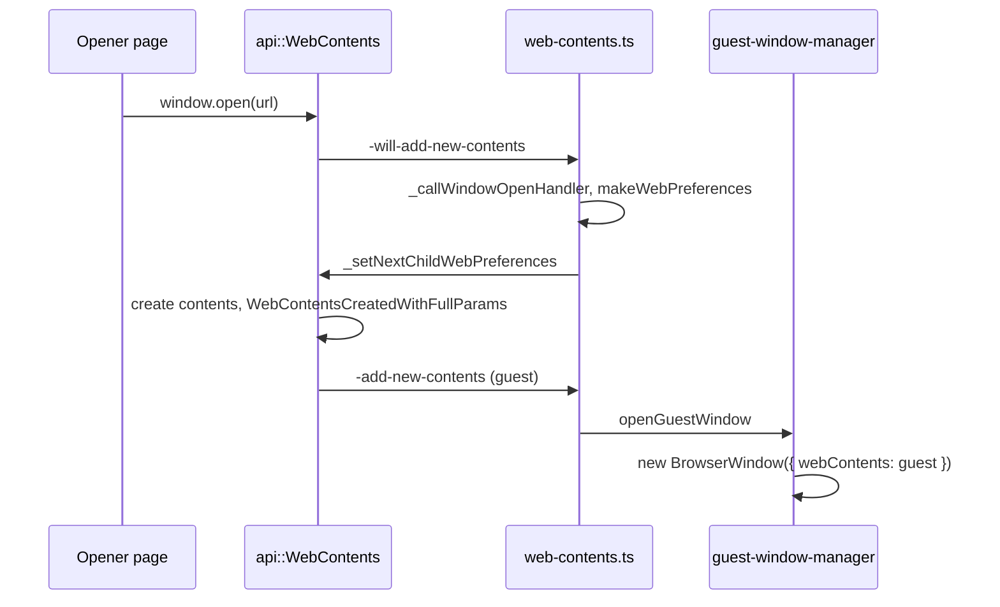

## Overview

`WebContents` is the object that represents one web page and its renderer process connections: it loads URLs, emits navigation events, creates child windows for `window.open`, and hosts frames. It is a C++ class, `electron::api::WebContents`, that wraps Chromium's `content::WebContents`, plus a TypeScript layer in `lib/browser/api/web-contents.ts` that adds behaviour on its prototype and wires events in an `_init` method. Windows embed one through a `WebContentsView` (see [[Windows, Views and Native Window Backends]]); IPC between a page and the main process is covered in [[IPC Messaging]].

Sources: [lib/browser/api/web-contents.ts:117-121](repo://lib/browser/api/web-contents.ts#L117-L121), [shell/browser/api/electron_api_web_contents.cc:785-789](repo://shell/browser/api/electron_api_web_contents.cc#L785-L789)

## Creating a WebContents

The C++ constructor reads `backgroundThrottling`, `type`, `transparent`, `offscreen`, `embedder` and `devTools` from the options. It then picks the session: an explicit `session`, otherwise `partition`, otherwise the default session (`Session::FromPartition(isolate, "")`); see [[Sessions, Protocols and Networking]]. It creates the underlying `content::WebContents` in one of three ways: a guest with a fake `chrome-guest://fake-host` site instance and a `WebViewGuestDelegate` for `<webview>`, an offscreen one with an `OffScreenWebContentsView` that paints to `OnPaint`, or a plain one honouring `show`.

Sources: [shell/browser/api/electron_api_web_contents.cc:793-889](repo://shell/browser/api/electron_api_web_contents.cc#L793-L889)

`InitWithSessionAndOptions` finishes setup. It builds the renderer's `accept_languages` from the application locale and preferred languages, copies font rendering parameters on Linux and Windows, creates the `WebContentsPreferences` object (unless one already exists from the `setWindowOpenHandler` path), creates permission and zoom helpers, extension observers and an autofill driver factory, sets the user agent and registers a user-data link so `WebContents::From(content::WebContents*)` can find the wrapper later.

Sources: [shell/browser/api/electron_api_web_contents.cc:906-988](repo://shell/browser/api/electron_api_web_contents.cc#L906-L988), [shell/browser/api/electron_api_web_contents.cc:4589-4595](repo://shell/browser/api/electron_api_web_contents.cc#L4589-L4595)

Every creation path (`New`, `CreateAndTake`, `FromOrCreate`) wraps the new object in a handle and then calls the JavaScript `_init` method inside a `TryCatch`, turning a throw into an uncaught exception.

Sources: [shell/browser/api/electron_api_web_contents.cc:4560-4611](repo://shell/browser/api/electron_api_web_contents.cc#L4560-L4611)

`_init` in `web-contents.ts` fixes `id` at construction, resets `_windowOpenHandler`, creates `webContents.ipc` as an `IpcMainImpl`, and defines `navigationHistory` as an object that binds the native history methods (`goBack`, `getAllEntries`, `restore` and so on). The older `canGoBack`, `goBack`, ... methods on `WebContents` log a one-time deprecation pointing to `navigationHistory`.

Sources: [lib/browser/api/web-contents.ts:486-535](repo://lib/browser/api/web-contents.ts#L486-L535), [lib/browser/api/web-contents.ts:537-575](repo://lib/browser/api/web-contents.ts#L537-L575)

## Loading a URL

`loadURL` in TypeScript does two things: it starts listening for the outcome with `_awaitNextLoad`, then calls the native `_loadURL`. The returned promise resolves on `did-finish-load` and rejects with an `Error` carrying `errno`, `code` and `url` on `did-fail-load`.

```ts
WebContents.prototype.loadURL = function (url, options) {
  const p = _awaitNextLoad.call(this, url);
  // Add a no-op rejection handler to silence the unhandled rejection error.
  p.catch(() => {});
  this._loadURL(url, options ?? {});
  return p;
};
```

Sources: [lib/browser/api/web-contents.ts:427-433](repo://lib/browser/api/web-contents.ts#L427-L433)

`_awaitNextLoad` also handles edge cases. A second unrelated main-frame navigation while the first is running rejects the first with `ERR_ABORTED`, but same-document transitions (`pushState`, hash changes) are ignored so client-side routing at page load is allowed. `did-stop-loading` without a finish or fail event, such as for a bad scheme, rejects with a generic `ERR_FAILED`, and `destroyed` also ends the wait.

Sources: [lib/browser/api/web-contents.ts:342-425](repo://lib/browser/api/web-contents.ts#L342-L425)

`loadFile` is sugar over this: it builds a `file:` URL from `app.getAppPath()` plus the path (with optional `query`, `search`, `hash`) and calls `loadURL`.

Sources: [lib/browser/api/web-contents.ts:324-338](repo://lib/browser/api/web-contents.ts#L324-L338)

The native `WebContents::LoadURL` first rejects an invalid or over-long URL by emitting `did-fail-load` with `ERR_INVALID_URL`. Otherwise it builds `LoadURLParams` from the options (`httpReferrer`, `userAgent`, `extraHeaders`, `postData`, `baseURLForDataURL`, `reloadIgnoringCache`) with a typed address-bar transition, and refuses with `ERR_FAILED` if it is not safe to navigate (`is_safe_to_delete_` is false or a pending-entry navigation is in progress, per crbug.com/347742). It discards uncommitted entries, calls `LoadURLWithParams`, and the code warns that this call can run JavaScript that destroys `this`, which is why it keeps a weak pointer.

Sources: [shell/browser/api/electron_api_web_contents.cc:2331-2402](repo://shell/browser/api/electron_api_web_contents.cc#L2331-L2402)

## Navigation events and throttling

Chromium's navigation observer callbacks become JavaScript events. `DidStartNavigation`, `DidRedirectNavigation` and `ReadyToCommitNavigation` each temporarily set `is_safe_to_delete_` to false with `base::AutoReset` and call `EmitNavigationEvent` (`did-start-navigation`, `did-redirect-navigation`, `-ready-to-commit-navigation`). `DidFinishNavigation` returns early for uncommitted navigations and otherwise emits the `did-navigate` family.

Sources: [shell/browser/api/electron_api_web_contents.cc:2027-2075](repo://shell/browser/api/electron_api_web_contents.cc#L2027-L2075)

Cancelable events come from `ElectronNavigationThrottle`, which `ElectronBrowserClient::CreateThrottlesForNavigation` adds to every navigation. `WillStartRequest` proceeds if there is no JavaScript wrapper, treats Chrome internal pages as renderer-initiated, and for renderer-initiated navigations emits `will-frame-navigate` and, in the main frame, `will-navigate`; a handler's `preventDefault` makes it return `CANCEL`. `WillRedirectRequest` does the same for `will-redirect`. App-initiated `loadURL` calls are browser-initiated, so they are not subject to `will-navigate`.

Sources: [shell/browser/electron_navigation_throttle.cc:26-86](repo://shell/browser/electron_navigation_throttle.cc#L26-L86), [shell/browser/electron_browser_client.cc:955-957](repo://shell/browser/electron_browser_client.cc#L955-L957)

## Opening new windows

`window.open`, links with `target="_blank"` and similar requests reach the app through `setWindowOpenHandler`, which stores a callback in `_windowOpenHandler`. `_callWindowOpenHandler` runs it and validates the answer: a non-object or `null` response, or an unknown `action`, calls `event.preventDefault()` and logs an error; `{ action: 'deny' }` prevents the window; `{ action: 'allow' }` returns the `overrideBrowserWindowOptions`, `outlivesOpener` and `createWindow` fields. With no handler the default is to allow with no overrides.

Sources: [lib/browser/api/web-contents.ts:435-477](repo://lib/browser/api/web-contents.ts#L435-L477)

There are two native entry points. `OpenURLFromTab` with a disposition other than the current tab (for example a link click) emits `-new-window`. For `window.open` Chromium first asks `IsWebContentsCreationOverridden`, which emits `-will-add-new-contents`; if the app prevented the default the creation is cancelled and `window.open` returns null. When the new contents exist, `WebContentsCreatedWithFullParams` records `url`, `frame_name`, `referrer`, `raw_features` and body in a `ChildWebContentsTracker` and applies the pending child `webPreferences` stored by `SetNextChildWebPreferences`. `AddNewContents` then wraps the contents in a `WebContents`, runs `HandleNewRenderFrame` (so preferences such as background colour apply even if the window never navigates) and emits `-add-new-contents`; if that is prevented the contents are destroyed.

Sources: [shell/browser/api/electron_api_web_contents.cc:1149-1200](repo://shell/browser/api/electron_api_web_contents.cc#L1149-L1200), [shell/browser/api/electron_api_web_contents.cc:1239-1292](repo://shell/browser/api/electron_api_web_contents.cc#L1239-L1292)

The TypeScript handlers for these three events live in `_init` (only for non-`remote` contents). `-new-window` builds a `HandlerDetails` object and, unless prevented, calls `openGuestWindow`. `-will-add-new-contents` calls the handler, then builds the child's web preferences with `makeWebPreferences` and hands them to native code with `_setNextChildWebPreferences`. `-add-new-contents` accepts only `foreground-tab`, `new-window` and `background-tab` dispositions and calls `openGuestWindow` with the guest `webContents`.



Sources: [lib/browser/api/web-contents.ts:624-753](repo://lib/browser/api/web-contents.ts#L624-L753), [shell/browser/api/electron_api_web_contents.cc:1178-1278](repo://shell/browser/api/electron_api_web_contents.cc#L1178-L1278)

`openGuestWindow` merges `show: true`, 800x600, the parsed `window.open` features and the handler's overrides into the `BrowserWindow` options. A repeated `window.open` with the same frame name reuses the existing window by calling `loadURL`. If the handler supplied `createWindow` it is used instead, and must return the same `webContents` it was given. Otherwise a `BrowserWindow` is created around the guest contents (and, when opened from a link, told to `loadURL` with the referrer and post data), lifecycle events are linked, and the opener emits `did-create-window`.

Sources: [lib/browser/guest-window-manager.ts:29-102](repo://lib/browser/guest-window-manager.ts#L29-L102)

The lifecycle link is one-directional by convention: closing the opener destroys the guest unless `outlivesOpener` is set, and the guest's destruction only unregisters it; frame names are registered so later opens can find them.

Sources: [lib/browser/guest-window-manager.ts:104-138](repo://lib/browser/guest-window-manager.ts#L104-L138)

Security preferences are inherited, not trusted. `makeWebPreferences` keeps `contextIsolation`, `javascript`, `nodeIntegration`, `sandbox`, `webviewTag`, `nodeIntegrationInSubFrames` and `enableWebSQL` from the parent only when the parent's value equals the secure value. The spread order lets the renderer-supplied features be overridden by those inherited values, and those in turn by `secureOverrideWebPreferences`, which only the main process can set.

Sources: [lib/browser/guest-window-manager.ts:140-175](repo://lib/browser/guest-window-manager.ts#L140-L175)

## Webview guests

A `<webview>` element is a guest `WebContents` of type `webview`. `guest-view-manager.ts` implements the main-process side. `createGuest` parses the element's attributes into web preferences (forcing the same inherited secure defaults), emits `will-attach-webview` on the embedder where the app can cancel by preventing default (returning `-1`), and creates the guest with `webContents.create({ type: 'webview', embedder })`. It stores the instance, waits for `did-attach` to load `src` on the first attach, and emits `did-attach-webview`. Messages from the element arrive through internal IPC channels (`GUEST_VIEW_MANAGER_CREATE_AND_ATTACH_GUEST`, `..._CALL`, `..._PROPERTY_GET`, `..._PROPERTY_SET`).

Sources: [lib/browser/guest-view-manager.ts:25-140](repo://lib/browser/guest-view-manager.ts#L25-L140), [lib/browser/guest-view-manager.ts:281-345](repo://lib/browser/guest-view-manager.ts#L281-L345)

## Frames

Each frame in a page is a `WebFrameMain`. It is tracked in two maps: `FrameTreeNodeIdMap`, keyed by the frame tree node so a frame is followed across navigations (like an `<iframe>`), and `FrameTokenMap`, keyed by the render frame host's token, which identifies the exact host. When a cross-origin navigation swaps hosts, `UpdateRenderFrameHost` re-points the same wrapper at the new host; `render_frame_host()` returns null once the frame is disposed. The TypeScript side adds a lazily created `ipc` per frame and `send` / `postMessage` wrappers, which are detailed in [[IPC Messaging]].

Sources: [shell/browser/api/electron_api_web_frame_main.cc:98-145](repo://shell/browser/api/electron_api_web_frame_main.cc#L98-L145), [shell/browser/api/electron_api_web_frame_main.cc:167-200](repo://shell/browser/api/electron_api_web_frame_main.cc#L167-L200), [lib/browser/api/web-frame-main.ts:1-48](repo://lib/browser/api/web-frame-main.ts#L1-L48)
