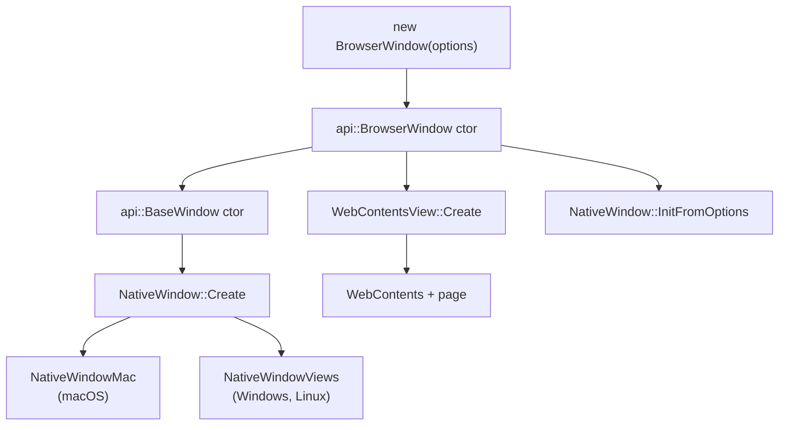

## Overview

A window in Electron is three layers stacked on each other. `BaseWindow` is the JavaScript-visible class with window behaviour and no web page. `BrowserWindow` extends it by creating a `WebContentsView` that hosts a page. Under both sits `NativeWindow`, a C++ abstract class with one implementation per platform family (`NativeWindowMac` on macOS, `NativeWindowViews` on Windows and Linux). This page follows `new BrowserWindow(options)` down through those layers. The page inside the window is the subject of [[WebContents and Navigation]]; the C++ class conventions are from [[Gin Helpers, Converters and Wrappables]].

Sources: [lib/browser/api/browser-window.ts:1-8](repo://lib/browser/api/browser-window.ts#L1-L8), [shell/browser/api/electron_api_base_window.cc:96-124](repo://shell/browser/api/electron_api_base_window.cc#L96-L124), [shell/browser/native_window.h:63-71](repo://shell/browser/native_window.h#L63-L71)

Sources: [shell/browser/api/electron_api_browser_window.cc:28-99](repo://shell/browser/api/electron_api_browser_window.cc#L28-L99), [shell/browser/native_window_views.cc:1949-1954](repo://shell/browser/native_window_views.cc#L1949-L1954), [shell/browser/native_window_mac.mm:1878-1883](repo://shell/browser/native_window_mac.mm#L1878-L1883)

## JavaScript classes

`lib/browser/api/base-window.ts` fetches the `BaseWindow` constructor from the `electron_browser_base_window` binding, makes its prototype inherit from `EventEmitter`, and adds `_init`, which on non-macOS platforms applies the application menu to the new window. It also defines property accessors (`fullScreen`, `kiosk`, `focusable`, `documentEdited`, and others) as getter/setter pairs over the native `isX`/`setX` methods.

Sources: [lib/browser/api/base-window.ts:1-60](repo://lib/browser/api/base-window.ts#L1-L60)

`BrowserWindow` sets its prototype to `BaseWindow.prototype` and overrides `_init`. The override calls the parent `_init`, freezes `id` at construction so it stays readable after the native window is destroyed, and makes `setBounds` merge partial bounds with the current ones. It forwards `focus` and `blur` to `app` as `browser-window-focus` and `browser-window-blur`, derives `unresponsive` and `responsive` window events from the web contents with timers (50 ms after the page reports unresponsive; a 5000 ms watchdog after `close`), and keeps the page's visibility state in sync on `show`, `hide`, `minimize`, `maximize` and `restore`. At the end it emits `browser-window-created` on `app`.

Sources: [lib/browser/api/browser-window.ts:8-99](repo://lib/browser/api/browser-window.ts#L8-L99)

Many `BrowserWindow` methods are thin forwards to `webContents` (`loadURL`, `getURL`, `loadFile`, `reload`, `send`), and the static finders `fromId` and `getAllWindows` filter `BaseWindow`'s results to real `BrowserWindow` instances.

Sources: [lib/browser/api/browser-window.ts:101-150](repo://lib/browser/api/browser-window.ts#L101-L150)

`BrowserView` is now implemented on top of `WebContentsView`. `addBrowserView` adds `browserView.webContentsView` to the window's `contentView`, `removeBrowserView` removes it, and `setTopBrowserView` re-adds it to bring it to the front.

Sources: [lib/browser/api/browser-window.ts:225-253](repo://lib/browser/api/browser-window.ts#L225-L253)

## Constructing the native window

The C++ `BaseWindow` constructor handles three things before any platform code. It records the `parent` window; it forces `frame: false` when `webPreferences.offscreen` is set (offscreen windows are always frameless); and it calls `NativeWindow::Create(options, parent_native_window)`, registers itself as an observer and installs an empty `View` as the content view. On Linux and Windows it also applies `icon`.

Sources: [shell/browser/api/electron_api_base_window.cc:96-124](repo://shell/browser/api/electron_api_base_window.cc#L96-L124)

`NativeWindow::Create` is declared once and defined twice: `native_window_views.cc` returns a `NativeWindowViews`, and `native_window_mac.mm` returns a `NativeWindowMac`. The build includes only the one for the target platform.

Sources: [shell/browser/native_window_views.cc:1949-1954](repo://shell/browser/native_window_views.cc#L1949-L1954), [shell/browser/native_window_mac.mm:1878-1883](repo://shell/browser/native_window_mac.mm#L1878-L1883)

The shared `NativeWindow` constructor reads the options every backend needs: `titleBarStyle`, `transparent`, `enableLargerThanScreen`, `modal` (only with a parent), `frame` (a window has a frame only if `frame` is true and the title bar style is normal), and the title-bar overlay. It adds the window to the global `WindowList`.

Sources: [shell/browser/native_window.cc:100-126](repo://shell/browser/native_window.cc#L100-L126)

Backends then build the actual window. `NativeWindowViews` computes the default 800x600 bounds, creates a `views::Widget` with `InitParams` (frameless or client-drawn frame, translucency, activatability), uses a platform native widget (`ElectronDesktopNativeWidgetAura` on Windows, `DesktopNativeWidgetAura` plus `ElectronDesktopWindowTreeHostLinux` on Linux, with window class and role names taken from the app name) and calls `widget()->Init`. `NativeWindowMac` computes bounds centered on the main screen, builds an `NSWindowStyleMask` from the options, and takes the `ElectronNSWindow` from the widget's native window.

Sources: [shell/browser/native_window_views.cc:256-305](repo://shell/browser/native_window_views.cc#L256-L305), [shell/browser/native_window_mac.mm:117-208](repo://shell/browser/native_window_mac.mm#L117-L208)

## BrowserWindow and its page

After `BaseWindow` has built the native window, the `BrowserWindow` constructor adds the page. It takes `webPreferences`, propagates `backgroundColor` (or a transparent color when the window is translucent) and `show` into them as hidden values, and keeps a `webContents` option if one was given. It then creates a `WebContentsView` with those preferences, registers it as a draggable-region provider, keeps references to the view and its `WebContents`, and observes the contents. It calls `SetOwnerWindow` so the page knows its window, runs `InitWithArgs`, and inserts the web view at index 0 of the native window's contents view.

Sources: [shell/browser/api/electron_api_browser_window.cc:28-95](repo://shell/browser/api/electron_api_browser_window.cc#L28-L95)

Inserting at index 0 is deliberate: the source comment says the web contents view sits as a sibling before `BaseWindow`'s own `contentView`, so views a user adds to `contentView` paint above the page. The very last step is `window()->InitFromOptions(options)`.

Sources: [shell/browser/api/electron_api_browser_window.cc:87-99](repo://shell/browser/api/electron_api_browser_window.cc#L87-L99)

`NativeWindow::InitFromOptions` applies everything that needs a live window: position (`x`/`y` or `center`), minimum and maximum size constraints (content-size or frame-size depending on `useContentSize`), `closable`, `movable`, `hasShadow`, `opacity`, `alwaysOnTop`, fullscreen state, `resizable`, `skipTaskbar`, `kiosk`, vibrancy or background material, background colour (white by default, transparent for translucent windows), the title (defaulting to the app name) and finally `Show()` unless `show: false`. A Windows-only workaround calls `SetPosition` twice, with a FIXME referencing issue 10862.

Sources: [shell/browser/native_window.cc:137-249](repo://shell/browser/native_window.cc#L137-L249)

## Window lifecycle

Closing a `BrowserWindow` goes through the page. When the close button is clicked, `OnCloseButtonClicked` sets `prevent_default` so the native window does not close at once. It notifies user activation, then dispatches `beforeunload` if the page needs it, or closes the contents directly; when the page is gone, `WebContentsDestroyed` calls `CloseImmediately`. On the native side `NativeWindowClientView::OnWindowCloseRequested` calls `NotifyWindowCloseButtonClicked` and returns `kCannotClose`, which is what feeds this path on Windows and Linux.

Sources: [shell/browser/api/electron_api_browser_window.cc:110-117](repo://shell/browser/api/electron_api_browser_window.cc#L110-L117), [shell/browser/api/electron_api_browser_window.cc:148-166](repo://shell/browser/api/electron_api_browser_window.cc#L148-L166), [shell/browser/native_window_views.cc:173-194](repo://shell/browser/native_window_views.cc#L173-L194)

`BaseWindow::WillCloseWindow` emits `close` and a listener's `preventDefault` stops the close. When the native window really closes, `OnWindowClosed` invalidates weak pointers, removes the window from the weak map, marks the JavaScript object destroyed, emits `closed`, detaches from its parent's child list, and posts the destroy closure for the native object. The destructor closes immediately and releases the native window on the next task, because native code may be iterating the window list.

Sources: [shell/browser/api/electron_api_base_window.cc:134-189](repo://shell/browser/api/electron_api_base_window.cc#L134-L189)

`BaseWindow` is a `TrackableObject`, so `BaseWindow.fromId` and `getAllWindows` are `FromWeakMapID` and `GetAll` on its weak map; the binding installs them as constructor methods and registers the class with `SetConstructor`.

Sources: [shell/browser/api/electron_api_base_window.cc:1332-1352](repo://shell/browser/api/electron_api_base_window.cc#L1332-L1352)

## Views and WebContentsView

`View` is the JavaScript wrapper of a `views::View` and is what makes `contentView` composable: its prototype provides `addChildView`, `removeChildView`, `setBounds`, `getBounds`, `setBackgroundColor`, `setBorderRadius`, `setLayout` and visibility accessors. In JavaScript `View` inherits from `EventEmitter`.

Sources: [shell/browser/api/electron_api_view.cc:447-460](repo://shell/browser/api/electron_api_view.cc#L447-L460), [lib/browser/api/view.ts:1-7](repo://lib/browser/api/view.ts#L1-L7)

`WebContentsView` is a `View` whose underlying view is the inspectable web contents' view. Its constructor sets a flex behaviour that scales to minimum and is unbounded in maximum, and observes the contents; if the view is destroyed without closing the contents it destroys them too. `WebContentsView::Create` builds the object by calling its own JavaScript constructor with `{ webPreferences }`, which is how `BrowserWindow` creates one from C++.

Sources: [shell/browser/api/electron_api_web_contents_view.cc:32-56](repo://shell/browser/api/electron_api_web_contents_view.cc#L32-L56), [shell/browser/api/electron_api_web_contents_view.cc:125-142](repo://shell/browser/api/electron_api_web_contents_view.cc#L125-L142), [lib/browser/api/web-contents-view.ts:1-7](repo://lib/browser/api/web-contents-view.ts#L1-L7)
