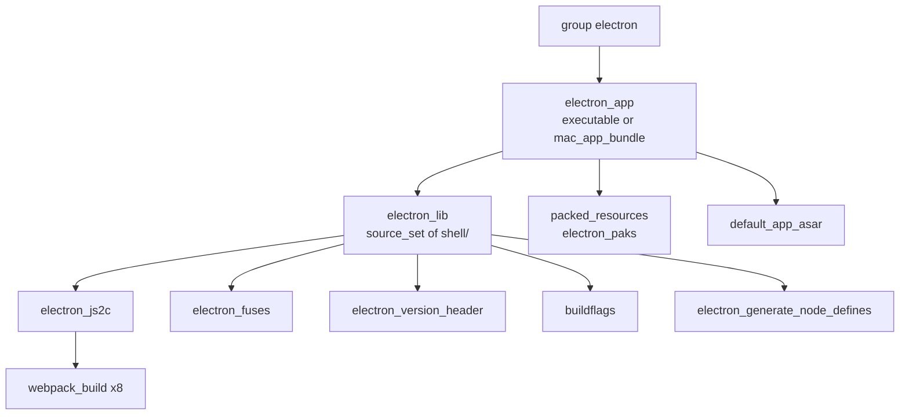

## Overview

Electron is not built on its own. This repository is checked out as `src/electron` inside a full Chromium source tree, and it is built by Chromium's toolchain: `gclient` fetches the dependencies, GN generates ninja files, and ninja compiles Chromium, Node.js and Electron into one executable. The repository's `BUILD.gn` is pulled into Chromium's build through the `root_extra_deps` argument, and it defines the Electron library, the app executable or bundle, the generated JavaScript and resources, and the distribution archives. The commands to drive this are in [[Quickstart: Build and Run from Source]]; this page explains what they set up.

Sources: [build/args/all.gn:1-2](repo://build/args/all.gn#L1-L2), [BUILD.gn:1-32](repo://BUILD.gn#L1-L32)

## Fetching sources: DEPS

### Dependencies

`DEPS` is the `gclient` manifest. Its `vars` pin the upstream versions (Chromium, Node.js, NAN, Squirrel.Mac and its Objective-C dependencies, reclient configs) and expose switches such as `apply_patches`, `use_mtime_cache` and `checkout_node`. Its `deps` place Chromium at `src`, Node.js at `src/third_party/electron_node`, NAN at `src/third_party/nan`, and Squirrel.Mac with ReactiveObjC and Mantle under `src/third_party/squirrel.mac`.

Sources: [DEPS:3-58](repo://DEPS#L3-L58), [DEPS:77-110](repo://DEPS#L77-L110)

### Hooks

After syncing, `gclient` runs the hooks. `patch_chromium` applies every patch set listed in `patches/config.json` with `script/apply_all_patches.py` ([[Patching Chromium and Node.js]]). The mtime-cache hooks record file modification times before patching and restore them afterwards, so re-applying identical patches does not make ninja rebuild everything. `electron_npm_deps` runs `yarn install --frozen-lockfile` in `src/electron`, and Linux sysroot hooks install the cross-compilation sysroots.

Sources: [DEPS:112-160](repo://DEPS#L112-L160), [DEPS:162-210](repo://DEPS#L162-L210)

## Build arguments

### Presets

`build/args` holds the argument presets passed to `gn gen` with `import(...)`. `all.gn` is shared: it sets `is_electron_build`, adds `//electron` to the root build, pins Node's `node_module_version`, tags V8 with `-electron.0`, enables proprietary codecs and printing, and turns off features that conflict with running V8 in the browser process (CET shadow stack, CFI) or that Electron does not use. `testing.gn` is a non-official, non-component build with DCHECKs on; `release.gn` is an official build. Both build ffmpeg as a shared library so it can be swapped for a version without proprietary codecs.

Sources: [build/args/all.gn:1-70](repo://build/args/all.gn#L1-L70), [build/args/testing.gn:1-7](repo://build/args/testing.gn#L1-L7), [build/args/release.gn:1-9](repo://build/args/release.gn#L1-L9)

### Electron build flags

`buildflags/buildflags.gni` declares Electron's own arguments: `enable_pdf_viewer`, `enable_electron_extensions`, `enable_builtin_spellchecker`, `enable_fake_location_provider` (on in non-official builds, for testing geolocation), `override_electron_version` and `electron_vendor_version`. `buildflags/BUILD.gn` turns them into `buildflags.h`, so C++ checks them with `BUILDFLAG(ENABLE_ELECTRON_EXTENSIONS)` and similar, and webpack reads the same header to define them for TypeScript ([[JavaScript Bundles and the electron Module]]). `BUILD.gn` asserts consistency: the PDF viewer needs Chromium's PDF support and Electron's extensions, and Electron's extensions need Chromium's.

Sources: [buildflags/buildflags.gni:5-30](repo://buildflags/buildflags.gni#L5-L30), [buildflags/BUILD.gn:8-28](repo://buildflags/BUILD.gn#L8-L28), [BUILD.gn:130-139](repo://BUILD.gn#L130-L139)

### Version and branding

The product and project names and the macOS bundle ID come from `shell/app/BRANDING.json`. The version comes from `override_electron_version` when set; otherwise GN runs `script/get-git-version.py` against `.git`, and deliberately fails when there is no git metadata, because a source tarball would otherwise produce a broken build. The version feeds templated files: `electron_version.h`, the Windows `.rc` resource, and the `version` file shipped next to the binary.

Sources: [BUILD.gn:100-122](repo://BUILD.gn#L100-L122), [BUILD.gn:341-386](repo://BUILD.gn#L341-L386)

## Main targets

### Target graph

Sources: [BUILD.gn:1557-1559](repo://BUILD.gn#L1557-L1559), [BUILD.gn:1209-1230](repo://BUILD.gn#L1209-L1230), [BUILD.gn:423-440](repo://BUILD.gn#L423-L440), [BUILD.gn:237-247](repo://BUILD.gn#L237-L247)

### electron_lib

`electron_lib` is a `source_set` holding all of `shell/`. It depends on the generated fuses, Node defines, `electron_natives.cc` from `electron_js2c`, the version header, resources and build flags. Its sources come from `filenames.gni`: `lib_sources` everywhere, plus `lib_sources_win`, `lib_sources_mac`, `lib_sources_posix`, `lib_sources_linux` (and `_x11`), `lib_sources_views` on Views platforms, and `lib_sources_extensions` when extensions are enabled.

Sources: [BUILD.gn:423-440](repo://BUILD.gn#L423-L440), [BUILD.gn:560-575](repo://BUILD.gn#L560-L575), [BUILD.gn:728-730](repo://BUILD.gn#L728-L730), [filenames.gni:1-24](repo://filenames.gni#L1-L24)

### electron_app

On Windows and Linux, `electron_app` is an `executable` built from the platform `main` file and linked with `electron_lib`, `libnode`, the packed resources, `default_app.asar` and crash-reporting support. On macOS it is a `mac_app_bundle` named after the product, with the framework and helper bundles assembled around it. The `electron` group, the usual ninja target, depends on it.

Sources: [BUILD.gn:1099-1110](repo://BUILD.gn#L1099-L1110), [BUILD.gn:1209-1230](repo://BUILD.gn#L1209-L1230), [BUILD.gn:1557-1559](repo://BUILD.gn#L1557-L1559)

### Generated code and resources

| Target | Produces |
| --- | --- |
| `electron_js2c` and the `webpack_build` targets | The per-process JavaScript bundles compiled into `electron_natives.cc` |
| `electron_fuses` | `fuses.h` and `fuses.cc` from `build/fuses/fuses.json5` ([[Fuses]]) |
| `build_electron_definitions` | `electron.d.ts` from the API docs |
| `default_app_js`, `default_app_asar` | The compiled default app packed into `resources/default_app.asar` |
| `resources` (grit) and `packed_resources` | `electron_resources.pak`, merged with Chromium's into `resources.pak` and the scale-factor paks |
| `generate_config_gypi`, Node header targets | Node's `config.gypi` and headers for building native modules |

Sources: [BUILD.gn:155-272](repo://BUILD.gn#L155-L272), [BUILD.gn:274-330](repo://BUILD.gn#L274-L330), [BUILD.gn:393-404](repo://BUILD.gn#L393-L404), [BUILD.gn:793-800](repo://BUILD.gn#L793-L800), [build/electron_paks.gni:35-60](repo://build/electron_paks.gni#L35-L60)

### Running JavaScript tools from GN

TypeScript, webpack and other Node tools run through the `npm_action` template in `build/npm.gni`. Each such action first runs a `pre-flight` stamp action that depends on `package.json` and `yarn.lock`, then runs the named `package.json` script through `build/npm-run.py`.

Sources: [build/npm.gni:1-40](repo://build/npm.gni#L1-L40)

## Keeping file lists in sync

GN needs every source file named. C++ files are listed by hand in `filenames.gni` (the API guide asks for new files to be added there alphabetically), while `filenames.auto.gni` is generated: `script/gen-filenames.ts` lists every API doc for the definitions target and asks webpack which files each bundle depends on, writing one `<bundle>_deps` list per target. The script runs from the pre-commit hook for JavaScript and TypeScript changes.

Sources: [script/gen-filenames.ts:18-118](repo://script/gen-filenames.ts#L18-L118), [docs/development/creating-api.md:7-35](repo://docs/development/creating-api.md#L7-L35), [package.json:101-107](repo://package.json#L101-L107)

## Distribution archives

The `dist_zip` template collects a target's runtime dependencies (`write_runtime_deps`) and zips them with `build/zip.py`, taking the target CPU and OS into account. `electron_dist_zip` packages the app, the version file and licenses into `dist.zip`; on Linux official builds it adds stripped binaries and the Chrome sandbox helper. Further `dist_zip` targets produce the shared ffmpeg, `chromedriver`, `mksnapshot`, Hunspell dictionaries and libc++ header archives that releases publish ([[Releases and the npm Package]]).

Sources: [BUILD.gn:1364-1400](repo://BUILD.gn#L1364-L1400), [BUILD.gn:1423-1447](repo://BUILD.gn#L1423-L1447), [BUILD.gn:1448-1545](repo://BUILD.gn#L1448-L1545)
