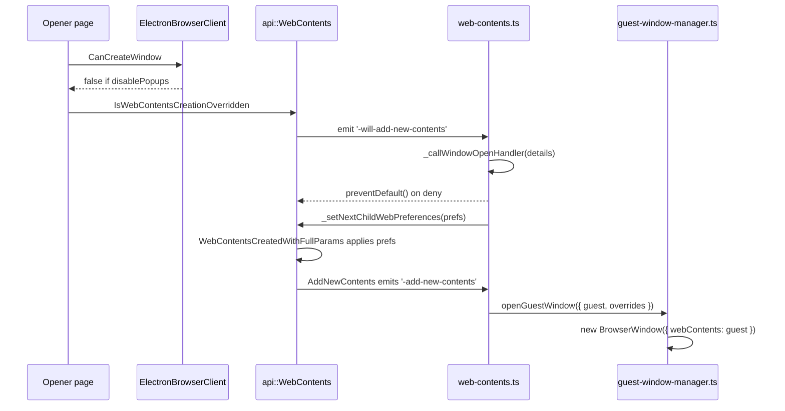

## Overview

Pages can create more web content in two ways. `window.open()`, or a link with `target="_blank"`, asks for a new top-level window; Electron lets the app approve, deny or customise it with `webContents.setWindowOpenHandler`, and turns approved requests into `BrowserWindow`s. The `<webview>` element embeds a separate "guest" page inside an embedder page, rendered as an inner `WebContents` attached to an iframe. Both are mostly implemented in TypeScript on top of hooks in `api::WebContents`, and both apply the same rule: a child can never be less secure than its parent unless the main process says so. General `webContents` behaviour is covered in [[WebContents and Frames]].

Sources: [lib/browser/guest-window-manager.ts:1-7](repo://lib/browser/guest-window-manager.ts#L1-L7), [lib/browser/guest-view-manager.ts:25-69](repo://lib/browser/guest-view-manager.ts#L25-L69)

## window.open

### The request path

Sources: [shell/browser/electron_browser_client.cc:651-692](repo://shell/browser/electron_browser_client.cc#L651-L692), [shell/browser/api/electron_api_web_contents.cc:1148-1201](repo://shell/browser/api/electron_api_web_contents.cc#L1148-L1201), [shell/browser/api/electron_api_web_contents.cc:1239-1278](repo://shell/browser/api/electron_api_web_contents.cc#L1239-L1278), [lib/browser/api/web-contents.ts:665-751](repo://lib/browser/api/web-contents.ts#L665-L751)

`ElectronBrowserClient::CanCreateWindow` refuses popups for contents whose preferences disable them, which is how a `<webview>` without `allowpopups` makes `window.open` return `null`. Chromium then asks `WebContents::IsWebContentsCreationOverridden`, which emits the internal `-will-add-new-contents` event with the URL, frame name, raw features, disposition, referrer and post body. If JavaScript prevents it, Chromium falls through to `CreateCustomWebContents`, which returns null, so `window.open` returns `null` in the page.

Sources: [shell/browser/electron_browser_client.cc:651-692](repo://shell/browser/electron_browser_client.cc#L651-L692), [shell/browser/api/electron_api_web_contents.cc:1178-1219](repo://shell/browser/api/electron_api_web_contents.cc#L1178-L1219)

### setWindowOpenHandler

`_callWindowOpenHandler` runs the app's handler. With no handler, the window is allowed with default options. The handler must return an object: `{ action: 'deny' }` prevents the window, `{ action: 'allow' }` may add `overrideBrowserWindowOptions`, `outlivesOpener` and `createWindow`, and anything else prevents the window and logs an error. An exception thrown by the handler also prevents the window and is rethrown.

Sources: [lib/browser/api/web-contents.ts:439-477](repo://lib/browser/api/web-contents.ts#L439-L477), [lib/browser/api/web-contents.ts:684-690](repo://lib/browser/api/web-contents.ts#L684-L690)

When the window is allowed, the listener computes the child's web preferences before Chromium creates the child: `backgroundColor`, `transparent` and the handler's `webPreferences` form the trusted overrides, the feature string supplies the untrusted ones, and `makeWebPreferences` combines them. `_setNextChildWebPreferences` stores the result, `MaybeOverrideCreateParamsForNewWindow` uses it to give an offscreen child an offscreen view, and `WebContentsCreatedWithFullParams` attaches it to the new `content::WebContents` before its first renderer starts.

Sources: [lib/browser/api/web-contents.ts:692-717](repo://lib/browser/api/web-contents.ts#L692-L717), [shell/browser/api/electron_api_web_contents.cc:1148-1176](repo://shell/browser/api/electron_api_web_contents.cc#L1148-L1176), [shell/browser/api/electron_api_web_contents.cc:1194-1237](repo://shell/browser/api/electron_api_web_contents.cc#L1194-L1237)

### Security inheritance

`makeWebPreferences` merges in a fixed order: parsed features first, then any security setting the parent has in its secure state (`contextIsolation: true`, `javascript: false`, `nodeIntegration: false`, `sandbox: true`, `webviewTag: false`, `nodeIntegrationInSubFrames: false`, `enableWebSQL: false`), then the main process's overrides. A page therefore cannot use the feature string to open a child with Node integration or without isolation if it lacks them itself, while the app's handler still can.

Sources: [lib/browser/guest-window-manager.ts:140-175](repo://lib/browser/guest-window-manager.ts#L140-L175)

### Parsing the feature string

`parseFeatures` splits `"key=value,key=value"` pairs. Numeric keys (`x`, `y`, `width`, `height`, the min/max sizes, `opacity`, `top`, `left`, `innerWidth`, `innerHeight`) become integers; otherwise `yes`, `1`, `true` or a bare key mean true and `no`, `0`, `false` mean false. Only `zoomFactor`, `nodeIntegration`, `javascript`, `contextIsolation` and `webviewTag` are treated as web preferences. `resizable` is dropped because, per the HTML spec, opened windows are always resizable, and `left`/`top` are mapped to `x`/`y`.

Sources: [lib/browser/parse-features-string.ts:13-107](repo://lib/browser/parse-features-string.ts#L13-L107)

### Creating the window

`AddNewContents` wraps the new `content::WebContents` as an `api::WebContents` (offscreen if its preferences say so) and emits `-add-new-contents`; if a listener prevents it, the new contents are destroyed. The listener accepts only the `foreground-tab`, `new-window` and `background-tab` dispositions and calls `openGuestWindow` with the options captured by the earlier handler call.

Sources: [shell/browser/api/electron_api_web_contents.cc:1239-1278](repo://shell/browser/api/electron_api_web_contents.cc#L1239-L1278), [lib/browser/api/web-contents.ts:720-751](repo://lib/browser/api/web-contents.ts#L720-L751)

`openGuestWindow` builds the `BrowserWindow` options from `show: true`, an 800×600 default, the parsed features and then the handler's overrides. Following the HTML rule for named targets, a second `window.open` with the same frame name navigates the existing window instead of creating one. With a `createWindow` callback the app creates the window itself and must attach the provided `webContents`; otherwise Electron creates a `BrowserWindow` around the guest and emits `did-create-window` on the opener.

Sources: [lib/browser/guest-window-manager.ts:29-102](repo://lib/browser/guest-window-manager.ts#L29-L102)

Links opened from the browser side, through `OpenURLFromTab` with a non-current-tab disposition, take a different route: they emit `-new-window`, run the same handler, and `openGuestWindow` creates the window and loads the URL with the original referrer and post data.

Sources: [shell/browser/api/electron_api_web_contents.cc:1280-1292](repo://shell/browser/api/electron_api_web_contents.cc#L1280-L1292), [lib/browser/api/web-contents.ts:624-663](repo://lib/browser/api/web-contents.ts#L624-L663), [lib/browser/guest-window-manager.ts:86-97](repo://lib/browser/guest-window-manager.ts#L86-L97)

### Lifetime

`handleWindowLifecycleEvents` destroys the child when the opener's current render view goes away, unless the handler returned `outlivesOpener: true`; this is Electron's convention, not browser behaviour. It also registers the frame name so later opens can find the window, and unregisters it when the child is destroyed.

Sources: [lib/browser/guest-window-manager.ts:104-138](repo://lib/browser/guest-window-manager.ts#L104-L138)

## The webview tag

### Defining the element

`<webview>` is available only when the embedder's `webviewTag` preference is on, and never inside another `<webview>`. With context isolation, Electron's renderer code runs in the isolated world, so `webViewInit` hides the `guestViewInternal` module on the window and the main-world `isolated_bundle` defines the element with it, as [[Context Isolation and contextBridge]] describes; without isolation it is defined directly. The element is defined once the document has finished loading, through `allowGuestViewElementDefinition`, and its lifecycle callbacks and `observedAttributes` are then deleted from the prototype so page code cannot call them.

Sources: [lib/renderer/web-view/web-view-init.ts:22-42](repo://lib/renderer/web-view/web-view-init.ts#L22-L42), [lib/renderer/web-view/web-view-element.ts:89-122](repo://lib/renderer/web-view/web-view-element.ts#L89-L122)

Each element owns a `WebViewImpl` that puts an `<iframe>` in its shadow root; that iframe is where the guest page will be attached. The element observes attributes such as `src`, `partition`, `preload`, `nodeintegration`, `allowpopups` and `webpreferences`; connecting it to the document registers its event channel and parses `src`, and disconnecting it detaches the guest.

Sources: [lib/renderer/web-view/web-view-element.ts:17-87](repo://lib/renderer/web-view/web-view-element.ts#L17-L87), [lib/renderer/web-view/web-view-impl.ts:21-62](repo://lib/renderer/web-view/web-view-impl.ts#L21-L62)

### Creating and attaching the guest

`WebViewImpl.createGuest` sends `GUEST_VIEW_MANAGER_CREATE_AND_ATTACH_GUEST` with the iframe's frame token and the element's parameters. In the main process, every `<webview>` IPC handler first checks that the sender has `webviewTag` enabled and throws "`<webview>` disabled" otherwise.

Sources: [lib/renderer/web-view/guest-view-internal.ts:21-32](repo://lib/renderer/web-view/guest-view-internal.ts#L21-L32), [lib/renderer/web-view/web-view-impl.ts:105-111](repo://lib/renderer/web-view/web-view-impl.ts#L105-L111), [lib/browser/guest-view-manager.ts:258-291](repo://lib/browser/guest-view-manager.ts#L258-L291)

`createGuest` builds the guest's preferences from the attributes (popups disabled unless `allowpopups`, web security on unless `disablewebsecurity`, the embedder's zoom factor, a `preload` converted from a `file:` URL to a path) plus the `webpreferences` string, then forces the same secure-parent inheritance as `window.open`. It emits `will-attach-webview` on the embedder, letting the app change the preferences or refuse the guest, creates a `webContents` of type `webview` with the embedder, registers it with the native `WebViewManager`, and calls `attachToIframe`.

Sources: [lib/browser/guest-view-manager.ts:25-69](repo://lib/browser/guest-view-manager.ts#L25-L69), [lib/browser/guest-view-manager.ts:83-105](repo://lib/browser/guest-view-manager.ts#L83-L105), [lib/browser/guest-view-manager.ts:186-205](repo://lib/browser/guest-view-manager.ts#L186-L205)

The guest's `api::WebContents` was created as a Chromium guest with a `WebViewGuestDelegate`. `AttachToIframe` resolves the frame token to the embedder's iframe and calls `AttachInnerWebContents`, so the guest renders in place of that iframe; it also links the guest's zoom controller to the embedder's and emits `did-attach`. On first attach the guest loads `src` with the `httpreferrer` and `useragent` attributes, and the embedder gets `did-attach-webview`. Reattaching an element that already had a guest detaches the old one from its frame.

Sources: [shell/browser/api/electron_api_web_contents.cc:3612-3627](repo://shell/browser/api/electron_api_web_contents.cc#L3612-L3627), [shell/browser/web_view_guest_delegate.cc:30-63](repo://shell/browser/web_view_guest_delegate.cc#L30-L63), [lib/browser/guest-view-manager.ts:121-134](repo://lib/browser/guest-view-manager.ts#L121-L134), [lib/browser/guest-view-manager.ts:186-197](repo://lib/browser/guest-view-manager.ts#L186-L197)

`WebViewManager` is the browser context's guest manager: a map from guest instance ID to the guest and its embedder, used by Chromium to enumerate an embedder's guests.

Sources: [shell/browser/web_view_manager.cc:15-52](repo://shell/browser/web_view_manager.cc#L15-L52)

### Events and methods

The guest's events are relayed to the element. For each event in `web-view-events.ts`, the main process sends `GUEST_VIEW_INTERNAL_DISPATCH_EVENT-<viewInstanceId>` to the embedder with the arguments mapped to named properties, and the element dispatches a DOM event. `ipcRenderer.sendToHost` in the guest arrives as an `ipc-message` event on the element, and `will-frame-navigate` is relayed the same way. Methods on the element, such as `loadURL`, `goBack` or `executeJavaScript`, go back through `GUEST_VIEW_MANAGER_CALL` and the property channels, which check the method or property against an allow-list and check that the caller is the guest's embedder before touching the guest.

Sources: [lib/browser/guest-view-manager.ts:136-175](repo://lib/browser/guest-view-manager.ts#L136-L175), [lib/renderer/web-view/guest-view-internal.ts:8-19](repo://lib/renderer/web-view/guest-view-internal.ts#L8-L19), [lib/browser/guest-view-manager.ts:304-358](repo://lib/browser/guest-view-manager.ts#L304-L358)

Inside the guest, `document.hidden` and `visibilityState` follow the embedder window rather than the element, updated through `GUEST_INSTANCE_VISIBILITY_CHANGE`, and the guest reports its focus to the browser so the embedder can emit `focus` and `blur` on the element.

Sources: [lib/renderer/window-setup.ts:22-52](repo://lib/renderer/window-setup.ts#L22-L52), [lib/renderer/web-view/web-view-init.ts:9-20](repo://lib/renderer/web-view/web-view-init.ts#L9-L20), [lib/browser/guest-view-manager.ts:225-256](repo://lib/browser/guest-view-manager.ts#L225-L256)
