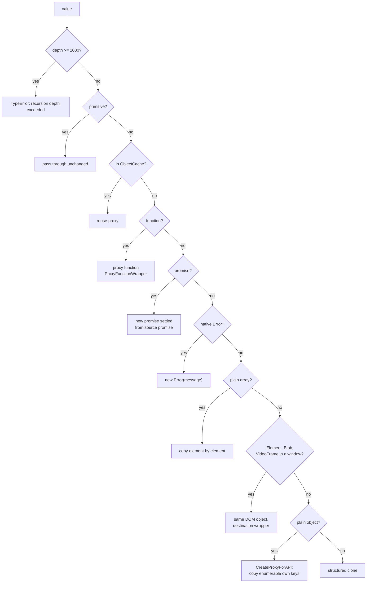

## Overview

Context isolation keeps a page's JavaScript and Electron's privileged JavaScript (the preload script, `ipcRenderer`, and Node when enabled) in different V8 contexts that share one DOM. Blink already supports this for extensions through "isolated worlds": each world has its own global object and built-in prototypes, so a page that overwrites `Array.prototype.push` or `JSON.parse` cannot reach into preload code. Electron runs its renderer code in world `999` and leaves the page in world `0`. `contextBridge` is the one sanctioned way to hand values across: it copies or proxies them so nothing from one world's object graph leaks into the other.

Sources: [shell/common/world_ids.h:12-26](repo://shell/common/world_ids.h#L12-L26), [lib/renderer/api/context-bridge.ts:1-22](repo://lib/renderer/api/context-bridge.ts#L1-L22)

How the isolated world gets created and which contexts receive preload scripts is covered in [[Renderer Processes and Preload Scripts]]. This page covers the world IDs, the `contextBridge` API, the value-passing algorithm in `electron_api_context_bridge.cc`, and the internal overrides Electron itself applies across worlds.

Sources: [shell/renderer/electron_render_frame_observer.cc:173-211](repo://shell/renderer/electron_render_frame_observer.cc#L173-L211)

## Worlds

| World | ID | Who runs there |
| --- | --- | --- |
| Main world | `MAIN_WORLD_ID = 0` | The page; also Electron's code when context isolation is off |
| Electron isolated world | `ISOLATED_WORLD_ID = 999` | Preload scripts and Electron's renderer bundles when context isolation is on |
| Extension worlds | `1 << 20` up to Blink's embedder limit | Chrome extension content scripts |

Sources: [shell/common/world_ids.h:12-26](repo://shell/common/world_ids.h#L12-L26)

`ElectronRenderFrameObserver::CreateIsolatedWorldContext` registers world 999 with the document's security origin and the DevTools name "Electron Isolated Context", then runs `void 0` in it to force the context into existence. `ShouldNotifyClient` makes the renderer client set up Electron only in world 999 when context isolation applies to the frame, and only in world 0 otherwise. `process.contextIsolated` tells JavaScript which case it is in.

Sources: [shell/renderer/electron_render_frame_observer.cc:173-211](repo://shell/renderer/electron_render_frame_observer.cc#L173-L211), [shell/renderer/renderer_client_base.cc:186-196](repo://shell/renderer/renderer_client_base.cc#L186-L196)

## The contextBridge API

### Methods

`contextBridge` is a thin wrapper over the `electron_renderer_context_bridge` binding. Every method first checks `process.contextIsolated` and throws "contextBridge API can only be used when contextIsolation is enabled" otherwise.

Sources: [lib/renderer/api/context-bridge.ts:1-22](repo://lib/renderer/api/context-bridge.ts#L1-L22)

| Method | Binding call | Purpose |
| --- | --- | --- |
| `exposeInMainWorld(key, api)` | `exposeAPIInWorld(0, key, api)` | Put a copy of `api` on the page's `window` |
| `exposeInIsolatedWorld(worldId, key, api)` | `exposeAPIInWorld(worldId, …)` | Same, for another isolated world |
| `executeInMainWorld({ func, args })` | `executeInWorld(0, …)` | Run a function's source in the page's world and return the result |

Sources: [lib/renderer/api/context-bridge.ts:7-20](repo://lib/renderer/api/context-bridge.ts#L7-L20)

### Exposing an API

`ExposeAPIInWorld` resolves the target context with `GetTargetContext`. In a window it is the frame's main-world context or the context of the requested world; in a service-worker preload realm only world 0 is allowed and it maps to the service worker's own context, with "Isolated worlds are not supported in preload realms" for any other ID.

Sources: [shell/renderer/api/electron_api_context_bridge.cc:775-823](repo://shell/renderer/api/electron_api_context_bridge.cc#L775-L823)

`ExposeAPI` then refuses to overwrite an existing global ("Cannot bind an API on top of an existing property on the window object"), converts the value with `PassValueToOtherContext`, deep-freezes the result unless it is a typed array, and defines it as a read-only, non-configurable property. The page therefore cannot replace or mutate an exposed API. The disabled-by-default `ContextBridgeMutability` feature skips the freezing and defines a plain property.

Sources: [shell/renderer/api/electron_api_context_bridge.cc:36-39](repo://shell/renderer/api/electron_api_context_bridge.cc#L36-L39), [shell/renderer/api/electron_api_context_bridge.cc:68-89](repo://shell/renderer/api/electron_api_context_bridge.cc#L68-L89), [shell/renderer/api/electron_api_context_bridge.cc:733-773](repo://shell/renderer/api/electron_api_context_bridge.cc#L733-L773)

### Executing in the main world

`executeInMainWorld` serialises `func` to source with `Function.prototype.toString`, compiles `(<source>)` in the target context, checks that the result is a function, passes each of `args` across the bridge, calls the new function and passes its return value back. Because only source text crosses, the function cannot close over variables from the preload.

Sources: [shell/renderer/api/electron_api_context_bridge.cc:921-1040](repo://shell/renderer/api/electron_api_context_bridge.cc#L921-L1040), [shell/renderer/api/electron_api_context_bridge.cc:1041-1060](repo://shell/renderer/api/electron_api_context_bridge.cc#L1041-L1060)

## Passing values between contexts

### Decision order

`PassValueToOtherContext` is the core of the bridge. It walks a value recursively, with a shared `ObjectCache` per call, and decides per type what to produce in the destination context.

Sources: [shell/renderer/api/electron_api_context_bridge.cc:469-490](repo://shell/renderer/api/electron_api_context_bridge.cc#L469-L490)

Sources: [shell/renderer/api/electron_api_context_bridge.cc:153-237](repo://shell/renderer/api/electron_api_context_bridge.cc#L153-L237), [shell/renderer/api/electron_api_context_bridge.cc:239-352](repo://shell/renderer/api/electron_api_context_bridge.cc#L239-L352), [shell/renderer/api/electron_api_context_bridge.cc:355-399](repo://shell/renderer/api/electron_api_context_bridge.cc#L355-L399), [shell/renderer/api/electron_api_context_bridge.cc:401-467](repo://shell/renderer/api/electron_api_context_bridge.cc#L401-L467)

### Primitives, errors and clones

Strings, numbers, booleans, symbols, bigints, `null` and `undefined` pass unchanged, since they carry no prototype. Native errors cannot be serialised, so a new `Error` is built in the destination from the original's `message`; the stack and custom properties are lost. Anything that is not a function, promise, error, plain array, supported DOM object or plain object falls back to structured cloning, so `Date`, `Map`, `Set`, `RegExp` and typed arrays arrive as copies, and a value that cannot be cloned throws.

Sources: [shell/renderer/api/electron_api_context_bridge.cc:177-186](repo://shell/renderer/api/electron_api_context_bridge.cc#L177-L186), [shell/renderer/api/electron_api_context_bridge.cc:355-372](repo://shell/renderer/api/electron_api_context_bridge.cc#L355-L372), [shell/renderer/api/electron_api_context_bridge.cc:444-466](repo://shell/renderer/api/electron_api_context_bridge.cc#L444-L466), [shell/renderer/api/electron_api_context_bridge.cc:91-108](repo://shell/renderer/api/electron_api_context_bridge.cc#L91-L108)

### Objects and arrays

A plain object becomes a new empty object in the destination, registered in the cache before its children are visited so cycles resolve to the same proxy, and filled with each enumerable own property passed recursively. Prototypes, non-enumerable properties and class identity do not cross. Plain arrays are copied element by element for the same reason: functions or promises inside them still need proxying. Nesting deeper than 1,000 levels throws a `TypeError`.

Sources: [shell/renderer/api/electron_api_context_bridge.cc:374-399](repo://shell/renderer/api/electron_api_context_bridge.cc#L374-L399), [shell/renderer/api/electron_api_context_bridge.cc:631-729](repo://shell/renderer/api/electron_api_context_bridge.cc#L631-L729), [shell/renderer/api/electron_api_context_bridge.cc:166-176](repo://shell/renderer/api/electron_api_context_bridge.cc#L166-L176)

With `support_dynamic_properties`, used by Electron's internal overrides, accessor properties are not read once but turned into proxied getters and setters.

Sources: [shell/renderer/api/electron_api_context_bridge.cc:656-701](repo://shell/renderer/api/electron_api_context_bridge.cc#L656-L701)

### Functions

A function becomes a native function in the destination context whose private state holds the original function, the object it was found on (used as `this`), and the dynamic-properties flag. When the proxy is called, `ProxyFunctionWrapper` enters the original function's creation context, passes every argument across in the other direction, calls the original, and passes the return value back. A thrown exception is reduced to a new `Error` with the same message in the caller's context. A function that has already crossed and is sent back to its own context is unwrapped to the original instead of being proxied twice.

Sources: [shell/renderer/api/electron_api_context_bridge.cc:194-237](repo://shell/renderer/api/electron_api_context_bridge.cc#L194-L237), [shell/renderer/api/electron_api_context_bridge.cc:492-560](repo://shell/renderer/api/electron_api_context_bridge.cc#L492-L560), [shell/renderer/api/electron_api_context_bridge.cc:561-629](repo://shell/renderer/api/electron_api_context_bridge.cc#L561-L629)

Callbacks therefore work in both directions: a page can pass a listener to an exposed `onUpdate(fn)` and the preload can call it later, each call crossing the bridge again.

Sources: [shell/renderer/api/electron_api_context_bridge.cc:523-536](repo://shell/renderer/api/electron_api_context_bridge.cc#L523-L536)

### Promises

A promise becomes a new promise in the destination. The bridge attaches `then` and `catch` callbacks to the source promise that pass the settled value across and resolve or reject the proxy. Both contexts are held weakly, so if either is torn down before the promise settles the callback does nothing. A resolution value the bridge cannot pass rejects the proxy with an explanatory error instead.

Sources: [shell/renderer/api/electron_api_context_bridge.cc:239-353](repo://shell/renderer/api/electron_api_context_bridge.cc#L239-L353)

### DOM objects

In window contexts, `Element`, `Blob` and `VideoFrame` values are not copied: the same underlying Blink object is wrapped for the destination world, so a preload can return a DOM node and the page receives the real node.

Sources: [shell/renderer/api/electron_api_context_bridge.cc:401-431](repo://shell/renderer/api/electron_api_context_bridge.cc#L401-L431)

### The object cache

`ObjectCache` maps source objects to the value already produced for them during one call. It keeps a value that appears twice in an argument list, or a cyclic structure, from being copied twice, and `ProxyFunctionWrapper` and `executeInMainWorld` create a fresh cache per call so identical arguments map to one proxy.

Sources: [shell/renderer/api/context_bridge/object_cache.cc:10-33](repo://shell/renderer/api/context_bridge/object_cache.cc#L10-L33), [shell/renderer/api/electron_api_context_bridge.cc:523-524](repo://shell/renderer/api/electron_api_context_bridge.cc#L523-L524)

### Where errors are thrown

Each conversion carries a `BridgeErrorTarget`. Failures while sending arguments are thrown in the source context, so the caller sees them; failures converting a return value or promise result are thrown in the destination context.

Sources: [shell/renderer/api/electron_api_context_bridge.cc:166-176](repo://shell/renderer/api/electron_api_context_bridge.cc#L166-L176), [shell/renderer/api/electron_api_context_bridge.cc:444-458](repo://shell/renderer/api/electron_api_context_bridge.cc#L444-L458)

## Electron's own overrides

Electron's renderer code also needs to change a few page-visible globals, and with isolation on it runs in the wrong world to do so directly. `internalContextBridge` exposes `_overrideGlobalValueFromIsolatedWorld` and `_overrideGlobalPropertyFromIsolatedWorld`, which follow a key path from the main world's `window` and set a bridged value or accessor there. `window-setup.ts` uses them to make `window.close()` send `BROWSER_WINDOW_CLOSE` to the main process, make `prompt()` throw "prompt() is not supported.", and, inside `<webview>` guests, make `document.hidden` and `document.visibilityState` follow the embedder window. The DevTools page gets similar overrides from `inspector.ts`.

Sources: [lib/renderer/api/context-bridge.ts:24-39](repo://lib/renderer/api/context-bridge.ts#L24-L39), [shell/renderer/api/electron_api_context_bridge.cc:834-865](repo://shell/renderer/api/electron_api_context_bridge.cc#L834-L865), [lib/renderer/window-setup.ts:1-53](repo://lib/renderer/window-setup.ts#L1-L53)

The `<webview>` element must be defined in the main world, where the page's DOM lives, while its implementation needs privileged IPC from world 999. `RendererClientBase::SetupMainWorldOverrides` bridges the hidden `guestViewInternal` object across and runs the small `isolated_bundle` in the main world, which calls `setupWebView` with it; see [[Child Windows and the webview Tag]].

Sources: [shell/renderer/renderer_client_base.cc:568-610](repo://shell/renderer/renderer_client_base.cc#L568-L610), [lib/isolated_renderer/init.ts:1-10](repo://lib/isolated_renderer/init.ts#L1-L10)
