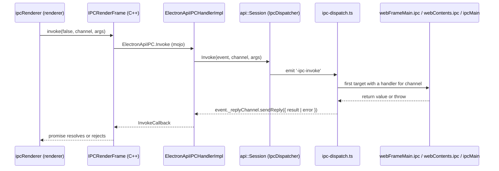

## Overview

Renderer code and main-process code talk through Electron's IPC: `ipcRenderer.send`, `sendSync`, `invoke` and `postMessage` in the renderer, and `ipcMain`, `webContents.ipc` and `webFrameMain.ipc` listeners and handlers in the main process, with `webContents.send` and `webFrameMain.send` for the opposite direction. Underneath, these are Mojo calls on two interfaces defined in `shell/common/api/api.mojom`: `ElectronApiIPC`, which a frame or service worker calls on the browser, and `ElectronRenderer`, which the browser calls on a frame. Arguments travel as `blink::CloneableMessage`, the structured-clone format `postMessage` uses, so functions, DOM objects and prototypes do not survive the trip.

Sources: [shell/common/api/api.mojom:8-56](repo://shell/common/api/api.mojom#L8-L56)

The same path carries Electron's own internal messages, flagged `internal`, which never reach app listeners. This page follows a message from the renderer to the main process and back, then the main-to-renderer direction and the internal channels. Transferring `MessagePort`s with `postMessage` is described in [[MessagePorts and the Utility Process]].

Sources: [lib/browser/ipc-dispatch.ts:58-74](repo://lib/browser/ipc-dispatch.ts#L58-L74)

## The Mojo interfaces

| `ElectronApiIPC` method | Renderer API | Reply |
| --- | --- | --- |
| `Message(internal, channel, args)` | `ipcRenderer.send` | none |
| `Invoke(internal, channel, args)` | `ipcRenderer.invoke` | async `CloneableMessage` |
| `MessageSync(internal, channel, args)` | `ipcRenderer.sendSync` | `[Sync]`: the renderer blocks until the reply |
| `MessageHost(channel, args)` | `ipcRenderer.sendToHost` | none; goes to the `<webview>` host page |
| `ReceivePostMessage(channel, message)` | `ipcRenderer.postMessage` | none; carries transferable ports |

Sources: [shell/common/api/api.mojom:28-56](repo://shell/common/api/api.mojom#L28-L56), [lib/renderer/api/ipc-renderer.ts:8-34](repo://lib/renderer/api/ipc-renderer.ts#L8-L34)

`ElectronRenderer` is the reverse interface: `Message` and `ReceivePostMessage` deliver main-process messages to a frame, and `TakeHeapSnapshot` writes a heap snapshot to a file handle.

Sources: [shell/common/api/api.mojom:8-17](repo://shell/common/api/api.mojom#L8-L17)

The browser only exposes `ElectronApiIPC` to frames that may run Electron code: `ElectronBrowserClient::RegisterAssociatedInterfaceBindersForRenderFrameHost` adds the binder for the main frame, or for any frame when `nodeIntegrationInSubFrames` is on, and creates an `ElectronApiIPCHandlerImpl` per frame. Service workers get the same interface through `ElectronApiSWIPCHandlerImpl`.

Sources: [shell/browser/electron_browser_client.cc:1425-1468](repo://shell/browser/electron_browser_client.cc#L1425-L1468)

## Renderer to main

### The invoke round trip

Sources: [shell/renderer/api/electron_api_ipc_renderer.cc:83-106](repo://shell/renderer/api/electron_api_ipc_renderer.cc#L83-L106), [shell/browser/electron_api_ipc_handler_impl.cc:47-60](repo://shell/browser/electron_api_ipc_handler_impl.cc#L47-L60), [shell/browser/api/ipc_dispatcher.h:39-45](repo://shell/browser/api/ipc_dispatcher.h#L39-L45), [lib/browser/ipc-dispatch.ts:76-108](repo://lib/browser/ipc-dispatch.ts#L76-L108)

### In the renderer

`ipcRenderer` is a JavaScript `EventEmitter` whose methods call a native object from the `electron_renderer_ipc` binding: `createForRenderFrame()` in pages, `createForServiceWorker()` in service-worker preload realms. The native `IPCRenderFrame` holds an associated Mojo remote to `ElectronApiIPC`, obtained from the frame's remote associated interfaces, and drops it when its script context is released, after which every method throws "IPC method called after context was released". Each method serialises its arguments with `SerializeV8Value` into a `CloneableMessage`; a value that cannot be cloned throws in the renderer before anything is sent.

Sources: [lib/renderer/ipc-renderer-bindings.ts:1-14](repo://lib/renderer/ipc-renderer-bindings.ts#L1-L14), [shell/renderer/api/electron_api_ipc_renderer.cc:57-81](repo://shell/renderer/api/electron_api_ipc_renderer.cc#L57-L81), [shell/renderer/api/electron_api_ipc_renderer.cc:192-229](repo://shell/renderer/api/electron_api_ipc_renderer.cc#L192-L229)

`invoke` returns a `gin_helper::Promise` resolved with the reply message; the JavaScript wrapper then unpacks `{ error, result }` and throws `Error invoking remote method '<channel>': <error>` when the main-process handler failed. `sendSync` blocks the renderer on the `[Sync]` Mojo call and deserialises the result.

Sources: [shell/renderer/api/electron_api_ipc_renderer.cc:83-106](repo://shell/renderer/api/electron_api_ipc_renderer.cc#L83-L106), [shell/renderer/api/electron_api_ipc_renderer.cc:162-180](repo://shell/renderer/api/electron_api_ipc_renderer.cc#L162-L180), [lib/renderer/api/ipc-renderer.ts:21-27](repo://lib/renderer/api/ipc-renderer.ts#L21-L27)

### In the browser: building the event

`ElectronApiIPCHandlerImpl` lives as long as its frame's Mojo pipe and `WebContents`. Every call looks up the `api::Session` for the frame's browser context and builds an event object with `MakeIPCEvent`: `type: 'frame'`, `sender` (the `webContents`), a lazy `senderFrame` getter, `frameId`, `processId` and `frameTreeNodeId`, a hidden `internal` flag, and for `invoke` and `sendSync` a `_replyChannel` wrapping the Mojo reply callback. If the session, `WebContents` or its JavaScript wrapper is gone, the reply callback is still called with an error, because a Mojo reply callback must always run.

Sources: [shell/browser/electron_api_ipc_handler_impl.cc:8-31](repo://shell/browser/electron_api_ipc_handler_impl.cc#L8-L31), [shell/browser/electron_api_ipc_handler_impl.cc:115-180](repo://shell/browser/electron_api_ipc_handler_impl.cc#L115-L180)

`ReplyChannel` converts a JavaScript value back to a `CloneableMessage` and runs the callback once; if it is garbage-collected without having replied, its destructor sends "reply was never sent".

Sources: [shell/common/gin_helper/reply_channel.cc:35-64](repo://shell/common/gin_helper/reply_channel.cc#L35-L64)

### Session as the dispatcher

The handler passes the event to the `Session`, which mixes in `IpcDispatcher<Session>`. `IpcDispatcher` simply re-emits each call on the session's JavaScript object as an internal event: `-ipc-message`, `-ipc-invoke`, `-ipc-message-sync`, `-ipc-message-host`, or `-ipc-ports` after entangling the transferred ports. Routing through the session lets one listener set serve frames and service workers alike.

Sources: [shell/browser/api/electron_api_session.h:67-67](repo://shell/browser/api/electron_api_session.h#L67-L67), [shell/browser/api/ipc_dispatcher.h:28-83](repo://shell/browser/api/ipc_dispatcher.h#L28-L83)

### ipc-dispatch.ts

Each `Session` calls `addIpcDispatchListeners(this)` when it is created. Messages flagged internal go to `ipcMainInternal` and nowhere else. For frame messages, the listeners pick the emitters in priority order: the sending frame's `webFrameMain.ipc` (looked up by frame-tree-node ID so messages sent during a frame swap are still delivered), the sender's `webContents.ipc`, then the global `ipcMain`.

Sources: [lib/browser/api/session.ts:24-27](repo://lib/browser/api/session.ts#L24-L27), [lib/browser/ipc-dispatch.ts:33-74](repo://lib/browser/ipc-dispatch.ts#L33-L74)

| Kind | Delivered to | Notes |
| --- | --- | --- |
| `send` | `webContents` `ipc-message` event, then all three emitters | `event.reply` sends back to the same frame |
| `sendSync` | `webContents` `ipc-message-sync`, then all three | Setting `event.returnValue` replies; a warning is logged when nobody listens |
| `invoke` | The first of the three with a `handle` for the channel | Only one handler runs; "No handler registered" error otherwise |
| `sendToHost` | `webContents` `-ipc-message-host` | Picked up by the `<webview>` implementation |
| `postMessage` | All three, with `event.ports` as `MessagePortMain`s | |

Sources: [lib/browser/ipc-dispatch.ts:10-22](repo://lib/browser/ipc-dispatch.ts#L10-L22), [lib/browser/ipc-dispatch.ts:59-150](repo://lib/browser/ipc-dispatch.ts#L59-L150)

For `invoke`, the handler's return value, awaited if it is a promise, is sent as `{ result }`; a thrown error is logged in the main process and sent as `{ error: error.toString() }`, so only the message reaches the renderer. Service-worker messages go to that worker's `ServiceWorkerMain.ipc` instead, with a `serviceWorker` property on the event.

Sources: [lib/browser/ipc-dispatch.ts:76-108](repo://lib/browser/ipc-dispatch.ts#L76-L108), [lib/browser/ipc-dispatch.ts:24-31](repo://lib/browser/ipc-dispatch.ts#L24-L31)

### ipcMain and scoped emitters

`ipcMain`, `ipcMainInternal`, `webContents.ipc` and `webFrameMain.ipc` are all `IpcMainImpl`: an `EventEmitter` with a `_invokeHandlers` map. `handle` refuses a second handler for the same channel, `handleOnce` removes itself after one call, and an `error` listener is pre-installed so a channel named `error` does not throw. Each `webContents` creates its instance when it is initialised; a frame's instance is created lazily on first access to `webFrameMain.ipc`.

Sources: [lib/browser/ipc-main-impl.ts:1-35](repo://lib/browser/ipc-main-impl.ts#L1-L35), [lib/browser/api/ipc-main.ts:1-5](repo://lib/browser/api/ipc-main.ts#L1-L5), [lib/browser/api/web-frame-main.ts:6-12](repo://lib/browser/api/web-frame-main.ts#L6-L12), [lib/browser/api/web-contents.ts:550-556](repo://lib/browser/api/web-contents.ts#L550-L556)

## Main to renderer

`webContents.send(channel, ...args)` forwards to `mainFrame.send`, and `sendToFrame` looks a frame up by ID or `[processId, frameId]` first. `WebFrameMain::Send` serialises the arguments and calls `Message` on the frame's `ElectronRenderer` remote. `MaybeSetupMojoConnection` binds that remote lazily and only once the render frame is live, so a message sent while a frame is being created is queued on the pipe rather than lost.

Sources: [lib/browser/api/web-contents.ts:125-148](repo://lib/browser/api/web-contents.ts#L125-L148), [lib/browser/api/web-frame-main.ts:14-36](repo://lib/browser/api/web-frame-main.ts#L14-L36), [shell/browser/api/electron_api_web_frame_main.cc:273-318](repo://shell/browser/api/electron_api_web_frame_main.cc#L273-L318)

In the renderer, `ElectronApiServiceImpl` receives the call, deserialises the arguments in the frame's Electron context and calls `ipc_native::EmitIPCEvent`. That looks up the hidden `ipcNative` object, which `ipc-native-setup.ts` installed, and calls its `onMessage`, wrapped in a `node::CallbackScope` when the context has Node so ticks and microtasks run. `onMessage` emits the channel on `ipcRendererInternal` or `ipcRenderer` with an event holding `sender` and `ports`.

Sources: [shell/renderer/electron_api_service_impl.cc:86-130](repo://shell/renderer/electron_api_service_impl.cc#L86-L130), [shell/renderer/electron_ipc_native.cc:20-83](repo://shell/renderer/electron_ipc_native.cc#L20-L83), [lib/renderer/ipc-native-setup.ts:1-14](repo://lib/renderer/ipc-native-setup.ts#L1-L14)

## Internal channels

Electron uses the same transport for its own requests. `IPC_MESSAGES` names every internal channel: preload loading, `window.close()`, clipboard access from sandboxed renderers, frame ID lookups, `<webview>` management, `webFrame` methods called from the main process, and DevTools prompts. Because these messages carry the `internal` flag, an app listening on `ipcMain` for the same string never sees them.

Sources: [lib/common/ipc-messages.ts:1-28](repo://lib/common/ipc-messages.ts#L1-L28), [lib/renderer/ipc-renderer-internal.ts:1-26](repo://lib/renderer/ipc-renderer-internal.ts#L1-L26)

Two helper pairs give them request/response shapes. `handleSync` in the main process answers a renderer's `invokeSync` by setting `event.returnValue` to `[error]` or `[null, result]`, which `invokeSync` unpacks and rethrows. `invokeInWebContents` goes the other way: it sends a command with a fresh request ID and waits on `<command>_RESPONSE_<id>`, ignoring replies from any other `WebContents`; the renderer's `handle` helper answers on that channel. `webContents.executeJavaScript` and `insertCSS` are implemented this way, on the `RENDERER_WEB_FRAME_METHOD` channel.

Sources: [lib/browser/ipc-main-internal-utils.ts:1-38](repo://lib/browser/ipc-main-internal-utils.ts#L1-L38), [lib/renderer/ipc-renderer-internal-utils.ts:1-24](repo://lib/renderer/ipc-renderer-internal-utils.ts#L1-L24), [lib/browser/api/web-contents.ts:150-183](repo://lib/browser/api/web-contents.ts#L150-L183)

`lib/browser/rpc-server.ts` holds most main-process handlers. Several check `event.type === 'frame'` and refuse service-worker callers, and the clipboard handler only allows the methods a sandboxed renderer cannot call itself on that platform: the find-pasteboard methods on macOS, every method on Linux, and none on Windows. The preload-loading handlers are described in [[Renderer Processes and Preload Scripts]].

Sources: [lib/browser/rpc-server.ts:11-50](repo://lib/browser/rpc-server.ts#L11-L50), [lib/browser/rpc-server.ts:89-126](repo://lib/browser/rpc-server.ts#L89-L126)
