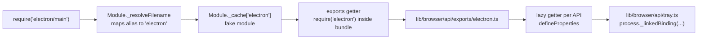

## Overview

Electron's JavaScript library lives in `lib/` as TypeScript, one directory per kind of JavaScript context: `browser`, `renderer`, `sandboxed_renderer`, `isolated_renderer`, `preload_realm`, `worker`, `utility` and `node`, plus `common` code they share. None of it ships as loose files. Each target is compiled by webpack into a single bundle, and the bundles are compiled into the executable by Node's `js2c` tool, so at runtime the C++ side starts a context by running a built-in script such as `electron/js2c/browser_init`.

Sources: [BUILD.gn:165-272](repo://BUILD.gn#L165-L272)

This page follows that build path and then the runtime path of `require('electron')`: the module lists, the lazy getters, and the fake module that makes `electron` resolvable from app code. The C++ objects most modules wrap are covered in [[Native API Bindings with gin]].

Sources: [lib/common/init.ts:78-119](repo://lib/common/init.ts#L78-L119), [lib/common/define-properties.ts:1-17](repo://lib/common/define-properties.ts#L1-L17)

## From TypeScript to the binary

### One webpack target per context

`BUILD.gn` declares a `webpack_build` target for each bundle, and the `webpack_build` template in `build/webpack/webpack.gni` runs webpack with the target's config file, an output path under `js2c/`, the generated `buildflags.h`, and `mode=production` in official builds.

Sources: [BUILD.gn:165-235](repo://BUILD.gn#L165-L235), [build/webpack/webpack.gni:3-46](repo://build/webpack/webpack.gni#L3-L46)

| Bundle (`js2c` id) | Entry | Has Node | Started by |
| --- | --- | --- | --- |
| `browser_init` | `lib/browser/init.ts` | yes | `NodeBindings::CreateEnvironment` in the main process |
| `renderer_init` | `lib/renderer/init.ts` | yes | `CreateEnvironment` in a renderer with Node integration |
| `worker_init` | `lib/worker/init.ts` | yes | `CreateEnvironment` in a web worker with Node integration |
| `utility_init` | `lib/utility/init.ts` | yes | `CreateEnvironment` in a utility process |
| `node_init` | `lib/node/init.ts` | yes | `OnNodePreload`, before any of the above |
| `sandbox_bundle` | `lib/sandboxed_renderer/init.ts` | no | `ElectronSandboxedRendererClient` |
| `isolated_bundle` | `lib/isolated_renderer/init.ts` | no | `RendererClientBase::SetupMainWorldOverrides`, in the main world when context isolation and `webviewTag` are on |
| `preload_realm_bundle` | `lib/preload_realm/init.ts` | no | `PreloadRealmContext` for service workers |

Sources: [BUILD.gn:165-235](repo://BUILD.gn#L165-L235), [shell/common/node_bindings.cc:702-702](repo://shell/common/node_bindings.cc#L702-L702), [shell/common/node_bindings.cc:1014-1021](repo://shell/common/node_bindings.cc#L1014-L1021), [shell/renderer/electron_sandboxed_renderer_client.cc:122-134](repo://shell/renderer/electron_sandboxed_renderer_client.cc#L122-L134), [shell/renderer/renderer_client_base.cc:607-607](repo://shell/renderer/renderer_client_base.cc#L607-L607), [shell/renderer/preload_realm_context.cc:184-184](repo://shell/renderer/preload_realm_context.cc#L184-L184)

### The shared webpack configuration

Every `webpack.config.<target>.js` calls `webpack.config.base.js` with a handful of options. The base config picks `lib/<target>/init.ts` as the entry and resolves `electron`, `electron/main`, `electron/renderer`, `electron/common` and `electron/utility` to `lib/<target>/api/exports/electron.ts`. The worker bundle sets `loadElectronFromAlternateTarget: 'renderer'`, so workers get the renderer's API.

Sources: [build/webpack/webpack.config.base.js:21-36](repo://build/webpack/webpack.config.base.js#L21-L36), [build/webpack/webpack.config.base.js:116-134](repo://build/webpack/webpack.config.base.js#L116-L134), [build/webpack/webpack.config.worker.js:1-7](repo://build/webpack/webpack.config.worker.js#L1-L7)

| Option | Effect | Used by |
| --- | --- | --- |
| `alwaysHasNode` | Webpack target `node`; when false, `Buffer` and `process` come from the `buffer` and `process/browser` polyfills and the target is `web` | true for browser, renderer, worker, utility, node |
| `targetDeletesNodeGlobals` | `Buffer`, `global` and `process` are provided from `webpack-provider.ts`, which reads them off `globalThis.global` | renderer, worker |
| `wrapInitWithTryCatch` | Wraps the bundle so an exception is logged as "Electron `<bundle>` script failed to run" instead of escaping | renderer, worker, sandboxed, isolated, preload realm |
| `wrapInitWithProfilingTimeout` | Defers the bundle with `setTimeout` when `--profile-electron-init` is on the command line | renderer, sandboxed, preload realm |

Sources: [build/webpack/webpack.config.base.js:66-106](repo://build/webpack/webpack.config.base.js#L66-L106), [lib/common/webpack-provider.ts:1-18](repo://lib/common/webpack-provider.ts#L1-L18), [build/webpack/webpack.config.renderer.js:1-7](repo://build/webpack/webpack.config.renderer.js#L1-L7), [build/webpack/webpack.config.sandboxed_renderer.js:1-6](repo://build/webpack/webpack.config.sandboxed_renderer.js#L1-L6)

The renderer needs `targetDeletesNodeGlobals` because, when a page has `nodeIntegration` off and runs without context isolation, `lib/renderer/init.ts` deletes `process`, `Buffer`, `global` and the immediate timers from the window once the environment has loaded. Electron's own code keeps reaching them through the provider, and `init.ts` replaces `Module.wrapper` so preload modules still receive `process`, `global` and `Buffer` as wrapper arguments.

Sources: [lib/renderer/init.ts:20-39](repo://lib/renderer/init.ts#L20-L39), [lib/renderer/init.ts:116-130](repo://lib/renderer/init.ts#L116-L130), [lib/common/webpack-provider.ts:1-18](repo://lib/common/webpack-provider.ts#L1-L18)

TypeScript is compiled with `ts-loader` against `tsconfig.electron.json`, the `@electron/internal` alias points at `lib/`, and `timers` is forced to `timers-browserify` so no bundle uses `window.postMessage` for `setImmediate`. Production builds minify with Terser but keep class and function names.

Sources: [build/webpack/webpack.config.base.js:113-171](repo://build/webpack/webpack.config.base.js#L113-L171)

### Build flags in JavaScript

When webpack receives `--env buildflags=<path>`, the base config reads every `#define BUILDFLAG_INTERNAL_<NAME>() (0|1)` line from the generated header and passes `<NAME>` to `DefinePlugin` as `true` or `false`. TypeScript sees the matching `BUILDFLAG(flag)` declaration in the internal typings, so code can be written as `if (BUILDFLAG(ENABLE_X))` and webpack folds the branch. When only printing the dependency graph, `BUILDFLAG` is defined as the identity function instead.

Sources: [build/webpack/webpack.config.base.js:41-56](repo://build/webpack/webpack.config.base.js#L41-L56), [typings/internal-ambient.d.ts:3-3](repo://typings/internal-ambient.d.ts#L3-L3)

### js2c

The `electron_js2c` action depends on all eight bundles and runs `build/js2c.py`, which calls Node's `js2c` binary in `--only-js` mode to produce `electron_natives.cc`. That file is part of `electron_lib`, so each bundle is registered as a Node built-in under its `electron/js2c/...` id. The C++ helper `util::CompileAndCall` looks an id up with Node's `BuiltinLoader`, compiles it with the given parameter names (`process` and `require` for `node_init`, `binding` for the sandbox bundle), and calls it, logging a failure to compile or run.

Sources: [BUILD.gn:237-272](repo://BUILD.gn#L237-L272), [build/js2c.py:7-14](repo://build/js2c.py#L7-L14), [shell/common/node_util.cc:23-59](repo://shell/common/node_util.cc#L23-L59)

### Keeping GN inputs in sync

GN must know every file a bundle reads so ninja rebuilds it when one changes. `script/gen-filenames.ts` runs webpack for each config with `--env PRINT_WEBPACK_GRAPH`; the `AccessDependenciesPlugin` in the base config prints the resolved module paths, and the script writes them as `<target>_bundle_deps` lists into `filenames.auto.gni`, which `BUILD.gn` uses as the targets' `inputs`. The script runs from the `lint-staged` hook whenever a `.js` or `.ts` file is committed.

Sources: [script/gen-filenames.ts:18-95](repo://script/gen-filenames.ts#L18-L95), [build/webpack/webpack.config.base.js:10-19](repo://build/webpack/webpack.config.base.js#L10-L19), [BUILD.gn:165-172](repo://BUILD.gn#L165-L172), [package.json:101-107](repo://package.json#L101-L107)

## How require('electron') resolves

### Module lists and lazy getters

Each target's `api/exports/electron.ts` builds `module.exports` from module lists. The main process combines `commonModuleList` (`nativeImage`, `shell`) with `browserModuleList`; a renderer with Node integration combines the common list with `rendererModuleList` (`clipboard`, `contextBridge`, `crashReporter`, `ipcRenderer`, `webFrame`, `webUtils`); the sandboxed renderer has its own list that reuses renderer and common implementations.

Sources: [lib/browser/api/exports/electron.ts:1-8](repo://lib/browser/api/exports/electron.ts#L1-L8), [lib/common/api/module-list.ts:1-5](repo://lib/common/api/module-list.ts#L1-L5), [lib/renderer/api/exports/electron.ts:1-8](repo://lib/renderer/api/exports/electron.ts#L1-L8), [lib/renderer/api/module-list.ts:1-9](repo://lib/renderer/api/module-list.ts#L1-L9), [lib/sandboxed_renderer/api/module-list.ts:1-26](repo://lib/sandboxed_renderer/api/module-list.ts#L1-L26)

A list entry is a name and a `loader` that calls `require` on the implementation file. `defineProperties` turns each entry into an enumerable getter, so `require('electron').Tray` does not load `tray.ts`, or touch its native binding, until it is read. The getter unwraps ES-module default exports, which is why API files can `export default`.

Sources: [lib/common/define-properties.ts:1-17](repo://lib/common/define-properties.ts#L1-L17), [lib/browser/api/module-list.ts:1-43](repo://lib/browser/api/module-list.ts#L1-L43)

Sources: [lib/common/init.ts:78-119](repo://lib/common/init.ts#L78-L119), [lib/common/define-properties.ts:1-17](repo://lib/common/define-properties.ts#L1-L17), [lib/browser/api/tray.ts:1-3](repo://lib/browser/api/tray.ts#L1-L3)

### The fake electron module

Inside a bundle, `require('electron')` is resolved by webpack. App code uses Node's real module system, which has no `electron` package. `lib/common/init.ts`, run at the start of every Node-backed bundle, creates `Module` objects named `electron` and `electron/common`, plus `electron/main`, `electron/renderer` or `electron/utility` for the current process type, marks them loaded, gives them an `exports` getter that returns the bundle's `require('electron')`, and stores them in `Module._cache`. It also wraps `Module._resolveFilename` so all five names resolve to `electron`. The sub-paths exist for TypeScript, which types each one with only that process's modules; at runtime any of them can be required from any process.

Sources: [lib/common/init.ts:78-119](repo://lib/common/init.ts#L78-L119)

Sandboxed preload scripts have no Node module system at all. The sandbox bundle instead keeps a small map of what `require` may return: `electron` and its sub-paths, `events`, `timers` and `url`. [[Renderer Processes and Preload Scripts]] describes how that `require` is built.

Sources: [lib/sandboxed_renderer/init.ts:23-38](repo://lib/sandboxed_renderer/init.ts#L23-L38)

## Adding a module

A new main-process API needs an entry in `browserModuleList`, kept alphabetical, and the comment at the top of that file says the module-keys file must be updated too. If the module wraps C++, its binding must also be listed in the binding macros in `node_bindings.cc`, as [[Native API Bindings with gin]] shows. New files are picked up by `gen-filenames.ts`.

Sources: [lib/browser/api/module-list.ts:1-4](repo://lib/browser/api/module-list.ts#L1-L4), [shell/common/node_bindings.cc:53-93](repo://shell/common/node_bindings.cc#L53-L93)
