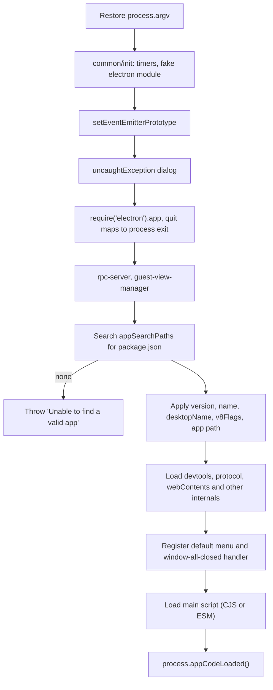

## Overview

Once the native side has created the main process's Node environment, Node runs `electron/js2c/browser_init`, the bundle built from `lib/browser/init.ts`. That script turns a bare Node environment into Electron's main process: it installs the `electron` module, sets up error handling and quit behaviour, finds the application on disk, applies its `package.json`, loads Electron's internal main-process services, and finally runs the app's main script. When no app is packaged with the executable it finds the bundled default app instead. The native steps before this point are in [[Process Model and Native Startup]], and the C++ that starts the bundle is in [[Node.js Integration and Event Loops]].

Sources: [shell/common/node_bindings.cc:702-704](repo://shell/common/node_bindings.cc#L702-L704), [lib/browser/init.ts:12-114](repo://lib/browser/init.ts#L12-L114), [lib/browser/init.ts:201-227](repo://lib/browser/init.ts#L201-L227)

## Order of operations

### The sequence

Sources: [lib/browser/init.ts:12-114](repo://lib/browser/init.ts#L12-L114), [lib/browser/init.ts:116-227](repo://lib/browser/init.ts#L116-L227)

### Process setup

`NodeBindings::CreateEnvironment` inserted the init script's name as `argv[1]` so Node would run it; `init.ts` removes it again so `process.argv` looks like a normal Node invocation. It then runs `lib/common/init.ts`, which wraps the timers and installs the `electron` module (see [[JavaScript Bundles and the electron Module]]), and hands Node's `EventEmitter.prototype` to the `electron_browser_event_emitter` binding so native objects can inherit from it, as described in [[Native API Bindings with gin]].

Sources: [lib/browser/init.ts:10-19](repo://lib/browser/init.ts#L10-L19), [shell/common/node_bindings.cc:702-704](repo://shell/common/node_bindings.cc#L702-L704)

### Uncaught exceptions

The main process must not die because of a JavaScript error, so `init.ts` installs an `uncaughtException` listener. If the app has added its own listener, Electron's does nothing; otherwise it imports `dialog` lazily, because the `electron` module is not usable yet when the handler is installed, and shows "A JavaScript error occurred in the main process" with the stack.

Sources: [lib/browser/init.ts:21-38](repo://lib/browser/init.ts#L21-L38)

### Exit behaviour

`app`'s `quit` event is forwarded as `process.emit('exit', exitCode)`, so Node `exit` listeners still run. `process.exit` is replaced with `app.exit`, which closes windows and shuts the message loop down instead of terminating the process abruptly. On Windows, if an `update.exe` sits next to the executable's parent directory, the app is treated as a Squirrel.Windows install and gets the App User Model ID `com.squirrel.<package>.<exe>`, matching the one Squirrel puts on its shortcuts.

Sources: [lib/browser/init.ts:40-74](repo://lib/browser/init.ts#L40-L74)

### Internal services

Before the app's code is found, `init.ts` loads `rpc-server`, which answers the internal IPC requests renderers make during their own startup, and `guest-view-manager`, which implements `<webview>`. These are covered in [[Inter-Process Communication]] and [[Child Windows and the webview Tag]].

Sources: [lib/browser/init.ts:76-80](repo://lib/browser/init.ts#L76-L80)

## Finding the app

The list of places to look is set by C++ as private values on the global object: `appSearchPaths` is `app.asar`, `app`, `default_app.asar` in that order, or only `app.asar` when the `OnlyLoadAppFromAsar` fuse is on, in which case `appSearchPathsOnlyLoadASAR` is also true. `init.ts` reads both through the `electron_common_v8_util` binding and takes the asar helper `process._getOrCreateArchive`, deleting it from `process` so app code cannot use it.

Sources: [shell/common/node_bindings.cc:675-698](repo://shell/common/node_bindings.cc#L675-L698), [lib/browser/init.ts:82-90](repo://lib/browser/init.ts#L82-L90)

For each search path, joined to `process.resourcesPath`, it tries to load `package.json` with Node's module loader and stops at the first success. In asar-only mode a path that does not open as an archive is skipped, so a plain `app` folder planted next to the executable is never used. Because `app.asar` comes first, a packaged app always wins over the default app. If nothing loads, the script schedules `process.exit(1)` and throws "Unable to find a valid app".

Sources: [lib/browser/init.ts:92-114](repo://lib/browser/init.ts#L92-L114)

## Applying package.json

| Field | Effect |
| --- | --- |
| `version` | `app.setVersion` |
| `productName`, else `name` | `app.name`, trimmed |
| `desktopName` | `app.setDesktopName`; defaults to `<app.name>.desktop` |
| `v8Flags` | Passed to `v8.setFlagsFromString`; `v8` is only required when the field exists |
| `main` | Entry script; defaults to `index.js` |
| `type` | `"module"` makes a non-`.cjs` entry load as an ES module |

Sources: [lib/browser/init.ts:116-163](repo://lib/browser/init.ts#L116-L163), [lib/browser/init.ts:204-222](repo://lib/browser/init.ts#L204-L222)

`app.setAppPath(packagePath)` records where the app lives; `ElectronBrowserClient` later passes this path to every renderer as `--app-path` so renderers can resolve modules relative to the app.

Sources: [lib/browser/init.ts:141-141](repo://lib/browser/init.ts#L141-L141), [shell/browser/electron_browser_client.cc:566-569](repo://shell/browser/electron_browser_client.cc#L566-L569)

## Preparing the environment for app code

Several internal modules are loaded eagerly rather than lazily, each for a stated reason: `devtools` (handlers DevTools needs), `protocol`, `service-worker-main`, `web-contents` and `web-frame-main` so their native classes are populated by the time `ready` fires, and `web-contents-view` because `new BrowserWindow` relies on its inheritance chain.

Sources: [lib/browser/init.ts:143-160](repo://lib/browser/init.ts#L143-L160)

On Linux, `init.ts` saves the original `XDG_CURRENT_DESKTOP` as `ORIGINAL_XDG_CURRENT_DESKTOP` and, on desktops known to support app indicators (Pantheon, Unity, pop:GNOME and Ubuntu sessions), sets it to `Unity` so tray icons use the indicator implementation.

Sources: [lib/browser/init.ts:165-184](repo://lib/browser/init.ts#L165-L184)

Two default behaviours are registered next. On `window-all-closed`, the app quits only if this handler is the sole listener; an app that listens for the event takes over the decision. On `will-finish-launching`, which fires before `ready`, `setDefaultApplicationMenu` installs a menu built from the `appMenu` (macOS only), `fileMenu`, `editMenu`, `viewMenu`, `windowMenu` and `help` roles, unless the app already called `Menu.setApplicationMenu`. Unpackaged builds get help links to the Electron site, docs, Discord and issue tracker. Menus and roles are covered in [[Menus, Accelerators and Tray]].

Sources: [lib/browser/init.ts:186-199](repo://lib/browser/init.ts#L186-L199), [lib/browser/default-menu.ts:1-60](repo://lib/browser/default-menu.ts#L1-L60), [lib/browser/api/menu.ts:175-179](repo://lib/browser/api/menu.ts#L175-L179)

## Running the main script

`init.ts` takes `process.appCodeLoaded` and deletes it from `process`. A CommonJS entry is loaded synchronously with `Module._load(path, Module, true)`, marking it as the main module, after calling `appCodeLoaded()`. An ES module entry, chosen when `type` is `"module"` and the file is not `.cjs`, or when the file ends in `.mjs`, goes through Node's `runEntryPointWithESMLoader`; `appCodeLoaded()` is called after the import settles, and an import error is re-emitted as `uncaughtException` so it reaches the error dialog.

Sources: [lib/browser/init.ts:201-227](repo://lib/browser/init.ts#L201-L227)

`appCodeLoaded` matters because native startup is waiting on it: `NodeBindings::JoinAppCode` pumps the uv loop until the flag is set, so the app's top-level code, including top-level `await` in an ES module, finishes before Chromium continues to `PreCreateThreads` and eventually emits `ready`. Code that touches the UI must therefore wait for `app.whenReady()`.

Sources: [shell/common/node_bindings.cc:895-924](repo://shell/common/node_bindings.cc#L895-L924), [shell/browser/electron_browser_main_parts.cc:257-262](repo://shell/browser/electron_browser_main_parts.cc#L257-L262)

## The app object

`lib/browser/api/app.ts` takes the native `app` from the `electron_browser_app` binding, makes it an `EventEmitter`, and fills gaps in JavaScript: the `name`, `badgeCount` and `accessibilitySupportEnabled` accessor properties, `app.commandLine`, `app.applicationMenu`, a no-op `setAppUserModelId` outside Windows, the dock menu getter on macOS, and memory figures from `/proc` in `getAppMetrics` on Linux. It forwards `certificate-error` and `select-client-certificate` from `app` to the `webContents` involved.

Sources: [lib/browser/api/app.ts:1-112](repo://lib/browser/api/app.ts#L1-L112)

`app.isPackaged` is decided natively: true when `ELECTRON_FORCE_IS_PACKAGED` is set, otherwise true when the executable is not named `electron` (or `Electron` and its helpers on macOS).

Sources: [shell/browser/api/electron_api_app.cc:903-923](repo://shell/browser/api/electron_api_app.cc#L903-L923)

## The default app

The build compiles `default_app/` with `tsc`, copies its static files, and packs the result into `resources/default_app.asar`, the last entry in the search paths. Its `package.json` declares `main.js` as an ES module named `Electron`.

Sources: [BUILD.gn:281-315](repo://BUILD.gn#L281-L315), [default_app/package.json:1-6](repo://default_app/package.json#L1-L6)

`default_app/main.ts` parses its own arguments: `--version`, `--abi`, `--interactive` for a main-process REPL, `--require` to preload modules, `--app=<path>`, or a positional path or URL. A URL opens in a window; an `.html` file is loaded with `loadFile`; anything else is treated as an app folder or script. For a folder it reads `package.json`, applies the same fields as `init.ts`, sets `process.defaultApp`, resolves the entry with `Module._resolveFilename`, and imports it, showing an error box when the app cannot be found or parsed. With no argument it prints usage and shows its own `index.html`.

Sources: [default_app/main.ts:20-75](repo://default_app/main.ts#L20-L75), [default_app/main.ts:77-149](repo://default_app/main.ts#L77-L149), [default_app/main.ts:253-298](repo://default_app/main.ts#L253-L298)

The default app's window is a small example of the secure defaults: it uses a sandboxed, context-isolated preload, denies every `window.open` and opens the URL externally, asks the user before granting permissions, and answers its `bootstrap` IPC call only when the sender is its own window showing its own `index.html`.

Sources: [default_app/default_app.ts:30-104](repo://default_app/default_app.ts#L30-L104)
