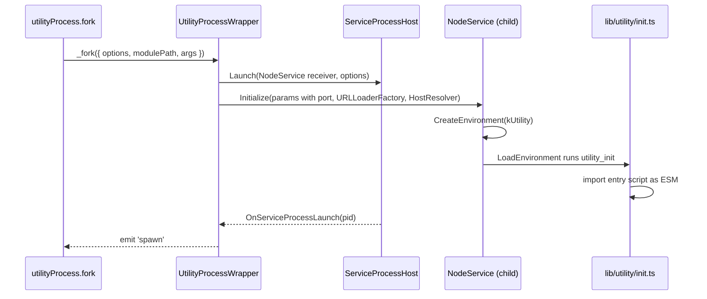

## Overview

Channel-based IPC ([[Inter-Process Communication]]) always goes through the main process. Two features let JavaScript set up direct, long-lived pipes instead. `MessageChannelMain` and `MessagePortMain` bring the web's `MessagePort` to the main process, so a port pair can be created anywhere and its ends handed to renderers, utility processes or other main-process code, after which messages flow between the two ends without channel names. `utilityProcess.fork` starts a Chromium utility process that runs a Node.js script, connected to the main process by its own port. Both are built on Blink's `MessagePortDescriptor` Mojo pipes and serialise messages with structured clone.

Sources: [lib/browser/api/message-channel.ts:1-16](repo://lib/browser/api/message-channel.ts#L1-L16), [shell/browser/api/message_port.cc:152-168](repo://shell/browser/api/message_port.cc#L152-L168), [lib/browser/api/utility-process.ts:134-152](repo://lib/browser/api/utility-process.ts#L134-L152)

## MessagePortMain

### Creating and wrapping ports

`new MessageChannelMain()` calls `createPair()` on the `electron_browser_message_port` binding, which returns two native `MessagePort` objects entangled with each other, and wraps each in a JavaScript `MessagePortMain`. The wrapper is an `EventEmitter` that replaces the native object's `emit`, so native `message` and `close` events surface on the wrapper and any ports received with a message are wrapped too. When a `MessagePortMain` is passed to `postMessage` anywhere in the main-process API, it is unwrapped to `_internalPort` first.

Sources: [lib/browser/api/message-channel.ts:1-16](repo://lib/browser/api/message-channel.ts#L1-L16), [lib/browser/message-port-main.ts:1-28](repo://lib/browser/message-port-main.ts#L1-L28)

### Entangling, queuing and lifetime

A native `MessagePort` owns a `mojo::Connector` over the port's pipe. `Entangle` creates the connector with incoming processing paused, so messages queue until `start()` resumes it; `Start` also pins the JavaScript wrapper. `HasPendingActivity` (started and entangled) decides pinning: an open, started port is kept alive even when the app drops its reference, because the other side may still send. A connection error on the pipe closes the port.

Sources: [shell/browser/api/message_port.cc:120-131](repo://shell/browser/api/message_port.cc#L120-L131), [shell/browser/api/message_port.cc:152-191](repo://shell/browser/api/message_port.cc#L152-L191), [shell/browser/api/message_port.cc:240-253](repo://shell/browser/api/message_port.cc#L240-L253)

`Close` disentangles the real pipe and replaces it with a fresh, unconnected one so later calls are harmless, unpins the wrapper, and emits `close`.

Sources: [shell/browser/api/message_port.cc:133-150](repo://shell/browser/api/message_port.cc#L133-L150)

### Sending and receiving

`postMessage(value, transfer?)` serialises `value` into a `TransferableMessage`, validates that every entry of `transfer` is a native `MessagePort`, refuses to transfer the sending port itself, and disentangles the transferred ports into the message. `DisentanglePorts` follows the HTML rule that a port list must not contain null, already-neutered or duplicate ports, throwing "Port at index N is …" otherwise. A transferred port is neutered on the sending side.

Sources: [shell/browser/api/message_port.cc:57-118](repo://shell/browser/api/message_port.cc#L57-L118), [shell/browser/api/message_port.cc:206-238](repo://shell/browser/api/message_port.cc#L206-L238)

On the receiving side, `Accept` deserialises the message, entangles new `MessagePort` objects for any ports it carried, and emits `message` with `{ data, ports }`.

Sources: [shell/browser/api/message_port.cc:255-279](repo://shell/browser/api/message_port.cc#L255-L279)

### Crossing to a renderer

Ports move between the main process and pages through the `ReceivePostMessage` Mojo methods. `webContents.postMessage` and `webFrameMain.postMessage` unwrap `MessagePortMain`s and send a `TransferableMessage` on the frame's `ElectronRenderer` interface; the renderer emits the message on `ipcRenderer` with `event.ports` as real DOM `MessagePort`s. In the other direction, `ipcRenderer.postMessage(channel, message, [port])` extracts each DOM port's channel and sends it on `ElectronApiIPC`; `IpcDispatcher` entangles the ports as native `MessagePort`s and `ipc-dispatch.ts` hands them to listeners as `MessagePortMain`s on `event.ports`.

Sources: [lib/browser/api/web-frame-main.ts:38-43](repo://lib/browser/api/web-frame-main.ts#L38-L43), [shell/browser/api/electron_api_web_frame_main.cc:339-370](repo://shell/browser/api/electron_api_web_frame_main.cc#L339-L370), [shell/renderer/electron_api_service_impl.cc:104-130](repo://shell/renderer/electron_api_service_impl.cc#L104-L130), [shell/renderer/api/electron_api_ipc_renderer.cc:108-143](repo://shell/renderer/api/electron_api_ipc_renderer.cc#L108-L143), [shell/browser/api/ipc_dispatcher.h:47-60](repo://shell/browser/api/ipc_dispatcher.h#L47-L60), [lib/browser/ipc-dispatch.ts:139-150](repo://lib/browser/ipc-dispatch.ts#L139-L150)

A common pattern is to create a `MessageChannelMain`, post `port1` to one renderer and `port2` to another; from then on the two renderers talk directly.

Sources: [lib/browser/api/message-channel.ts:7-16](repo://lib/browser/api/message-channel.ts#L7-L16)

## The utility process

### Forking from JavaScript

`utilityProcess.fork(modulePath, args?, options?)` validates its arguments in JavaScript (`execArgv` must be an array, `serviceName` and `cwd` strings) and normalises `stdio`. A string becomes a triple whose stdin is always `ignore`; an array must have three entries and stdin must be `ignore`. For each of stdout and stderr set to `pipe`, the wrapper creates a `PassThrough` stream to expose as `child.stdout` or `child.stderr`. It then calls the native `_fork`.

Sources: [lib/browser/api/utility-process.ts:9-93](repo://lib/browser/api/utility-process.ts#L9-L93)

`UtilityProcessWrapper::Create` refuses to run before the app is ready, reads `modulePath`, `args`, `env`, `execArgv`, `serviceName`, `cwd`, `stdio`, `respondToAuthRequestsFromMainProcess` and, on macOS, `allowLoadingUnsignedLibraries` (which launches the plugin helper executable), and pins the new wrapper so it lives until the process exits.

Sources: [shell/browser/api/electron_api_utility_process.cc:438-509](repo://shell/browser/api/electron_api_utility_process.cc#L438-L509)

### Launching the service

Sources: [shell/browser/api/electron_api_utility_process.cc:155-237](repo://shell/browser/api/electron_api_utility_process.cc#L155-L237), [shell/services/node/node_service.cc:107-195](repo://shell/services/node/node_service.cc#L107-L195), [lib/utility/init.ts:1-50](repo://lib/utility/init.ts#L1-L50)

The constructor launches a `node.mojom.NodeService` through `content::ServiceProcessHost` with the display name (default "Node Utility Process"), `execArgv` as extra command-line switches, the working directory, and the environment: a custom `env` replaces the parent's environment entirely, an absent one inherits it. On POSIX, piped stdout and stderr are passed as extra file descriptors; on Windows as handles.

Sources: [shell/browser/api/electron_api_utility_process.cc:155-195](repo://shell/browser/api/electron_api_utility_process.cc#L155-L195)

It then creates a separate `MessagePortDescriptorPair`: one end stays with the wrapper's connector, the other goes into the service parameters. Using a separate pipe rather than the `NodeService` interface lets messages queue without blocking other calls. The parameters also carry a trusted `URLLoaderFactory` and `HostResolver` from the system network context, optionally with a network observer so authentication challenges are answered by the main process, which is how `net` works inside the child (see [[The net Module]]).

Sources: [shell/browser/api/electron_api_utility_process.cc:196-237](repo://shell/browser/api/electron_api_utility_process.cc#L196-L237)

### Inside the child

`NodeService::Initialize` binds the parent port, installs the network factory, creates a `JavascriptEnvironment` and a `kUtility` Node environment with the script arguments (prefixed with the program path for `argv0`), hides the entry script path on `process` as `_serviceStartupScript`, sets unhandled rejections to warn, and loads the environment before starting the embed thread described in [[Node.js Integration and Event Loops]]. A process-exit handler closes the parent port and resets the Mojo receiver with the reason `process_exit_termination` and the exit code before Node's default exit handling runs.

Sources: [shell/services/node/node_service.cc:107-195](repo://shell/services/node/node_service.cc#L107-L195)

`lib/utility/init.ts` puts the entry script back into `process.argv`, runs the common initialisation, and defines a read-only `process.parentPort`. The port starts receiving when the first `message` listener is added and pauses when the last is removed, mirroring Node's worker ports. The entry script is always loaded through Node's ESM loader; an import error is raised as an uncaught exception, which, unlike in the main process, terminates the child as plain Node would.

Sources: [lib/utility/init.ts:1-50](repo://lib/utility/init.ts#L1-L50), [shell/common/node_bindings.cc:750-762](repo://shell/common/node_bindings.cc#L750-L762)

### Messaging

`child.postMessage(value, transfer?)` serialises the value and any `MessagePortMain`s onto the dedicated pipe. In the child, `ParentPort::Accept` emits `message` with `{ data, ports }`, and `process.parentPort.postMessage(value)` sends a value back; the parent's `UtilityProcessWrapper::Accept` emits it as `message` on the child object. The child's side of this pipe takes no transfer list, so ports flow only from parent to child; a port the child receives can still be used to talk to a renderer directly.

Sources: [lib/browser/api/utility-process.ts:134-140](repo://lib/browser/api/utility-process.ts#L134-L140), [shell/browser/api/electron_api_utility_process.cc:332-345](repo://shell/browser/api/electron_api_utility_process.cc#L332-L345), [shell/services/node/parent_port.cc:34-108](repo://shell/services/node/parent_port.cc#L34-L108), [lib/utility/parent-port.ts:1-32](repo://lib/utility/parent-port.ts#L1-L32), [shell/browser/api/electron_api_utility_process.cc:410-423](repo://shell/browser/api/electron_api_utility_process.cc#L410-L423)

### Lifecycle events

| Event | When |
| --- | --- |
| `spawn` | The process has launched; preceded by internal `stdout`/`stderr` events carrying pipe file descriptors |
| `message` | The child posted a message |
| `error` | The child hit a V8 fatal error; arguments are `'FatalError'`, location and report |
| `exit` | The child ended, with its exit code |

Sources: [shell/browser/api/electron_api_utility_process.cc:244-257](repo://shell/browser/api/electron_api_utility_process.cc#L244-L257), [shell/browser/api/electron_api_utility_process.cc:410-428](repo://shell/browser/api/electron_api_utility_process.cc#L410-L428)

The JavaScript wrapper turns the internal `stdout` and `stderr` events into `net.Socket`s on those descriptors piped into its `PassThrough` streams. On `exit` it forwards the event, then drops its native handle and stream listeners, so `pid` becomes `undefined` and `kill()` returns false.

Sources: [lib/browser/api/utility-process.ts:94-147](repo://lib/browser/api/utility-process.ts#L94-L147)

`HandleTermination` runs once, whichever signal arrives first (Mojo disconnect with `process_exit_termination`, normal termination, or crash). It removes the process from the PID map, closes the port, and emits `exit`. After `kill()`, which terminates the process and ensures it is reaped, a POSIX exit code of `SIGTERM` or `SIGKILL` is reported as 0, since the app asked for the shutdown.

Sources: [shell/browser/api/electron_api_utility_process.cc:259-316](repo://shell/browser/api/electron_api_utility_process.cc#L259-L316), [shell/browser/api/electron_api_utility_process.cc:386-401](repo://shell/browser/api/electron_api_utility_process.cc#L386-L401)

When the app quits, `ElectronBrowserMainParts::PostMainMessageLoopRun` shuts down every utility process running the Node service before stopping the main process's Node environment, so their `exit` events still reach JavaScript.

Sources: [shell/browser/electron_browser_main_parts.cc:559-591](repo://shell/browser/electron_browser_main_parts.cc#L559-L591)
