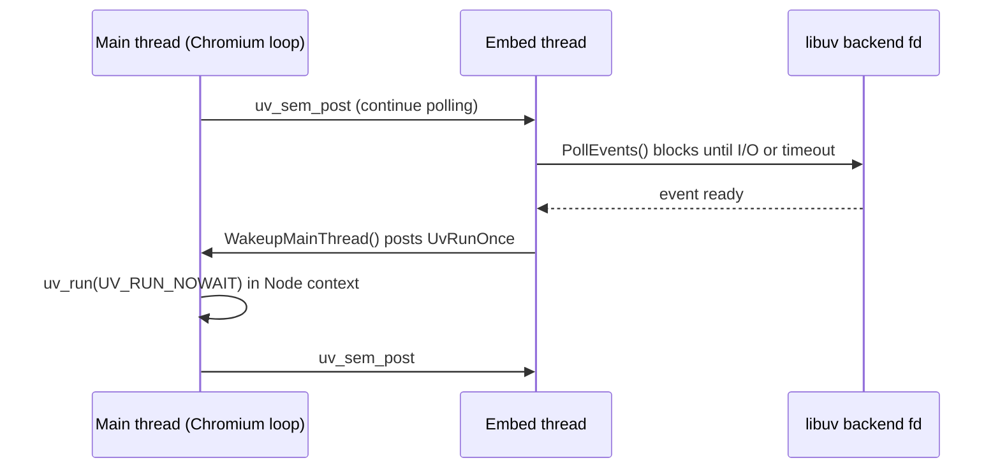

## Overview

Chromium and Node.js each expect to own the thread they run on: Chromium runs its own message loop, Node runs libuv's. Electron runs both on the same thread. It lets Chromium's loop drive the thread, keeps a helper "embed" thread blocked on libuv's backend file descriptor, and when libuv has work the embed thread posts a task that runs one non-blocking pass of the uv loop on the main thread. `NodeBindings` implements this for every process that hosts Node: the main process, renderers with Node integration, web workers and utility processes.

Sources: [shell/common/node_bindings.cc:879-993](repo://shell/common/node_bindings.cc#L879-L993)

This page covers that loop integration, the V8 setup in `JavascriptEnvironment`, how `NodeBindings` creates a Node environment and which script it starts, and the JavaScript wrappers that keep Node timers prompt. Where each process calls into this is described in [[Process Model and Native Startup]], [[Renderer Processes and Preload Scripts]] and [[MessagePorts and the Utility Process]].

Sources: [shell/browser/electron_browser_main_parts.cc:225-259](repo://shell/browser/electron_browser_main_parts.cc#L225-L259), [shell/renderer/web_worker_observer.cc:40-105](repo://shell/renderer/web_worker_observer.cc#L40-L105), [shell/services/node/node_service.cc:88-195](repo://shell/services/node/node_service.cc#L88-L195)

## Merging the two event loops

### The embed thread

`NodeBindings` is constructed with a `BrowserEnvironment` (`kBrowser`, `kRenderer`, `kWorker` or `kUtility`). Workers get a private `uv_loop_t` because several can run in one renderer; every other environment uses `uv_default_loop()`. The loop is configured with `UV_LOOP_INTERRUPT_ON_IO_CHANGE` so that starting a new handle interrupts the embed thread's wait.

Sources: [shell/common/node_bindings.cc:477-529](repo://shell/common/node_bindings.cc#L477-L529)

`PrepareEmbedThread` adds a dummy `uv_async_t` handle, so libuv never decides it has nothing to do, then starts `EmbedThreadRunner`. `StartPolling` remembers the main thread's task runner and runs the loop once so libuv registers its file descriptors. Both return early on a second call: on Windows a second polling thread would exceed the I/O completion port's concurrency limit.

Sources: [shell/common/node_bindings.cc:860-893](repo://shell/common/node_bindings.cc#L860-L893)

Sources: [shell/common/node_bindings.cc:926-993](repo://shell/common/node_bindings.cc#L926-L993)

`EmbedThreadRunner` loops: wait on the semaphore, call `PollEvents()`, then `WakeupMainThread()`, which posts `UvRunOnce` to the main thread. `UvRunOnce` enters the Node context, opens an explicit microtask scope, runs `uv_run(UV_RUN_NOWAIT)` and posts the semaphore so the embed thread polls again. If no environment is attached (a renderer navigating without restarting), it does nothing; if the loop has no more work, it asks the run loop to quit when idle.

Sources: [shell/common/node_bindings.cc:926-993](repo://shell/common/node_bindings.cc#L926-L993)

### Platform polling

`PollEvents` is the only platform-specific piece, and `NodeBindings::Create` returns the subclass for the current OS.

Sources: [shell/common/node_bindings.cc:972-993](repo://shell/common/node_bindings.cc#L972-L993)

| Platform | How `PollEvents` waits |
| --- | --- |
| Linux | `epoll_wait` on an epoll set holding libuv's backend fd, with `uv_backend_timeout` as the timeout |
| macOS | `select` on the backend fd with the same timeout |
| Windows | `GetQueuedCompletionStatus` on libuv's IOCP, then posts the packet back so libuv still sees it |

Sources: [shell/common/node_bindings_linux.cc:11-38](repo://shell/common/node_bindings_linux.cc#L11-L38), [shell/common/node_bindings_mac.cc:24-50](repo://shell/common/node_bindings_mac.cc#L24-L50), [shell/common/node_bindings_win.cc:18-54](repo://shell/common/node_bindings_win.cc#L18-L54)

On single-processor Windows machines the constructor replaces libuv's completion port with one allowing two concurrent threads, to avoid a busy loop in `PollEvents`.

Sources: [shell/common/node_bindings_win.cc:18-30](repo://shell/common/node_bindings_win.cc#L18-L30)

## V8 and the isolate

In the main process V8 is set up by `JavascriptEnvironment` before Chromium's task scheduler is running, so it uses Node's `MultiIsolatePlatform` rather than gin's platform. `Initialize` applies `--js-flags`, creates the Node platform with a tracing agent, initialises gin's `IsolateHolder` without its own platform, allocates the isolate and registers it with the uv loop.

Sources: [shell/browser/javascript_environment.cc:94-136](repo://shell/browser/javascript_environment.cc#L94-L136)

Microtasks follow Node's explicit policy in the browser and utility processes. `JavascriptEnvironment::CreateMicrotasksRunner` installs a `MicrotasksRunner` task observer that, after each Chromium task, opens a `node::CallbackScope` so Node performs the checkpoint; letting Chromium do it directly used to delay Node callbacks. In renderers Blink's scoped policy is kept and the policy is switched to explicit only while `UvRunOnce` runs Node.

Sources: [shell/browser/microtasks_runner.cc:16-34](repo://shell/browser/microtasks_runner.cc#L16-L34), [shell/browser/javascript_environment.cc:144-157](repo://shell/browser/javascript_environment.cc#L144-L157), [shell/common/node_bindings.cc:770-782](repo://shell/common/node_bindings.cc#L770-L782)

## Creating a Node environment

### Initialize

`NodeBindings::Initialize` runs once per process. It re-reads the real command line in zygote-forked children on Linux and registers Electron's linked bindings for the process type (browser, common, renderer, utility, and testing in debug builds), which is how `process._linkedBinding('electron_browser_tray')` finds anything. [[Native API Bindings with gin]] describes those bindings.

Sources: [shell/common/node_bindings.cc:531-547](repo://shell/common/node_bindings.cc#L531-L547), [shell/common/node_bindings.cc:587-600](repo://shell/common/node_bindings.cc#L587-L600)

Only a small set of Node command-line flags is passed through: `ParseNodeCliFlags` keeps debugging flags such as `--inspect` (unless the inspect fuse is off) and a few trace and deprecation flags, and adds `--no-experimental-fetch` in renderers and workers so Node's `fetch` does not replace Blink's. `NODE_OPTIONS` is filtered too: packaged apps keep only `--http-parser` and `--max-http-header-size`, options that conflict with BoringSSL are always removed, and the variable is dropped entirely when the `NodeOptions` fuse is off.

Sources: [shell/common/node_bindings.cc:353-395](repo://shell/common/node_bindings.cc#L353-L395), [shell/common/node_bindings.cc:397-455](repo://shell/common/node_bindings.cc#L397-L455), [shell/common/node_bindings.cc:555-585](repo://shell/common/node_bindings.cc#L555-L585)

### CreateEnvironment

`CreateEnvironment` maps the environment to a `process.type` string and inserts `electron/js2c/<type>_init` as Node's main script, so Node starts the bundle built from `lib/<type>/init.ts` instead of a user file. In the main process it also stores the app search paths (`app.asar`, `app`, `default_app.asar`, or only `app.asar` when the `OnlyLoadAppFromAsar` fuse is on) as private values on the global for [[Main Process Bootstrap]] to read.

Sources: [shell/common/node_bindings.cc:653-698](repo://shell/common/node_bindings.cc#L653-L698)

| Environment flag | Applied when | Why |
| --- | --- | --- |
| `kNoGlobalSearchPaths`, `kNoRegisterESMLoader`, `kHideConsoleWindows` | Always | No global `node_modules` lookup; Electron registers its own ESM hooks |
| `kNoBrowserGlobals`, `kNoCreateInspector` | Renderer, worker | Blink owns the ESM loader, globals like `setImmediate`, and the inspector |
| `kNoStartDebugSignalHandler` | Inspect fuse off | Don't listen for `SIGUSR1` |

Sources: [shell/common/node_bindings.cc:699-728](repo://shell/common/node_bindings.cc#L699-L728)

Error handling differs by process. A custom fatal-error and out-of-memory callback adds the message to crash reports. Outside utility processes, Node is told never to abort on an uncaught exception, because Electron handles those itself; utility processes behave like standard Node. In renderers and workers Electron keeps Blink's promise-rejection and stack-trace callbacks and its message listener instead of Node's.

Sources: [shell/common/node_bindings.cc:745-762](repo://shell/common/node_bindings.cc#L745-L762), [shell/common/node_bindings.cc:783-812](repo://shell/common/node_bindings.cc#L783-L812)

Finally it sets `process.type`, adds `process.appCodeLoaded` in the browser and renderer, and returns the environment with a deleter that clears the context's embedder slot before freeing it.

Sources: [shell/common/node_bindings.cc:813-842](repo://shell/common/node_bindings.cc#L813-L842)

### Loading and preload

`LoadEnvironment` calls `node::LoadEnvironment` with `OnNodePreload` and then emits `loaded` on `process`. `OnNodePreload` runs before the init script: it sets `process.resourcesPath`, `process.helperExecPath`, adds `electron` and `chrome` to `process.versions`, and runs the `node_init` bundle from `lib/node/init.ts`, which installs the asar file-system support described in [[ASAR Archives]].

Sources: [shell/common/node_bindings.cc:855-858](repo://shell/common/node_bindings.cc#L855-L858), [shell/common/node_bindings.cc:995-1022](repo://shell/common/node_bindings.cc#L995-L1022)

In the main process, `JoinAppCode` then pumps the uv loop with `UV_RUN_ONCE` until the init script calls `process.appCodeLoaded()` or the browser starts shutting down. This lets the app's main script, including an ES module whose import is asynchronous, finish loading before Chromium continues its startup phases.

Sources: [shell/common/node_bindings.cc:895-924](repo://shell/common/node_bindings.cc#L895-L924)

## Keeping timers prompt from JavaScript

Because the uv loop only runs when the embed thread notices I/O, a callback queued with `process.nextTick` or `setImmediate` could wait until something unrelated woke the loop. `lib/common/init.ts` wraps `process.nextTick`, `setImmediate`, `setTimeout` and `setInterval` so each call first runs `process.activateUvLoop()`, preserving `util.promisify.custom`. The global `setTimeout` and `setInterval` are replaced only in browser and utility processes, since renderers use Blink's timers.

Sources: [lib/common/init.ts:8-62](repo://lib/common/init.ts#L8-L62)

`activateUvLoop` is defined in `ElectronBindings`: it queues the current environment once and sends a `uv_async_t`; the async callback opens a `node::CallbackScope` for each queued environment, which drains Node's tick and microtask queues.

Sources: [shell/common/api/electron_bindings.cc:81-112](repo://shell/common/api/electron_bindings.cc#L81-L112)
