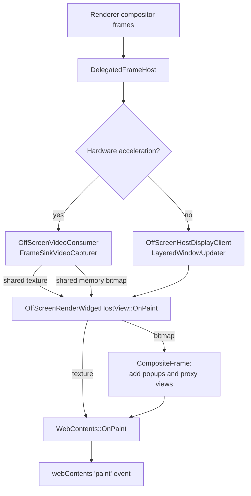

## Overview

With `webPreferences.offscreen`, a page is rendered without being composited into a visible window, and every new frame is delivered to the main process as a `paint` event on its `webContents`. Apps use this to draw web content into a game engine, a video, or a custom compositor. Offscreen rendering replaces two Chromium classes for the page: the `WebContentsView`, which normally places the page in a native window, and the `RenderWidgetHostView`, which normally shows the renderer's output. Electron's versions capture the output instead and hand it to `api::WebContents::OnPaint`. There are two delivery modes: CPU bitmaps (the default) and GPU shared textures (`offscreen: { useSharedTexture: true }`).

Sources: [shell/browser/api/electron_api_web_contents.cc:785-808](repo://shell/browser/api/electron_api_web_contents.cc#L785-L808), [shell/browser/osr/README.md:1-21](repo://shell/browser/osr/README.md#L1-L21)

How a `webContents` is created in general is in [[WebContents and Frames]]; the window that hosts an offscreen page is a normal `BrowserWindow` from [[Windows and Views]], forced to be frameless.

Sources: [shell/browser/api/electron_api_base_window.cc:103-109](repo://shell/browser/api/electron_api_base_window.cc#L103-L109)

## Turning it on

The `WebContents` constructor reads `offscreen`: `true` or an object makes the type `kOffScreen`, and an object's `useSharedTexture` selects GPU delivery. For an offscreen page it creates an `OffScreenWebContentsView`, transparent when the hidden `backgroundColor` is fully transparent, with a callback bound to `WebContents::OnPaint`, and passes it to Chromium as both the view and the delegate view of the new `content::WebContents`. A `<webview>` inside an offscreen embedder, and a child window opened with offscreen preferences, get the same kind of view.

Sources: [shell/browser/api/electron_api_web_contents.cc:796-808](repo://shell/browser/api/electron_api_web_contents.cc#L796-L808), [shell/browser/api/electron_api_web_contents.cc:847-870](repo://shell/browser/api/electron_api_web_contents.cc#L847-L870), [shell/browser/api/electron_api_web_contents.cc:1214-1237](repo://shell/browser/api/electron_api_web_contents.cc#L1214-L1237)

## OffScreenWebContentsView

`OffScreenWebContentsView` stands in for the platform `WebContentsView`. Its size is the size of the native window it is associated with (empty without one), and it observes that window so a resize calls `SetSize` on the render widget host view and a close detaches it. The native view and top-level window it reports are the owner window's, so code that expects a native parent still finds one.

Sources: [shell/browser/osr/osr_web_contents_view.cc:37-92](repo://shell/browser/osr/osr_web_contents_view.cc#L37-L92)

Its main job is to create the render widget host views. `CreateViewForWidget` makes an `OffScreenRenderWidgetHostView` for the page; `CreateViewForChildWidget` makes one for popups (such as `<select>` dropdowns) that is parented to the page's view, or to the outer page's view for a guest, and inherits its frame rate. `SetPainting` and `SetFrameRate` remember the value and forward it to the current view, which is how `webContents.startPainting()`, `stopPainting()` and `setFrameRate()` reach it.

Sources: [shell/browser/osr/osr_web_contents_view.cc:102-138](repo://shell/browser/osr/osr_web_contents_view.cc#L102-L138), [shell/browser/osr/osr_web_contents_view.cc:165-195](repo://shell/browser/osr/osr_web_contents_view.cc#L165-L195), [shell/browser/api/electron_api_web_contents.cc:3653-3679](repo://shell/browser/api/electron_api_web_contents.cc#L3653-L3679)

## OffScreenRenderWidgetHostView

### Construction

`OffScreenRenderWidgetHostView` derives from Chromium's `RenderWidgetHostViewBase`. Its constructor sets up a `DelegatedFrameHost` that receives the renderer's compositor frames, a root `ui::Layer`, and its own `ui::Compositor` with no accelerated widget, so the page is composited into nothing visible. It then chooses how frames will come back: when hardware acceleration is enabled it creates an `OffScreenVideoConsumer`; otherwise the compositor's `CreateHostDisplayClient` returns an `OffScreenHostDisplayClient`. Both report to `OnPaint`, and both are switched on and off by `SetPainting`.

Sources: [shell/browser/osr/osr_render_widget_host_view.cc:155-221](repo://shell/browser/osr/osr_render_widget_host_view.cc#L155-L221), [shell/browser/osr/osr_render_widget_host_view.cc:632-641](repo://shell/browser/osr/osr_render_widget_host_view.cc#L632-L641), [shell/browser/osr/osr_render_widget_host_view.cc:893-908](repo://shell/browser/osr/osr_render_widget_host_view.cc#L893-L908)

Sources: [shell/browser/osr/osr_render_widget_host_view.cc:214-221](repo://shell/browser/osr/osr_render_widget_host_view.cc#L214-L221), [shell/browser/osr/osr_render_widget_host_view.cc:662-731](repo://shell/browser/osr/osr_render_widget_host_view.cc#L662-L731), [shell/browser/api/electron_api_web_contents.cc:3633-3651](repo://shell/browser/api/electron_api_web_contents.cc#L3633-L3651)

### The video consumer

`OffScreenVideoConsumer` asks the view for a frame-sink video capturer, the same mechanism Chromium uses for tab capture. It disables auto-throttling, allows any size change rate, and requests ARGB frames. `SetActive` starts the capturer, preferring GPU memory buffers in shared-texture mode, or stops it; `SetFrameRate` sets the minimum capture period to one frame interval.

Sources: [shell/browser/osr/osr_video_consumer.cc:21-56](repo://shell/browser/osr/osr_video_consumer.cc#L21-L56)

In bitmap mode, `OnFrameCaptured` maps the frame's read-only shared memory, checks its size, and wraps it in an `SkBitmap` whose release procedure returns the buffer to the capturer. In shared-texture mode it clones the GPU memory buffer handle and fills an `OffscreenSharedTextureValue` with the pixel format, sizes, rectangles, colour space, timestamp, frame counter and the platform handle: a DXGI handle on Windows, an `IOSurface` on macOS, or native pixmap planes on Linux. An `OffscreenReleaserHolder` keeps the buffer reserved until JavaScript releases it.

Sources: [shell/browser/osr/osr_video_consumer.cc:58-120](repo://shell/browser/osr/osr_video_consumer.cc#L58-L120), [shell/browser/osr/osr_video_consumer.cc:121-189](repo://shell/browser/osr/osr_video_consumer.cc#L121-L189)

### The software path

Without GPU acceleration, the compositor draws in software. `OffScreenHostDisplayClient::CreateLayeredWindowUpdater` gives viz a `LayeredWindowUpdater` that receives a shared-memory canvas and, on each `Draw`, calls the paint callback with the damaged rectangle when active.

Sources: [shell/browser/osr/osr_host_display_client.cc:22-103](repo://shell/browser/osr/osr_host_display_client.cc#L22-L103)

### Composing the frame

`OffScreenRenderWidgetHostView::OnPaint` passes a shared texture straight through to the paint callback. A bitmap is copied into the view's backing store; a popup's view then asks its parent to repaint, and the page's view runs `CompositeFrame`. When there is no popup and no proxy view, the backing bitmap is the frame. Otherwise it draws the page, then the open popup at its position, then every `OffscreenViewProxy` (views drawn on top, such as an autofill popup) into one bitmap, and reports the damage rectangle clipped to the view size. Resizes requested while a frame is being composed are held and applied afterwards.

Sources: [shell/browser/osr/osr_render_widget_host_view.cc:662-753](repo://shell/browser/osr/osr_render_widget_host_view.cc#L662-L753)

## Frame rate and painting

`setFrameRate` clamps the value to at least 1, and to at most 240 in bitmap mode; shared-texture mode has no upper bound. A child view always uses its parent's rate, and the rate propagates to guest views. `stopPainting` deactivates the capturer or display client, the popup and guests, so no frames are produced until `startPainting`. `webContents.invalidate()` schedules a full repaint of an offscreen view, or invalidates the owner window otherwise.

Sources: [shell/browser/osr/osr_render_widget_host_view.cc:893-933](repo://shell/browser/osr/osr_render_widget_host_view.cc#L893-L933), [shell/browser/api/electron_api_web_contents.cc:3681-3691](repo://shell/browser/api/electron_api_web_contents.cc#L3681-L3691)

## The paint event

`WebContents::OnPaint` emits `paint` with an event object, the dirty rectangle and a `NativeImage` made from the bitmap. In shared-texture mode the bitmap is empty and the event has a `texture` property instead.

Sources: [shell/browser/api/electron_api_web_contents.cc:3633-3651](repo://shell/browser/api/electron_api_web_contents.cc#L3633-L3651)

The texture object is built by the converter in `osr_converter.cc`. It turns the frame metadata into a plain object with the platform handle as a `Buffer`, and adds a `release()` function that frees the releaser and returns the buffer to the pool. A monitor is attached to the object so that if it is garbage-collected without `release()` having been called, Electron prints a warning. Textures come from a pool of at most 10 frames, so a consumer that holds them stalls capture; the README advises opening the handle on every event, copying to a texture the app owns, and releasing immediately, since each frame may use a different texture from the pool.

Sources: [shell/common/gin_converters/osr_converter.cc:45-100](repo://shell/common/gin_converters/osr_converter.cc#L45-L100), [shell/browser/osr/README.md:19-38](repo://shell/browser/osr/README.md#L19-L38), [shell/browser/osr/README.md:122-124](repo://shell/browser/osr/README.md#L122-L124)

## Input

Because there is no visible window to receive input, `webContents.sendInputEvent` drives an offscreen page. `OffScreenRenderWidgetHostView::SendMouseEvent` routes mouse events to an open popup when the point falls inside it, translating coordinates, and to the page otherwise; mouse wheel and keyboard events have their own `Send` methods.

Sources: [shell/browser/osr/osr_render_widget_host_view.cc:772-812](repo://shell/browser/osr/osr_render_widget_host_view.cc#L772-L812)
