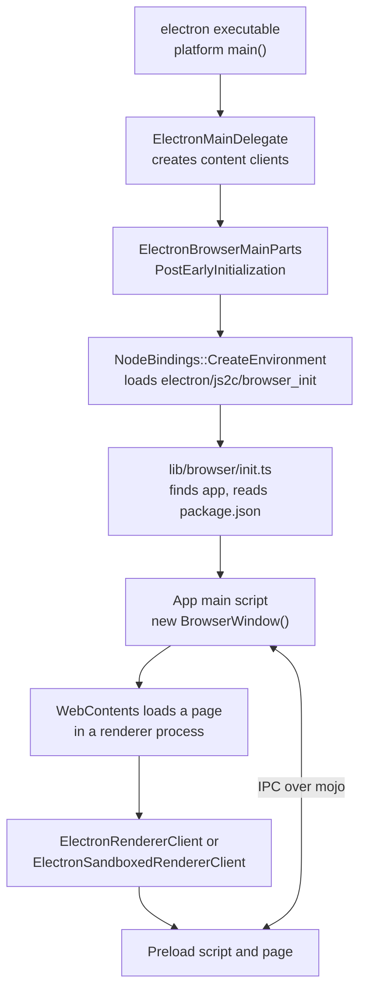

## Overview

Electron lets developers write cross-platform desktop applications in JavaScript, HTML and CSS by combining Chromium and Node.js in one runtime. This repository is that runtime: a C++ "shell" that embeds Chromium's content layer and Node.js, the TypeScript library that implements the `electron` module apps `require`, the patches Electron carries on its upstream dependencies, and the scripts that build, test and release it.

Sources: [README.md:8-12](repo://README.md#L8-L12), [docs/development/source-code-directory-structure.md:12-77](repo://docs/development/source-code-directory-structure.md#L12-L77)

The code splits along two axes. By language, `shell/` holds C++ and `lib/` holds TypeScript. By process, each tree has a `browser` (main process), `renderer` and `common` part, mirroring Chromium's multi-process architecture, with extra `lib/` targets for sandboxed renderers, isolated worlds, preload realms, web workers and utility processes.

Sources: [docs/development/source-code-directory-structure.md:25-74](repo://docs/development/source-code-directory-structure.md#L25-L74)

## Parts of the repository

| Area | What it does | Page |
| --- | --- | --- |
| `shell/app` | Platform `main` functions and `ElectronMainDelegate`, which picks the content clients for each process type | [[Process Model and Native Startup]] |
| `shell/common/node_bindings*` | Embeds Node.js and merges its libuv loop with Chromium's message loop | [[Node.js Integration and Event Loops]] |
| `lib/`, `build/webpack`, `build/js2c.py` | Per-process TypeScript bundles compiled into the binary; the `electron` module | [[JavaScript Bundles and the electron Module]] |
| `shell/common/gin_helper`, `shell/*/api` | C++ objects exposed to JavaScript through linked bindings | [[Native API Bindings with gin]] |
| `lib/browser/init.ts`, `default_app/` | Finds the app, reads `package.json` and runs its main script | [[Main Process Bootstrap]] |
| `shell/renderer`, `lib/renderer`, `lib/sandboxed_renderer` | Renderer setup, Node integration in pages, preload scripts | [[Renderer Processes and Preload Scripts]] |
| `ipcMain`, `ipcRenderer`, `api.mojom` | Messages between renderers and the main process | [[Inter-Process Communication]] |
| `contextBridge`, `lib/isolated_renderer` | Separate JavaScript worlds for preload and page code | [[Context Isolation and contextBridge]] |
| `MessageChannelMain`, `utilityProcess` | Transferable ports and Node.js child processes | [[MessagePorts and the Utility Process]] |
| `BaseWindow`, `BrowserWindow`, `View` | Native windows and the view tree | [[Windows and Views]] |
| `webContents`, `webFrameMain` | The web page in a window and its frames | [[WebContents and Frames]] |
| `window.open`, `<webview>` | Child windows and embedded guest pages | [[Child Windows and the webview Tag]] |
| `shell/browser/osr` | Rendering pages to bitmaps without a window | [[Offscreen Rendering]] |
| `session` | Browser contexts, partitions, permissions, cookies, downloads | [[Sessions and Browser Contexts]] |
| `protocol`, `webRequest` | Custom schemes and request interception | [[Custom Protocols and Request Interception]] |
| `net` | HTTP client on Chromium's network stack | [[The net Module]] |
| `shell/common/asar`, `lib/node/asar-fs-wrapper.ts` | Reading apps packed in `.asar` archives | [[ASAR Archives]] |
| `build/fuses` | Feature switches flipped in the shipped binary | [[Fuses]] |
| `Menu`, `Tray`, `globalShortcut` | Menus, accelerators and status icons | [[Menus, Accelerators and Tray]] |
| `dialog`, `clipboard`, `powerMonitor`, … | Other operating-system services | [[System Integration Modules]] |
| `shell/browser/extensions` | The subset of Chrome extensions Electron loads | [[Chrome Extensions Support]] |
| `BUILD.gn`, `DEPS`, `buildflags/` | Building Electron inside a Chromium checkout | [[Build System]] |
| `patches/` | Changes applied to Chromium, Node.js, V8 and others | [[Patching Chromium and Node.js]] |
| `spec/`, `script/spec-runner.js` | Test suites | [[Testing]] |
| `script/release`, `npm/` | Versioning, publishing and the `electron` npm package | [[Releases and the npm Package]] |

Sources: [docs/development/source-code-directory-structure.md:12-99](repo://docs/development/source-code-directory-structure.md#L12-L99)

## From launch to the app's first window

Sources: [shell/app/electron_main_delegate.cc:446-479](repo://shell/app/electron_main_delegate.cc#L446-L479), [shell/browser/electron_browser_main_parts.cc:225-259](repo://shell/browser/electron_browser_main_parts.cc#L225-L259), [shell/common/node_bindings.cc:653-694](repo://shell/common/node_bindings.cc#L653-L694), [lib/browser/init.ts:109-222](repo://lib/browser/init.ts#L109-L222)

1. The platform `main` hands control to Chromium's content main with an `ElectronMainDelegate`, covered in [[Process Model and Native Startup]].
2. `ElectronMainDelegate` returns Electron's own `ContentBrowserClient`, `ContentRendererClient` and `ContentUtilityClient`; the renderer client is the sandboxed one when the sandbox is enabled for that process.
3. In `PostEarlyInitialization`, `ElectronBrowserMainParts` creates the V8 isolate and the Node.js environment, then waits for the app code, as described in [[Node.js Integration and Event Loops]].
4. `CreateEnvironment` passes Node the script `electron/js2c/browser_init`, the main-process bundle built from `lib/browser/init.ts` ([[JavaScript Bundles and the electron Module]]).
5. That script searches `app.asar`, `app` and `default_app.asar`, applies `package.json`, and loads the app's main script ([[Main Process Bootstrap]]).
6. The app creates windows ([[Windows and Views]]) whose `WebContents` load pages in renderer processes ([[WebContents and Frames]], [[Renderer Processes and Preload Scripts]]), which talk back through [[Inter-Process Communication]].

Sources: [shell/app/electron_main_delegate.cc:446-479](repo://shell/app/electron_main_delegate.cc#L446-L479), [shell/common/node_bindings.cc:675-698](repo://shell/common/node_bindings.cc#L675-L698), [lib/browser/init.ts:92-114](repo://lib/browser/init.ts#L92-L114)

## Design decisions

### Embedding Chromium's content layer

Electron does not fork Chrome's browser UI. It implements Chromium's embedder interfaces: `ElectronMainDelegate` creates an `ElectronContentClient`, `ElectronBrowserClient`, `ElectronGpuClient`, a renderer client and an `ElectronContentUtilityClient`, and Chromium calls back into them. Everything Chrome would normally provide above the content layer (windows, menus, sessions, downloads) is written in `shell/browser`.

Sources: [shell/app/electron_main_delegate.cc:446-479](repo://shell/app/electron_main_delegate.cc#L446-L479)

### Thin TypeScript over native bindings

Most API classes live in C++ and are registered as Node linked bindings with names such as `electron_browser_tray`. The TypeScript module often only re-exports the binding, as `lib/browser/api/tray.ts` does; others add JavaScript behaviour on top. The full list of bindings each process gets is a macro in `node_bindings.cc`, so a new API has to be added there to be reachable. [[Native API Bindings with gin]] follows this path.

Sources: [shell/common/node_bindings.cc:53-93](repo://shell/common/node_bindings.cc#L53-L93), [shell/browser/api/electron_api_tray.cc:465-465](repo://shell/browser/api/electron_api_tray.cc#L465-L465), [lib/browser/api/tray.ts:1-3](repo://lib/browser/api/tray.ts#L1-L3)

### Bundled, lazily loaded JavaScript

Each process type gets one webpack bundle (`browser_init.js`, `renderer_init.js`, `sandbox_bundle.js` and others), and the `electron_js2c` action compiles all of them into `electron_natives.cc`, so the library ships inside the executable rather than as files an app could change. Inside a bundle, the `electron` module exposes each API through a getter that loads it on first use, so an app pays only for the modules it touches.

Sources: [BUILD.gn:165-272](repo://BUILD.gn#L165-L272), [lib/browser/api/module-list.ts:1-43](repo://lib/browser/api/module-list.ts#L1-L43), [lib/browser/api/exports/electron.ts:1-8](repo://lib/browser/api/exports/electron.ts#L1-L8)

### One `electron` module for every process

`lib/common/init.ts` inserts a fake `electron` module into Node's module cache and resolves `electron/main`, `electron/renderer`, `electron/common` and `electron/utility` to it. The sub-paths exist only so TypeScript can type each process's view of the API.

Sources: [lib/common/init.ts:78-119](repo://lib/common/init.ts#L78-L119)

### Never crash the main process on script errors

The main process keeps running after a JavaScript error: Node is told not to abort on uncaught exceptions outside utility processes, unhandled rejections only warn, and `lib/browser/init.ts` shows an error dialog when the app has no `uncaughtException` handler of its own.

Sources: [shell/common/node_bindings.cc:750-762](repo://shell/common/node_bindings.cc#L750-L762), [shell/browser/electron_browser_main_parts.cc:243-246](repo://shell/browser/electron_browser_main_parts.cc#L243-L246), [lib/browser/init.ts:21-38](repo://lib/browser/init.ts#L21-L38)

### Patch upstream, don't fork

Chromium, Node.js, V8 and the other dependencies are checked out unmodified and patched with series of patch files listed in `patches/config.json`. Every patch has to justify itself as temporary, needed only to compile in Electron, or a functional change upstream won't take; the aim is to upstream changes instead. See [[Patching Chromium and Node.js]].

Sources: [patches/config.json:1-16](repo://patches/config.json#L1-L16), [docs/development/patches.md:5-19](repo://docs/development/patches.md#L5-L19)
