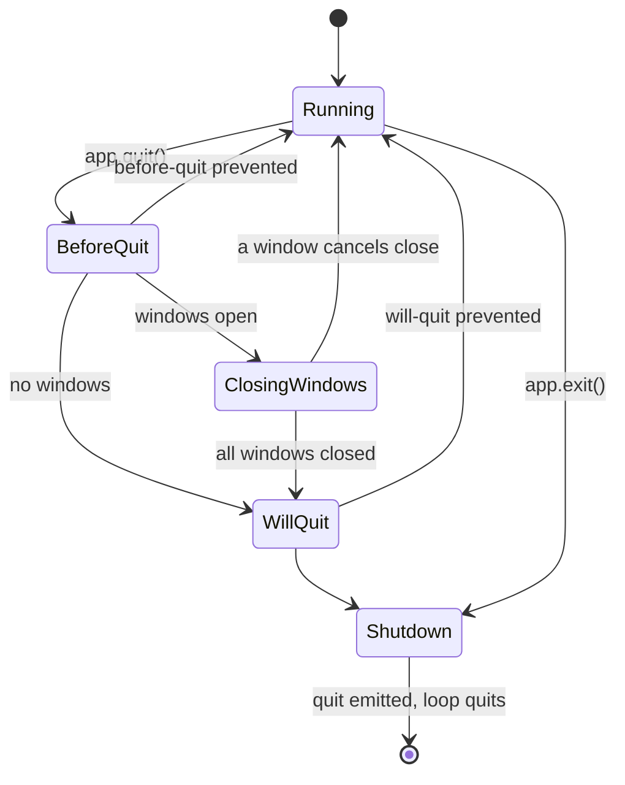

## Overview

Electron runs as several processes, all started from the same executable: one browser (main) process that runs the app's main script, renderer processes for web pages, a GPU process, and utility processes. This page follows the C++ path from the operating system's `main` to the point where the main process's message loop runs: the platform entry points, `ElectronMainDelegate`, the `ElectronBrowserMainParts` phases, the `Browser` object that owns the ready and quit lifecycle, and how `ElectronBrowserClient` prepares child processes. Embedding Node.js is left to [[Node.js Integration and Event Loops]] and the JavaScript that runs next to [[Main Process Bootstrap]].

Sources: [shell/app/electron_main_linux.cc:29-44](repo://shell/app/electron_main_linux.cc#L29-L44), [shell/app/electron_main_delegate.cc:446-488](repo://shell/app/electron_main_delegate.cc#L446-L488)

## Entry points

### Platform main functions

Each platform has its own `main`: `electron_main_linux.cc`, `electron_main_mac.cc` and `electron_main_win.cc`. On Linux it fixes the standard streams, lets libuv take a copy of `argv`, initialises `base::CommandLine` and Electron's own `ElectronCommandLine`, and then makes the one decision that matters before Chromium starts: if the `RunAsNode` fuse is on and `ELECTRON_RUN_AS_NODE` is set, it calls `NodeMain()` and Electron behaves as a plain Node.js binary. Otherwise it constructs an `ElectronMainDelegate` and hands it to `content::ContentMain`.

Sources: [shell/app/electron_main_linux.cc:22-44](repo://shell/app/electron_main_linux.cc#L22-L44)

```cpp
  if (electron::fuses::IsRunAsNodeEnabled() && IsEnvSet(electron::kRunAsNode)) {
    base::i18n::InitializeICU();
    base::AtExitManager atexit_manager;
    return electron::NodeMain();
  }

  electron::ElectronMainDelegate delegate;
  return content::ContentMain(content::ContentMainParams{&delegate});
```

Sources: [shell/app/electron_main_linux.cc:36-43](repo://shell/app/electron_main_linux.cc#L36-L43)

The Windows entry point checks the same fuse and variable before calling `NodeMain()`; macOS does the same check in its own `main`.

Sources: [shell/app/electron_main_win.cc:160-170](repo://shell/app/electron_main_win.cc#L160-L170), [shell/app/electron_main_mac.cc:54-54](repo://shell/app/electron_main_mac.cc#L54-L54)

### Node mode

`NodeMain()` runs Node without Chromium's content layer. It drops `NODE_OPTIONS` and `NODE_EXTRA_CA_CERTS` when the `NodeOptions` fuse is off, and on macOS strips the variables that could inject scripts when the parent process is not signed as the same app. It then installs a `UvTaskRunner` on the default libuv loop, registers Electron's built-in bindings, initialises Node once per process, sets up crash reporting, creates a `JavascriptEnvironment` and a Node environment, adds `process.crash` and `process.crashReporter`, and spins Node's event loop until it exits. [[Fuses]] lists the switches this path checks.

Sources: [shell/app/node_main.cc:123-150](repo://shell/app/node_main.cc#L123-L150), [shell/app/node_main.cc:176-291](repo://shell/app/node_main.cc#L176-L291)

## ElectronMainDelegate

`ElectronMainDelegate` implements Chromium's `ContentMainDelegate`, so Chromium calls it at fixed points in every process.

Sources: [shell/app/electron_main_delegate.cc:253-264](repo://shell/app/electron_main_delegate.cc#L253-L264)

| Hook | What Electron does |
| --- | --- |
| `BasicStartupComplete` | Honours `ELECTRON_ENABLE_STACK_DUMPING` and `ELECTRON_DISABLE_SANDBOX`, registers the Chrome and Electron path providers |
| `PreSandboxStartup` | Applies `--user-data-dir`, initialises logging, loads the resource bundle for processes that need it, starts Crashpad |
| `SandboxInitialized` | Initialises logging for child processes on Windows after the sandbox is up |
| `CreateContentClient` and friends | Return Electron's content, browser, GPU, renderer and utility clients |
| `RunProcess` | Runs the relauncher helper for `app.relaunch()`; every other type goes back to Chromium |

Sources: [shell/app/electron_main_delegate.cc:264-300](repo://shell/app/electron_main_delegate.cc#L264-L300), [shell/app/electron_main_delegate.cc:334-416](repo://shell/app/electron_main_delegate.cc#L334-L416), [shell/app/electron_main_delegate.cc:446-488](repo://shell/app/electron_main_delegate.cc#L446-L488)

The renderer client is chosen per process. When the process's command line has `--enable-sandbox` or lacks `--no-sandbox`, `CreateContentRendererClient` returns an `ElectronSandboxedRendererClient`; otherwise an `ElectronRendererClient`, which can run Node.js inside the page. Running as root on Linux with the sandbox on is a fatal error.

Sources: [shell/app/electron_main_delegate.cc:462-473](repo://shell/app/electron_main_delegate.cc#L462-L473), [shell/app/command_line_args.cc:57-60](repo://shell/app/command_line_args.cc#L57-L60), [shell/app/electron_main_delegate.cc:309-314](repo://shell/app/electron_main_delegate.cc#L309-L314)

## Browser process phases

### Phase order

`ElectronBrowserClient::CreateBrowserMainParts` returns an `ElectronBrowserMainParts`, and Chromium's `BrowserMainLoop` drives it through its phases. Its constructor creates a fake `BrowserProcessImpl` (standing in for Chrome's `g_browser_process`), the browser `NodeBindings`, `ElectronBindings` and the `Browser` singleton; only one instance may exist.

Sources: [shell/browser/electron_browser_client.cc:845-847](repo://shell/browser/electron_browser_client.cc#L845-L847), [shell/browser/electron_browser_main_parts.cc:175-184](repo://shell/browser/electron_browser_main_parts.cc#L175-L184)

```mermaid
sequenceDiagram
  participant Loop as BrowserMainLoop
  participant Parts as ElectronBrowserMainParts
  participant Node as NodeBindings
  participant Browser as Browser
  Loop->>Parts: PreEarlyInitialization()
  Loop->>Parts: PostEarlyInitialization()
  Parts->>Node: CreateEnvironment + LoadEnvironment
  Note over Parts,Node: app main script runs here
  Loop->>Parts: PreCreateThreads()
  Loop->>Parts: ToolkitInitialized()
  Loop->>Parts: PreMainMessageLoopRun()
  Parts->>Node: StartPolling()
  Parts->>Browser: WillFinishLaunching / DidFinishLaunching
  Loop->>Parts: WillRunMainMessageLoop()
  Note over Loop: message loop runs
  Loop->>Parts: PostMainMessageLoopRun()
```

Sources: [shell/browser/electron_browser_main_parts.cc:207-259](repo://shell/browser/electron_browser_main_parts.cc#L207-L259), [shell/browser/electron_browser_main_parts.cc:425-493](repo://shell/browser/electron_browser_main_parts.cc#L425-L493), [shell/browser/electron_browser_main_parts.cc:549-591](repo://shell/browser/electron_browser_main_parts.cc#L549-L591)

### Early initialization runs the app

`PreEarlyInitialization` creates the field trial list, handles `SIGCHLD` on POSIX and sets up Ozone or the native screen. `PostEarlyInitialization` is where the app's code first runs: it creates the `JavascriptEnvironment` and the Node environment, sets unhandled rejections to `warn-with-error-code`, binds Electron's extra `process` APIs, loads the environment and calls `JoinAppCode()` to wait until the main script has been loaded. Because the app has now had a chance to change command-line switches, the feature list, field trials and logging are initialised again afterwards.

Sources: [shell/browser/electron_browser_main_parts.cc:207-280](repo://shell/browser/electron_browser_main_parts.cc#L207-L280)

### Threads, toolkit and resources

`PreCreateThreads` loads the resource bundle for the `--lang` locale (or the system locale), creates the desktop screen on Aura, and records the application locale for both Electron and Chromium. `ToolkitInitialized` sets up the platform UI toolkit: GTK, gdk-pixbuf and the dark-mode manager on Linux, the window-manager state on Aura, and a `ViewsDelegate`. `PostCreateMainMessageLoop` configures OS cookie encryption (the Linux password store, the macOS keychain names `<app> Safe Storage`) and installs handlers so `SIGINT` and `SIGTERM` call `Browser::Quit`.

Sources: [shell/browser/electron_browser_main_parts.cc:282-356](repo://shell/browser/electron_browser_main_parts.cc#L282-L356), [shell/browser/electron_browser_main_parts.cc:388-423](repo://shell/browser/electron_browser_main_parts.cc#L388-L423), [shell/browser/electron_browser_main_parts.cc:495-547](repo://shell/browser/electron_browser_main_parts.cc#L495-L547)

### Before the message loop

`PreMainMessageLoopRun` starts the Node polling thread, locks the URL scheme registries (so schemes must be registered before `ready`), creates the extensions clients, registers the WebUI factory, starts the remote-debugging pipe or port when asked, and on Windows and Linux calls `Browser::WillFinishLaunching` and `DidFinishLaunching`. On macOS those two calls come from the application delegate instead. `WillRunMainMessageLoop` hands `Browser` the closure that quits the run loop.

Sources: [shell/browser/electron_browser_main_parts.cc:425-493](repo://shell/browser/electron_browser_main_parts.cc#L425-L493)

### Shutdown

After the loop ends, `PostMainMessageLoopRun` shuts down every session's download manager, then shuts down utility processes started through `utilityProcess` so their `exit` events can still reach JavaScript, stops and frees the Node environment, and only then destroys every `ElectronBrowserContext`. The order keeps C++ destructors that call into V8 from running after Node is gone.

Sources: [shell/browser/electron_browser_main_parts.cc:549-601](repo://shell/browser/electron_browser_main_parts.cc#L549-L601)

## The ready and quit lifecycle

`Browser` is the process-wide object behind `app`'s lifecycle. `api::App` observes it and turns each notification into an event: `OnWillFinishLaunching` emits `will-finish-launching`, `OnFinishLaunching` emits `ready`, and `before-quit`, `will-quit`, `window-all-closed` and `quit` follow the same pattern. `DidFinishLaunching` also creates the user-data directory and resolves the promise `app.whenReady()` returns, which resolves immediately if the app is already ready.

Sources: [shell/browser/browser.cc:179-211](repo://shell/browser/browser.cc#L179-L211), [shell/browser/api/electron_api_app.cc:573-624](repo://shell/browser/api/electron_api_app.cc#L573-L624)



Sources: [shell/browser/browser.cc:86-141](repo://shell/browser/browser.cc#L86-L141), [shell/browser/browser.cc:232-268](repo://shell/browser/browser.cc#L232-L268)

`Browser::Quit` asks `before-quit` listeners first; if none prevents it, it closes all windows through `WindowList`, or goes straight to `NotifyAndShutdown` when there are none. A window whose `beforeunload` cancels its close cancels the quit too. When the last window closes during a quit, `will-quit` gets its chance to prevent shutdown; `Shutdown` then emits `quit` and runs the stored quit closure, or waits for it if the loop does not exist yet. `Browser::Exit` skips the events: it records the exit code and destroys windows without asking them. When no quit is in progress, the last window closing only emits `window-all-closed`.

Sources: [shell/browser/browser.cc:86-141](repo://shell/browser/browser.cc#L86-L141), [shell/browser/browser.cc:225-268](repo://shell/browser/browser.cc#L225-L268)

## Configuring child processes

Before Chromium launches a child, it calls `ElectronBrowserClient::AppendExtraCommandLineSwitches`. Electron first checks that the program is the expected helper executable and aborts otherwise. It then passes `--user-data-dir` to every child except the zygote, and copies the custom scheme lists registered through `protocol.registerSchemesAsPrivileged` (standard, secure, CORS, fetch, service worker, streaming, code cache, bypass-CSP) and `--enable-sandbox` into renderer and utility processes.

Sources: [shell/browser/electron_browser_client.cc:458-552](repo://shell/browser/electron_browser_client.cc#L458-L552)

Renderers get more: the app path, the per-`WebContents` switches from `WebContentsPreferences::AppendCommandLineSwitches`, and `--service-worker-preload` when the session has a service-worker preload script. Those preferences decide the sandbox: a sandboxed `WebContents`, or a cross-origin subframe without `nodeIntegrationInSubFrames`, gets `--enable-sandbox`; otherwise the renderer gets `--no-sandbox` and `--no-zygote`, which is what makes `ElectronMainDelegate` pick the Node-capable renderer client. [[Renderer Processes and Preload Scripts]] continues from there.

Sources: [shell/browser/electron_browser_client.cc:554-598](repo://shell/browser/electron_browser_client.cc#L554-L598), [shell/browser/web_contents_preferences.cc:308-348](repo://shell/browser/web_contents_preferences.cc#L308-L348)
