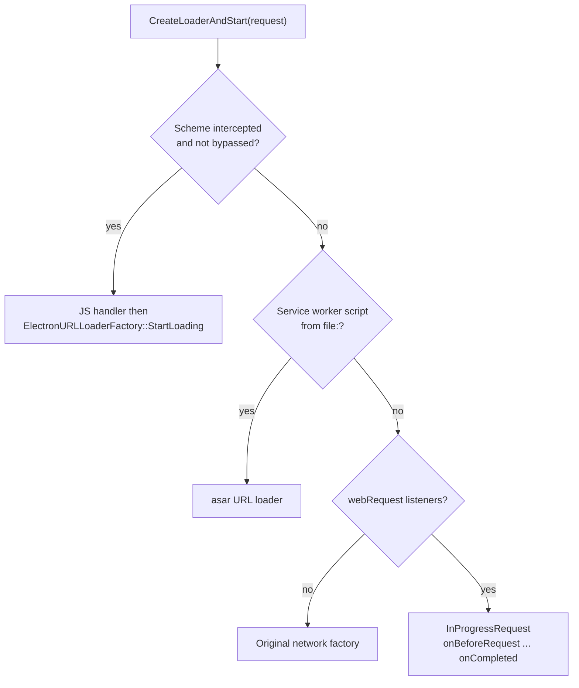

## Overview

Electron lets the main process take part in loading resources in three ways. `protocol.registerSchemesAsPrivileged` tells Chromium, before startup finishes, that a custom scheme should behave like `https` in chosen respects. `protocol.handle` (and the older `register*Protocol` and `intercept*Protocol` functions) answer requests for a scheme from JavaScript. `session.webRequest` observes and modifies every network request a session makes. All of it is per session except the scheme registration, and all of it is implemented by inserting Electron's own `URLLoaderFactory` objects into Chromium's network stack. Sessions themselves are covered in [[Sessions and Browser Contexts]]; making requests from the main process is [[The net Module]].

Sources: [lib/browser/api/protocol.ts:111-183](repo://lib/browser/api/protocol.ts#L111-L183), [shell/browser/electron_browser_client.cc:1309-1380](repo://shell/browser/electron_browser_client.cc#L1309-L1380)

## Privileged schemes

`registerSchemesAsPrivileged` must be called before `ready`; afterwards it throws, because the URL scheme registries are locked when the main loop starts ([[Process Model and Native Startup]]). Each scheme can opt into:

Sources: [shell/browser/api/electron_api_protocol.cc:348-358](repo://shell/browser/api/electron_api_protocol.cc#L348-L358)

| Option | Effect in the browser process |
| --- | --- |
| `standard` | Parsed like `http` (host, path, relative URLs, origin); registered as web-safe |
| `secure` | Treated as a secure context |
| `bypassCSP` | Content Security Policy does not apply |
| `corsEnabled` | CORS fetches allowed |
| `supportFetchAPI` | Usable with `fetch()` |
| `allowServiceWorkers` | Can register service workers |
| `stream` | Responses may be streamed (media) |
| `codeCache` | V8 code cache enabled; only valid with `standard` |

Sources: [shell/browser/api/electron_api_protocol.cc:110-165](repo://shell/browser/api/electron_api_protocol.cc#L110-L165)

The function applies each option to Chromium's URL scheme lists in the main process and also appends the scheme lists to the main process's own command line as `--secure-schemes`, `--fetch-schemes` and so on. `ElectronBrowserClient` copies those switches to every renderer and utility process, and `RendererClientBase` registers them with Blink when the render thread starts, so all processes agree on the schemes.

Sources: [shell/browser/api/electron_api_protocol.cc:167-195](repo://shell/browser/api/electron_api_protocol.cc#L167-L195), [shell/browser/electron_browser_client.cc:529-547](repo://shell/browser/electron_browser_client.cc#L529-L547), [shell/renderer/renderer_client_base.cc:256-284](repo://shell/renderer/renderer_client_base.cc#L256-L284)

## protocol.handle

### From Request to Response

`protocol.handle(scheme, handler)` is implemented in JavaScript on top of the native protocol object. For `http`, `https` and `file` it uses `interceptProtocol`, replacing the built-in handling; for any other scheme it uses `registerProtocol`. The native callback receives a `ProtocolRequest`; the wrapper converts it to a WHATWG `Request` (dropping an `Origin: null` header and turning upload data, including files, streams and blobs, into a `ReadableStream` body), awaits the handler, and validates the `Response`. An invalid response becomes `ERR_UNEXPECTED`, `Response.error()` becomes `ERR_FAILED`, and otherwise the body, headers, status and status text are passed back with the body converted to a Node stream. An exception in the handler is logged and also reported as `ERR_UNEXPECTED`.

Sources: [lib/browser/api/protocol.ts:13-90](repo://lib/browser/api/protocol.ts#L13-L90), [lib/browser/api/protocol.ts:92-147](repo://lib/browser/api/protocol.ts#L92-L147)

```ts
Protocol.prototype.handle = function (this: Electron.Protocol, scheme: string, handler: (req: Request) => Response | Promise<Response>) {
  const register = isBuiltInScheme(scheme) ? this.interceptProtocol : this.registerProtocol;
```

Sources: [lib/browser/api/protocol.ts:111-112](repo://lib/browser/api/protocol.ts#L111-L112)

The module-level `protocol` object forwards every method to `session.defaultSession.protocol`, so `protocol.handle` affects only the default session; other sessions use `ses.protocol.handle`.

Sources: [lib/browser/api/protocol.ts:159-183](repo://lib/browser/api/protocol.ts#L159-L183)

### ProtocolRegistry

Each `ElectronBrowserContext` owns a `ProtocolRegistry` with two maps from scheme to `(ProtocolType, handler)`: registered handlers for new schemes and intercept handlers for existing ones. The native `Protocol` object's `register<Type>Protocol` and `intercept<Type>Protocol` methods add entries to them, refusing a scheme that already has one. `ProtocolType` (`kString`, `kBuffer`, `kFile`, `kHttp`, `kStream`, `kFree`) records which legacy API registered the handler; `protocol.handle` uses `kFree`.

Sources: [shell/browser/protocol_registry.cc:66-90](repo://shell/browser/protocol_registry.cc#L66-L90), [shell/browser/api/electron_api_protocol.cc:219-253](repo://shell/browser/api/electron_api_protocol.cc#L219-L253), [shell/browser/api/electron_api_protocol.cc:304-338](repo://shell/browser/api/electron_api_protocol.cc#L304-L338)

### Serving registered schemes

Chromium asks the embedder for factories for schemes that are not handled by the network service. `ElectronBrowserClient::RegisterNonNetworkSubresourceURLLoaderFactories` (and the navigation, worker and service-worker equivalents) call `ProtocolRegistry::RegisterURLLoaderFactories`, which adds an `ElectronURLLoaderFactory` for each registered scheme. When the `GrantFileProtocolExtraPrivileges` fuse is on, it also replaces the `file:` factory with the asar-aware `AsarURLLoaderFactory`, or adds it when web security is disabled.

Sources: [shell/browser/electron_browser_client.cc:1139-1166](repo://shell/browser/electron_browser_client.cc#L1139-L1166), [shell/browser/protocol_registry.cc:23-64](repo://shell/browser/protocol_registry.cc#L23-L64)

`ElectronURLLoaderFactory::CreateLoaderAndStart` runs the JavaScript handler with the request and a callback bound to `StartLoading`. `StartLoading` interprets what the handler passed back:

Sources: [shell/browser/net/electron_url_loader_factory.cc:411-432](repo://shell/browser/net/electron_url_loader_factory.cc#L411-L432)

1. Nothing at all: `ERR_NOT_IMPLEMENTED`. `{ error }`: complete with that network error.
2. A response whose headers are a redirect: Chromium's network service no longer follows `Location` by itself, so the factory computes the redirect, sends `OnReceiveRedirect`, and keeps a `RedirectedRequest` that will create the next loader through the right factory when the client follows it.
3. Otherwise, by type. For `kFree`, the `data` (or the response itself) is checked: a buffer is sent as the body, a string as text, a readable stream is piped, an object with `url` is fetched over HTTP, an object with `path` is served from a file, and anything else fails with `ERR_FAILED`.

Sources: [shell/browser/net/electron_url_loader_factory.cc:446-528](repo://shell/browser/net/electron_url_loader_factory.cc#L446-L528), [shell/browser/net/electron_url_loader_factory.cc:581-620](repo://shell/browser/net/electron_url_loader_factory.cc#L581-L620)

## The proxying factory

For network schemes, Chromium lets the embedder wrap the factory each frame, worker or navigation uses. `ElectronBrowserClient::WillCreateURLLoaderFactory` inserts a `ProxyingURLLoaderFactory` for every such factory, unless the session has no `webRequest` listener and the extensions `webRequest` API wants to proxy it instead. The proxy holds the session's intercept handlers and its `WebRequest` object.

Sources: [shell/browser/electron_browser_client.cc:1309-1380](repo://shell/browser/electron_browser_client.cc#L1309-L1380)



Sources: [shell/browser/net/proxying_url_loader_factory.cc:781-850](repo://shell/browser/net/proxying_url_loader_factory.cc#L781-L850)

`ProxyingURLLoaderFactory::CreateLoaderAndStart` first raises priority and ignores connection limits for domains configured to do so. An intercepted scheme goes to its JavaScript handler, unless the request carries the `kBypassCustomProtocolHandlers` option, which `net.fetch` sets when called with `bypassCustomProtocolHandlers: true`, so a handler can fetch the real resource for the scheme it intercepts. Service-worker scripts from `file:` are served by the asar loader because Chromium's service-worker loader refuses `file:`. With no `webRequest` listener the request passes straight through; otherwise an `InProgressRequest` is created to run the listeners.

Sources: [shell/browser/net/proxying_url_loader_factory.cc:771-850](repo://shell/browser/net/proxying_url_loader_factory.cc#L771-L850), [lib/browser/api/net-fetch.ts:88-92](repo://lib/browser/api/net-fetch.ts#L88-L92)

## session.webRequest

### Listeners and filters

`session.webRequest` is a per-context `WebRequest` object with one slot per event; setting a listener replaces the previous one, and passing `null` removes it. The optional filter is `{ urls, excludeUrls, types }`: `urls` is required when a filter is given (an empty list is deprecated and treated as `<all_urls>`), URL patterns use the extension match-pattern syntax, and unknown resource types throw. With no filter the listener matches all URLs.

Sources: [shell/browser/api/electron_api_web_request.cc:325-349](repo://shell/browser/api/electron_api_web_request.cc#L325-L349), [shell/browser/api/electron_api_web_request.cc:638-713](repo://shell/browser/api/electron_api_web_request.cc#L638-L713)

### The request lifecycle

`InProgressRequest` walks a request through the same stages as Chrome's extension `webRequest` API, calling into `WebRequest` at each one.

Sources: [shell/browser/net/proxying_url_loader_factory.cc:103-178](repo://shell/browser/net/proxying_url_loader_factory.cc#L103-L178)

| Event | Kind | What a listener can do |
| --- | --- | --- |
| `onBeforeRequest` | Blocking | `{ cancel: true }` or `{ redirectURL }` |
| `onBeforeSendHeaders` | Blocking | `{ cancel }` or replace `requestHeaders` |
| `onSendHeaders` | Notification | Observe the headers sent |
| `onHeadersReceived` | Blocking | `{ cancel }`, replace `responseHeaders`, change `statusLine` |
| `onResponseStarted`, `onBeforeRedirect`, `onCompleted`, `onErrorOccurred` | Notification | Observe |

Sources: [shell/browser/net/proxying_url_loader_factory.cc:130-178](repo://shell/browser/net/proxying_url_loader_factory.cc#L130-L178), [shell/browser/net/proxying_url_loader_factory.cc:421-470](repo://shell/browser/net/proxying_url_loader_factory.cc#L421-L470), [shell/browser/net/proxying_url_loader_factory.cc:690-730](repo://shell/browser/net/proxying_url_loader_factory.cc#L690-L730), [shell/browser/api/electron_api_web_request.cc:600-620](repo://shell/browser/api/electron_api_web_request.cc#L600-L620)

A blocking event whose filter matches stores the request's completion callback in `blocked_requests_`, calls the listener with a details object and a callback, and returns `ERR_IO_PENDING`, so the request waits for JavaScript. When the listener answers, `cancel` turns into `ERR_BLOCKED_BY_CLIENT` and `redirectURL` or new headers are written back; the completion callback is posted as a task. A listener that never calls back leaves the request pending.

Sources: [shell/browser/api/electron_api_web_request.cc:359-422](repo://shell/browser/api/electron_api_web_request.cc#L359-L422), [shell/browser/api/electron_api_web_request.cc:463-500](repo://shell/browser/api/electron_api_web_request.cc#L463-L500)

### WebSockets

WebSocket handshakes do not go through URL loader factories. `ElectronBrowserClient::WillInterceptWebSocket` returns true when the session has a `webRequest` listener (or an extension may proxy), and `CreateWebSocket` then wraps the connection in a `ProxyingWebSocket` that runs the same events for the handshake.

Sources: [shell/browser/electron_browser_client.cc:1245-1307](repo://shell/browser/electron_browser_client.cc#L1245-L1307)

## file: URLs and asar

Because the `file:` factory is the asar-aware one, `loadFile` and `file:` subresources can read from inside `app.asar` as if it were a directory, including unpacked files and integrity checks; [[ASAR Archives]] describes that loader. Without the `GrantFileProtocolExtraPrivileges` fuse, Electron leaves `file:` to Chromium's default handling.

Sources: [shell/browser/protocol_registry.cc:23-41](repo://shell/browser/protocol_registry.cc#L23-L41), [shell/browser/net/asar/asar_url_loader.cc:105-170](repo://shell/browser/net/asar/asar_url_loader.cc#L105-L170)
