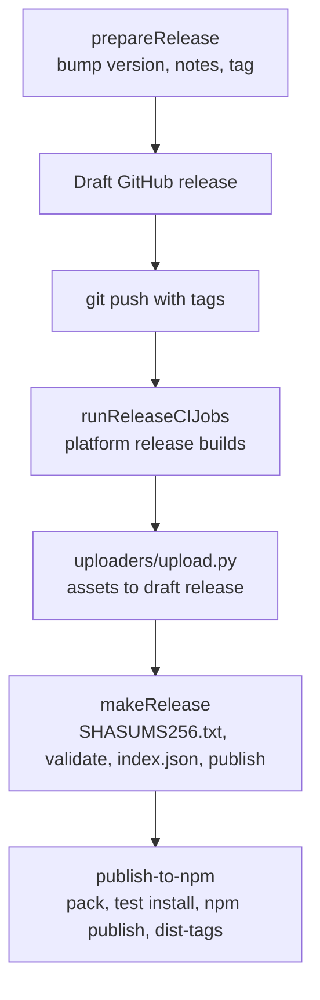

## Overview

A release turns a tagged commit into published binaries on GitHub and a version of the `electron` package on npm. The npm package does not contain Electron itself: it is a few small scripts that, on install, download the matching prebuilt zip from the GitHub release, verify it against checksums baked into the package, and expose the path to the executable. The release scripts live in `script/release`, and the package's files in `npm/`. Building the zips is covered in [[Build System]].

Sources: [npm/package.json:1-17](repo://npm/package.json#L1-L17), [npm/install.js:41-53](repo://npm/install.js#L41-L53), [script/release/prepare-release.ts:213-222](repo://script/release/prepare-release.ts#L213-L222)

## Release flow

### Stages

Sources: [script/release/prepare-release.ts:76-166](repo://script/release/prepare-release.ts#L76-L166), [script/release/prepare-release.ts:168-222](repo://script/release/prepare-release.ts#L168-L222), [script/release/release.ts:414-433](repo://script/release/release.ts#L414-L433), [script/release/bin/publish-to-npm.ts:185-240](repo://script/release/bin/publish-to-npm.ts#L185-L240)

### Choosing the version

`version-bumper.ts` computes the next version from the current one (read by `getElectronVersion`) and a bump type. From a nightly, alpha or beta version, `nightly`, `alpha` and `beta` produce the next prerelease of that kind and `stable` drops the prerelease suffix. From a stable version, `nightly` is allowed, `minor` and `stable` increment the minor or patch number, and `alpha` or `beta` are errors. `--dryRun` only prints the result.

Sources: [script/release/version-bumper.ts:20-99](repo://script/release/version-bumper.ts#L20-L99)

`version-utils.ts` defines the prerelease formats: nightlies are `nightly.YYYYMMDD` (on `main`, based on the next major version); alphas and betas continue the highest existing tag of that line or start at `.1`.

Sources: [script/release/version-utils.ts:12-62](repo://script/release/version-utils.ts#L12-L62)

### Preparing the release

`prepareRelease` runs the bumper for real, generates release notes (nightlies get a fixed note instead), and creates an annotated git tag. It refuses to continue if a draft release with that tag already exists, then creates a draft GitHub release named `electron <version>`. Prerelease bodies explain how to install the prerelease: nightlies through the separate `electron-nightly` package, alphas and betas through the `alpha` and `beta` npm tags. Nightlies target `main`; other releases target the release branch. Finally it pushes the branch with tags and triggers the CI release builds.

Sources: [script/release/prepare-release.ts:29-74](repo://script/release/prepare-release.ts#L29-L74), [script/release/prepare-release.ts:76-166](repo://script/release/prepare-release.ts#L76-L166), [script/release/prepare-release.ts:168-222](repo://script/release/prepare-release.ts#L168-L222)

### Uploading assets

Each platform's release build runs `script/release/uploaders/upload.py`, which renames `dist.zip` to `electron-<version>-<platform>-<arch>.zip`, and uploads it with the symbols, dSYM, PDB and debug archives and the other `dist_zip` outputs to the draft release. Other uploaders handle Node headers, symbols and the release index.

Sources: [script/release/uploaders/upload.py:34-90](repo://script/release/uploaders/upload.py#L34-L90), [script/release/release.ts:128-210](repo://script/release/release.ts#L128-L210)

### Publishing

`makeRelease` (`npm run release`) finds the draft, uploads Node's checksums, merges every asset's checksum into one `SHASUMS256.txt` and attaches it, and validates that the draft has every expected asset for the version (`assetsForVersion` lists the `electron`, `chromedriver`, `mksnapshot`, `ffmpeg`, symbol and other zips per platform). It uploads `index.json` as late as possible, because that file goes live immediately and must not list a release that then fails, and then publishes the draft.

Sources: [script/release/release.ts:128-210](repo://script/release/release.ts#L128-L210), [script/release/release.ts:308-340](repo://script/release/release.ts#L308-L340), [script/release/release.ts:382-433](repo://script/release/release.ts#L382-L433)

### publish-to-npm

`publish-to-npm` assembles the package in a temporary directory: the files in `npm/` (`cli.js`, `index.js`, `install.js`, `package.json`) plus `README.md` and `LICENSE`, metadata fields copied from the root `package.json`, `electron.d.ts` downloaded from the release, and `checksums.json` built from the release's `SHASUMS256.txt`. Nightlies are renamed `electron-nightly`. It packs the tarball, installs it in a scratch project to check that `require('electron')` returns a path to an existing binary, publishes it under the right npm tag unless that version already exists, and moves the `latest`, `beta` or `alpha` dist-tag when the new version is newer.

Sources: [script/release/bin/publish-to-npm.ts:25-40](repo://script/release/bin/publish-to-npm.ts#L25-L40), [script/release/bin/publish-to-npm.ts:94-170](repo://script/release/bin/publish-to-npm.ts#L94-L170), [script/release/bin/publish-to-npm.ts:185-240](repo://script/release/bin/publish-to-npm.ts#L185-L240)

## The electron npm package

### package.json

The package's `main` is `index.js`, its types come from `electron.d.ts`, it installs an `electron` command from `cli.js`, and a `postinstall` script runs `install.js`. Its dependencies are `@electron/get` for downloading and `extract-zip`.

Sources: [npm/package.json:1-17](repo://npm/package.json#L1-L17)

### install.js

`install.js` does nothing when `ELECTRON_SKIP_BINARY_DOWNLOAD` is set, or when the version in `dist/version` and the executable path in `path.txt` already match this package and platform. It honours `npm_config_platform` and `npm_config_arch` for cross-installs, and on macOS switches an x64 install to arm64 when it detects it is running under Rosetta. `downloadArtifact` fetches the release zip, using the cache in `electron_config_cache` unless `force_no_cache` is set, and verifies it against the bundled `checksums.json` unless remote checksums were requested. The zip is extracted into `dist/` (or `ELECTRON_OVERRIDE_DIST_PATH`), `electron.d.ts` is moved up to the package root, and `path.txt` records the executable's relative path: `Electron.app/Contents/MacOS/Electron` on macOS and Mac App Store builds, `electron` on Linux and the BSDs, `electron.exe` on Windows.

Sources: [npm/install.js:1-109](repo://npm/install.js#L1-L109)

### index.js and cli.js

`require('electron')` from Node (outside Electron) returns the absolute path of the executable: `index.js` reads `path.txt` and joins it with `dist/` or `ELECTRON_OVERRIDE_DIST_PATH`, and throws an "Electron failed to install correctly" error when the file is missing. Inside an Electron process the same name resolves to the built-in `electron` module instead, as described in [[JavaScript Bundles and the electron Module]].

Sources: [npm/index.js:1-21](repo://npm/index.js#L1-L21), [lib/common/init.ts:78-119](repo://lib/common/init.ts#L78-L119)

The `electron` command spawns that executable with the remaining arguments, inheriting stdio, forwards `SIGINT` and `SIGTERM`, and exits with the child's code, or with 1 and a message if the child died from a signal. Run without an app, the executable starts the default app ([[Main Process Bootstrap]]).

Sources: [npm/cli.js:1-25](repo://npm/cli.js#L1-L25)
