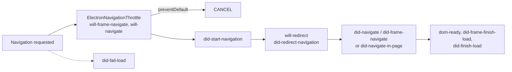

## Overview

A `webContents` is one web page: a tree of frames rendered by one or more renderer processes, with its own navigation history, zoom, DevTools and permissions. It wraps Chromium's `content::WebContents` in `api::WebContents`, which also acts as that `WebContents`'s delegate and observer, so the C++ class is the place where Chromium's page events become JavaScript events. Individual frames are exposed as `webFrameMain`. This page covers how a `webContents` is created and configured, how it loads pages and reports navigation, how frames are tracked, how DevTools attach, and how it is destroyed. Which window shows it is the subject of [[Windows and Views]]; messages to and from its frames are in [[Inter-Process Communication]].

Sources: [shell/browser/api/electron_api_web_contents.h:128-137](repo://shell/browser/api/electron_api_web_contents.h#L128-L137), [shell/browser/api/electron_api_web_contents.cc:906-990](repo://shell/browser/api/electron_api_web_contents.cc#L906-L990)

## Types of WebContents

Every `api::WebContents` has a `Type`, reported to JavaScript by `getType()`.

Sources: [shell/browser/api/electron_api_web_contents.h:128-137](repo://shell/browser/api/electron_api_web_contents.h#L128-L137)

| Type | Created by |
| --- | --- |
| `kBrowserWindow` | `BrowserWindow`, `WebContentsView` |
| `kBrowserView` | The JavaScript `BrowserView` compatibility layer; otherwise identical |
| `kWebView` | A `<webview>` guest (see [[Child Windows and the webview Tag]]) |
| `kOffScreen` | `webPreferences.offscreen` (see [[Offscreen Rendering]]) |
| `kBackgroundPage` | A Chrome extension's background page |
| `kRemote` | A thin wrapper around a `content::WebContents` Electron did not create, such as DevTools |

Sources: [shell/browser/api/electron_api_web_contents.h:128-137](repo://shell/browser/api/electron_api_web_contents.h#L128-L137)

## Creation

### From web preferences

`WebContents::CreateFromWebPreferences` is the entry point for views and windows. If the preferences carry a hidden `webContents` (an existing page being adopted), it applies the new preferences to that page and reuses it; otherwise it calls `WebContents::New`, which constructs the object and immediately calls its JavaScript `_init`, turning an exception there into an uncaught exception.

Sources: [shell/browser/api/electron_api_web_contents.cc:4560-4572](repo://shell/browser/api/electron_api_web_contents.cc#L4560-L4572), [shell/browser/api/electron_api_web_contents.cc:4614-4638](repo://shell/browser/api/electron_api_web_contents.cc#L4614-L4638)

The constructor registers the object in a global ID map (`webContents.id`), reads `backgroundThrottling`, `type`, `offscreen` (a boolean or an object with `useSharedTexture`), `embedder` and `devTools`, and picks the session: an explicit `session`, else the `partition`, else the default session ([[Sessions and Browser Contexts]]). It then creates the `content::WebContents` one of three ways: a guest with a `WebViewGuestDelegate` in a `chrome-guest://` site instance for `<webview>`, a `WebContents` with an `OffScreenWebContentsView` for offscreen rendering, or a normal `WebContents`, initially hidden when `show` is false.

Sources: [shell/browser/api/electron_api_web_contents.cc:785-890](repo://shell/browser/api/electron_api_web_contents.cc#L785-L890)

### InitWithSessionAndOptions

`InitWithSessionAndOptions` wraps the page in an `InspectableWebContents` (the container that can show DevTools next to it), sets the renderer's `Accept-Language` from the app locale and the OS's preferred languages, copies the platform's font rendering settings, attaches a `WebContentsPreferences`, a permission helper, a zoom controller, the extension observers and the autofill driver, applies the session's user agent, and gives a guest its embedder's window as owner. Finally it stores a back-link so `WebContents::From(content::WebContents*)` can find the API object.

Sources: [shell/browser/api/electron_api_web_contents.cc:906-990](repo://shell/browser/api/electron_api_web_contents.cc#L906-L990), [shell/browser/api/electron_api_web_contents.cc:4587-4595](repo://shell/browser/api/electron_api_web_contents.cc#L4587-L4595)

### The JavaScript layer

`lib/browser/api/web-contents.ts` finishes the object in `_init`. It fixes `id` so it stays readable after destruction, creates the per-contents `ipc` emitter, builds the `navigationHistory` object from native methods, forwards `render-process-gone` to `app` (with a debugging hint when logging is on), cancels unload for interactive types when `beforeunload` did not allow it, and turns link-initiated new windows into the `window.open` flow handled in [[Child Windows and the webview Tag]].

Sources: [lib/browser/api/web-contents.ts:537-640](repo://lib/browser/api/web-contents.ts#L537-L640)

## Web preferences

`WebContentsPreferences` holds the parsed `webPreferences` for the lifetime of the page. `Clear` defines the defaults, among them `contextIsolation: true`, `nodeIntegration: false`, `webSecurity: true` and `webviewTag: false`; `SetFromDictionary` overrides them from the options. Some rules are applied while parsing: turning off `webSecurity` also allows insecure content unless that is set explicitly, `transparent` forces a transparent background, a relative `preload` path is rejected with a log message, and a guest of an offscreen embedder is offscreen too.

Sources: [shell/browser/web_contents_preferences.cc:85-105](repo://shell/browser/web_contents_preferences.cc#L85-L105), [shell/browser/web_contents_preferences.cc:111-159](repo://shell/browser/web_contents_preferences.cc#L111-L159), [shell/browser/web_contents_preferences.cc:161-261](repo://shell/browser/web_contents_preferences.cc#L161-L261)

`IsSandboxed` returns the explicit `sandbox` value if given, and otherwise true unless `nodeIntegration` or `nodeIntegrationInWorker` is on, so pages are sandboxed by default. The preferences reach the renderer two ways: as command-line switches when a renderer process is launched (described in [[Process Model and Native Startup]]), and through `OverrideWebkitPrefs`, which maps JavaScript, images, WebGL, web security, autoplay, fonts and similar settings onto Blink's `WebPreferences` whenever Chromium asks. `SaveLastPreferences` keeps the security-relevant subset for `getLastWebPreferences()`, which the renderer's security warnings read.

Sources: [shell/browser/web_contents_preferences.cc:280-286](repo://shell/browser/web_contents_preferences.cc#L280-L286), [shell/browser/web_contents_preferences.cc:308-358](repo://shell/browser/web_contents_preferences.cc#L308-L358), [shell/browser/web_contents_preferences.cc:360-420](repo://shell/browser/web_contents_preferences.cc#L360-L420)

## Loading pages

### loadURL and loadFile

`webContents.loadURL(url, options)` returns a promise. `_awaitNextLoad` subscribes to the load events before calling the native `_loadURL`: it resolves on `did-finish-load`, rejects with an `Error` carrying `errno`, `code` and `url` on a main-frame `did-fail-load`, rejects with `ERR_ABORTED` if another main-frame navigation starts before this one finishes, ignores same-document navigations such as `pushState`, and falls back to `ERR_FAILED` if loading stops without either event. `loadFile` resolves the path against the app path and loads it as a `file:` URL.

Sources: [lib/browser/api/web-contents.ts:324-432](repo://lib/browser/api/web-contents.ts#L324-L432)

Native `WebContents::LoadURL` rejects invalid or overlong URLs with `ERR_INVALID_URL`. It applies the `httpReferrer`, `userAgent`, `extraHeaders`, `postData`, `baseURLForDataURL` and `reloadIgnoringCache` options, and marks the load as typed into the address bar. If called while a navigation is being started on the same stack, which Chromium forbids, it fails with `ERR_FAILED` instead. It discards uncommitted entries, starts the load, and records a user activation so `beforeunload` works.

Sources: [shell/browser/api/electron_api_web_contents.cc:2331-2392](repo://shell/browser/api/electron_api_web_contents.cc#L2331-L2392)

### Navigation events

Sources: [shell/browser/electron_navigation_throttle.cc:30-86](repo://shell/browser/electron_navigation_throttle.cc#L30-L86), [shell/browser/api/electron_api_web_contents.cc:2027-2110](repo://shell/browser/api/electron_api_web_contents.cc#L2027-L2110)

`ElectronNavigationThrottle` runs before a navigation starts. For renderer-initiated navigations (including those from WebUI pages, which Chromium marks as browser-initiated) it emits `will-frame-navigate`, and for main frames also `will-navigate`; `preventDefault()` cancels the navigation. Redirects emit `will-redirect`, which is cancellable for any navigation. `loadURL` itself does not trigger `will-navigate`.

Sources: [shell/browser/electron_navigation_throttle.cc:30-86](repo://shell/browser/electron_navigation_throttle.cc#L30-L86)

All of these go through `EmitNavigationEvent`, which builds an event object with `url`, `isSameDocument`, `isMainFrame`, `processId`, `routingId`, and lazy `frame` and `initiator` getters, then emits it with the legacy positional arguments too and returns whether the event was prevented. `did-start-navigation` and `did-redirect-navigation` use the same helper. When a navigation commits, `DidFinishNavigation` emits `did-navigate-in-page` for same-document changes, or `did-frame-navigate` and, for the main frame, `did-navigate` with the HTTP status; guests also emit `load-commit`.

Sources: [shell/browser/api/electron_api_web_contents.cc:1951-1991](repo://shell/browser/api/electron_api_web_contents.cc#L1951-L1991), [shell/browser/api/electron_api_web_contents.cc:2058-2110](repo://shell/browser/api/electron_api_web_contents.cc#L2058-L2110)

### Other page events

Chromium observer callbacks map one-to-one onto events: `dom-ready`, `did-frame-finish-load` then `did-finish-load` for the main frame, `did-fail-load`, `frame-created`, `render-process-gone`, `media-started-playing`, `media-paused`, `did-change-theme-color`, `focus`, `blur` and `navigation-entry-committed`. Console messages become `console-message` with the frame, level, message, line and source.

Sources: [shell/browser/api/electron_api_web_contents.cc:1752-1775](repo://shell/browser/api/electron_api_web_contents.cc#L1752-L1775), [shell/browser/api/electron_api_web_contents.cc:1846-1930](repo://shell/browser/api/electron_api_web_contents.cc#L1846-L1930), [shell/browser/api/electron_api_web_contents.cc:2268-2272](repo://shell/browser/api/electron_api_web_contents.cc#L2268-L2272), [shell/browser/api/electron_api_web_contents.cc:1111-1130](repo://shell/browser/api/electron_api_web_contents.cc#L1111-L1130)

## Frames: webFrameMain

`WebFrameMain` represents one frame of a page in the main process. Chromium replaces a frame's `RenderFrameHost` on cross-origin navigation while keeping its `FrameTreeNode`, so each `WebFrameMain` is keyed by frame-tree-node ID and by frame token. When `RenderFrameHostChanged` reports a swap, the existing object adopts the new host and reconnects its `ElectronRenderer` Mojo pipe, so an app holding a `webFrameMain` keeps a valid object across navigations. A host that is already running unload handlers is created as "detached" and is not registered by frame-tree-node ID.

Sources: [shell/browser/api/electron_api_web_frame_main.cc:55-70](repo://shell/browser/api/electron_api_web_frame_main.cc#L55-L70), [shell/browser/api/electron_api_web_frame_main.cc:150-203](repo://shell/browser/api/electron_api_web_frame_main.cc#L150-L203), [shell/browser/api/electron_api_web_contents.cc:1801-1827](repo://shell/browser/api/electron_api_web_contents.cc#L1801-L1827)

`RenderFrameDeleted` marks the matching object's render frame as disposed only when the frame tokens match, so deleting the swapped-out old host does not invalidate the object that moved on. `FrameDeleted`, when the frame itself goes away, destroys it. Methods called on a disposed frame throw "Render frame was disposed before WebFrameMain could be accessed".

Sources: [shell/browser/api/electron_api_web_contents.cc:1779-1799](repo://shell/browser/api/electron_api_web_contents.cc#L1779-L1799), [shell/browser/api/electron_api_web_contents.cc:1823-1827](repo://shell/browser/api/electron_api_web_contents.cc#L1823-L1827), [shell/browser/api/electron_api_web_frame_main.cc:205-214](repo://shell/browser/api/electron_api_web_frame_main.cc#L205-L214)

Many `webContents` methods simply delegate to the main frame (`send`, `postMessage`), or ask the renderer through an internal IPC round trip (`executeJavaScript`, `insertCSS`).

Sources: [lib/browser/api/web-contents.ts:121-183](repo://lib/browser/api/web-contents.ts#L121-L183)

## DevTools

Each `api::WebContents` owns an `InspectableWebContents`, whose view hosts both the page and, when open, the DevTools front end. `openDevTools` does nothing for `kRemote` contents or when `devTools: false` was passed. Guests, background pages and contents without an owner window always open DevTools detached; otherwise the `mode`, `activate` and `title` options choose the dock state, and `InspectableWebContents::ShowDevTools` creates or shows the DevTools `WebContents`.

Sources: [shell/browser/api/electron_api_web_contents.cc:2753-2790](repo://shell/browser/api/electron_api_web_contents.cc#L2753-L2790), [shell/browser/ui/inspectable_web_contents.cc:385-440](repo://shell/browser/ui/inspectable_web_contents.cc#L385-L440)

## Closing and destruction

`webContents.close({ waitForBeforeUnload })` either dispatches `beforeunload` first or closes the page directly. `destroy()` deletes the C++ object on the next task, or synchronously during shutdown and for guests, because apps often call it from inside one of the page's own events. When the `content::WebContents` is gone, `WebContentsDestroyed` removes the ID, clears the wrapper's pointer so further calls see a destroyed object, tells a guest delegate, and emits `destroyed`.

Sources: [shell/browser/api/electron_api_web_contents.cc:1085-1109](repo://shell/browser/api/electron_api_web_contents.cc#L1085-L1109), [shell/browser/api/electron_api_web_contents.cc:2249-2266](repo://shell/browser/api/electron_api_web_contents.cc#L2249-L2266)
