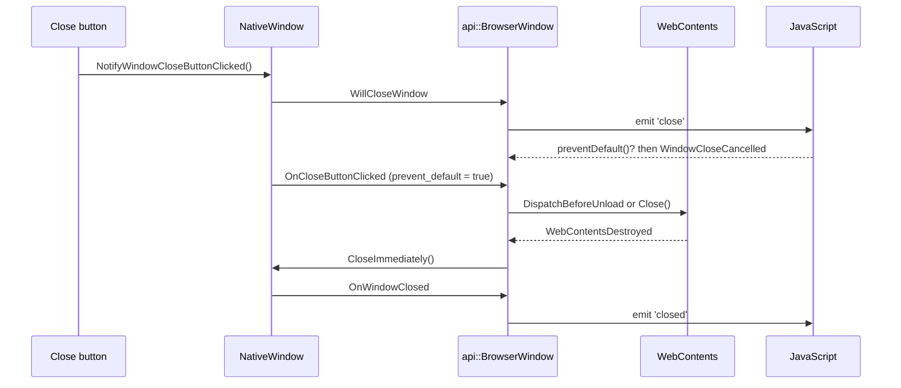

## Overview

Electron's window API has two layers. `BaseWindow` is a native top-level window with a tree of `View`s inside it; `BrowserWindow` is a `BaseWindow` that comes with one `WebContentsView` filling it. Each JavaScript object wraps a C++ `api::BaseWindow` or `api::View`, which in turn owns a platform object: a `NativeWindow` (`NativeWindowViews` on Windows and Linux, `NativeWindowMac` on macOS) and Chromium `views::View`s. Events travel the other way, from the platform window through `NativeWindowObserver` to JavaScript. This page follows window creation, the view tree, events, and closing. The web page a `WebContentsView` shows is covered in [[WebContents and Frames]].

Sources: [lib/browser/api/browser-window.ts:1-8](repo://lib/browser/api/browser-window.ts#L1-L8), [lib/browser/api/base-window.ts:1-19](repo://lib/browser/api/base-window.ts#L1-L19), [shell/browser/api/electron_api_base_window.cc:96-124](repo://shell/browser/api/electron_api_base_window.cc#L96-L124)

## Class layers

| JavaScript | C++ API object | Platform object |
| --- | --- | --- |
| `BaseWindow` | `api::BaseWindow` (`TrackableObject`, `NativeWindowObserver`) | `NativeWindow` → `NativeWindowViews` / `NativeWindowMac` |
| `BrowserWindow` | `api::BrowserWindow`, a `BaseWindow` that also observes its `WebContents` | Same, plus a `WebContentsView` |
| `View` | `api::View` | `views::View` |
| `WebContentsView` | `api::WebContentsView`, a `View` | The `InspectableWebContents` view hosting the page and DevTools |

Sources: [shell/browser/api/electron_api_base_window.h:37-37](repo://shell/browser/api/electron_api_base_window.h#L37-L37), [shell/browser/api/electron_api_web_contents_view.cc:31-48](repo://shell/browser/api/electron_api_web_contents_view.cc#L31-L48), [shell/browser/native_window_views.cc:1949-1954](repo://shell/browser/native_window_views.cc#L1949-L1954)

In JavaScript, `BrowserWindow.prototype` is chained onto `BaseWindow.prototype`, which is chained onto `EventEmitter.prototype`. `BrowserWindow.fromId` and `getAllWindows` filter `BaseWindow`'s results by constructor name, so a plain `BaseWindow` never appears as a `BrowserWindow`.

Sources: [lib/browser/api/browser-window.ts:4-6](repo://lib/browser/api/browser-window.ts#L4-L6), [lib/browser/api/base-window.ts:6-8](repo://lib/browser/api/base-window.ts#L6-L8), [lib/browser/api/browser-window.ts:101-112](repo://lib/browser/api/browser-window.ts#L101-L112)

## Creating a window

### BaseWindow

`new BaseWindow(options)` reaches the C++ constructor, which records `parent`, forces `frame: false` when `webPreferences.offscreen` is set, and calls `NativeWindow::Create` with the options and the parent's native window. It registers itself as the window's observer, installs an empty `View` as the content view, and sets the icon. Afterwards `InitWithArgs` creates the JavaScript wrapper and runs `_init`, and `NativeWindow::InitFromOptions` applies the rest of the options.

Sources: [shell/browser/api/electron_api_base_window.cc:96-132](repo://shell/browser/api/electron_api_base_window.cc#L96-L132)

`InitWith` attaches the wrapper's ID to the native window, adds the window to its parent's `child_windows_`, and keeps a strong self-reference so an open window is never garbage-collected even if the app drops every reference to it. The JavaScript `_init` copies the application menu onto the window on platforms other than macOS, where menus belong to windows.

Sources: [shell/browser/api/electron_api_base_window.cc:146-160](repo://shell/browser/api/electron_api_base_window.cc#L146-L160), [lib/browser/api/base-window.ts:10-19](repo://lib/browser/api/base-window.ts#L10-L19)

### NativeWindow

The `NativeWindow` constructor reads the options that must be known before the platform window exists: `titleBarStyle`, `transparent`, `enableLargerThanScreen`, `modal` (only with a parent), whether the window has a frame (only when `frame` is not false and the title-bar style is normal), and `titleBarOverlay`. It adds itself to `WindowList`.

Sources: [shell/browser/native_window.cc:98-123](repo://shell/browser/native_window.cc#L98-L123)

`NativeWindowViews` builds a `views::Widget` of type `TYPE_WINDOW`, translucent when transparent, wrapped in a root view that also hosts the menu bar on Windows and Linux. `NativeWindowMac` creates an `ElectronNSWindow` through an `ElectronNativeWidgetMac`. Both finish by installing an empty content view.

Sources: [shell/browser/native_window_views.cc:198-205](repo://shell/browser/native_window_views.cc#L198-L205), [shell/browser/native_window_views.cc:263-303](repo://shell/browser/native_window_views.cc#L263-L303), [shell/browser/native_window_views.cc:397-397](repo://shell/browser/native_window_views.cc#L397-L397), [shell/browser/native_window_mac.mm:117-117](repo://shell/browser/native_window_mac.mm#L117-L117), [shell/browser/native_window_mac.mm:189-189](repo://shell/browser/native_window_mac.mm#L189-L189), [shell/browser/native_window_mac.mm:315-315](repo://shell/browser/native_window_mac.mm#L315-L315)

`InitFromOptions` applies everything else in order: position (`x`/`y`, or `center`), size constraints (`minWidth`, `maxWidth` and friends, against the content size when `useContentSize` is set), `closable`, `movable`, `hasShadow`, `opacity`, `alwaysOnTop`, `fullscreenable` and `fullscreen`, `resizable`, `skipTaskbar`, `kiosk`, vibrancy or background material, `backgroundColor` (transparent for translucent windows, white otherwise), and `title`, which defaults to the app name. Finally it shows the window unless `show` is false.

Sources: [shell/browser/native_window.cc:137-249](repo://shell/browser/native_window.cc#L137-L249)

### BrowserWindow

`BrowserWindow::New` throws before `ready`. The constructor runs the `BaseWindow` constructor, then prepares the `webPreferences` dictionary for the page: it copies `backgroundColor` into it (or a transparent colour for translucent windows), copies `show` when `paintWhenInitiallyHidden` is false, and forwards an existing `webContents` option. It creates a `WebContentsView` from those preferences, keeps its `WebContents`, observes it, and makes this window its owner.

Sources: [shell/browser/api/electron_api_browser_window.cc:293-311](repo://shell/browser/api/electron_api_browser_window.cc#L293-L311), [shell/browser/api/electron_api_browser_window.cc:28-83](repo://shell/browser/api/electron_api_browser_window.cc#L28-L83)

The page's view is inserted at index 0 of the window's contents view, as a sibling placed before `BaseWindow`'s `contentView` in paint order, so views an app adds to `win.contentView` are drawn on top of the page. `InitFromOptions` runs last, after everything is wired.

Sources: [shell/browser/api/electron_api_browser_window.cc:85-98](repo://shell/browser/api/electron_api_browser_window.cc#L85-L98)

The JavaScript `_init` adds behaviour on top: `setBounds` merges partial bounds with the current ones, `focus` and `blur` are re-emitted on `app` as `browser-window-focus` and `browser-window-blur`, `unresponsive` is debounced by 50 ms (and armed for 5 s after a `close` that was not prevented), visibility changes are forwarded to the page as `-window-visibility-change`, and `app` emits `browser-window-created`.

Sources: [lib/browser/api/browser-window.ts:8-99](repo://lib/browser/api/browser-window.ts#L8-L99)

## The view tree

`View` wraps a `views::View`. `addChildView(child, index?)` inserts at an index clamped to the child count, reorders instead of re-adding when the child is already present, refuses a destroyed child or the view itself, and holds a strong reference to each child's wrapper. On macOS it disables Core Animation's implicit animations while inserting. `setBounds` positions a child in its parent's coordinates, and `setLayout` installs either a `FlexLayout` configured from JavaScript or a layout manager whose `calculateProposedLayout` callback is JavaScript.

Sources: [shell/browser/api/electron_api_view.cc:210-259](repo://shell/browser/api/electron_api_view.cc#L210-L259), [shell/browser/api/electron_api_view.cc:283-312](repo://shell/browser/api/electron_api_view.cc#L283-L312), [shell/browser/api/electron_api_view.cc:151-170](repo://shell/browser/api/electron_api_view.cc#L151-L170)

`new WebContentsView({ webPreferences, webContents })` creates a `WebContents` from the preferences, defaulting `show` to false, or adopts an existing one, which must not already belong to a window. Its `views::View` is the `InspectableWebContents` view, which flexes to fill its parent. When the view is added to a window's widget, `OnViewAddedToWidget` makes that window the `WebContents`'s owner and registers the view for draggable regions; removing it unregisters them. A `BaseWindow` can host several `WebContentsView`s side by side.

Sources: [shell/browser/api/electron_api_web_contents_view.cc:31-48](repo://shell/browser/api/electron_api_web_contents_view.cc#L31-L48), [shell/browser/api/electron_api_web_contents_view.cc:101-124](repo://shell/browser/api/electron_api_web_contents_view.cc#L101-L124), [shell/browser/api/electron_api_web_contents_view.cc:156-210](repo://shell/browser/api/electron_api_web_contents_view.cc#L156-L210)

## Events from the platform window

`NativeWindow` notifies its observers for every platform event, and `api::BaseWindow` implements `NativeWindowObserver` by emitting the matching JavaScript event: `blur`, `focus`, `show`, `hide`, `maximize`, `minimize`, `restore`, `will-resize`, `resize`, `resized`, `will-move`, `move`, `moved`, the fullscreen events, `swipe`, `rotate-gesture`, sheet events, `app-command`, `system-context-menu` and Windows `query-session-end`/`session-end`. `api::BrowserWindow` overrides a few to involve the page: on focus it restores the page's focus, on blur it stores it, and leaving fullscreen on macOS also exits HTML fullscreen.

Sources: [shell/browser/api/electron_api_base_window.cc:191-300](repo://shell/browser/api/electron_api_base_window.cc#L191-L300), [shell/browser/api/electron_api_base_window.cc:302-347](repo://shell/browser/api/electron_api_base_window.cc#L302-L347), [shell/browser/api/electron_api_browser_window.cc:168-203](repo://shell/browser/api/electron_api_browser_window.cc#L168-L203)

The page drives the window too: a title change emits `page-title-updated` and sets the window title unless prevented, `window.resizeTo` and `moveTo` set the window bounds, and focusing the page hides an auto-hidden menu bar.

Sources: [shell/browser/api/electron_api_browser_window.cc:119-142](repo://shell/browser/api/electron_api_browser_window.cc#L119-L142)

## Closing a window

Sources: [shell/browser/native_window.cc:486-512](repo://shell/browser/native_window.cc#L486-L512), [shell/browser/api/electron_api_browser_window.cc:148-166](repo://shell/browser/api/electron_api_browser_window.cc#L148-L166), [shell/browser/api/electron_api_browser_window.cc:110-117](repo://shell/browser/api/electron_api_browser_window.cc#L110-L117), [shell/browser/api/electron_api_base_window.cc:162-189](repo://shell/browser/api/electron_api_base_window.cc#L162-L189)

`NativeWindow::NotifyWindowCloseButtonClicked` asks observers first: if a `close` listener calls `preventDefault()`, the close is cancelled and `WindowList` is told, which also cancels an in-progress `app.quit()`. A `BaseWindow` then closes immediately. A `BrowserWindow` instead takes over in `OnCloseButtonClicked`: it closes the page first, running `beforeunload` if needed, and only when the `WebContents` is destroyed does it call `CloseImmediately`. A `beforeunload` that cancels reaches `WindowList::WindowCloseCancelled` as well.

Sources: [shell/browser/native_window.cc:486-502](repo://shell/browser/native_window.cc#L486-L502), [shell/browser/api/electron_api_browser_window.cc:110-117](repo://shell/browser/api/electron_api_browser_window.cc#L110-L117), [shell/browser/api/electron_api_browser_window.cc:148-166](repo://shell/browser/api/electron_api_browser_window.cc#L148-L166), [shell/browser/browser.cc:252-257](repo://shell/browser/browser.cc#L252-L257)

`NotifyWindowClosed` runs once per window. `api::BaseWindow::OnWindowClosed` invalidates pending callbacks, removes the window from the weak map, marks the JavaScript object destroyed (so later method calls see a destroyed window), emits `closed`, detaches from its parent, and schedules its own destruction. `BrowserWindow::CloseImmediately` closes child windows first.

Sources: [shell/browser/native_window.cc:504-512](repo://shell/browser/native_window.cc#L504-L512), [shell/browser/api/electron_api_base_window.cc:169-189](repo://shell/browser/api/electron_api_base_window.cc#L169-L189), [shell/browser/api/electron_api_browser_window.cc:210-220](repo://shell/browser/api/electron_api_browser_window.cc#L210-L220)

## WindowList

`WindowList` is the process-wide list of open `NativeWindow`s. Windows add themselves on construction and remove themselves when closed; removing the last one notifies observers with `OnWindowAllClosed`, which `Browser` turns into `window-all-closed` or the next step of a quit, as described in [[Process Model and Native Startup]]. `CloseAllWindows` asks every window to close (in reverse order on macOS), giving pages their `beforeunload`; `DestroyAllWindows`, used by `app.exit()`, closes them immediately. Both iterate over weak pointers because closing one window can destroy others.

Sources: [shell/browser/window_list.cc:25-111](repo://shell/browser/window_list.cc#L25-L111), [shell/browser/browser.cc:259-268](repo://shell/browser/browser.cc#L259-L268)
