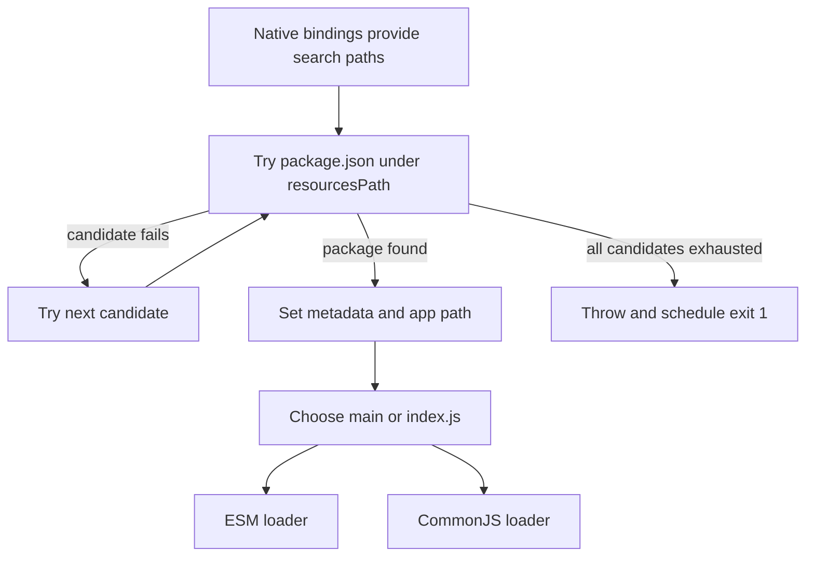

## Overview

Electron's main-process bootstrap establishes the runtime before executing an application's entry script. The exported `app` is a single native object given an EventEmitter prototype. Package discovery determines the app path, metadata and startup module; browser initialization separately determines when window creation is permitted. The runnable example in [[Quickstart]] waits on that readiness boundary before constructing its first window.

Sources: [lib/browser/api/app.ts:6-13](repo://lib/browser/api/app.ts#L6-L13), [lib/browser/init.ts:82-163](repo://lib/browser/init.ts#L82-L163), [shell/browser/api/electron_api_browser_window.cc:292-310](repo://shell/browser/api/electron_api_browser_window.cc#L292-L310), [docs/fiddles/quick-start/main.js:16-24](repo://docs/fiddles/quick-start/main.js#L16-L24)

## Discover the application

Native Node bindings select a process-specific initialization script and insert it into the arguments. For the browser environment, they also install hidden application search paths on the global object. Normally the candidates are `app.asar`, `app` and `default_app.asar`, in that order. The `OnlyLoadAppFromAsar` fuse replaces the list with only `app.asar` and sets a flag requiring an archive. [[Binary Installation and ASAR]] explains how archive paths are made readable.

Sources: [shell/common/node_bindings.cc:665-704](repo://shell/common/node_bindings.cc#L665-L704)

The browser initialization script removes its injected argument, loads common settings and installs the native EventEmitter prototype. It then reads the search paths beneath `process.resourcesPath`, attempting to load each candidate's `package.json`. A candidate that throws is skipped. When archive-only loading is enabled, a path must first pass the archive helper. If no package loads, initialization schedules exit code 1 and throws `Unable to find a valid app`.

Sources: [lib/browser/init.ts:12-19](repo://lib/browser/init.ts#L12-L19), [lib/browser/init.ts:82-114](repo://lib/browser/init.ts#L82-L114)

Sources: [shell/common/node_bindings.cc:680-699](repo://shell/common/node_bindings.cc#L680-L699), [lib/browser/init.ts:92-163](repo://lib/browser/init.ts#L92-L163), [lib/browser/init.ts:204-222](repo://lib/browser/init.ts#L204-L222)

## Apply package configuration

| Package field | Bootstrap behavior |
| --- | --- |
| `version` | Sets the application version when present |
| `productName`, then `name` | Selects the application name and trims its string representation |
| `desktopName` | Sets the desktop name; otherwise uses the app name plus `.desktop` |
| `v8Flags` | Lazily loads V8 and applies the supplied flags |
| `main` | Selects the startup script, defaulting to `index.js` |
| `type` | Participates in choosing the ESM loader |

Sources: [lib/browser/init.ts:116-163](repo://lib/browser/init.ts#L116-L163), [lib/browser/init.ts:204-221](repo://lib/browser/init.ts#L204-L221)

After `app.setAppPath`, bootstrap initializes DevTools support and selected API wrappers. Protocol, service-worker, WebContents and frame modules are loaded so their readiness hooks exist. WebContentsView is loaded before application code because BrowserWindow construction uses its inheritance setup. These explicit loads supplement the normal lazy module exports and establish dependencies before an application can create windows.

Sources: [lib/browser/init.ts:141-160](repo://lib/browser/init.ts#L141-L160), [lib/common/define-properties.ts:7-17](repo://lib/common/define-properties.ts#L7-L17)

## Transfer control to the entry script

An entry ending in `.mjs` uses the ESM loader. A package with `type: 'module'` also uses ESM unless the entry ends in `.cjs`. That branch converts the entry path to a file URL and awaits its import. On success it calls the native `appCodeLoaded` callback; on failure it still calls the callback and emits `uncaughtException`. The CommonJS branch calls the callback before synchronous `Module._load`.

Sources: [lib/browser/init.ts:201-222](repo://lib/browser/init.ts#L201-L222)

When launching an entry with the default application, as in [[Quickstart]], there is an additional loader. It marks `process.defaultApp`, optionally reads package metadata, resolves the requested application with Node's module resolver, sets the app path and imports the resulting file URL. This accounts for the difference between packaged application discovery under resources and a development launch that names a JavaScript file on the command line.

Sources: [default_app/main.ts:77-137](repo://default_app/main.ts#L77-L137), [default_app/main.ts:253-266](repo://default_app/main.ts#L253-L266)

## Readiness and launch hooks

`Browser::DidFinishLaunching` creates the user-data directory when its path is available, sets `is_ready_`, resolves an existing ready promise and notifies launch observers. `WhenReady` creates that promise lazily and resolves it immediately if initialization already finished. Calling it after readiness therefore remains valid. The native BrowserWindow constructor independently rejects calls made before readiness; [[Windows and Navigation]] starts at the successful construction path.

Sources: [shell/browser/browser.cc:183-211](repo://shell/browser/browser.cc#L183-L211), [shell/browser/api/electron_api_browser_window.cc:292-310](repo://shell/browser/api/electron_api_browser_window.cc#L292-L310)

Bootstrap installs the default application menu on `will-finish-launching`, before `ready`, so it is available before user windows are created. Application code can supply its own menu using the mechanisms in [[Native Menus and Commands]]. Bootstrap also installs a `window-all-closed` listener that quits only when it is the sole listener; adding an application listener transfers that policy decision to the application.

Sources: [lib/browser/init.ts:186-199](repo://lib/browser/init.ts#L186-L199), [lib/browser/api/menu.ts:172-188](repo://lib/browser/api/menu.ts#L172-L188)

## Quit, exit and cancellation

`Browser::Quit` ignores repeated requests while already quitting, asks observers whether quitting may begin and then closes all windows. When there are no windows, it proceeds to the will-quit notification. Preventing that notification clears the quitting flag; otherwise shutdown begins. A window close cancellation also clears the quitting flag. This explains why requesting quit does not guarantee that the process immediately exits.

Sources: [shell/browser/browser.cc:86-98](repo://shell/browser/browser.cc#L86-L98), [shell/browser/browser.cc:232-274](repo://shell/browser/browser.cc#L232-L274)

`Browser::Exit` accepts an exit code, records an exiting state and destroys windows without asking them to close. Before the main message loop can accept an exit code it exits directly. Normal shutdown notifies observers and posts the quit closure onto the task runner: the comment explains that quitting directly during `ready` can race pending Chromium initialization. The JavaScript bootstrap maps `process.exit` to `app.exit` and forwards the app's `quit` notification into the process `exit` event.

Sources: [shell/browser/browser.cc:39-48](repo://shell/browser/browser.cc#L39-L48), [shell/browser/browser.cc:100-140](repo://shell/browser/browser.cc#L100-L140), [lib/browser/init.ts:40-45](repo://lib/browser/init.ts#L40-L45), [lib/browser/init.ts:73-74](repo://lib/browser/init.ts#L73-L74)

## Startup error reporting

The default uncaught-exception handler displays the error stack in a main-process error dialog. It yields when another uncaught-exception listener is installed. The Electron import occurs inside the handler because this bootstrap itself establishes the Electron require hook. For errors in the default application's entry loader, the loader first logs that app loading failed, then logs the stack and rethrows; package parsing and resolution errors instead use its launch-error dialog and exit code 1.

Sources: [lib/browser/init.ts:21-38](repo://lib/browser/init.ts#L21-L38), [default_app/main.ts:93-103](repo://default_app/main.ts#L93-L103), [default_app/main.ts:128-148](repo://default_app/main.ts#L128-L148)
