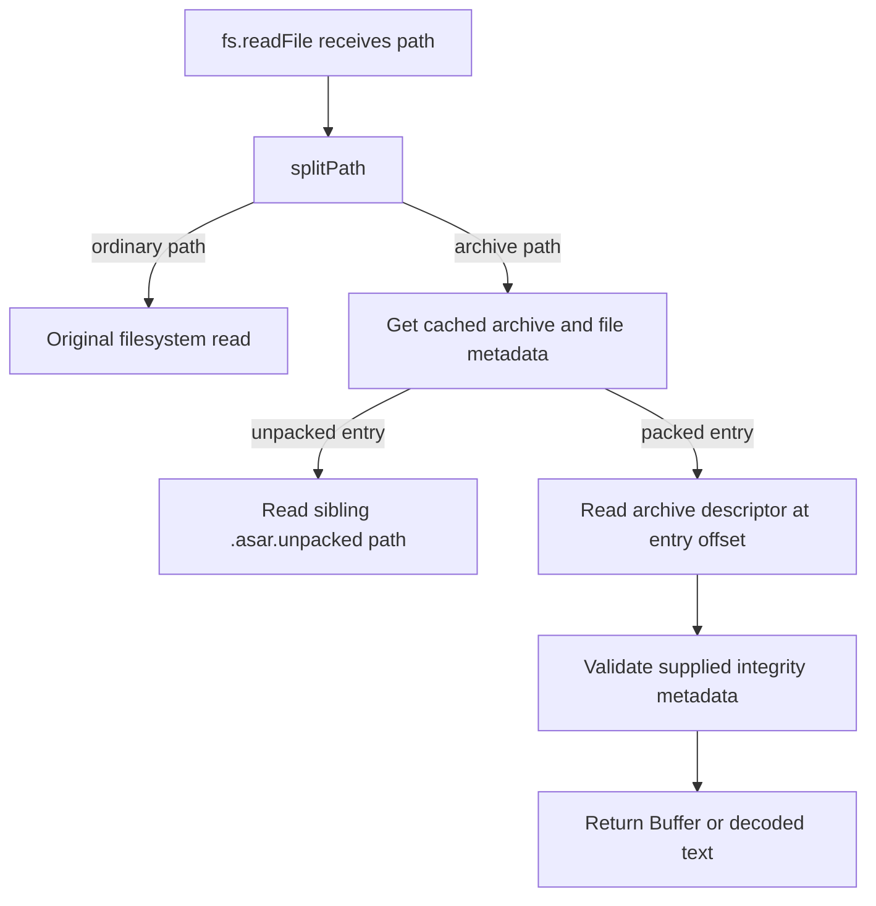

## Overview

The published npm package supplies a binary installer, executable-path export and command-line launcher. Inside the runtime, ASAR support lets application files reside in an archive while filesystem calls address entries through directory-like paths. These are successive parts of delivering and loading an application: [[Quickstart]] uses the installed executable, [[Application Startup and Lifecycle]] selects the packaged entry, and [[Building and Testing Electron]] describes producing a framework binary from source.

Sources: [npm/package.json:1-14](repo://npm/package.json#L1-L14), [npm/index.js:4-21](repo://npm/index.js#L4-L21), [npm/cli.js:3-14](repo://npm/cli.js#L3-L14), [lib/node/init.ts:3-5](repo://lib/node/init.ts#L3-L5), [lib/node/asar-fs-wrapper.ts:70-87](repo://lib/node/asar-fs-wrapper.ts#L70-L87), [lib/browser/init.ts:92-114](repo://lib/browser/init.ts#L92-L114)

## Install and locate the executable

The npm package runs `install.js` as its postinstall script. Installation stops immediately when `ELECTRON_SKIP_BINARY_DOWNLOAD` is set or its installed-version check succeeds. Otherwise it selects a platform and architecture from npm configuration overrides or the current process. On macOS, an apparent x64 installation without an explicit architecture override checks whether it is running under Rosetta and switches the requested artifact to arm64 when indicated.

Sources: [npm/package.json:7-9](repo://npm/package.json#L7-L9), [npm/install.js:12-39](repo://npm/install.js#L12-L39)

The installer requests the Electron artifact for the package version, platform and architecture. It passes cache configuration, a force-download flag and checksum configuration to the downloader. Download or extraction failures print the error stack and exit with code 1. A successful extraction writes into the package's `dist` directory and records the platform executable path in `path.txt`; it also moves bundled TypeScript definitions to the package root when found at the selected distribution path.

Sources: [npm/install.js:41-53](repo://npm/install.js#L41-L53), [npm/install.js:73-90](repo://npm/install.js#L73-L90)

| Platform selected by the installer | Executable path written to `path.txt` |
| --- | --- |
| `darwin` or `mas` | `Electron.app/Contents/MacOS/Electron` |
| `linux`, `freebsd` or `openbsd` | `electron` |
| `win32` | `electron.exe` |
| Anything else | Throws an unavailable-platform error |

Sources: [npm/install.js:93-109](repo://npm/install.js#L93-L109)

The installed-state check requires the recorded version and path to match and the executable path to exist. At import time, `npm/index.js` reads `path.txt` and returns a path under `dist`, or under `ELECTRON_OVERRIDE_DIST_PATH` when supplied. Without a recorded path or override, it throws an installation error. Thus importing the npm package from ordinary Node resolves an executable location; the Electron runtime's process-specific API exports are a separate mechanism.

Sources: [npm/install.js:55-71](repo://npm/install.js#L55-L71), [npm/index.js:4-21](repo://npm/index.js#L4-L21), [README.md:60-74](repo://README.md#L60-L74)

The CLI spawns that executable with the user's remaining arguments and inherited standard streams. It propagates a normal exit code, reports signal termination as failure and forwards SIGINT and SIGTERM when the child has not already been killed. Application selection then follows [[Application Startup and Lifecycle]]: the runtime searches resource candidates, including `app.asar`, and loads the selected package's entry script.

Sources: [npm/cli.js:3-25](repo://npm/cli.js#L3-L25), [shell/common/node_bindings.cc:680-699](repo://shell/common/node_bindings.cc#L680-L699), [lib/browser/init.ts:204-222](repo://lib/browser/init.ts#L204-L222)

## Resolve a path inside an archive

Node initialization calls `wrapFsWithAsar` on the filesystem module. The wrapper detects archive paths by normalizing strings, buffers and supported URL inputs, testing for `.asar` and calling the native path splitter. Archive objects are cached by archive path. Failed archive construction returns null so each filesystem operation can produce its own appropriate failure rather than retaining a bad archive instance.

Sources: [lib/node/init.ts:3-5](repo://lib/node/init.ts#L3-L5), [lib/node/asar-fs-wrapper.ts:29-45](repo://lib/node/asar-fs-wrapper.ts#L29-L45), [lib/node/asar-fs-wrapper.ts:70-87](repo://lib/node/asar-fs-wrapper.ts#L70-L87)

Sources: [lib/node/asar-fs-wrapper.ts:599-674](repo://lib/node/asar-fs-wrapper.ts#L599-L674), [shell/common/asar/archive.cc:356-375](repo://shell/common/asar/archive.cc#L356-L375)

## Read packed and unpacked files

The asynchronous archive read normalizes encoding options, retrieves file metadata and handles an empty file without reading the archive descriptor. An unpacked entry uses `copyFileOut` to obtain its external path and delegates to ordinary filesystem reading. A packed entry allocates a buffer of the recorded size and reads from the archive descriptor at its offset, then returns bytes or decoded text. Promise-based readFile uses the same archive helper through promisification.

Sources: [lib/node/asar-fs-wrapper.ts:599-674](repo://lib/node/asar-fs-wrapper.ts#L599-L674)

When integrity metadata is present, buffer validation hashes the read bytes with the recorded algorithm and compares the digest. A mismatch is logged and terminates the process with exit code 1; it is not merely returned as an ordinary missing-file error. When metadata is absent, the helper returns without hashing. The synchronous archive-read path performs the same integrity check after reading its buffer.

Sources: [lib/node/asar-fs-wrapper.ts:254-266](repo://lib/node/asar-fs-wrapper.ts#L254-L266), [lib/node/asar-fs-wrapper.ts:703-713](repo://lib/node/asar-fs-wrapper.ts#L703-L713)

## Provide real paths to native operations

Some APIs require a real filesystem pathname. The wrappers for open, native-library loading, copyFile and execFile obtain one with `copyFileOut` and substitute it before calling the original implementation. For an unpacked entry, native `CopyFileOut` returns the sibling archive-name-plus-`.unpacked` path. For a packed entry it creates a temporary file from the archive offset and size, applies executable permissions on POSIX when needed and caches the extracted file for reuse.

Sources: [lib/node/asar-fs-wrapper.ts:185-202](repo://lib/node/asar-fs-wrapper.ts#L185-L202), [lib/node/asar-fs-wrapper.ts:1230-1252](repo://lib/node/asar-fs-wrapper.ts#L1230-L1252), [shell/common/asar/archive.cc:356-392](repo://shell/common/asar/archive.cc#L356-L392)

Command-string `exec` and `execSync` temporarily disable ASAR interpretation instead of using the execFile path wrapper. The source explains that otherwise a whole command containing an archive path could be mistaken for a single archive pathname. This hook restores the prior `process.noAsar` value in a finally block and normally patches child_process only when that module is first loaded.

Sources: [lib/node/asar-fs-wrapper.ts:1218-1278](repo://lib/node/asar-fs-wrapper.ts#L1218-L1278)

## Understand filesystem limits and failures

ASAR directories are virtual and the repository's guide treats archives as read-only; they cannot be used as an operating-system working directory. The wrapper also synthesizes filesystem Stats fields such as timestamps and inode numbers, so those fields do not represent independent physical entry metadata. Use archive entries for application resources, with these constraints in mind when an API expects an ordinary writable directory.

Sources: [docs/tutorial/asar-archives.md:117-145](repo://docs/tutorial/asar-archives.md#L117-L145), [lib/node/asar-fs-wrapper.ts:126-146](repo://lib/node/asar-fs-wrapper.ts#L126-L146)

Missing entries produce ENOENT, directory mismatches ENOTDIR, write-access denial EACCES and invalid archives an “Invalid package” error. To read the archive itself as bytes, the existing guide provides `original-fs`, while `process.noAsar` disables the wrapper's path interpretation. The environment-based `ELECTRON_NO_ASAR` branch applies only outside browser and renderer process types in this implementation.

Sources: [lib/node/asar-fs-wrapper.ts:149-183](repo://lib/node/asar-fs-wrapper.ts#L149-L183), [lib/node/asar-fs-wrapper.ts:15-18](repo://lib/node/asar-fs-wrapper.ts#L15-L18), [lib/node/asar-fs-wrapper.ts:70-74](repo://lib/node/asar-fs-wrapper.ts#L70-L74), [docs/tutorial/asar-archives.md:89-109](repo://docs/tutorial/asar-archives.md#L89-L109)
