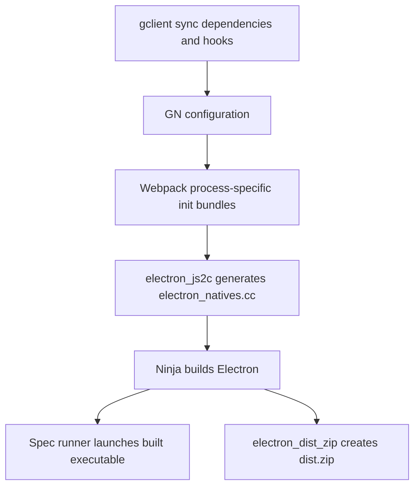

## Overview

Building Electron means generating a GN project and compiling the framework together with its Chromium and Node dependencies. The resulting executable runs the repository's specs as an Electron application. This workflow is for framework changes; [[Quickstart]] runs an application with a prebuilt runtime, and [[Binary Installation and ASAR]] explains how the published npm package installs that runtime.

Sources: [docs/development/build-instructions-gn.md:1-30](repo://docs/development/build-instructions-gn.md#L1-L30), [docs/development/build-instructions-gn.md:163-190](repo://docs/development/build-instructions-gn.md#L163-L190), [docs/development/testing.md:24-38](repo://docs/development/testing.md#L24-L38)

## Prepare a complete checkout

The manual build workflow requires depot_tools and the platform toolchain. The checked-in platform guides list Node.js 22.12.0 or later; Linux and macOS also list Python 3.9 or later. Linux requires development libraries such as GTK 3 and libnotify, macOS requires Xcode, and Windows requires Visual Studio toolchains and the Windows SDK. Windows manual setup sets `DEPOT_TOOLS_WIN_TOOLCHAIN=0` so depot_tools uses the local toolchain.

Sources: [docs/development/build-instructions-gn.md:32-42](repo://docs/development/build-instructions-gn.md#L32-L42), [docs/development/build-instructions-linux.md:7-23](repo://docs/development/build-instructions-linux.md#L7-L23), [docs/development/build-instructions-macos.md:7-14](repo://docs/development/build-instructions-macos.md#L7-L14), [docs/development/build-instructions-windows.md:7-32](repo://docs/development/build-instructions-windows.md#L7-L32)

Configure a workspace with the Electron repository at `src/electron`, then sync its dependencies. The enclosing `src` directory is the Chromium source root used by subsequent GN commands. The repository's manual guide provides this checkout sequence; a standalone clone without the dependency checkout is not the complete build tree expected by these paths.

Sources: [docs/development/build-instructions-gn.md:59-89](repo://docs/development/build-instructions-gn.md#L59-L89), [docs/development/build-instructions-gn.md:101-127](repo://docs/development/build-instructions-gn.md#L101-L127)

```sh
mkdir electron && cd electron
gclient config --name "src/electron" --unmanaged https://github.com/electron/electron
gclient sync --with_branch_heads --with_tags
```

Sources: [docs/development/build-instructions-gn.md:61-66](repo://docs/development/build-instructions-gn.md#L61-L66)

`DEPS` pins Chromium, Node and other dependency revisions. Its hooks apply Electron's patches and install the root JavaScript dependencies using the pinned Yarn version with a frozen lockfile. After changing the Electron revision, the manual guide uses `gclient sync -f` to align dependencies with that revision. This dependency step is separate from regenerating or rebuilding an output directory.

Sources: [DEPS:3-40](repo://DEPS#L3-L40), [DEPS:124-160](repo://DEPS#L124-L160), [docs/development/build-instructions-gn.md:86-97](repo://docs/development/build-instructions-gn.md#L86-L97)

## Generate and compile a configuration

From the enclosing `src` directory, set `CHROMIUM_BUILDTOOLS_PATH` to its `buildtools` directory. Generate a Testing configuration with the command below, then run `ninja -C out/Testing electron`. The checked-in Testing arguments enable DCHECKs while setting `is_debug = false`; the configuration name should not be interpreted as a conventional Debug build. Release imports a different argument file with `is_official_build = true`.

Sources: [docs/development/build-instructions-gn.md:101-138](repo://docs/development/build-instructions-gn.md#L101-L138), [docs/development/build-instructions-gn.md:163-175](repo://docs/development/build-instructions-gn.md#L163-L175), [build/args/testing.gn:1-7](repo://build/args/testing.gn#L1-L7), [build/args/release.gn:1-9](repo://build/args/release.gn#L1-L9)

```sh
gn gen out/Testing --args="import(\"//electron/build/args/testing.gn\")"
```

Sources: [docs/development/build-instructions-gn.md:124-128](repo://docs/development/build-instructions-gn.md#L124-L128)

Output directories belong under `src/out`. `gn args out/Testing` edits an existing configuration, and `gn args out/Testing --list` lists available arguments. For Release, import `//electron/build/args/release.gn` and build `out/Release`. The executable appears at the platform-specific location under that output directory: an application bundle on macOS, `electron.exe` on Windows or `electron` on Linux.

Sources: [docs/development/build-instructions-gn.md:140-190](repo://docs/development/build-instructions-gn.md#L140-L190)

## Follow JavaScript into the native build



Sources: [DEPS:124-160](repo://DEPS#L124-L160), [docs/development/build-instructions-gn.md:122-175](repo://docs/development/build-instructions-gn.md#L122-L175), [BUILD.gn:165-272](repo://BUILD.gn#L165-L272), [BUILD.gn:1423-1446](repo://BUILD.gn#L1423-L1446), [script/spec-runner.js:194-221](repo://script/spec-runner.js#L194-L221)

GN declares separate browser, renderer, worker, sandboxed-renderer, isolated-renderer, Node, utility and preload-realm bundles. `electron_js2c` collects their generated JavaScript and emits `electron_natives.cc`. The shared webpack configuration locates each target's init file and aliases Electron imports to the matching API exports. These are the build-time connections behind the process-specific initialization paths in [[Application Startup and Lifecycle]] and [[Preloads and Context Isolation]].

Sources: [BUILD.gn:165-272](repo://BUILD.gn#L165-L272), [build/webpack/webpack.config.base.js:21-34](repo://build/webpack/webpack.config.base.js#L21-L34), [build/webpack/webpack.config.base.js:109-128](repo://build/webpack/webpack.config.base.js#L109-L128)

## Select and run the local executable

From `src/electron`, the root `npm start` script calls `script/start.js`, which resolves the built executable and forwards arguments and standard streams. Output discovery accepts `ELECTRON_OUT_DIR` or searches Testing, Release, Default and Debug in that order. An explicitly selected nonexistent directory throws, as does a checkout with no recognized output directory. This lookup is also used by the local spec runner, so selecting the right output is part of testing the intended build.

Sources: [package.json:90-92](repo://package.json#L90-L92), [script/start.js:1-19](repo://script/start.js#L1-L19), [script/lib/utils.js:8-62](repo://script/lib/utils.js#L8-L62), [script/spec-runner.js:194-201](repo://script/spec-runner.js#L194-L201)

## Run relevant tests

Run `npm run test` for the main-process spec suite, or `npm run test -- -g ipc` for the documented IPC-pattern example. The root pretest hook generates TypeScript definitions first. The spec app waits for readiness, installs ts-node, parses grep/invert/file filters, collects matching `-spec.ts` and `-spec.js` files and loads them in sorted order. Explicit file filters that match nothing cause an error rather than a successful empty selection.

Sources: [docs/development/testing.md:30-38](repo://docs/development/testing.md#L30-L38), [package.json:79-92](repo://package.json#L79-L92), [spec/index.js:61-69](repo://spec/index.js#L61-L69), [spec/index.js:123-167](repo://spec/index.js#L123-L167)

Before launch, the runner compares hashes for the spec package, lockfile, runner and installed modules. Changed inputs trigger reinstallation of spec dependencies; local native-module installation uses generated Node headers under the selected output directory. Tests then run with the local executable, or an installed version when `--electronVersion` is supplied. On Linux the launch is wrapped by `dbus_mock.py`. Process failure or a signal is reported as a failed test run.

Sources: [script/spec-runner.js:92-107](repo://script/spec-runner.js#L92-L107), [script/spec-runner.js:194-218](repo://script/spec-runner.js#L194-L218), [script/spec-runner.js:247-286](repo://script/spec-runner.js#L247-L286)

## Check documentation and generated API types

`npm run lint` combines the repository linter with documentation checks. The documentation pipeline runs prose, Markdown, example-code, relative-link, API-history and TypeScript checks. `create-api-json` parses the existing API documentation into `electron-api.json`; definition generation consumes it and runs TypeScript smoke tests. Changes to the existing API reference therefore participate in build validation through generated public types, beyond their rendered prose.

Sources: [package.json:64-80](repo://package.json#L64-L80), [script/create-api-json.mjs:1-18](repo://script/create-api-json.mjs#L1-L18)

For changes to Node embedding, the repository documents `node script/node-spec-runner.js` and a single-test form such as `node script/node-spec-runner.js parallel/test-crypto-keygen`. Use that suite to exercise the embedded Node fork in addition to Electron API specs when the change reaches that boundary.

Sources: [docs/development/testing.md:40-59](repo://docs/development/testing.md#L40-L59)

## Produce a distributable runtime

After a Release build, run `ninja -C out/Release electron:electron_dist_zip` from the Chromium source root. The target includes the application, version file and licenses, adds platform-specific dependencies and writes `dist.zip` into the build directory. This creates the framework distribution consumed by the installation flow in [[Binary Installation and ASAR]]; application source selection remains the runtime behavior documented in [[Application Startup and Lifecycle]].

Sources: [docs/development/build-instructions-gn.md:192-198](repo://docs/development/build-instructions-gn.md#L192-L198), [BUILD.gn:1423-1446](repo://BUILD.gn#L1423-L1446), [lib/browser/init.ts:92-114](repo://lib/browser/init.ts#L92-L114)
