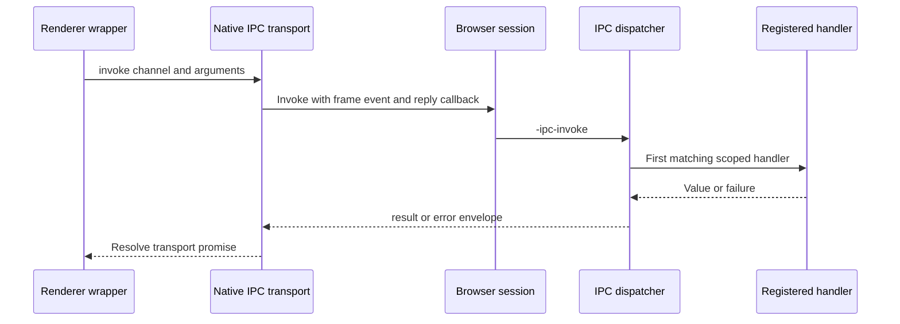

## Overview

Electron IPC connects renderer-side calls to browser-side event listeners or invocation handlers. The public renderer wrapper delegates to a native transport with an explicit non-internal flag. Browser-side dispatch then selects handlers using the sending frame, WebContents or service worker. [[Preloads and Context Isolation]] explains how application code reaches renderer APIs; this page follows the message after that boundary.

Sources: [lib/renderer/api/ipc-renderer.ts:1-34](repo://lib/renderer/api/ipc-renderer.ts#L1-L34), [lib/browser/ipc-dispatch.ts:58-108](repo://lib/browser/ipc-dispatch.ts#L58-L108)

## Choose a communication pattern

| Renderer operation | Browser-side behavior |
| --- | --- |
| `send(channel, ...args)` | Emits a message event to the applicable listeners |
| `invoke(channel, ...args)` | Finds one registered invocation handler and returns its result or error |
| `sendSync(channel, ...args)` | Delivers an event with a `returnValue` setter backed by a reply channel |
| `postMessage(channel, message, transferables)` | Transfers message ports and dispatches the message with `event.ports` |
| `sendToHost(channel, ...args)` | Uses the host-message dispatch path |

Sources: [lib/renderer/api/ipc-renderer.ts:8-30](repo://lib/renderer/api/ipc-renderer.ts#L8-L30), [lib/browser/ipc-dispatch.ts:17-21](repo://lib/browser/ipc-dispatch.ts#L17-L21), [lib/browser/ipc-dispatch.ts:58-150](repo://lib/browser/ipc-dispatch.ts#L58-L150)

`IpcMainImpl` stores invocation handlers in a map separate from EventEmitter listeners. `handle` rejects a second handler for the same channel and rejects non-functions. `handleOnce` removes the entry before calling the supplied function, so a second invocation cannot reuse that registration even while the first result is pending. `removeHandler` deletes the map entry; ordinary event listeners have their own EventEmitter lifecycle.

Sources: [lib/browser/ipc-main-impl.ts:3-35](repo://lib/browser/ipc-main-impl.ts#L3-L35)

## Cross the native transport

The renderer binding is cached and created for either a render frame or a service worker; other process types throw. Native send and invoke serialize V8 arguments into a cloneable message before calling the remote IPC interface. They reject use after the context's remote has been released. Invocation creates a native promise and resolves it with the reply message delivered by the remote callback.

Sources: [lib/renderer/ipc-renderer-bindings.ts:1-17](repo://lib/renderer/ipc-renderer-bindings.ts#L1-L17), [shell/renderer/api/electron_api_ipc_renderer.cc:66-106](repo://shell/renderer/api/electron_api_ipc_renderer.cc#L66-L106)

Sources: [lib/renderer/api/ipc-renderer.ts:21-27](repo://lib/renderer/api/ipc-renderer.ts#L21-L27), [shell/renderer/api/electron_api_ipc_renderer.cc:82-106](repo://shell/renderer/api/electron_api_ipc_renderer.cc#L82-L106), [shell/browser/electron_api_ipc_handler_impl.cc:57-70](repo://shell/browser/electron_api_ipc_handler_impl.cc#L57-L70), [shell/browser/api/ipc_dispatcher.h:39-45](repo://shell/browser/api/ipc_dispatcher.h#L39-L45), [lib/browser/ipc-dispatch.ts:76-108](repo://lib/browser/ipc-dispatch.ts#L76-L108)

For frame messages, the browser transport finds the session through the RenderFrameHost's browser context. It builds an event containing the sender, frame and process IDs, FrameTreeNode ID and a reply channel when a callback is present. The transport observes WebContents and deletes itself when content is destroyed or the connection disconnects. [[Sessions and Permissions]] follows the ownership of the session receiving these events.

Sources: [shell/browser/electron_api_ipc_handler_impl.cc:20-42](repo://shell/browser/electron_api_ipc_handler_impl.cc#L20-L42), [shell/browser/electron_api_ipc_handler_impl.cc:117-124](repo://shell/browser/electron_api_ipc_handler_impl.cc#L117-L124), [shell/browser/electron_api_ipc_handler_impl.cc:161-180](repo://shell/browser/electron_api_ipc_handler_impl.cc#L161-L180)

## Understand handler priority

For a frame event, the dispatcher obtains emitters in this order: frame `ipc`, WebContents `ipc`, global `ipcMain`. It locates the frame by FrameTreeNode ID so messages sent during a frame swap or unload still find the relevant emitter. Public `send` first emits WebContents' `ipc-message`, then emits the channel on every available scoped emitter. Public `invoke` instead selects only the first emitter whose invocation map contains that channel.

Sources: [lib/browser/ipc-dispatch.ts:33-74](repo://lib/browser/ipc-dispatch.ts#L33-L74), [lib/browser/ipc-dispatch.ts:85-108](repo://lib/browser/ipc-dispatch.ts#L85-L108)

Internal messages use `ipcMainInternal`, bypassing those public targets. Service-worker events resolve the worker by version ID and use its `ipc` object; they do not follow the frame-to-WebContents-to-global chain. An event's lazy `serviceWorker` property uses the session's service-worker collection. These branches matter when a correctly named global handler does not receive a message from a different origin type.

Sources: [lib/browser/ipc-dispatch.ts:24-30](repo://lib/browser/ipc-dispatch.ts#L24-L30), [lib/browser/ipc-dispatch.ts:59-108](repo://lib/browser/ipc-dispatch.ts#L59-L108)

## Return values and failures

Invocation accepts either a direct return value or a promise by awaiting `Promise.resolve(handler(...))`. Success sends a result envelope. A thrown or rejected error is logged and converted with `error.toString()` into an error envelope; a missing handler takes the same failure route with a channel-specific message. The renderer wrapper creates a new Error from that string. The original Error object's identity and custom properties are not returned by this path.

Sources: [lib/browser/ipc-dispatch.ts:76-108](repo://lib/browser/ipc-dispatch.ts#L76-L108), [lib/renderer/api/ipc-renderer.ts:21-27](repo://lib/renderer/api/ipc-renderer.ts#L21-L27)

For synchronous messages, setting `event.returnValue` sends the reply through `_replyChannel`. Frame dispatch warns when neither WebContents' synchronous-message event nor any applicable emitter has a listener, then emits to those targets. `event.reply` targets the original process/frame pair, whereas `webContents.send` targets the main frame. Use the original-frame reply when responding to a message whose sender may be a subframe.

Sources: [lib/browser/ipc-dispatch.ts:10-21](repo://lib/browser/ipc-dispatch.ts#L10-L21), [lib/browser/ipc-dispatch.ts:110-133](repo://lib/browser/ipc-dispatch.ts#L110-L133), [lib/browser/api/web-contents.ts:125-147](repo://lib/browser/api/web-contents.ts#L125-L147)

## Transfer ports

Native `postMessage` serializes the message and converts the optional transfer array into message-port channels, rejecting invalid transfer values. On receipt, the browser dispatcher wraps incoming ports in `MessagePortMain` and attaches them to the event before emitting. The transfer path therefore carries port objects alongside the message value rather than treating them as invocation results.

Sources: [shell/renderer/api/electron_api_ipc_renderer.cc:108-140](repo://shell/renderer/api/electron_api_ipc_renderer.cc#L108-L140), [lib/browser/ipc-dispatch.ts:139-150](repo://lib/browser/ipc-dispatch.ts#L139-L150)

`MessagePortMain` is an EventEmitter wrapper around a native port. It forwards `start` and `close`, unwraps outgoing main-process ports and wraps ports attached to incoming messages. [[Utility Processes]] uses the same wrapper when connecting an auxiliary process, so transfer conversion remains consistent even though launching and terminating that process follow a different lifecycle.

Sources: [lib/browser/message-port-main.ts:1-28](repo://lib/browser/message-port-main.ts#L1-L28), [lib/browser/api/utility-process.ts:134-147](repo://lib/browser/api/utility-process.ts#L134-L147)
