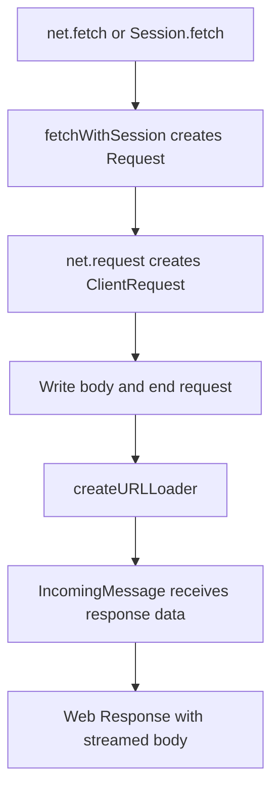

## Overview

Electron's browser-side `net` API creates requests through its native URL loader. `net.fetch` delegates to the default session, while `Session.fetch` passes that specific session to a shared adapter. Custom protocol handlers use the same web Request and Response shapes to serve application-defined URLs. [[Sessions and Permissions]] explains how the session is selected; this page follows request construction, response streaming and protocol adaptation.

Sources: [lib/browser/api/net.ts:8-21](repo://lib/browser/api/net.ts#L8-L21), [lib/browser/api/session.ts:44-46](repo://lib/browser/api/session.ts#L44-L46), [lib/common/api/net-client-request.ts:426-456](repo://lib/common/api/net-client-request.ts#L426-L456), [lib/browser/api/protocol.ts:111-147](repo://lib/browser/api/protocol.ts#L111-L147)

## Choose an entry point

`net.request` requires application readiness and constructs a ClientRequest, optionally attaching a response callback through that constructor. `net.fetch` uses `session.defaultSession.fetch`, and `net.resolveHost` similarly delegates to the default session. Use an existing session's `fetch` when the request must carry that context; the adapter includes the session explicitly in the ClientRequest options.

Sources: [lib/browser/api/net.ts:8-21](repo://lib/browser/api/net.ts#L8-L21), [lib/browser/api/session.ts:44-46](repo://lib/browser/api/session.ts#L44-L46), [lib/browser/api/net-fetch.ts:75-88](repo://lib/browser/api/net-fetch.ts#L75-L88), [lib/common/api/net-client-request.ts:332-347](repo://lib/common/api/net-client-request.ts#L332-L347)

The ClientRequest parser accepts a URL string or options object, normalizes the method and URL and validates request configuration. Direct requests ordinarily accept only HTTP and HTTPS; the fetch adapter applies the internal `allowAnyProtocol` mechanism. Browser-side session options require a Session instance, and partition options require a string. Redirect policy is validated against `follow`, `error` and `manual` before request execution.

Sources: [lib/common/api/net-client-request.ts:229-315](repo://lib/common/api/net-client-request.ts#L229-L315), [lib/common/api/net-client-request.ts:332-347](repo://lib/common/api/net-client-request.ts#L332-L347), [lib/browser/api/net-fetch.ts:79-88](repo://lib/browser/api/net-fetch.ts#L79-L88)

## Adapt fetch to the URL loader

Sources: [lib/browser/api/net.ts:8-17](repo://lib/browser/api/net.ts#L8-L17), [lib/browser/api/session.ts:44-46](repo://lib/browser/api/session.ts#L44-L46), [lib/browser/api/net-fetch.ts:18-27](repo://lib/browser/api/net-fetch.ts#L18-L27), [lib/browser/api/net-fetch.ts:75-124](repo://lib/browser/api/net-fetch.ts#L75-L124), [lib/common/api/net-client-request.ts:402-456](repo://lib/common/api/net-client-request.ts#L402-L456)

`fetchWithSession` first constructs a web Request and rejects its promise if that construction fails. It copies method, URL, origin, credentials, cache, referrer policy and redirect mode into request options. When credentials are `same-origin` but no origin header exists, it substitutes `include`; the comment explains that same-origin credentials cannot be set without an origin. It also avoids setting CORS mode without an origin and copies the request headers before sending.

Sources: [lib/browser/api/net-fetch.ts:18-27](repo://lib/browser/api/net-fetch.ts#L18-L27), [lib/browser/api/net-fetch.ts:75-99](repo://lib/browser/api/net-fetch.ts#L75-L99)

The adapter pipes an upload body into the writable ClientRequest and ends it when piping completes, or ends immediately when there is no body. The normal ClientRequest write path buffers data until its body stream finishes; the finalization path starts a bodyless request directly. Starting creates the native URL loader, installs response/data/completion/error listeners and converts response data into IncomingMessage chunks.

Sources: [lib/browser/api/net-fetch.ts:122-124](repo://lib/browser/api/net-fetch.ts#L122-L124), [lib/common/api/net-client-request.ts:402-456](repo://lib/common/api/net-client-request.ts#L402-L456)

## Consume responses and handle cancellation

IncomingMessage applies backpressure: it retains chunks until its readable side accepts them and calls the native resume callback only when more data can be pushed. The fetch adapter converts the stream to a web-readable body, except for HEAD requests and its null-body status list. It creates a Response with status, status text and headers, then resolves the fetch promise when response metadata is available; body consumption continues through the stream.

Sources: [lib/common/api/net-client-request.ts:101-127](repo://lib/common/api/net-client-request.ts#L101-L127), [lib/browser/api/net-fetch.ts:101-116](repo://lib/browser/api/net-fetch.ts#L101-L116)

An already-aborted signal rejects before a ClientRequest is created. A later abort marks the operation locally aborted, rejects with the signal reason or an AbortError and calls the underlying request's `abort`. ClientRequest schedules its abort event, destroys itself, cancels the URL loader and destroys any response stream. A loader error similarly destroys an active response and propagates an error through the request.

Sources: [lib/browser/api/net-fetch.ts:29-73](repo://lib/browser/api/net-fetch.ts#L29-L73), [lib/common/api/net-client-request.ts:453-456](repo://lib/common/api/net-client-request.ts#L453-L456), [lib/common/api/net-client-request.ts:517-539](repo://lib/common/api/net-client-request.ts#L517-L539)

## Control redirects and authentication

| ClientRequest condition | Behavior |
| --- | --- |
| Redirect policy `error` | Terminates with a redirect-policy error |
| Redirect policy `manual` | Emits `redirect`; the listener must call `followRedirect` during that emission or the request fails unless already aborted |
| Redirect policy `follow` | Emits `redirect` and allows a no-op `followRedirect` call |
| `followRedirect` outside a redirect callback | Throws because no redirect decision is pending |
| Authentication without a `login` listener | Cancels the authentication request by invoking its callback without credentials |

Sources: [lib/common/api/net-client-request.ts:459-515](repo://lib/common/api/net-client-request.ts#L459-L515)

Header mutation also has a timing boundary: removing a header after a request starts or after its first write throws. These lifecycle checks are useful when debugging a request configured incrementally, because the first body write can make later header changes invalid before response handling begins.

Sources: [lib/common/api/net-client-request.ts:389-413](repo://lib/common/api/net-client-request.ts#L389-L413)

## Serve a custom protocol

`protocol.handle` selects interception for `http`, `https` and `file`, and registration for other schemes. The top-level protocol object delegates these operations to the default session's protocol; a session-specific protocol object scopes them to that session. Privileged scheme registration is a separate global API whose native wrapper throws after the app becomes ready, unlike installing a handler on a ready session.

Sources: [lib/browser/api/protocol.ts:7-13](repo://lib/browser/api/protocol.ts#L7-L13), [lib/browser/api/protocol.ts:111-113](repo://lib/browser/api/protocol.ts#L111-L113), [lib/browser/api/protocol.ts:159-180](repo://lib/browser/api/protocol.ts#L159-L180), [shell/browser/api/electron_api_protocol.cc:348-357](repo://shell/browser/api/electron_api_protocol.cc#L348-L357)

For each incoming protocol request, the wrapper converts upload data into a body, removes an origin header whose value is the string `null` and creates a Request with method, headers and referrer. A single raw upload chunk avoids stream creation; mixed raw, file, pipe and blob chunks become a readable stream. Unknown chunk types throw. The handler may return a Response directly or asynchronously.

Sources: [lib/browser/api/protocol.ts:48-89](repo://lib/browser/api/protocol.ts#L48-L89), [lib/browser/api/protocol.ts:111-127](repo://lib/browser/api/protocol.ts#L111-L127)

Response validation checks object shape and the types of supplied status, status text, headers and body fields. Invalid results become `ERR_UNEXPECTED`; an error Response becomes `ERR_FAILED`. Successful bodies are converted back into Node-readable streams for the native callback. Thrown handler errors are logged and mapped to `ERR_UNEXPECTED`. Failed registration and unhandling throw, while `isProtocolHandled` checks the appropriate interception or registration table.

Sources: [lib/browser/api/protocol.ts:92-157](repo://lib/browser/api/protocol.ts#L92-L157)

The fetch adapter exposes `bypassCustomProtocolHandlers` through its loader options. This is the explicit switch to inspect when a fetch issued by a protocol handler must reach the underlying URL path instead of another registered handler. It affects request routing without changing the selected session's identity or permission configuration described in [[Sessions and Permissions]].

Sources: [lib/browser/api/net-fetch.ts:79-90](repo://lib/browser/api/net-fetch.ts#L79-L90)
