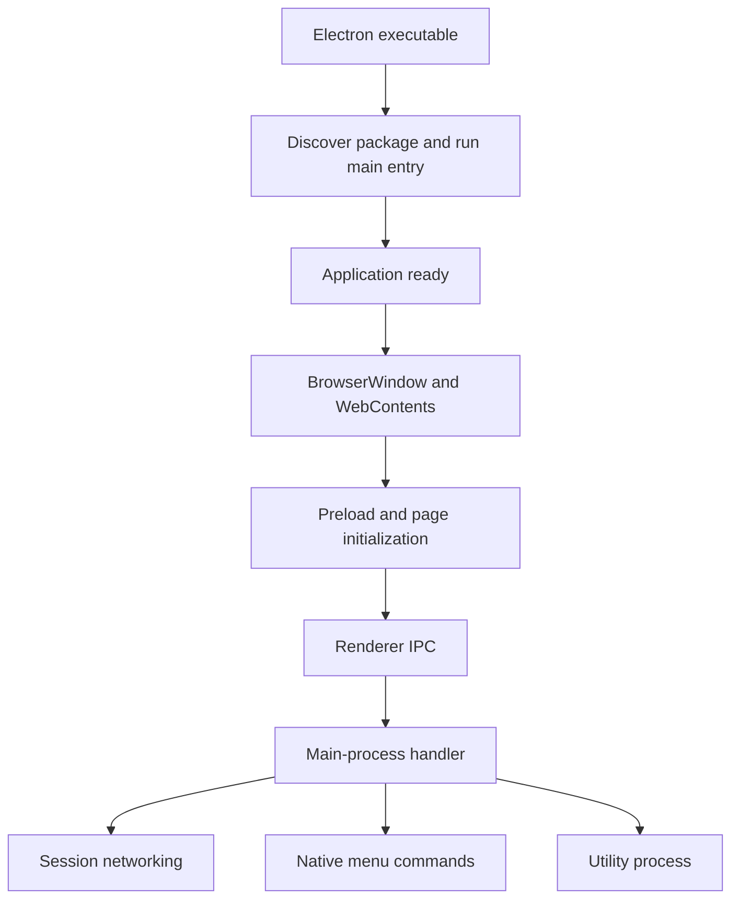

## Overview

Electron is a framework for desktop applications written with JavaScript, HTML and CSS, built on Node.js and Chromium. This repository contains the framework, its native bindings, JavaScript API wrappers, installation package, examples and contributor tooling. An application supplies its own entry script and web content; Electron discovers that entry, initializes its browser-side APIs and runs it. [[Quickstart]] follows the small application included in this checkout so that each architectural boundary has a concrete example.

Sources: [README.md:9-12](repo://README.md#L9-L12), [lib/browser/init.ts:141-163](repo://lib/browser/init.ts#L141-L163), [lib/browser/init.ts:204-222](repo://lib/browser/init.ts#L204-L222), [docs/fiddles/quick-start/main.js:1-30](repo://docs/fiddles/quick-start/main.js#L1-L30)

## Systems and reading paths

The runtime exposes APIs through process-specific module lists. The browser list includes application, window, session, network, menu and utility-process APIs; the public properties are backed by loader functions. The following pages follow those APIs through their implementation, while the installation and build pages explain how the executable reaches the machine.

Sources: [lib/browser/api/module-list.ts:3-43](repo://lib/browser/api/module-list.ts#L3-L43), [lib/common/define-properties.ts:1-17](repo://lib/common/define-properties.ts#L1-L17), [npm/install.js:41-53](repo://npm/install.js#L41-L53), [docs/development/build-instructions-gn.md:19-30](repo://docs/development/build-instructions-gn.md#L19-L30)

| Area | What it does | Page |
| --- | --- | --- |
| First application | Runs the included main script, preload and HTML | [[Quickstart]] |
| Application lifetime | Finds a package, loads its entry and handles launch and quit | [[Application Startup and Lifecycle]] |
| Windows and web content | Connects native windows to WebContents and navigation | [[Windows and Navigation]] |
| Renderer environment | Executes preloads and bridges isolated worlds | [[Preloads and Context Isolation]] |
| Messages | Routes renderer events and invocations to main-process handlers | [[Interprocess Communication]] |
| Browser state | Provides session instances and their configuration | [[Sessions and Permissions]] |
| Requests and schemes | Adapts fetch and protocol handlers to Electron networking | [[Networking and Custom Protocols]] |
| Native commands | Builds and installs application and popup menus | [[Native Menus and Commands]] |
| Auxiliary work | Launches utility processes and transfers messages | [[Utility Processes]] |
| Installed runtime | Downloads binaries and supports archive-backed applications | [[Binary Installation and ASAR]] |
| Contributor workflow | Configures, builds and tests the framework | [[Building and Testing Electron]] |

Sources: [docs/fiddles/quick-start/main.js:1-30](repo://docs/fiddles/quick-start/main.js#L1-L30), [lib/browser/init.ts:82-163](repo://lib/browser/init.ts#L82-L163), [lib/browser/api/browser-window.ts:131-155](repo://lib/browser/api/browser-window.ts#L131-L155), [lib/sandboxed_renderer/init.ts:16-62](repo://lib/sandboxed_renderer/init.ts#L16-L62), [lib/renderer/api/context-bridge.ts:1-20](repo://lib/renderer/api/context-bridge.ts#L1-L20), [lib/browser/ipc-dispatch.ts:58-108](repo://lib/browser/ipc-dispatch.ts#L58-L108), [lib/browser/api/session.ts:44-57](repo://lib/browser/api/session.ts#L44-L57), [lib/browser/api/net.ts:8-21](repo://lib/browser/api/net.ts#L8-L21), [lib/browser/api/protocol.ts:111-147](repo://lib/browser/api/protocol.ts#L111-L147), [lib/browser/api/menu.ts:172-212](repo://lib/browser/api/menu.ts#L172-L212), [lib/browser/api/utility-process.ts:93-151](repo://lib/browser/api/utility-process.ts#L93-L151), [npm/install.js:41-90](repo://npm/install.js#L41-L90), [shell/common/node_bindings.cc:680-699](repo://shell/common/node_bindings.cc#L680-L699), [package.json:61-94](repo://package.json#L61-L94)

## From launch to application behavior

Sources: [lib/browser/init.ts:92-114](repo://lib/browser/init.ts#L92-L114), [lib/browser/init.ts:204-222](repo://lib/browser/init.ts#L204-L222), [docs/fiddles/quick-start/main.js:4-24](repo://docs/fiddles/quick-start/main.js#L4-L24), [lib/sandboxed_renderer/init.ts:16-62](repo://lib/sandboxed_renderer/init.ts#L16-L62), [lib/renderer/api/ipc-renderer.ts:8-30](repo://lib/renderer/api/ipc-renderer.ts#L8-L30), [lib/browser/ipc-dispatch.ts:76-108](repo://lib/browser/ipc-dispatch.ts#L76-L108), [lib/browser/api/net.ts:8-21](repo://lib/browser/api/net.ts#L8-L21), [lib/browser/api/menu.ts:172-212](repo://lib/browser/api/menu.ts#L172-L212), [lib/browser/api/utility-process.ts:93-119](repo://lib/browser/api/utility-process.ts#L93-L119)

The executable's package search and entry loading belong to [[Application Startup and Lifecycle]]; the normal search considers `app.asar`, `app`, then `default_app.asar`. The sample waits for readiness before constructing its window, which is the transition explained in [[Windows and Navigation]]. Its preload runs as part of content initialization, with execution rules covered in [[Preloads and Context Isolation]].

Sources: [shell/common/node_bindings.cc:680-699](repo://shell/common/node_bindings.cc#L680-L699), [lib/browser/init.ts:204-222](repo://lib/browser/init.ts#L204-L222), [docs/fiddles/quick-start/main.js:4-24](repo://docs/fiddles/quick-start/main.js#L4-L24), [lib/sandboxed_renderer/init.ts:58-62](repo://lib/sandboxed_renderer/init.ts#L58-L62)

A renderer invocation crosses the transport and selects a handler as described in [[Interprocess Communication]]. Main-process code can then use the session-bound request path in [[Networking and Custom Protocols]], install the command structures in [[Native Menus and Commands]], or fork the child described in [[Utility Processes]]. These are available application operations; IPC does not automatically call any of them without a registered handler.

Sources: [lib/browser/ipc-dispatch.ts:76-108](repo://lib/browser/ipc-dispatch.ts#L76-L108), [lib/browser/api/net.ts:8-21](repo://lib/browser/api/net.ts#L8-L21), [lib/browser/api/menu.ts:172-212](repo://lib/browser/api/menu.ts#L172-L212), [lib/browser/api/utility-process.ts:150-152](repo://lib/browser/api/utility-process.ts#L150-L152)

## Design decisions across the runtime

JavaScript wrappers prepare state around native operations. For example, `loadURL` installs completion listeners before calling `_loadURL`. Native navigation can synchronously trigger JavaScript that destroys the WebContents, so the C++ implementation holds a weak reference and checks it after handing control to Chromium. This ordering matters when debugging a failure that appears to occur during an otherwise simple method call.

Sources: [lib/browser/api/web-contents.ts:410-432](repo://lib/browser/api/web-contents.ts#L410-L432), [shell/browser/api/electron_api_web_contents.cc:2374-2404](repo://shell/browser/api/electron_api_web_contents.cc#L2374-L2404)

Context isolation is an explicit boundary: public `contextBridge` operations reject use when it is disabled. The sandboxed preload receives a curated module loader, with Electron, events, timers and URL modules supplied through maps. Consequently, the preload's execution environment is part of an API's design, not merely the location of a script file.

Sources: [lib/renderer/api/context-bridge.ts:1-20](repo://lib/renderer/api/context-bridge.ts#L1-L20), [lib/sandboxed_renderer/init.ts:24-39](repo://lib/sandboxed_renderer/init.ts#L24-L39)

IPC dispatch preserves frame identity across frame swaps by looking up the FrameTreeNode ID. Its emitter array is cached to avoid frequent allocations, and invocation priority runs from the frame to its WebContents to global `ipcMain`. The source states both the identity and allocation reasons; applications can scope handlers without changing the renderer's invocation API.

Sources: [lib/browser/ipc-dispatch.ts:33-53](repo://lib/browser/ipc-dispatch.ts#L33-L53), [lib/browser/ipc-dispatch.ts:85-106](repo://lib/browser/ipc-dispatch.ts#L85-L106)

Session ownership carries into requests: `net.fetch` selects the default session, while a session's own `fetch` passes that instance into the request adapter. [[Sessions and Permissions]] explains that ownership boundary. It is the connection to inspect when a request behaves differently from content using another browser session.

Sources: [lib/browser/api/net.ts:15-21](repo://lib/browser/api/net.ts#L15-L21), [lib/browser/api/session.ts:44-46](repo://lib/browser/api/session.ts#L44-L46), [lib/browser/api/net-fetch.ts:75-88](repo://lib/browser/api/net-fetch.ts#L75-L88)

## Working on the framework

An npm installation downloads a runtime artifact and records its executable path; a contributor build generates the framework with GN and compiles it with Ninja. [[Binary Installation and ASAR]] explains the installed artifact, while [[Building and Testing Electron]] follows source changes through the build and spec runner. The root package also generates TypeScript definitions from API documentation before its test command, making documentation part of the development workflow.

Sources: [npm/install.js:41-90](repo://npm/install.js#L41-L90), [docs/development/build-instructions-gn.md:122-175](repo://docs/development/build-instructions-gn.md#L122-L175), [package.json:79-92](repo://package.json#L79-L92)
