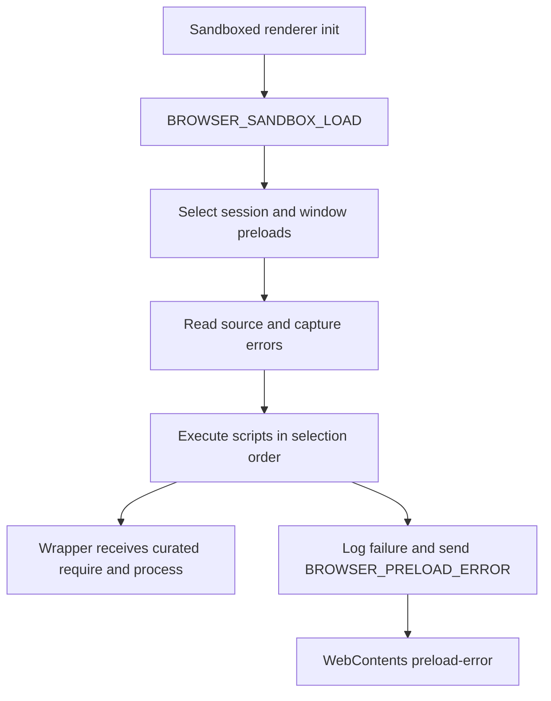

## Overview

A preload is application code loaded during renderer initialization, with an environment chosen by Electron's renderer path. Session registrations and a window's preload preference contribute to the selected scripts. This page starts after the window configuration in [[Windows and Navigation]] and follows script selection, execution and cross-world exposure. Message routing after an exposed function calls IPC is covered in [[Interprocess Communication]].

Sources: [lib/browser/rpc-server.ts:52-106](repo://lib/browser/rpc-server.ts#L52-L106), [lib/sandboxed_renderer/init.ts:16-39](repo://lib/sandboxed_renderer/init.ts#L16-L39), [lib/renderer/init.ts:133-168](repo://lib/renderer/init.ts#L133-L168), [lib/renderer/api/context-bridge.ts:7-20](repo://lib/renderer/api/context-bridge.ts#L7-L20)

## Select scripts and establish preferences

WebContents preferences start with Node integration disabled and context isolation enabled. The preferences reader then applies explicitly supplied options, including sandbox and context-isolation values. These are separate settings in the implementation: choosing whether Node symbols reach a renderer global and choosing how an API crosses contexts affect different branches of initialization.

Sources: [shell/browser/web_contents_preferences.cc:111-127](repo://shell/browser/web_contents_preferences.cc#L111-L127), [shell/browser/web_contents_preferences.cc:161-178](repo://shell/browser/web_contents_preferences.cc#L161-L178), [lib/renderer/init.ts:66-70](repo://lib/renderer/init.ts#L66-L70), [lib/renderer/init.ts:117-130](repo://lib/renderer/init.ts#L117-L130), [lib/renderer/api/context-bridge.ts:3-18](repo://lib/renderer/api/context-bridge.ts#L3-L18)

The browser's preload selector starts with the sender's session registrations. Frame events retain frame scripts and append the WebContents preload, while service-worker events retain service-worker scripts. The final filter keeps absolute paths. [[Sessions and Permissions]] describes registration and session ownership; the important execution consequence is that session frame scripts precede the window-specific script in the selected list.

Sources: [lib/browser/rpc-server.ts:52-70](repo://lib/browser/rpc-server.ts#L52-L70)

For sandboxed renderers, the browser reads each selected file as UTF-8 and returns its contents or captured read error, along with selected process properties. `Promise.all` collects those reads in selection order. The nonsandboxed request returns paths instead, allowing the renderer's Node loader to load the modules itself. The browser therefore supplies source text for one execution path and module locations for the other.

Sources: [lib/browser/rpc-server.ts:72-107](repo://lib/browser/rpc-server.ts#L72-L107)

## Execute sandboxed preloads

Sources: [lib/sandboxed_renderer/init.ts:16-22](repo://lib/sandboxed_renderer/init.ts#L16-L22), [lib/sandboxed_renderer/init.ts:58-71](repo://lib/sandboxed_renderer/init.ts#L58-L71), [lib/browser/rpc-server.ts:52-112](repo://lib/browser/rpc-server.ts#L52-L112), [lib/sandboxed_renderer/preload.ts:66-101](repo://lib/sandboxed_renderer/preload.ts#L66-L101)

The sandboxed `require` first checks already loaded modules, then a map of loadable modules, caching a loaded result. Anything else throws `module not found`. The available entries are deliberately enumerated: an arbitrary package or filesystem module is not resolved through Node's normal module search by this function.

Sources: [lib/sandboxed_renderer/preload.ts:46-57](repo://lib/sandboxed_renderer/preload.ts#L46-L57), [lib/sandboxed_renderer/init.ts:24-39](repo://lib/sandboxed_renderer/init.ts#L24-L39)

| Supplied module names | Loading behavior |
| --- | --- |
| `electron`, `electron/common`, `electron/renderer` | Share the loaded Electron export |
| `events`, `node:events` | Share the loaded events module |
| `timers`, `node:timers` | Load on first request |
| `url`, `node:url` | Load on first request |

Sources: [lib/sandboxed_renderer/init.ts:24-39](repo://lib/sandboxed_renderer/init.ts#L24-L39)

Each source is wrapped in a function receiving `require`, `process`, `exports`, `module` and explicitly exposed globals. Initialization supplies Buffer, globalThis, setImmediate and clearImmediate. The preload process object is an EventEmitter, receives native and browser-supplied properties and implements memory-information retrieval through internal IPC. The wrapper executes in window scope without access to the implementation's local closure.

Sources: [lib/sandboxed_renderer/preload.ts:19-43](repo://lib/sandboxed_renderer/preload.ts#L19-L43), [lib/sandboxed_renderer/preload.ts:59-82](repo://lib/sandboxed_renderer/preload.ts#L59-L82), [lib/sandboxed_renderer/init.ts:41-71](repo://lib/sandboxed_renderer/init.ts#L41-L71)

## Execute preloads with the Node renderer path

The Node renderer initializer changes the module wrapper to preserve process, global and Buffer references for preloads even if global symbols are later removed. With Node integration enabled it supplies global module and require objects, deriving module paths from the loaded file or app path. When Node integration and context isolation are both disabled, a `loaded` hook deletes Node globals from the shared global object after environment initialization.

Sources: [lib/renderer/init.ts:20-40](repo://lib/renderer/init.ts#L20-L40), [lib/renderer/init.ts:66-103](repo://lib/renderer/init.ts#L66-L103), [lib/renderer/init.ts:117-130](repo://lib/renderer/init.ts#L117-L130)

The selected preload paths are divided by extension. All paths other than `.mjs` run first through `Module._load`; `.mjs` paths then run sequentially through the ESM loader as file URLs. Thus execution follows CommonJS-then-ESM grouping even if registrations interleaved the two kinds. Each failure is logged and reported, and the ESM chain calls `appCodeLoaded` in `finally`; with no ESM scripts, that callback runs directly after the CommonJS loop.

Sources: [lib/renderer/init.ts:133-168](repo://lib/renderer/init.ts#L133-L168)

## Expose an API across contexts

`contextBridge.exposeInMainWorld` targets world 0, while `exposeInIsolatedWorld` targets the supplied world ID. `executeInMainWorld` also targets world 0. All three first verify `process.contextIsolated`, throwing when isolation is disabled. These calls are the explicit bridge between contexts; the preload's availability of a module does not itself install that module on the page's global object.

Sources: [lib/renderer/api/context-bridge.ts:1-20](repo://lib/renderer/api/context-bridge.ts#L1-L20), [lib/sandboxed_renderer/preload.ts:73-81](repo://lib/sandboxed_renderer/preload.ts#L73-L81)

The native exposure function rejects an API key that already exists on the destination global. It passes the API value through cross-context conversion. With the mutable-context-bridge feature enabled it sets the result directly; otherwise object results, except typed arrays, pass through deep freezing and the key is installed read-only and non-deletable. A bridge-related failure can therefore come from context configuration, a name collision or value conversion, independently of any later IPC request.

Sources: [shell/renderer/api/electron_api_context_bridge.cc:725-777](repo://shell/renderer/api/electron_api_context_bridge.cc#L725-L777)

## Report preload failures

Sandboxed execution catches failures per script, prints the path and error and sends `BROWSER_PRELOAD_ERROR`, then continues the loop. The Node path similarly reports failed module loads. On the browser side, frame-originated errors become `preload-error` on the sender's WebContents; service-worker events do not take that forwarding branch. For the version display in [[Quickstart]], inspect this path when the document appears but the preload did not populate its fields.

Sources: [lib/sandboxed_renderer/preload.ts:87-101](repo://lib/sandboxed_renderer/preload.ts#L87-L101), [lib/renderer/init.ts:139-163](repo://lib/renderer/init.ts#L139-L163), [lib/browser/rpc-server.ts:109-112](repo://lib/browser/rpc-server.ts#L109-L112), [docs/fiddles/quick-start/preload.js:1-10](repo://docs/fiddles/quick-start/preload.js#L1-L10)
