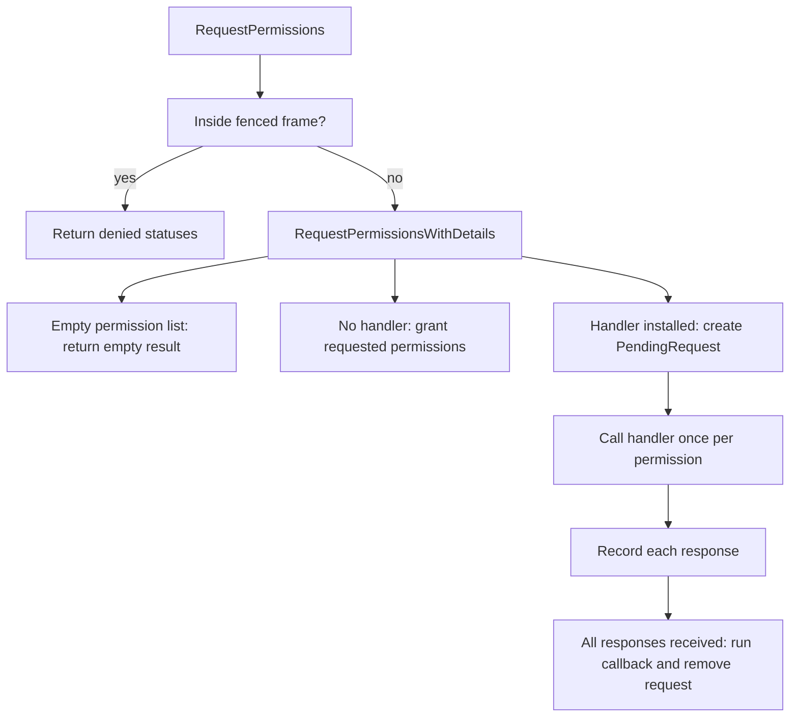

## Overview

A Session is the JavaScript-facing owner of an Electron browser context. Looking up a partition selects that context, reuses its existing Session when possible and initializes IPC dispatch on newly created wrappers. This makes the session a shared boundary for browser state and application policy. [[Interprocess Communication]] follows messages routed through it; [[Networking and Custom Protocols]] follows requests made with it.

Sources: [shell/browser/api/electron_api_session.cc:1673-1728](repo://shell/browser/api/electron_api_session.cc#L1673-L1728), [lib/browser/api/session.ts:25-46](repo://lib/browser/api/session.ts#L25-L46)

## Select a session identity

The public `fromPartition` and `fromPath` bindings reject lookup before the app is ready. `defaultSession` is a getter that calls `fromPartition('')`, so it follows the same readiness requirement. Wait at the boundary described in [[Application Startup and Lifecycle]] before configuring these session objects.

Sources: [shell/browser/api/electron_api_session.cc:1874-1905](repo://shell/browser/api/electron_api_session.cc#L1874-L1905), [lib/browser/api/session.ts:114-120](repo://lib/browser/api/session.ts#L114-L120)

| Lookup | Browser-context identity |
| --- | --- |
| Empty partition | Default persistent context |
| Partition beginning with `persist:` | Persistent named context after removing the prefix |
| Other nonempty partition | In-memory named context |
| `fromPath` | Persistent context keyed by the supplied absolute filesystem path |

Sources: [shell/browser/api/electron_api_session.cc:1713-1749](repo://shell/browser/api/electron_api_session.cc#L1713-L1749), [shell/browser/electron_browser_context.cc:870-897](repo://shell/browser/electron_browser_context.cc#L870-L897)

The context map distinguishes partition-based and path-based keys and includes the in-memory flag for partition keys. Constructors run only when a map entry has no context. Consequently, supplying new construction options on a repeated lookup does not rebuild or reconfigure an existing context. `CreateFrom` similarly returns an existing Session wrapper; only a new wrapper runs `_init` and emits `session-created` on the application.

Sources: [shell/browser/electron_browser_context.cc:308-332](repo://shell/browser/electron_browser_context.cc#L308-L332), [shell/browser/electron_browser_context.cc:870-897](repo://shell/browser/electron_browser_context.cc#L870-L897), [shell/browser/api/electron_api_session.cc:1683-1709](repo://shell/browser/api/electron_api_session.cc#L1683-L1709)

## Configure state at creation

The browser-context constructor initializes HTTP-cache usage from the command line and then applies a supplied `cache` boolean. It reads the disk-cache-size switch separately. Named persistent partitions derive a directory under the session-data path's `Partitions` directory, while a path-based context uses the supplied path. `fromPath` rejects an empty or relative path before creating the context, providing a distinct error for each case.

Sources: [shell/browser/electron_browser_context.cc:367-390](repo://shell/browser/electron_browser_context.cc#L367-L390), [shell/browser/api/electron_api_session.cc:1732-1749](repo://shell/browser/api/electron_api_session.cc#L1732-L1749)

`clearStorageData` delegates to the context's default storage partition and returns a promise resolved by Chromium's completion callback. Clearing cookies also resets the media-device ID salt. `flushStorageData` directly asks the partition to flush. These methods operate on the selected context; they do not create a replacement Session or change the identity chosen by the lookup.

Sources: [shell/browser/api/electron_api_session.cc:725-749](repo://shell/browser/api/electron_api_session.cc#L725-L749)

## Distinguish permission requests from checks

`setPermissionRequestHandler` and `setPermissionCheckHandler` install separate callbacks on the context's permission manager. Both accept a function or null, rejecting other values. Request handling receives a response callback and can complete later. Checking returns the installed check callback's boolean result, with the requesting origin and details supplied to that callback. Installing one handler does not populate the other callback field.

Sources: [shell/browser/api/electron_api_session.cc:861-897](repo://shell/browser/api/electron_api_session.cc#L861-L897), [shell/browser/electron_permission_manager.cc:111-128](repo://shell/browser/electron_permission_manager.cc#L111-L128), [shell/browser/electron_permission_manager.cc:225-231](repo://shell/browser/electron_permission_manager.cc#L225-L231), [shell/browser/electron_permission_manager.cc:308-342](repo://shell/browser/electron_permission_manager.cc#L308-L342)

In this implementation, the ordinary request path grants requested permissions when no request handler is installed, including the associated MIDI-sysex and geolocation side effects. The check path without a handler returns true except for deprecated synchronous clipboard reads. Fenced-frame request entry points deny before reaching ordinary request handling. These are Electron permission-manager decisions; the cited code does not promise that a separate operating-system permission will be available.

Sources: [shell/browser/electron_permission_manager.cc:145-178](repo://shell/browser/electron_permission_manager.cc#L145-L178), [shell/browser/electron_permission_manager.cc:196-214](repo://shell/browser/electron_permission_manager.cc#L196-L214), [shell/browser/electron_permission_manager.cc:308-318](repo://shell/browser/electron_permission_manager.cc#L308-L318)

## Follow an asynchronous permission request

Sources: [shell/browser/electron_permission_manager.cc:166-246](repo://shell/browser/electron_permission_manager.cc#L166-L246)

Pending requests initialize their result vector to denied and track the number of outstanding results. Handler details include the requesting frame's last committed URL and whether it is the main frame. Each permission receives a callback tied to the request ID and permission index; the aggregate callback runs after all results arrive. Permission-check details additionally identify audio or video media type for those checks.

Sources: [shell/browser/electron_permission_manager.cc:55-96](repo://shell/browser/electron_permission_manager.cc#L55-L96), [shell/browser/electron_permission_manager.cc:216-246](repo://shell/browser/electron_permission_manager.cc#L216-L246), [shell/browser/electron_permission_manager.cc:321-342](repo://shell/browser/electron_permission_manager.cc#L321-L342)

Removing the request handler while requests are pending runs their callbacks when the originating content is still alive and clears the pending map. Unanswered entries retain their initialized denied status. A later response whose request is no longer in the map returns without acting. This cleanup behavior is relevant when replacing session policy during a running application rather than configuring it once at startup.

Sources: [shell/browser/electron_permission_manager.cc:55-64](repo://shell/browser/electron_permission_manager.cc#L55-L64), [shell/browser/electron_permission_manager.cc:111-123](repo://shell/browser/electron_permission_manager.cc#L111-L123), [shell/browser/electron_permission_manager.cc:235-246](repo://shell/browser/electron_permission_manager.cc#L235-L246)

## Register session preloads

`registerPreloadScript` stores scripts in SessionPreferences, rejects a duplicate ID and requires an absolute file path for the current API. Successful registration appends the script and returns its ID. `unregisterPreloadScript` erases the matching entry and throws for an unknown ID; `getPreloadScripts` returns the stored list. [[Preloads and Context Isolation]] explains how frame and worker types are selected and executed from that list.

Sources: [shell/browser/api/electron_api_session.cc:1084-1149](repo://shell/browser/api/electron_api_session.cc#L1084-L1149), [lib/browser/rpc-server.ts:52-70](repo://lib/browser/rpc-server.ts#L52-L70)

The deprecated `setPreloads` wrapper removes only existing frame registrations, then recreates frame entries marked deprecated. `getPreloads` likewise filters to frame paths. The compatibility path logs a relative-path problem instead of throwing at registration, but the browser's execution selector still filters out relative paths. New registration callers should therefore use the absolute-path contract directly rather than relying on this compatibility behavior.

Sources: [lib/browser/api/session.ts:60-83](repo://lib/browser/api/session.ts#L60-L83), [shell/browser/api/electron_api_session.cc:1104-1118](repo://shell/browser/api/electron_api_session.cc#L1104-L1118), [lib/browser/rpc-server.ts:67-70](repo://lib/browser/rpc-server.ts#L67-L70)
