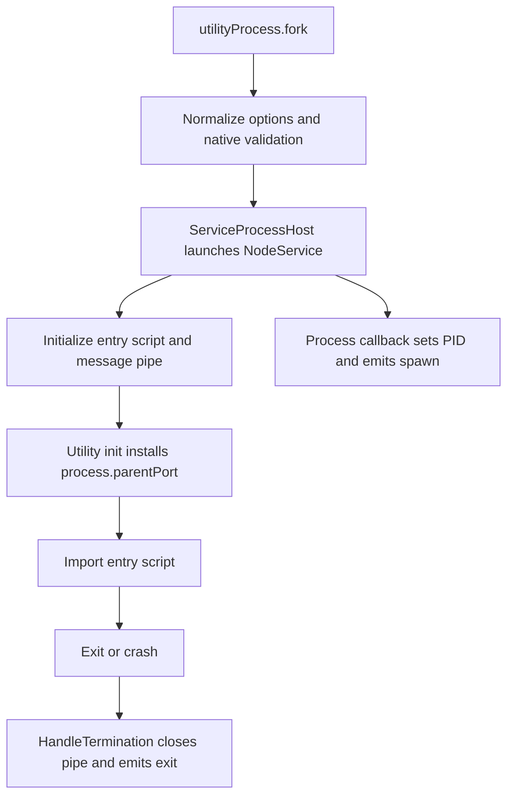

## Overview

`utilityProcess.fork` launches a Node service process from the main process and returns an EventEmitter wrapper for messages, spawn, exit and optional output streams. Native launch requires application readiness, as described in [[Application Startup and Lifecycle]]. Communication uses a dedicated message pipe; transferred main-process ports use the MessagePortMain wrapper described in [[Interprocess Communication]].

Sources: [lib/browser/api/utility-process.ts:7-14](repo://lib/browser/api/utility-process.ts#L7-L14), [lib/browser/api/utility-process.ts:93-152](repo://lib/browser/api/utility-process.ts#L93-L152), [shell/browser/api/electron_api_utility_process.cc:158-210](repo://shell/browser/api/electron_api_utility_process.cc#L158-L210), [shell/browser/api/electron_api_utility_process.cc:438-445](repo://shell/browser/api/electron_api_utility_process.cc#L438-L445)

## Validate fork arguments

The JavaScript constructor rejects a missing entry script. It accepts an argument array, or treats a non-array object in that position as the options object and uses an empty argument list. Options are shallow-copied before normalization. The wrapper checks that `execArgv` is an array, `serviceName` is a string and `cwd` is a string when those values are supplied; native conversion further validates arguments, environment and execution arguments.

Sources: [lib/browser/api/utility-process.ts:13-53](repo://lib/browser/api/utility-process.ts#L13-L53), [shell/browser/api/electron_api_utility_process.cc:453-480](repo://shell/browser/api/electron_api_utility_process.cc#L453-L480)

| Option | Implementation effect |
| --- | --- |
| `serviceName` | Supplies the service display name, otherwise “Node Utility Process” |
| `cwd` | Supplies the service process's current directory |
| `env` | Supplies the native environment map; a nonempty map requests environment replacement |
| `execArgv` | Supplies extra execution switches |
| `stdio` | Selects output inheritance, ignoring or pipes; stdin is ignored |
| `respondToAuthRequestsFromMainProcess` | Requests a URL-loader network observer |
| `allowLoadingUnsignedLibraries` | On macOS, selects the plugin helper flag |

Sources: [shell/browser/api/electron_api_utility_process.cc:164-190](repo://shell/browser/api/electron_api_utility_process.cc#L164-L190), [shell/browser/api/electron_api_utility_process.cc:212-234](repo://shell/browser/api/electron_api_utility_process.cc#L212-L234), [shell/browser/api/electron_api_utility_process.cc:467-499](repo://shell/browser/api/electron_api_utility_process.cc#L467-L499), [lib/browser/api/utility-process.ts:55-89](repo://lib/browser/api/utility-process.ts#L55-L89)

## Launch the service and load its entry

The native wrapper registers as a service-process observer and launches NodeService through Chromium's ServiceProcessHost. It passes launch options and attaches a process callback, then creates a separate message-port connector. The source states the reason for that second pipe: messages can queue without blocking other service interfaces. It also supplies a URL-loader factory and host resolver from the system network context before initializing the Node service.

Sources: [shell/browser/api/electron_api_utility_process.cc:158-237](repo://shell/browser/api/electron_api_utility_process.cc#L158-L237)

Sources: [lib/browser/api/utility-process.ts:13-93](repo://lib/browser/api/utility-process.ts#L13-L93), [shell/browser/api/electron_api_utility_process.cc:164-237](repo://shell/browser/api/electron_api_utility_process.cc#L164-L237), [shell/browser/api/electron_api_utility_process.cc:244-315](repo://shell/browser/api/electron_api_utility_process.cc#L244-L315), [lib/utility/init.ts:8-50](repo://lib/utility/init.ts#L8-L50)

In the child, utility initialization replaces the injected initialization argument with the real entry script, loads common settings and installs `process.parentPort` as a read-only property. It converts the entry path to a file URL and imports it through Node's ESM entry loader. Import failures trigger Node's uncaught-exception machinery. This is a distinct startup path from the browser's package discovery and renderer preload selection.

Sources: [lib/utility/init.ts:8-50](repo://lib/utility/init.ts#L8-L50)

The process launch callback records the operating-system PID, registers the wrapper by PID, emits stdout and stderr descriptors when pipes exist and then emits `spawn`. Before a PID is assigned, or after termination resets it, the native PID getter returns undefined. Treat `spawn` as the notification that process identity and output descriptors have been established.

Sources: [shell/browser/api/electron_api_utility_process.cc:244-257](repo://shell/browser/api/electron_api_utility_process.cc#L244-L257), [shell/browser/api/electron_api_utility_process.cc:266-270](repo://shell/browser/api/electron_api_utility_process.cc#L266-L270), [shell/browser/api/electron_api_utility_process.cc:403-408](repo://shell/browser/api/electron_api_utility_process.cc#L403-L408)

## Exchange messages

The main-process wrapper's `postMessage` unwraps transferred MessagePortMain objects before delegating to native code. Native posting serializes the value, validates the transfer list and disentangles ports before writing to the connector. The child ParentPort wraps incoming ports and emits a message event. Messages returned by the child become the utility wrapper's `message` event in the main process after native deserialization.

Sources: [lib/browser/api/utility-process.ts:134-140](repo://lib/browser/api/utility-process.ts#L134-L140), [shell/browser/api/electron_api_utility_process.cc:332-384](repo://shell/browser/api/electron_api_utility_process.cc#L332-L384), [lib/utility/parent-port.ts:7-18](repo://lib/utility/parent-port.ts#L7-L18), [shell/browser/api/electron_api_utility_process.cc:410-422](repo://shell/browser/api/electron_api_utility_process.cc#L410-L422)

Utility initialization starts the parent port when its first `message` listener is added and pauses it when the last one is removed. ParentPort also exposes direct start, pause and postMessage forwarding methods. This listener-based activation is part of child startup, so application message handling should attach to `process.parentPort` rather than expecting renderer `ipcRenderer` routing in the utility process.

Sources: [lib/utility/init.ts:18-36](repo://lib/utility/init.ts#L18-L36), [lib/utility/parent-port.ts:21-31](repo://lib/utility/parent-port.ts#L21-L31), [lib/renderer/ipc-renderer-bindings.ts:6-16](repo://lib/renderer/ipc-renderer-bindings.ts#L6-L16)

## Route standard output

The default native stdio configuration ignores stdin and inherits stdout and stderr. The JavaScript string form accepts `inherit`, `ignore` or `pipe`; pipe creates PassThrough streams for both outputs. An array form must include at least three entries, with ignored stdin and supported output modes. When native launch emits a pipe descriptor, the wrapper constructs a readable Socket and pipes it into the corresponding PassThrough stream exposed by `stdout` or `stderr`.

Sources: [shell/browser/api/electron_api_utility_process.cc:483-495](repo://shell/browser/api/electron_api_utility_process.cc#L483-L495), [lib/browser/api/utility-process.ts:55-89](repo://lib/browser/api/utility-process.ts#L55-L89), [lib/browser/api/utility-process.ts:110-132](repo://lib/browser/api/utility-process.ts#L110-L132)

## Terminate and release resources

Normal termination, a matching service crash and the explicit process-exit disconnection all converge on `HandleTermination`. It guards against duplicate handling, removes the PID registration, clears the PID, closes the connector, emits `exit` and unpins the native wrapper. When a process was killed, POSIX SIGTERM or SIGKILL exit values are normalized to zero by this code. A V8 fatal error has a separate error event containing its location and report.

Sources: [shell/browser/api/electron_api_utility_process.cc:259-329](repo://shell/browser/api/electron_api_utility_process.cc#L259-L329), [shell/browser/api/electron_api_utility_process.cc:425-428](repo://shell/browser/api/electron_api_utility_process.cc#L425-L428)

The JavaScript wrapper emits `exit` inside a try/finally block. Its finally clause nulls the native handle, removes output-stream listeners and clears the stream references even when an application exit listener throws. After cleanup `kill` returns false, `pid` is undefined and optional-chained posting has no handle to call. Native kill requests termination and ensures process cleanup; the comment explicitly notes that this utility-process configuration is not sandboxed.

Sources: [lib/browser/api/utility-process.ts:93-107](repo://lib/browser/api/utility-process.ts#L93-L107), [lib/browser/api/utility-process.ts:122-147](repo://lib/browser/api/utility-process.ts#L122-L147), [shell/browser/api/electron_api_utility_process.cc:386-401](repo://shell/browser/api/electron_api_utility_process.cc#L386-L401)
