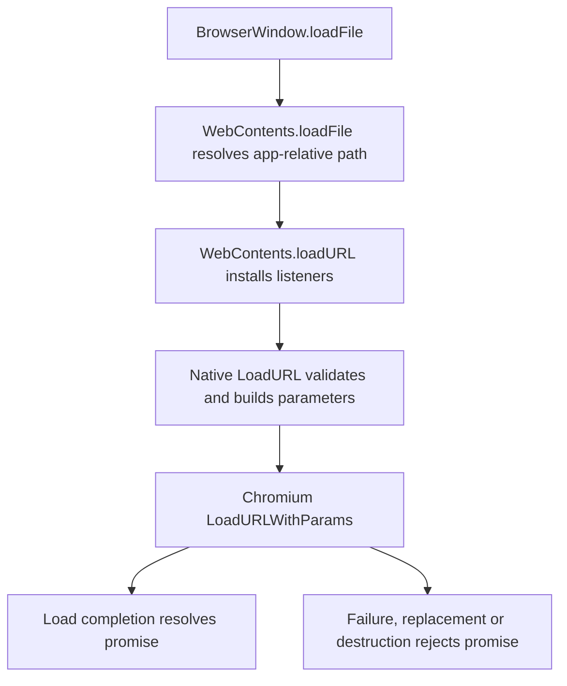

## Overview

`BrowserWindow` joins a native window to a WebContentsView and its WebContents. The window owns desktop presentation, while WebContents owns loading and document behavior. Window methods such as `loadURL`, `loadFile`, `reload` and `send` forward to that content object. Construction begins after the readiness boundary in [[Application Startup and Lifecycle]]; [[Quickstart]] supplies a complete application that reaches it.

Sources: [shell/browser/api/electron_api_browser_window.cc:28-98](repo://shell/browser/api/electron_api_browser_window.cc#L28-L98), [shell/browser/api/electron_api_browser_window.cc:292-310](repo://shell/browser/api/electron_api_browser_window.cc#L292-L310), [lib/browser/api/browser-window.ts:131-151](repo://lib/browser/api/browser-window.ts#L131-L151), [docs/fiddles/quick-start/main.js:4-24](repo://docs/fiddles/quick-start/main.js#L4-L24)

## Construct the window and content

The native constructor starts with BaseWindow, extracts `webPreferences` and propagates relevant presentation options. A transparent or vibrancy window supplies a transparent content background unless another background was provided. The `paintWhenInitiallyHidden` option controls whether the initial `show` setting is copied to content. It then creates the WebContentsView, retains its WebContents, observes it and associates it with the native owner window.

Sources: [shell/browser/api/electron_api_browser_window.cc:28-85](repo://shell/browser/api/electron_api_browser_window.cc#L28-L85)

After JavaScript initialization, the content view is inserted before the BaseWindow content view in paint order, allowing additional views to appear above the page. JavaScript initialization freezes the numeric window ID so it remains readable after native destruction, merges partial bounds with existing bounds and forwards focus and blur events to `app`. The creation notification is emitted after these wrappers have been installed.

Sources: [shell/browser/api/electron_api_browser_window.cc:87-98](repo://shell/browser/api/electron_api_browser_window.cc#L87-L98), [lib/browser/api/browser-window.ts:8-38](repo://lib/browser/api/browser-window.ts#L8-L38), [lib/browser/api/browser-window.ts:83-98](repo://lib/browser/api/browser-window.ts#L83-L98)

## Load a document

`loadFile` requires a string, resolves it against `app.getAppPath()` and constructs a file URL carrying any query, search and hash options. It calls `loadURL`, which creates a promise and installs navigation listeners before invoking the native `_loadURL`. A no-op rejection handler suppresses an unhandled-rejection report internally, but the returned promise still rejects for callers awaiting it. Renderer setup and preload execution are covered in [[Preloads and Context Isolation]].

Sources: [lib/browser/api/web-contents.ts:324-343](repo://lib/browser/api/web-contents.ts#L324-L343), [lib/browser/api/web-contents.ts:410-432](repo://lib/browser/api/web-contents.ts#L410-L432)

Sources: [lib/browser/api/browser-window.ts:133-143](repo://lib/browser/api/browser-window.ts#L133-L143), [lib/browser/api/web-contents.ts:324-432](repo://lib/browser/api/web-contents.ts#L324-L432), [shell/browser/api/electron_api_web_contents.cc:2331-2404](repo://shell/browser/api/electron_api_web_contents.cc#L2331-L2404)

The native loader rejects an invalid or oversized URL through `did-fail-load`. It applies referrer, user-agent, headers, POST data, data-URL base and cache options to Chromium's navigation parameters. Before navigating it refuses unsafe reentrant navigation and discards uncommitted entries. Because navigation may synchronously invoke JavaScript that destroys the object, it checks a weak reference before continuing with user-activation notification.

Sources: [shell/browser/api/electron_api_web_contents.cc:2331-2404](repo://shell/browser/api/electron_api_web_contents.cc#L2331-L2404)

## Interpret load outcomes

| Condition | Promise behavior |
| --- | --- |
| `did-finish-load` without a recorded error | Resolves and removes listeners |
| Main-frame `did-fail-load` | Records the first error and rejects on completion, or immediately if navigation never started |
| Another unrelated main-frame navigation begins | Rejects with `ERR_ABORTED` |
| Same-document routing during load | Avoids treating the URL-state transition as a replacement document |
| Loading stops or content is destroyed without a recorded outcome | Falls back to `ERR_FAILED` |

Sources: [lib/browser/api/web-contents.ts:342-424](repo://lib/browser/api/web-contents.ts#L342-L424)

Rejected load errors carry `errno`, `code` and `url` properties in addition to their message. Subframe failures do not become the recorded main-frame load error. Navigation-history operations are exposed through `navigationHistory`; restoring entries validates the target index, waits for the selected entry's next load and calls the native history-restoration method. These distinctions help separate a failed top-level navigation from an embedded resource or history operation.

Sources: [lib/browser/api/web-contents.ts:348-389](repo://lib/browser/api/web-contents.ts#L348-L389), [lib/browser/api/web-contents.ts:558-598](repo://lib/browser/api/web-contents.ts#L558-L598)

## Decide whether to open child windows

`setWindowOpenHandler` installs a callback whose response is validated before window creation. `action: 'deny'` prevents creation. `action: 'allow'` can supply constructor overrides, `outlivesOpener` and a custom `createWindow` function. Null, non-object or unknown-action responses are logged and prevented. With no handler installed, the implementation returns its default response without preventing the event; the caller proceeds to the guest-window flow.

Sources: [lib/browser/api/web-contents.ts:435-477](repo://lib/browser/api/web-contents.ts#L435-L477), [lib/browser/api/web-contents.ts:624-663](repo://lib/browser/api/web-contents.ts#L624-L663)

The guest manager parses feature options, overlays main-process overrides and reuses an existing live window for a registered frame name. Otherwise it constructs a BrowserWindow or calls the supplied creation callback. When Chromium already supplied guest WebContents, a custom callback must return that same content object. For links where no guest content exists yet, the browser initiates the new window's navigation, including referrer and POST information.

Sources: [lib/browser/guest-window-manager.ts:29-102](repo://lib/browser/guest-window-manager.ts#L29-L102)

Child web preferences merge in a deliberate order: parsed renderer features, restrictive values inherited from the parent, then trusted main-process overrides. The code names context isolation, sandboxing and disabled Node integration among inherited security settings. Main-process overrides are explicitly treated as elevated. That ordering prevents an untrusted feature string from undoing inherited restrictions while preserving the main process's control over child configuration.

Sources: [lib/browser/guest-window-manager.ts:140-175](repo://lib/browser/guest-window-manager.ts#L140-L175)

## Observe and end the window lifetime

Visibility notifications combine native visibility with minimized state and emit only when that combined state changes. Unresponsive notifications are delayed, cleared when content becomes responsive and suppressed for destroyed or disabled windows. A close attempt starts a longer timer when the close was not prevented. These wrappers explain why native and WebContents events do not always appear as immediate one-to-one window events.

Sources: [lib/browser/api/browser-window.ts:40-81](repo://lib/browser/api/browser-window.ts#L40-L81)

Destroying WebContents closes its BrowserWindow immediately, and destroying the BrowserWindow directly removes observers and destroys remaining content. Guest windows normally follow the opener's current-render-view deletion; `outlivesOpener` disables that coupling. Guest destruction unregisters its frame name and removes the opener listener when applicable. Application-wide shutdown then follows the policy in [[Application Startup and Lifecycle]], while content messages remain the responsibility of [[Interprocess Communication]].

Sources: [shell/browser/api/electron_api_browser_window.cc:101-117](repo://shell/browser/api/electron_api_browser_window.cc#L101-L117), [lib/browser/guest-window-manager.ts:104-138](repo://lib/browser/guest-window-manager.ts#L104-L138), [shell/browser/browser.cc:259-266](repo://shell/browser/browser.cc#L259-L266), [lib/browser/api/browser-window.ts:149-151](repo://lib/browser/api/browser-window.ts#L149-L151)
