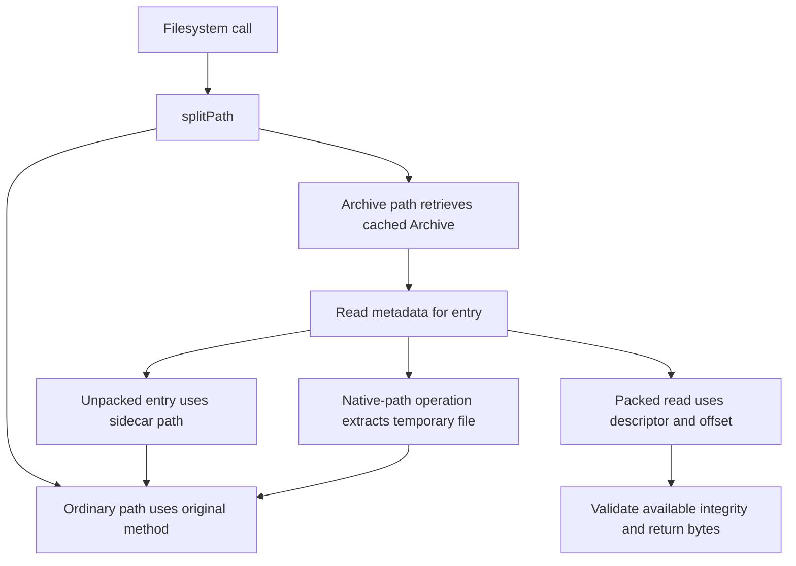

## Overview

Electron makes paths inside ASAR archives usable by wrapping Node filesystem and module-loading operations. The wrapper detects an archive path, retrieves a cached native Archive, and either reads bytes inside the archive or obtains a real filesystem path for an operation that needs one. Application discovery can use this support to load `app.asar`, as described in [[Binary Installation and Application Startup]]; the mechanisms here also serve later file and module reads.

Sources: [lib/node/asar-fs-wrapper.ts:29-87](repo://lib/node/asar-fs-wrapper.ts#L29-L87), [lib/node/asar-fs-wrapper.ts:185-207](repo://lib/node/asar-fs-wrapper.ts#L185-L207), [lib/node/asar-fs-wrapper.ts:599-652](repo://lib/node/asar-fs-wrapper.ts#L599-L652), [lib/browser/init.ts:82-105](repo://lib/browser/init.ts#L82-L105)

## Detect paths and cache archives

`splitPath` first checks whether ASAR handling is disabled. It converts Buffer paths to strings, recognizes Node's internal URL class through Node path validation, rejects nonstring inputs from ASAR handling, and quickly returns for strings without an `.asar` match. Candidate paths are normalized and passed to the native splitter. Nonarchive paths continue to each saved original filesystem method.

Sources: [lib/node/asar-fs-wrapper.ts:66-87](repo://lib/node/asar-fs-wrapper.ts#L66-L87), [lib/node/asar-fs-wrapper.ts:656-674](repo://lib/node/asar-fs-wrapper.ts#L656-L674)

`getOrCreateArchive` caches successful native Archive instances by archive path and returns null when construction throws. It also exposes a temporary process helper used by browser application discovery. The native initializer runs only once: it reads the encoded header size, reads and decodes the header, parses a JSON dictionary, and stores both the metadata and the data-offset base. File lookup follows archive links and combines each stored offset with the header size.

Sources: [lib/node/asar-fs-wrapper.ts:29-47](repo://lib/node/asar-fs-wrapper.ts#L29-L47), [shell/common/asar/archive.cc:189-232](repo://shell/common/asar/archive.cc#L189-L232), [shell/common/asar/archive.cc:258-292](repo://shell/common/asar/archive.cc#L258-L292), [shell/common/asar/archive.cc:108-114](repo://shell/common/asar/archive.cc#L108-L114)

## Read archive contents

Callback `readFile` normalizes its encoding options, resolves the archive, and gets file information. An empty file returns an empty Buffer or string on the next tick. An unpacked file resolves to a real path and delegates back to filesystem reading. A packed file allocates a buffer of the recorded size, obtains the archive descriptor, reads from the stored offset, checks available integrity metadata, and converts to the requested encoding before invoking the callback.

Sources: [lib/node/asar-fs-wrapper.ts:599-652](repo://lib/node/asar-fs-wrapper.ts#L599-L652)

Promise readFile uses a promisified version of the same archive callback implementation. Synchronous reading performs its own archive lookup and offset read, throws errors directly, and returns encoded text or a Buffer. These paths preserve the distinction between archive metadata and the underlying file descriptor: reading one packed file does not require extracting the entire archive.

Sources: [lib/node/asar-fs-wrapper.ts:666-722](repo://lib/node/asar-fs-wrapper.ts#L666-L722)

Sources: [lib/node/asar-fs-wrapper.ts:185-207](repo://lib/node/asar-fs-wrapper.ts#L185-L207), [lib/node/asar-fs-wrapper.ts:599-664](repo://lib/node/asar-fs-wrapper.ts#L599-L664), [shell/common/asar/archive.cc:356-392](repo://shell/common/asar/archive.cc#L356-L392)

## Materialize files for native operations

The generic overrides replace the relevant path argument with `archive.copyFileOut`'s result before invoking the original function. They cover file opening, copying, native module loading, and executable-file spawning. Callback and promise wrappers report lookup failures through their respective error channels; the synchronous wrapper throws. Custom promisification is preserved when the original function supplies it.

Sources: [lib/node/asar-fs-wrapper.ts:185-251](repo://lib/node/asar-fs-wrapper.ts#L185-L251), [lib/node/asar-fs-wrapper.ts:267-287](repo://lib/node/asar-fs-wrapper.ts#L267-L287), [lib/node/asar-fs-wrapper.ts:1230-1253](repo://lib/node/asar-fs-wrapper.ts#L1230-L1253)

Native CopyFileOut locks its extracted-file cache and reuses an existing temporary path when available. Unpacked entries map to the archive name with `.unpacked` appended and then the entry path. Packed entries are copied into a scoped temporary file using their offset, size, and integrity payload. On POSIX, an executable entry receives mode 0755. The resulting temporary-file object is retained in the archive's cache.

Sources: [shell/common/asar/archive.cc:356-392](repo://shell/common/asar/archive.cc#L356-L392)

Command-string execution is handled differently from executable-file spawning. The wrapper temporarily disables ASAR handling around `exec` and `execSync`, restoring the previous flag in a finally block. The comment explains that otherwise a command containing an archive path can be mistaken for one complete archive filename by the internal execFile call. Child-process wrapping is normally installed lazily when that module is first loaded.

Sources: [lib/node/asar-fs-wrapper.ts:1218-1228](repo://lib/node/asar-fs-wrapper.ts#L1218-L1228), [lib/node/asar-fs-wrapper.ts:1241-1278](repo://lib/node/asar-fs-wrapper.ts#L1241-L1278)

## Metadata and module resolution

Archive stat information is converted into Node Stats objects with synthesized device, link, inode, and timestamp fields, the entry size, and a mode derived from archive file type. These are filesystem-compatible metadata objects rather than a direct stat of an individual on-disk file. The lstat wrappers return these objects and honor the synchronous `throwIfNoEntry` option when archive or entry lookup fails.

Sources: [lib/node/asar-fs-wrapper.ts:89-146](repo://lib/node/asar-fs-wrapper.ts#L89-L146), [lib/node/asar-fs-wrapper.ts:302-360](repo://lib/node/asar-fs-wrapper.ts#L302-L360)

Node's internal module read hook also uses the synchronous archive reader, returning undefined for ordinary paths so Node can fall back to its implementation, or false when an archive read fails. The internal module-stat override returns directory or file indicators based on archive metadata. Covering these internal paths is what lets package resolution participate in archive access instead of relying only on public `fs` calls.

Sources: [lib/node/asar-fs-wrapper.ts:997-1027](repo://lib/node/asar-fs-wrapper.ts#L997-L1027)

## Integrity and failures

On macOS and Windows, native header validation runs when the embedded-ASAR-integrity fuse is enabled and the archive has a validatable relative path. Missing integrity data or an ineligible hash causes a fatal failure. Validated archives then require supported file-integrity metadata for packed entries. These platform and fuse checks mean integrity enforcement is conditional; the filesystem wrapper should not be described as validating every archive in every configuration.

Sources: [shell/common/asar/archive.cc:234-256](repo://shell/common/asar/archive.cc#L234-L256), [shell/common/asar/archive.cc:120-153](repo://shell/common/asar/archive.cc#L120-L153)

The JavaScript buffer validator returns immediately without an integrity payload. Otherwise it lazily loads crypto, hashes the bytes with the supplied algorithm, compares against the expected hash, and logs a violation before exiting with status 1 on mismatch. Lazy loading avoids the crypto startup cost when protection is absent. Ordinary lookup failures instead use errors such as ENOENT, ENOTDIR, EACCES, or invalid-package errors; they are not integrity mismatches.

Sources: [lib/node/asar-fs-wrapper.ts:158-183](repo://lib/node/asar-fs-wrapper.ts#L158-L183), [lib/node/asar-fs-wrapper.ts:253-265](repo://lib/node/asar-fs-wrapper.ts#L253-L265)

## Runtime controls

`process.noAsar` disables archive interpretation. `ELECTRON_NO_ASAR` contributes to that decision only outside browser and renderer process types. `ELECTRON_LOG_ASAR_READS` writes offsets and entry paths into an archive-specific access log in the temporary directory. The separate eager-hook environment flag exists for tests to obtain matching stack traces; its source comment explicitly says it slows application startup and should not be used in applications.

Sources: [lib/node/asar-fs-wrapper.ts:15-18](repo://lib/node/asar-fs-wrapper.ts#L15-L18), [lib/node/asar-fs-wrapper.ts:290-300](repo://lib/node/asar-fs-wrapper.ts#L290-L300), [lib/node/asar-fs-wrapper.ts:1255-1263](repo://lib/node/asar-fs-wrapper.ts#L1255-L1263)
